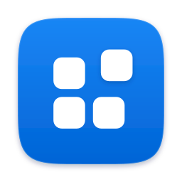
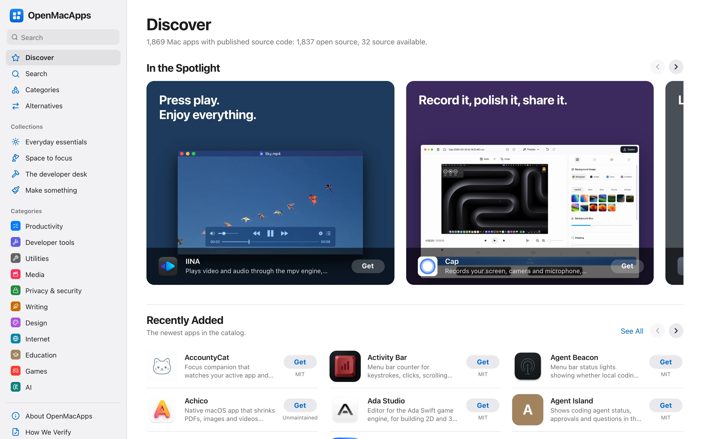

<p align="center">
  <a href="https://openmacapps.com/"></a>
</p>

<h1 align="center">OpenMacApps</h1>

<p align="center">
  Open-source Mac apps, each with its source, license and official download in one place.
</p>

<p align="center">
  <a href="https://openmacapps.com/"><b>Browse the catalog</b></a>
  &nbsp;·&nbsp;
  <a href="https://openmacapps.com/how-we-verify/">How we verify</a>
  &nbsp;·&nbsp;
  <a href="CONTRIBUTING.md">Add an app</a>
</p>

<p align="center">
  <a href="https://openmacapps.com/">
    <picture>
      <source media="(prefers-color-scheme: dark)" srcset="docs/preview-dark.webp">
      
    </picture>
  </a>
</p>

## What you get

- **The license from the file, not a guess.** GitHub's license detector reports `NOASSERTION` for Rectangle, Sequel Ace, CotEditor and HandBrake; their license files say MIT, MIT, Apache-2.0 and GPL-2.0. Each listing links the file it was read from and the date it was checked.
- **Source available, labelled.** Apps whose code comes with extra restrictions (Commons Clause, FSL, CC BY-NC and similar) carry a separate label, explained on their page and easy to filter out. They are never counted as open source.
- **Official downloads only.** The Get button goes to the project's own release page or website. A Homebrew command is shown only when the cask installs from that same source. Nothing is mirrored or repackaged.
- **Status you can see.** When a project stops (no release or meaningful commit for about two years, or its README says so), the app carries an Unmaintained label instead of disappearing.

Inclusion is not a security audit or an endorsement. The [research notes](docs/RESEARCH.md) list every source and every app left out, with the reason.

## Browse the collection

<!-- catalog:start -->

1,898 macOS apps: **1,866 open source** and **32 source available**. Source-available apps have additional restrictions and are labeled separately. Each category's list is generated from [content/apps](content/apps); edit the app folders to contribute.

| Category | Apps |
| --- | ---: |
| [Productivity](catalog/productivity.md) | 292 |
| [Developer tools](catalog/developer-tools.md) | 331 |
| [Utilities](catalog/utilities.md) | 577 |
| [Media](catalog/media.md) | 162 |
| [Privacy & security](catalog/privacy-security.md) | 63 |
| [Writing](catalog/writing.md) | 54 |
| [Design](catalog/design.md) | 62 |
| [Internet](catalog/internet.md) | 99 |
| [Education](catalog/education.md) | 29 |
| [Games](catalog/games.md) | 49 |
| [AI](catalog/ai.md) | 180 |

<!-- catalog:end -->

## Add or fix an app

Every app is one folder in [`content/apps`](content/apps). [Suggest an app](https://github.com/koative/openmacapps/issues/new?template=app.yml), [report a listing problem](https://github.com/koative/openmacapps/issues/new?template=listing-problem.yml), or open a pull request. [CONTRIBUTING.md](CONTRIBUTING.md) has the format, the image policy and the checks. Corrections from an app's maintainers are applied first.

## How it works

```text
content/apps/rectangle/
  index.md          # metadata and the description
  assets/
    icon.png        # official icon, with its source recorded
    screenshot.png
```

The YAML frontmatter holds the facts: category, tags, the products an app replaces, repository, website, download, Homebrew cask, license and license evidence, verification date and image credits. Astro builds the site from these folders; a Bun script validates them and generates the category lists above. Alternatives and topic pages pick up new apps through their fields and tags.

### Development

Requires [Bun](https://bun.sh) 1.4.3 or later.

```sh
bun install --frozen-lockfile
bun run dev          # local site at http://localhost:4321/
bun run validate     # check every app record
bun run check        # TypeScript and Astro
bun test
bun run build
bun run check:links
```

`bun run sync` copies catalog assets and refreshes the generated lists; commit them with your change. CI runs the same checks, and every merge to `main` deploys to GitHub Pages. The discovery queue and the Homebrew matcher are described in [CONTRIBUTING.md](CONTRIBUTING.md#local-workflow); the data model in [ARCHITECTURE.md](docs/ARCHITECTURE.md), site setup in [PUBLISHING.md](docs/PUBLISHING.md) and project decisions in [DECISIONS.md](docs/DECISIONS.md).

## Credits and licensing

Discovery sources include [mac-apps](https://github.com/jeffreyjackson/mac-apps), [open-source-mac-os-apps](https://github.com/serhii-londar/open-source-mac-os-apps) and [awesome-mac](https://github.com/jaywcjlove/awesome-mac); the full comparison is in the [research notes](docs/RESEARCH.md). Built with [Astro](https://astro.build/) and [Lucide](https://lucide.dev/) ([third-party notices](public/third-party-notices.txt)).

The code and text of OpenMacApps are MIT licensed ([LICENSE](LICENSE)). App icons, screenshots and names belong to their owners; each app records the source and terms of its images in [`content/apps`](content/apps), and an app's code license does not automatically cover its artwork. Mac and macOS are trademarks of Apple Inc.; OpenMacApps is not affiliated with Apple.

<p align="center">Made by <a href="https://koative.com">koative</a></p>
