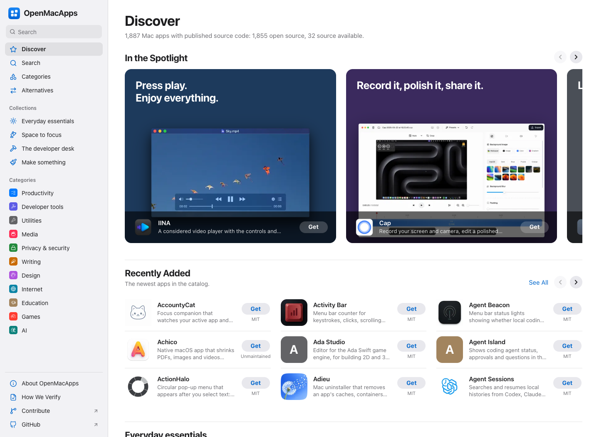

# OpenMacApps

**Good software. Open by nature.** A considered collection of open-source macOS apps and clearly labeled source-available alternatives, maintained by [Koative](https://github.com/koative).

[Explore the catalog](https://openmacapps.com/) · [Contribute an app](CONTRIBUTING.md) · [Research & inclusion policy](docs/RESEARCH.md)



OpenMacApps is an app-store-style catalog of open-source Mac software. Browse Discover shelves, collections, and categories, search the whole catalog, and open a product page that puts the source code, license, and official download side by side. Light and dark appearance follow your system. Every entry is a small, reviewable folder, and the website and the catalog below come from the same Markdown source.

## One app, one folder

```text
content/apps/
  rectangle/
    index.md              # Metadata + original Markdown description
    assets/
      icon.png            # Official image with recorded provenance
      screenshot.png
```

YAML frontmatter describes the app: name, summary, category, tags, the proprietary products it replaces, repository, official website, download page, optional Homebrew cask, source classification, reviewed license, license evidence, verification date, and asset attribution. The Markdown body explains what it does. Screenshots are optional; invented screenshots and unverified compatibility claims are not accepted. Alternatives pages (`content/alternatives/`) and topic pages (`content/topics/`) list apps by those fields and tags, so a new folder appears on them automatically.

This structure keeps assets beside the app, makes pull requests understandable, and avoids one giant JSON file becoming a merge-conflict bottleneck. Generated output is never the editing surface.

## Development

Requires Bun 1.4.3+. Bun installs dependencies, runs TypeScript, executes tests, and runs Astro in development and CI. The static site is served by GitHub Pages.

```sh
bun install --frozen-lockfile
bun run dev
bun run validate
bun run check
bun test
bun run build
bun run check:links
```

Open the address printed by the dev server (normally `http://localhost:4321/`). `bun run sync` copies catalog assets for the site and refreshes the generated catalog below. CI checks the data, TypeScript, tests, and production build. Changes pushed to `main` deploy to GitHub Pages.

The [discovery queue](research/README.md) tracks repository leads from eleven directories. Refresh it with `bun run discover`; only independently reviewed app folders enter the store. `bun run homebrew` records Homebrew casks whose download or homepage is the app's own repository or website; see [CONTRIBUTING.md](CONTRIBUTING.md#local-workflow) for the matching rules.

See [publishing and SEO](docs/PUBLISHING.md) for the shared site configuration, social card, custom domain setup, and sitemap submission.

## Catalog principles

- **Licenses are explicit.** Paid open-source distributions can qualify. Apps with published source and additional restrictions are separately labeled **Source available**, explained on their detail pages, and filterable. Closed-source freeware is excluded.
- **Evidence travels with every entry.** Source repository, license file, official download, and a dated verification record are required.
- **Original projects get the credit.** Logos, screenshots, and trademarks belong to their respective owners; each included asset records its source and applicable rights.
- **A directory is a lead, not proof.** We research multiple lists and verify individual projects. See the [research notes](docs/RESEARCH.md).
- **No installer mirror.** Download links lead to official sources. Inclusion is not a security audit or an endorsement by Apple or the app authors.

## Browse the collection

<!-- catalog:start -->

1,888 macOS apps: **1,856 open source** and **32 source available**. Source-available apps have additional restrictions and are labeled separately. Generated from [content/apps](content/apps); edit the app folders to contribute.

### Productivity

| App | What it does | License |
| --- | --- | --- |
| [2FHey](https://openmacapps.com/apps/2fhey/) · [Source](https://github.com/SoFriendly/2fhey) | Detects verification codes arriving in Messages and copies them to the clipboard, with optional auto-paste. | [CC0-1.0](https://github.com/SoFriendly/2fhey/blob/main/LICENSE) |
| [AccountyCat](https://openmacapps.com/apps/accountycat/) · [Source](https://github.com/strjonas/AccountyCat) | Focus companion that watches your active app and window title and nudges you back when you drift. | [MIT](https://github.com/strjonas/AccountyCat/blob/main/LICENSE) |
| [ActionHalo](https://openmacapps.com/apps/actionhalo/) · [Source](https://github.com/Wooden-Robot/ActionHalo) | Circular pop-up menu that appears after you select text: click an action, or press, drag and release to run it. | [MIT](https://github.com/Wooden-Robot/ActionHalo/blob/main/LICENSE) |
| [Activity Bar](https://openmacapps.com/apps/activity-bar/) · [Source](https://github.com/SuveenE/activity-bar) | Menu bar counter for keystrokes, clicks, scrolling and talk time, plus time spent in AI coding tools, kept on your Mac. | [MIT](https://github.com/SuveenE/activity-bar/blob/main/LICENSE) |
| [ActivityWatch](https://openmacapps.com/apps/activitywatch/) · [Source](https://github.com/ActivityWatch/activitywatch) | Track which apps, windows and sites you use, with the activity data kept on your own computer. | [MPL-2.0](https://github.com/ActivityWatch/activitywatch/blob/master/LICENSE.txt) |
| [Actual Budget](https://openmacapps.com/apps/actual-budget/) · [Source](https://github.com/actualbudget/actual) | A local-first personal finance app for envelope budgeting, with optional self-hosted sync between devices. | [MIT](https://github.com/actualbudget/actual/blob/master/LICENSE.txt) |
| [AeroSpace](https://openmacapps.com/apps/aerospace/) · [Source](https://github.com/nikitabobko/AeroSpace) | Arrange windows into keyboard-driven tiles and fast-switching workspaces. | [MIT](https://github.com/nikitabobko/AeroSpace/blob/main/LICENSE.txt) |
| [AFFiNE](https://openmacapps.com/apps/affine/) · [Source](https://github.com/toeverything/AFFiNE) | A local-first workspace that combines block-based docs, an infinite whiteboard and database views in one app. | [MIT AND MPL-2.0](https://github.com/toeverything/AFFiNE/blob/canary/LICENSE) |
| [AIME](https://openmacapps.com/apps/aime/) · [Source](https://github.com/zoolapp/aime) | Open-source Chinese input method for macOS built on RIME, local-first, with optional AI text actions. | [MIT AND GPL-3.0](https://github.com/zoolapp/aime/blob/main/LICENSE) |
| [akou](https://openmacapps.com/apps/akou/) · [Source](https://github.com/GeiserX/akou) | Records calls on your Mac, transcribes them on-device and lets a terminal agent ask about the call. | [GPL-3.0-or-later](https://github.com/GeiserX/akou/blob/main/LICENSE) |
| [AltTab](https://openmacapps.com/apps/alttab/) · [Source](https://github.com/lwouis/alt-tab-macos) | Switch between individual windows with visual previews. | [GPL-3.0](https://github.com/lwouis/alt-tab-macos/blob/master/LICENCE.md) |
| [Amanu](https://openmacapps.com/apps/amanu/) · [Source](https://github.com/gsamat/amanu) | Records and transcribes online meetings automatically, with local or cloud speech models and summaries. | [MIT](https://github.com/gsamat/amanu/blob/master/LICENSE) |
| [Amethyst](https://openmacapps.com/apps/amethyst/) · [Source](https://github.com/ianyh/Amethyst) | Automatically tile windows and move between layouts with keyboard shortcuts. | [MIT](https://github.com/ianyh/Amethyst/blob/development/LICENSE.md) |
| [Ao](https://openmacapps.com/apps/ao/) · [Source](https://github.com/klaudiosinani/ao) | Unofficial desktop client for Microsoft To-Do with themes, keyboard shortcuts and optional global hotkeys. | [MIT](https://github.com/klaudiosinani/ao/blob/master/license.md) |
| [Apache OpenOffice](https://openmacapps.com/apps/apache-openoffice/) · [Source](https://github.com/apache/openoffice) | A long-running office suite with a word processor, spreadsheet, presentations, drawing, database and formula editor. | [Apache-2.0](https://github.com/apache/openoffice/blob/trunk/LICENSE) |
| [AppFlowy](https://openmacapps.com/apps/appflowy/) · [Source](https://github.com/AppFlowy-IO/AppFlowy) | Arrange documents, tasks, and structured information in a customizable desktop workspace. | [AGPL-3.0](https://github.com/AppFlowy-IO/AppFlowy/blob/main/LICENSE) |
| [Apple Notes Exporter](https://openmacapps.com/apps/apple-notes-exporter/) · [Source](https://github.com/kzaremski/apple-notes-exporter) | Bulk-export Apple Notes, including iCloud notes, to Markdown, HTML, PDF and other formats with folders intact. | [GPL-3.0](https://github.com/kzaremski/apple-notes-exporter/blob/main/LICENSE) |
| [AutoDoc](https://openmacapps.com/apps/autodoc/) · [Source](https://github.com/DuetDisplay/AutoDoc) | Record meetings and get transcripts, editable notes and answers generated on your own computer, with timestamped replay. | [AGPL-3.0](https://github.com/DuetDisplay/AutoDoc/blob/main/LICENSE) |
| [AutoRaise](https://openmacapps.com/apps/autoraise/) · [Source](https://github.com/sbmpost/AutoRaise) | Focus and raise windows automatically when you hover over them. | [GPL-3.0](https://github.com/sbmpost/AutoRaise/blob/master/LICENSE.md) |
| [BarTranslate](https://openmacapps.com/apps/bartranslate/) · [Source](https://github.com/ThijmenDam/BarTranslate) | A menu bar panel that opens Google Translate behind a hotkey, with a shortcut for translating the clipboard. | [GPL-3.0](https://github.com/ThijmenDam/BarTranslate/blob/master/LICENSE) |
| [Batch Clipboard](https://openmacapps.com/apps/batch-clipboard/) · [Source](https://github.com/jpmhouston/Batch-Clipboard) | Menu bar utility that copies several items as one batch and pastes them back in the same order. | [MIT](https://github.com/jpmhouston/Batch-Clipboard/blob/main/LICENSE) |
| [BetterAirdrop](https://openmacapps.com/apps/betterairdrop/) · [Source](https://github.com/MoizAhmedd/betterairdrop) | Menu bar app that renames AirDropped photos into searchable names using Apple Vision, Apple Intelligence or an API key. | [MIT](https://github.com/MoizAhmedd/betterairdrop/blob/main/LICENSE) |
| [BetterCmdTab](https://openmacapps.com/apps/bettercmdtab/) · [Source](https://github.com/rokartur/BetterCmdTab) | Switch among windows using searchable lists, grids, and live previews. | [GPL-3.0](https://github.com/rokartur/BetterCmdTab/blob/main/LICENSE) |
| [BetterWispr](https://openmacapps.com/apps/betterwispr/) · [Source](https://github.com/opennookorg/betterwispr) | Hold a shortcut, speak and release, and the text is typed into the app you were using, with offline speech models. | [Apache-2.0](https://github.com/opennookorg/betterwispr/blob/main/LICENSE) |
| [bindPDF](https://openmacapps.com/apps/bindpdf/) · [Source](https://github.com/vishaltelangre/bindPDF) | Simple Mac app for combining several PDF files into one document. | [MIT](https://github.com/vishaltelangre/bindPDF/blob/master/LICENSE) · **Unmaintained** |
| [Biscotti](https://openmacapps.com/apps/biscotti/) · [Source](https://github.com/scosman/Biscotti) | Meeting recorder that transcribes calls on the Mac, labels speakers and writes summaries, with no bot in the call. | [PolyForm-Perimeter-1.0.1](https://github.com/scosman/Biscotti/blob/main/LICENSE.md) · **Source available** |
| [Blankie](https://openmacapps.com/apps/blankie/) · [Source](https://github.com/codybrom/Blankie) | An ambient sound mixer that layers rain, waves, fire and other sounds into presets for focus, relaxation and sleep. | [MIT](https://github.com/codybrom/Blankie/blob/main/LICENSE) |
| [BreakTimer](https://openmacapps.com/apps/breaktimer/) · [Source](https://github.com/tom-james-watson/breaktimer-app) | A break reminder that schedules regular pauses as notifications or fullscreen prompts, within your working hours. | [GPL-3.0](https://github.com/tom-james-watson/breaktimer-app/blob/master/LICENSE.md) |
| [Brink](https://openmacapps.com/apps/brink/) · [Source](https://github.com/StepanBlaha/Brink) | Edge pill near the notch that unfolds into pinned Notion pages and tasks on hover, with quick capture. | [MIT](https://github.com/StepanBlaha/Brink/blob/main/LICENSE) |
| [Buffer](https://openmacapps.com/apps/buffer/) · [Source](https://github.com/samirpatil2000/Buffer) | A small menu bar clipboard manager with searchable history, pins, tags, multi-paste and on-device OCR for images. | [MIT](https://github.com/samirpatil2000/Buffer/blob/main/LICENSE) |
| [Cadenza](https://openmacapps.com/apps/cadenza/) · [Source](https://github.com/DragonKingIO/Cadenza-voice) | Open-source voice input for macOS: hold a shortcut, speak, and the text is typed at your cursor. Local by default. | [MIT](https://github.com/DragonKingIO/Cadenza-voice/blob/main/LICENSE) |
| [Calendr](https://openmacapps.com/apps/calendr/) · [Source](https://github.com/pakerwreah/Calendr) | A menu bar calendar with upcoming events, natural-language event entry and extra time zones in the menu bar. | [MIT](https://github.com/pakerwreah/Calendr/blob/master/LICENSE) |
| [Calibre](https://openmacapps.com/apps/calibre/) · [Source](https://github.com/kovidgoyal/calibre) | Organize ebooks, edit their metadata, convert formats, and transfer books to reading devices. | [GPL-3.0](https://github.com/kovidgoyal/calibre/blob/master/LICENSE) |
| [CapaTheNotch](https://openmacapps.com/apps/capathenotch/) · [Source](https://github.com/maximfakel/capa-the-notch) | Shows Codex, Claude Code and OpenCode Go usage limits in the MacBook notch, with a teleprompter and dictation. | [MIT](https://github.com/maximfakel/capa-the-notch/blob/main/LICENSE) |
| [Capd](https://openmacapps.com/apps/capd/) · [Source](https://github.com/jamiedavenport/capd) | Capture web pages, text, links, notes and images into a local library and find them again with full-text search. | [MIT](https://github.com/jamiedavenport/capd/blob/main/LICENSE) |
| [Cerebro](https://openmacapps.com/apps/cerebro/) · [Source](https://github.com/cerebroapp/cerebro) | A keyboard launcher for apps, files, web searches and calculations, extended through community plugins. | [MIT](https://github.com/cerebroapp/cerebro/blob/master/LICENSE) |
| [Chorus](https://openmacapps.com/apps/chorus-web-apps/) · [Source](https://github.com/nicojan/Chorus) | One window for Gmail, Slack, Discord and other web apps, each with its own isolated WebKit session. | [MIT](https://github.com/nicojan/Chorus/blob/main/LICENSE) |
| [ClipAI](https://openmacapps.com/apps/clipai/) · [Source](https://github.com/michaelh03/ClipAi) | Clipboard history for macOS with one-click AI prompts on copied text and code, using your own OpenAI or Gemini API key. | [MIT](https://github.com/michaelh03/ClipAi/blob/master/LICENSE) |
| [Clipbara](https://openmacapps.com/apps/clipbara/) · [Source](https://github.com/mobrava/Clipbara) | A clipboard history that slides up as a row of cards, with pinboards, Quick Look, and an optional iPhone companion. | [GPL-3.0](https://github.com/mobrava/Clipbara/blob/main/LICENSE) |
| [ClipPocket](https://openmacapps.com/apps/clippocket/) · [Source](https://github.com/Dhahd/ClipPocket) | Menu bar clipboard history with type detection, search, pins and local-only storage. | [MIT](https://github.com/Dhahd/ClipPocket/blob/main/LICENSE) |
| [ClipRecallBar](https://openmacapps.com/apps/cliprecallbar/) · [Source](https://github.com/turhe123/clip-recall-bar) | Keyboard-first clipboard history in the menu bar: filter as you type, then paste the match with Return. | [MIT](https://github.com/turhe123/clip-recall-bar/blob/main/LICENSE) |
| [ClipStack](https://openmacapps.com/apps/clipstack/) · [Source](https://github.com/chiranjeebhub/ClipStack) | Clipboard history for the Mac: search copied items, pin the ones you reuse and paste them from the keyboard. | [MIT](https://github.com/chiranjeebhub/ClipStack/blob/main/LICENSE) |
| [Clipward](https://openmacapps.com/apps/clipward/) · [Source](https://github.com/ypankovych/clipward) | Clipboard manager with encrypted history, skipped password-manager copies and a clipboard that clears itself after pasting. | [MIT](https://github.com/ypankovych/clipward/blob/main/LICENSE) |
| [Clipy](https://openmacapps.com/apps/clipy/) · [Source](https://github.com/Clipy/Clipy) | Recall clipboard history and reusable snippets through keyboard shortcuts. | [MIT](https://github.com/Clipy/Clipy/blob/develop/LICENSE) |
| [Cluxo](https://openmacapps.com/apps/cluxo/) · [Source](https://github.com/kykim79/Cluxo) | Menu bar tool for presentations and screencasts: highlights the cursor, draws on screen, shows keystrokes and offers a magnifier. | [MIT](https://github.com/kykim79/Cluxo/blob/main/LICENSE) |
| [Cockpit](https://openmacapps.com/apps/cockpit/) · [Source](https://github.com/Yvsleyen00941/Cockpit) | Daily dashboard that brings calendar, music, Notion and mail into one view, driven by a macOS menu-bar helper. | [MIT](https://github.com/Yvsleyen00941/Cockpit/blob/main/LICENSE) |
| [Condution](https://openmacapps.com/apps/condution/) · [Source](https://github.com/Shabang-Systems/Condution) | Open-source task dashboard for checklists, due and start dates, tags and shareable workspaces, built on Electron. | [GPL-3.0](https://github.com/Shabang-Systems/Condution/blob/beta-v1.2.0/LICENSE) · **Unmaintained** |
| [Convertino](https://openmacapps.com/apps/convertino/) · [Source](https://github.com/hasanzadee/convertino) | Radial file converter: drag a file, tap Shift and pick a conversion from the petal menu. | [MIT](https://github.com/hasanzadee/convertino/blob/main/LICENSE) |
| [Copy 2FA](https://openmacapps.com/apps/copy-2fa/) · [Source](https://github.com/stanczykwyatt/copy-2fa) | Copies the newest 2FA code from Apple Mail or Messages with one shortcut, and includes a TOTP and HOTP authenticator. | [MIT](https://github.com/stanczykwyatt/copy-2fa/blob/main/LICENSE) |
| [CopyQ](https://openmacapps.com/apps/copyq/) · [Source](https://github.com/hluk/CopyQ) | A scriptable clipboard manager that stores text, images and other formats in searchable, editable tabs. | [GPL-3.0](https://github.com/hluk/CopyQ/blob/master/LICENSE) |
| [CopyWheel](https://openmacapps.com/apps/copywheel/) · [Source](https://github.com/weselski/copywheel) | Menu bar app that opens a radial menu at the cursor so you can pick a saved text snippet and copy it. | [MIT](https://github.com/weselski/copywheel/blob/main/LICENSE) |
| [Cornetta](https://openmacapps.com/apps/cornetta/) · [Source](https://github.com/stellakamikaze/cornetta) | Free call recorder that saves your mic and the other side's audio to one m4a file, with on-device transcription on macOS 26. | [MIT](https://github.com/stellakamikaze/cornetta/blob/master/LICENSE) |
| [CrossMacro](https://openmacapps.com/apps/crossmacro/) · [Source](https://github.com/alper-han/CrossMacro) | Record mouse and keyboard actions once, then replay them from hotkeys, schedules or window-based triggers. | [GPL-3.0-only](https://github.com/alper-han/CrossMacro/blob/dev/LICENSE) |
| [CrossPaste](https://openmacapps.com/apps/crosspaste/) · [Source](https://github.com/CrossPaste/crosspaste-desktop) | A clipboard manager that syncs copied text, images and files between your computers over the local network, encrypted. | [AGPL-3.0](https://github.com/CrossPaste/crosspaste-desktop/blob/main/LICENSE) |
| [DayDream](https://openmacapps.com/apps/daydream/) · [Source](https://github.com/getnorthlight/daydream) | Local timeline of the apps, windows and Chrome pages you used, searchable by word and kept on your Mac. | [MIT](https://github.com/getnorthlight/daydream/blob/main/LICENSE) |
| [Dayflow](https://openmacapps.com/apps/dayflow/) · [Source](https://github.com/JerryZLiu/Dayflow) | An automatic work journal that turns periodic screen captures into a timeline, daily standup notes and weekly reviews. | [MIT](https://github.com/JerryZLiu/Dayflow/blob/main/LICENSE) |
| [DevSwitcher2](https://openmacapps.com/apps/devswitcher2/) · [Source](https://github.com/vaspike/DevSwitcher2) | Menu bar tool that enhances Command-Tab and Command-` with window and app switchers, including project names from titles. | [MIT](https://github.com/vaspike/DevSwitcher2/blob/main/LICENSE) |
| [Dictámelo](https://openmacapps.com/apps/dictamelo/) · [Source](https://github.com/sarrazola/dictamelo) | Push-to-talk dictation for Mac and Windows using local speech models or your own cloud keys. | [MIT](https://github.com/sarrazola/dictamelo/blob/main/LICENSE) |
| [DockDoor](https://openmacapps.com/apps/dockdoor/) · [Source](https://github.com/ejbills/DockDoor) | Preview application windows from the Dock and switch between them quickly. | [GPL-3.0-or-later](https://github.com/ejbills/DockDoor/blob/main/LICENSE) |
| [Dorso](https://openmacapps.com/apps/dorso/) · [Source](https://github.com/tldev/dorso) | Use a screen-blur reminder based on camera or AirPods posture tracking. | [MIT](https://github.com/tldev/dorso/blob/main/LICENSE) |
| [DrawPen](https://openmacapps.com/apps/drawpen/) · [Source](https://github.com/DmytroVasin/DrawPen) | Draw, highlight and point on top of any app during presentations, tutorials and screen shares, with a blank whiteboard mode. | [MIT](https://github.com/DmytroVasin/DrawPen/blob/main/LICENSE) |
| [Earnote](https://openmacapps.com/apps/earnote/) · [Source](https://github.com/louiskl/Earnote) | Records meetings, calls and lectures, transcribes them on your Mac and writes structured notes. | [MIT](https://github.com/louiskl/Earnote/blob/main/LICENSE) |
| [Earshot](https://openmacapps.com/apps/earshot/) · [Source](https://github.com/Bouliw/earshot) | Live, on-device transcript of any Mac app's audio, with speaker names taken from Microsoft Teams live captions. | [MIT](https://github.com/Bouliw/earshot/blob/main/LICENSE) |
| [Easy Move+Resize](https://openmacapps.com/apps/easy-move-resize/) · [Source](https://github.com/dmarcotte/easy-move-resize) | Move or resize any window by holding modifier keys and dragging anywhere inside it, as on many Linux desktops. | [MIT](https://github.com/dmarcotte/easy-move-resize/blob/main/LICENSE.txt) |
| [Easydict](https://openmacapps.com/apps/easydict/) · [Source](https://github.com/tisfeng/Easydict) | Look up words and translate selected text or screenshots with dictionaries, system translation and AI services. | [GPL-3.0](https://github.com/tisfeng/Easydict/blob/dev/LICENSE) |
| [Echo](https://openmacapps.com/apps/echo/) · [Source](https://github.com/akira82-ai/echo-app) | Menu bar clipboard history with Markdown paste, inline calculation and optional DeepSeek questions. | [MIT](https://github.com/akira82-ai/echo-app/blob/main/LICENSE) |
| [EcoPaste](https://openmacapps.com/apps/ecopaste/) · [Source](https://github.com/EcoPasteHub/EcoPaste) | Store and search copied text, images, files, and folders locally. | [Apache-2.0](https://github.com/EcoPasteHub/EcoPaste/blob/master/LICENSE) |
| [EdgeMark](https://openmacapps.com/apps/edgemark/) · [Source](https://github.com/Ender-Wang/EdgeMark) | A Markdown notes panel that slides in from the edge of the screen and keeps every note as a plain file on disk. | [GPL-3.0](https://github.com/Ender-Wang/EdgeMark/blob/main/LICENSE) |
| [espanso](https://openmacapps.com/apps/espanso/) · [Source](https://github.com/espanso/espanso) | A cross-platform text expander that turns typed triggers into snippets, dates, forms or script output. | [GPL-3.0](https://github.com/espanso/espanso/blob/dev/LICENSE) |
| [Evoo](https://openmacapps.com/apps/evoo/) · [Source](https://github.com/chndr-prksh/evoo) | Offline voice dictation for Apple silicon Macs: hold fn, speak, and cleaned-up text appears at the cursor. | [Apache-2.0](https://github.com/chndr-prksh/evoo/blob/main/LICENSE) |
| [File Architect](https://openmacapps.com/apps/file-architect/) · [Source](https://github.com/filearchitect/app) | Type an indented outline of files and folders and have the whole structure created on disk in one step. | [MIT](https://github.com/filearchitect/app/blob/main/LICENSE) |
| [FileFluss](https://openmacapps.com/apps/filefluss/) · [Source](https://github.com/rana-gmbh/FileFluss) | Dual-panel file manager that copies, moves, syncs and searches files between local folders and cloud accounts. | [GPL-3.0](https://github.com/rana-gmbh/FileFluss/blob/main/LICENSE) |
| [FlashSpace](https://openmacapps.com/apps/flashspace/) · [Source](https://github.com/wojciech-kulik/FlashSpace) | A fast virtual workspace manager that shows and hides groups of apps per display, replacing macOS Spaces. | [GPL-3.0](https://github.com/wojciech-kulik/FlashSpace/blob/main/LICENSE) |
| [Flycut](https://openmacapps.com/apps/flycut/) · [Source](https://github.com/TermiT/Flycut) | Keep a history of copied text and paste earlier items with a shortcut. | [MIT](https://github.com/TermiT/Flycut/blob/master/license.txt) |
| [Fotohaus](https://openmacapps.com/apps/fotohaus/) · [Source](https://github.com/aelnagish/Fotohaus) | Private photo organizer for Apple silicon Macs with face and text search and non-destructive editing, all on-device. | [GPL-3.0-or-later](https://github.com/aelnagish/Fotohaus/blob/main/LICENSE) |
| [Freeplane](https://openmacapps.com/apps/freeplane/) · [Source](https://github.com/freeplane/freeplane) | Map ideas into branching diagrams with notes, links, and structured project information. | [GPL-2.0](https://github.com/freeplane/freeplane/blob/1.13.x/license.txt) |
| [Freeter](https://openmacapps.com/apps/freeter/) · [Source](https://github.com/FreeterApp/Freeter) | Organize the links, notes, files and tools for each project into switchable workspaces. | [GPL-3.0](https://github.com/FreeterApp/Freeter/blob/master/COPYING) |
| [FrogDrop](https://openmacapps.com/apps/frogdrop/) · [Source](https://github.com/sarthak-SyntaxSamurai/FrogDrop) | Menu bar app combining clipboard history, a drag-and-drop file shelf, image tools and a Pomodoro timer. | [MIT](https://github.com/sarthak-SyntaxSamurai/FrogDrop/blob/main/LICENSE) |
| [FS PDF Compressor](https://openmacapps.com/apps/fs-pdf-compressor/) · [Source](https://github.com/gitlares/fs-pdf-compressor) | Drag-and-drop PDF compressor that runs Ghostscript locally, so your files never leave the Mac. | [AGPL-3.0](https://github.com/gitlares/fs-pdf-compressor/blob/main/LICENSE) |
| [Gadak](https://openmacapps.com/apps/gadak/) · [Source](https://github.com/midagedev/gadak) | Mirrors Jira Cloud and Confluence content into a local SQLite file for offline search and SQL queries. | [Apache-2.0](https://github.com/midagedev/gadak/blob/main/LICENSE) |
| [GanttProject](https://openmacapps.com/apps/ganttproject/) · [Source](https://github.com/bardsoftware/ganttproject) | A desktop project planner with Gantt and PERT charts, task dependencies, resources, baselines and MS Project import and export. | [GPL-3.0](https://github.com/bardsoftware/ganttproject/blob/master/LICENSE) |
| [Ghostmark](https://openmacapps.com/apps/ghostmark/) · [Source](https://github.com/markksantos/Ghostmark) | Persistent watermark drawn on your desktop for screen recordings and calls, with live date, time and user tokens. | [MIT](https://github.com/markksantos/Ghostmark/blob/main/LICENSE) |
| [Glance](https://openmacapps.com/apps/glance/) · [Source](https://github.com/glanceformac/glance) | Notch panel with music, weather, calendar, a focus timer, clipboard history and a file shelf, opened on hover. | [MIT](https://github.com/glanceformac/glance/blob/main/LICENSE) |
| [Glide](https://openmacapps.com/apps/glide/) · [Source](https://github.com/tmandry/glide) | A keyboard-driven tiling window manager inspired by i3 and Sway that works alongside macOS Spaces. | [Apache-2.0 OR MIT](https://github.com/tmandry/glide/blob/main/LICENSE-APACHE) |
| [GnuCash](https://openmacapps.com/apps/gnucash/) · [Source](https://github.com/Gnucash/gnucash) | Track accounts, transactions, and reports with a desktop double-entry bookkeeping system. | [GPL-2.0-only OR GPL-3.0-only](https://github.com/Gnucash/gnucash/blob/stable/LICENSE) |
| [GoldenCheetah](https://openmacapps.com/apps/goldencheetah/) · [Source](https://github.com/GoldenCheetah/GoldenCheetah) | Analyze recorded endurance activities with charts, training histories, and performance metrics. | [GPL-2.0](https://github.com/GoldenCheetah/GoldenCheetah/blob/master/COPYING) |
| [Golosok](https://openmacapps.com/apps/golosok/) · [Source](https://github.com/Berliner187/Golosok) | Offline voice dictation for Apple silicon Macs: press Option+Space to type at the cursor, or transcribe media files. | [MIT](https://github.com/Berliner187/Golosok/blob/main/LICENSE) |
| [Gramps](https://openmacapps.com/apps/gramps/) · [Source](https://github.com/gramps-project/gramps) | A long-running genealogy program for recording family trees, sources and events and producing charts and reports. | [GPL-2.0-or-later](https://github.com/gramps-project/gramps/blob/maintenance/gramps61/COPYING) |
| [Griasa](https://openmacapps.com/apps/griasa/) · [Source](https://github.com/Stari-am/griasa) | Records meetings on your Mac and lists the promises made in them, with dates, before your next call. | [GPL-3.0](https://github.com/Stari-am/griasa/blob/main/LICENSE) |
| [Hammerdeck](https://openmacapps.com/apps/hammerdeck/) · [Source](https://github.com/kouxing2000/hammerdeck) | Keyboard window grids and moves across displays, plus rules that rearrange windows when displays or apps change. | [GPL-3.0](https://github.com/kouxing2000/hammerdeck/blob/master/LICENSE) |
| [Hammerspoon](https://openmacapps.com/apps/hammerspoon/) · [Source](https://github.com/Hammerspoon/hammerspoon) | Automate windows, shortcuts, and desktop behavior with Lua scripts. | [MIT](https://github.com/Hammerspoon/hammerspoon/blob/master/LICENSE) |
| [HealthTick](https://openmacapps.com/apps/healthtick/) · [Source](https://github.com/lifedever/health-tick-release) | A menu bar timer that reminds you to get up from your desk and can enforce a short break. | [GPL-3.0](https://github.com/lifedever/health-tick-release/blob/main/LICENSE) |
| [Helix](https://openmacapps.com/apps/helix/) · [Source](https://github.com/mickaphd/Helix) | Free, open-source app for organizing, analyzing and graphing scientific data on your Mac, without a subscription. | [GPL-3.0-or-later](https://github.com/mickaphd/Helix/blob/main/LICENSE) |
| [horita](https://openmacapps.com/apps/horita/) · [Source](https://github.com/cordwainersmith/horita) | Menu bar app that shows your next meeting with a countdown and joins the call in one click. Reads your Mac's calendars. | [MIT](https://github.com/cordwainersmith/horita/blob/main/LICENSE) |
| [Impulso](https://openmacapps.com/apps/impulso/) · [Source](https://github.com/nuance-dev/impulso) | Task manager with priority scoring and Active, Completed and Backlog views, for macOS 14.5 or later. | [MIT](https://github.com/nuance-dev/impulso/blob/main/LICENSE) · **Unmaintained** |
| [inlaut](https://openmacapps.com/apps/inlaut/) · [Source](https://github.com/tobymarks/inlaut) | Local menu bar dictation: hold a key combination, speak, and the text lands in the focused field. German and English. | [GPL-3.0-or-later](https://github.com/tobymarks/inlaut/blob/main/LICENSE) |
| [Itsycal](https://openmacapps.com/apps/itsycal/) · [Source](https://github.com/sfsam/Itsycal) | A small calendar that is always one click away. | [MIT](https://github.com/sfsam/Itsycal/blob/master/LICENSE.txt) |
| [Itsypad](https://openmacapps.com/apps/itsypad/) · [Source](https://github.com/nickustinov/itsypad-macos) | A small scratchpad and clipboard history in one window, summoned with a global hotkey. | [MIT](https://github.com/nickustinov/itsypad-macos/blob/main/LICENSE) |
| [Itsypin](https://openmacapps.com/apps/itsypin/) · [Source](https://github.com/nickustinov/itsypin-macos) | Menu bar app that keeps pinned websites one click away in floating popovers or screen bubbles, without a browser. | [MIT](https://github.com/nickustinov/itsypin-macos/blob/main/LICENSE) |
| [JUMP](https://openmacapps.com/apps/jump/) · [Source](https://github.com/alvaldes/jump) | Keyboard-driven clicking for macOS: press a shortcut, type the label of any clickable element, and it clicks. | [GPL-3.0](https://github.com/alvaldes/jump/blob/main/LICENSE) |
| [Kando](https://openmacapps.com/apps/kando/) · [Source](https://github.com/kando-menu/kando) | A configurable pie menu that pops up under the pointer to launch apps, open files and send shortcuts. | [MIT](https://github.com/kando-menu/kando/blob/main/LICENSE.md) |
| [Kaskas](https://openmacapps.com/apps/kaskas/) · [Source](https://github.com/ramazanberkozbek/kaskas) | Menu bar break reminder that schedules eye-rest breaks and tracks focus time by app and category. | [GPL-2.0](https://github.com/ramazanberkozbek/kaskas/blob/main/LICENSE) |
| [Keyboard Cowboy](https://openmacapps.com/apps/keyboard-cowboy/) · [Source](https://github.com/zenangst/KeyboardCowboy) | Create keyboard workflows and context-sensitive automation for your Mac. | [MIT](https://github.com/zenangst/KeyboardCowboy/blob/main/LICENSE.md) |
| [Knopo](https://openmacapps.com/apps/knopo/) · [Source](https://github.com/alkalim/Knopo) | A block-based outliner for linked notes and journals that stores everything as plain Markdown files. | [AGPL-3.0](https://github.com/alkalim/Knopo/blob/main/LICENSE) |
| [Koodo Reader](https://openmacapps.com/apps/koodo-reader/) · [Source](https://github.com/koodo-reader/koodo-reader) | A cross-platform ebook reader for EPUB, PDF, MOBI, comics and more, with optional cloud sync and backup. | [AGPL-3.0](https://github.com/koodo-reader/koodo-reader/blob/dev/LICENSE) |
| [Kopi](https://openmacapps.com/apps/kopi/) · [Source](https://github.com/code-devanshu/kopi) | Open-source clipboard history for macOS and Windows that stays on your machine; still in alpha. | [MIT](https://github.com/code-devanshu/kopi/blob/main/LICENSE) |
| [Koru](https://openmacapps.com/apps/koru/) · [Source](https://github.com/koruworks/mono) | Local-first notes and documents workspace with coding agents as tabs, and device-to-device sync without a cloud server. | [MPL-2.0](https://github.com/koruworks/mono/blob/main/LICENSE) |
| [Later](https://openmacapps.com/apps/later/) · [Source](https://github.com/alyssaxuu/later) | A menu bar app that hides or closes every open app in one click, then restores the session now or on a schedule. | [MIT](https://github.com/alyssaxuu/later/blob/master/LICENSE) |
| [LayoutKeeper](https://openmacapps.com/apps/layoutkeeper/) · [Source](https://github.com/tumingke0/LayoutKeeper) | Restores window layouts across displays and Spaces after you reconnect external monitors. | [GPL-3.0-only](https://github.com/tumingke0/LayoutKeeper/blob/main/LICENSE) |
| [Leader Key](https://openmacapps.com/apps/leader-key/) · [Source](https://github.com/mikker/LeaderKey) | Launch apps and actions through nested, memorable key sequences. | [MIT](https://github.com/mikker/LeaderKey/blob/main/LICENSE) |
| [Lekh Flow](https://openmacapps.com/apps/lekh-flow/) · [Source](https://github.com/ibuhs/Lekh-flow) | Open-source menu bar dictation for macOS: press a shortcut, speak, and the text lands at your cursor, transcribed on-device. | [GPL-3.0](https://github.com/ibuhs/Lekh-flow/blob/main/LICENSE) |
| [LibreOffice](https://openmacapps.com/apps/libreoffice/) · [Source](https://github.com/LibreOffice/core) | Create documents, spreadsheets, presentations, and drawings in an open desktop office suite. | [MPL-2.0](https://github.com/LibreOffice/core/blob/master/COPYING.MPL) |
| [Linked Ideas](https://openmacapps.com/apps/linked-ideas/) · [Source](https://github.com/fespinoza/LinkedIdeas) | Mac app for connecting ideas as linked concepts on a free-form canvas, with an iOS app for reading documents. | [MIT](https://github.com/fespinoza/LinkedIdeas/blob/master/LICENSE) · **Unmaintained** |
| [Live Translator](https://openmacapps.com/apps/live-translator/) · [Source](https://github.com/umutcetinkaya/live-translator) | Translates system audio live on screen with on-device speech recognition and your own OpenAI, Gemini or Claude key. | [MIT](https://github.com/umutcetinkaya/live-translator/blob/main/LICENSE) |
| [Local Transcriber](https://openmacapps.com/apps/local-transcriber/) · [Source](https://github.com/teconomix/local-transcriber) | Menu bar app that records and transcribes meetings and dictation on your Mac, with speaker recognition and no cloud. | [MIT](https://github.com/teconomix/local-transcriber/blob/main/LICENSE) |
| [Lockin](https://openmacapps.com/apps/lockin-focus/) · [Source](https://github.com/sigma-prog/lockin) | Focus blocker that closes listed websites and apps during timed sessions and comes back if force-quit. | [MIT](https://github.com/sigma-prog/lockin/blob/main/LICENSE) |
| [LockIn](https://openmacapps.com/apps/lockin/) · [Source](https://github.com/HumbleBee14/LockIn) | Blocks websites and apps on a recurring schedule across all browsers, and does not let a session be turned off early. | [GPL-3.0](https://github.com/HumbleBee14/LockIn/blob/main/LICENSE) |
| [Logue](https://openmacapps.com/apps/logue/) · [Source](https://github.com/bitwize-ai/Logue) | A local-first workspace for documents, tasks and recorded meetings, with on-device transcription and an AI agent. | [MIT](https://github.com/bitwize-ai/Logue/blob/main/LICENSE) |
| [look](https://openmacapps.com/apps/look/) · [Source](https://github.com/kunkka19xx/look) | A keyboard-first launcher for apps, files, folders, clipboard history and quick commands, with a local index. | [GPL-3.0-or-later](https://github.com/kunkka19xx/look/blob/main/LICENSE) |
| [Loop](https://openmacapps.com/apps/loop/) · [Source](https://github.com/mrkai77/Loop) | Arrange windows with a radial menu and configurable keyboard shortcuts. | [GPL-3.0](https://github.com/mrkai77/Loop/blob/develop/LICENSE) |
| [Lotti](https://openmacapps.com/apps/lotti/) · [Source](https://github.com/matthiasn/lotti) | A private logbook for tasks, journal entries, voice notes and time, with encrypted sync and AI assistants you approve. | [GPL-3.0](https://github.com/matthiasn/lotti/blob/main/LICENSE) |
| [LunarBar](https://openmacapps.com/apps/lunarbar/) · [Source](https://github.com/LunarBar-app/LunarBar) | A compact menu bar calendar showing Chinese lunar dates, public holidays, and system calendar events. | [MIT](https://github.com/LunarBar-app/LunarBar/blob/main/LICENSE) |
| [Macboard](https://openmacapps.com/apps/macboard/) · [Source](https://github.com/saumsy/Macboard) | Keyboard-driven clipboard history with search, pins, image support and link previews. | [MIT](https://github.com/saumsy/Macboard/blob/main/LICENSE) · **Unmaintained** |
| [Maccy](https://openmacapps.com/apps/maccy/) · [Source](https://github.com/p0deje/Maccy) | A quick, searchable clipboard history that stays close to your keyboard. | [MIT](https://github.com/p0deje/Maccy/blob/master/LICENSE) |
| [Mailflare](https://openmacapps.com/apps/mailflare/) · [Source](https://github.com/hieunc229/mailflare-macos) | Native Mac mail app for Mailflare, Gmail, Outlook, iCloud and custom servers, with offline reading and AI drafting. | [AGPL-3.0](https://github.com/hieunc229/mailflare-macos/blob/main/LICENSE) |
| [MakeItHome](https://openmacapps.com/apps/makeithome/) · [Source](https://github.com/Geckos-Ink/MakeItHome) | Push the cursor past a screen edge to switch apps with live previews and open a zone of widgets. | [MPL-2.0](https://github.com/Geckos-Ink/MakeItHome/blob/main/LICENSE) |
| [Manta](https://openmacapps.com/apps/manta/) · [Source](https://github.com/hql287/Manta) | Desktop invoicing app with customizable templates, custom invoice statuses and PDF export; financial data stays local. | [LGPL-3.0](https://github.com/hql287/Manta/blob/master/LICENSE) |
| [MDViewer](https://openmacapps.com/apps/mdviewer/) · [Source](https://github.com/mmmikael/mdviewer) | Native Markdown viewer with live reload, Quick Look previews, Mermaid and math, and optional AI summaries. | [MIT](https://github.com/mmmikael/mdviewer/blob/main/LICENSE) |
| [MeetAlert](https://openmacapps.com/apps/meetalert/) · [Source](https://github.com/roypadina/MeetAlert) | Menu bar meeting alerts with a popup that stays until you act, one-tap Join and optional phone push through ntfy. | [MIT](https://github.com/roypadina/MeetAlert/blob/main/LICENSE) |
| [Meeting Transcriber](https://openmacapps.com/apps/meeting-transcriber/) · [Source](https://github.com/pasrom/meeting-transcriber) | Menu bar app that records Teams, Zoom and Webex calls and transcribes them on the Mac, separating speakers. | [MIT](https://github.com/pasrom/meeting-transcriber/blob/main/LICENSE) |
| [MeetingBar](https://openmacapps.com/apps/meetingbar/) · [Source](https://github.com/leits/MeetingBar) | Keep upcoming meetings in the menu bar and join from their calendar links. | [Apache-2.0](https://github.com/leits/MeetingBar/blob/master/LICENSE) |
| [Memo](https://openmacapps.com/apps/memo/) · [Source](https://github.com/LaluIman/Memo) | A menu bar to-do list with priorities, due dates, drag-to-reorder and an optional sound when you finish a task. | [MIT](https://github.com/LaluIman/Memo/blob/main/LICENSE) |
| [Metrune](https://openmacapps.com/apps/metrune/) · [Source](https://github.com/TREAFREE/Metrune) | Notch-area workspace for Apple silicon Macs with task focus timers, Codex and GitHub activity, and periodic reports. | [PolyForm-Noncommercial-1.0.0](https://github.com/TREAFREE/Metrune/blob/main/LICENSE.md) · **Source available** |
| [Mimer](https://openmacapps.com/apps/mimer/) · [Source](https://github.com/hasanjafri/Mimer) | Open-source clipboard manager for developers with type-aware history, text transforms and history encrypted at rest. | [MIT](https://github.com/hasanjafri/Mimer/blob/main/LICENSE) |
| [Mindwtr](https://openmacapps.com/apps/mindwtr/) · [Source](https://github.com/dongdongbh/Mindwtr) | A free Getting Things Done to-do app with inbox capture, projects and weekly reviews that works offline without an account. | [AGPL-3.0](https://github.com/dongdongbh/Mindwtr/blob/main/LICENSE) |
| [Modal File Manager](https://openmacapps.com/apps/modal-file-manager/) · [Source](https://github.com/raguay/ModalFileManager) | A keyboard-driven file manager that uses Vim-style modal commands. | [MIT](https://github.com/raguay/ModalFileManager/blob/main/LICENSE) |
| [MoePeek](https://openmacapps.com/apps/moepeek/) · [Source](https://github.com/cosZone/MoePeek) | A menu bar translator that turns selected text, screenshots or the clipboard into a floating translation panel. | [AGPL-3.0](https://github.com/cosZone/MoePeek/blob/main/LICENSE) |
| [Mojito](https://openmacapps.com/apps/mojito/) · [Source](https://github.com/wr/mojito) | Type :emoji:, ::symbol:: or :::gif::: shortcodes in most apps on macOS to insert emoji, symbols and GIFs. | [AGPL-3.0](https://github.com/wr/mojito/blob/main/LICENSE) |
| [Money Manager Ex](https://openmacapps.com/apps/money-manager-ex/) · [Source](https://github.com/moneymanagerex/moneymanagerex) | Track everyday spending, accounts, and budgets in a personal finance desktop application. | [GPL-2.0](https://github.com/moneymanagerex/moneymanagerex/blob/master/LICENSE) |
| [Moony](https://openmacapps.com/apps/moony/) · [Source](https://github.com/fiiles/Moony) | Local-first net worth tracker for accounts, stocks, crypto, property and loans, stored AES-256 encrypted on your computer. | [AGPL-3.0](https://github.com/fiiles/Moony/blob/main/LICENSE) |
| [MultiClaude](https://openmacapps.com/apps/multiclaude/) · [Source](https://github.com/QuentinCar0n/multiclaude) | Menu bar manager that runs several Claude desktop accounts side by side, each with its own profile and data folder. | [Apache-2.0](https://github.com/QuentinCar0n/multiclaude/blob/main/LICENSE) |
| [nCompHunt](https://openmacapps.com/apps/ncomphunt/) · [Source](https://github.com/nhannht/ncomphunt) | Native macOS tracker for programming contests, CTFs, hackathons and design contests, with optional calendar sync. | [MIT](https://github.com/nhannht/ncomphunt/blob/master/LICENSE) |
| [NeatPaste](https://openmacapps.com/apps/neatpaste/) · [Source](https://github.com/NeatMacApps/NeatPaste) | Menu bar clipboard history with a global shortcut for picking an item. History stays local, with no account. | [MIT](https://github.com/NeatMacApps/NeatPaste/blob/main/LICENSE) |
| [Nimclip](https://openmacapps.com/apps/nimclip/) · [Source](https://github.com/hukdoesn/Nimclip) | A local-first clipboard history in the menu bar, with tags, favourites and OCR search for copied images. | [Apache-2.0](https://github.com/hukdoesn/Nimclip/blob/main/LICENSE) |
| [Nonja](https://openmacapps.com/apps/nonja/) · [Source](https://github.com/piro0919/nonja) | Menu bar inbox that reads macOS Notification Center in the background, groups alerts by app and opens their source. | [MIT](https://github.com/piro0919/nonja/blob/main/LICENSE) |
| [Notable](https://openmacapps.com/apps/notable/) · [Source](https://github.com/jmcfarlane/notable) | Small note app with search as you type, local storage and optional encryption for each note. | [MIT](https://github.com/jmcfarlane/notable/blob/main/LICENSE) · **Unmaintained** |
| [Notational Velocity](https://openmacapps.com/apps/notational-velocity/) · [Source](https://github.com/scrod/nv) | The classic keyboard-driven Mac notes app where one field both searches your notes and creates new ones. | [GPL-3.0](https://github.com/scrod/nv/blob/master/COPYING.txt) |
| [NotchOTP](https://openmacapps.com/apps/notchotp/) · [Source](https://github.com/Photon94/NotchOTP) | Menu-bar TOTP authenticator that shows codes in a panel below the notch. Secrets stay in the Keychain and copy takes one shortcut. | [MIT](https://github.com/Photon94/NotchOTP/blob/main/LICENSE) |
| [Notchprompt](https://openmacapps.com/apps/notchprompt/) · [Source](https://github.com/saif0200/notchprompt) | Scroll a script beside the notch while presenting or recording. | [MIT](https://github.com/saif0200/notchprompt/blob/main/LICENSE) |
| [NotchPrompter](https://openmacapps.com/apps/notch-prompter/) · [Source](https://github.com/jpomykala/NotchPrompter) | Keep a configurable floating script visible while presenting or recording. | [LicenseRef-NotchPrompter](https://github.com/jpomykala/NotchPrompter/blob/main/LICENSE) · **Source available** |
| [Noty](https://openmacapps.com/apps/noty/) · [Source](https://github.com/aimen08/noty) | Sticky notes that tuck into a slim tab on the screen edge and fan out as a deck when the pointer reaches it. | [MIT](https://github.com/aimen08/noty/blob/main/LICENSE) |
| [oats](https://openmacapps.com/apps/oats/) · [Source](https://github.com/ariso-ai/oats) | A menu bar meeting recorder that produces transcripts and notes in the cloud or fully on-device. | [MIT](https://github.com/ariso-ai/oats/blob/main/LICENSE) |
| [OffPDF](https://openmacapps.com/apps/offpdf/) · [Source](https://github.com/McanKul/offpdf) | An offline PDF toolbox for merging, splitting, converting, compressing, editing and OCR without uploading files. | [MIT](https://github.com/McanKul/offpdf/blob/main/LICENSE) |
| [OLIV](https://openmacapps.com/apps/oliv/) · [Source](https://github.com/chayapats/oliv) | Push-to-talk dictation for Thai mixed with English on Apple silicon Macs, running offline and pasting at the cursor. | [MIT](https://github.com/chayapats/oliv/blob/main/LICENSE) |
| [OmniWM](https://openmacapps.com/apps/omniwm/) · [Source](https://github.com/OmniNull/OmniWM) | Organize windows with scrolling containers or binary-tree tiling layouts. | [GPL-2.0](https://github.com/OmniNull/OmniWM/blob/main/LICENSE) |
| [On Hand](https://openmacapps.com/apps/on-hand/) · [Source](https://github.com/coreyhaines31/onhand) | Clipboard manager that keeps a searchable history, including text read from screenshots, on your Mac. | [MIT](https://github.com/coreyhaines31/onhand/blob/cf/development/LICENSE) |
| [ONLYOFFICE Desktop Editors](https://openmacapps.com/apps/onlyoffice/) · [Source](https://github.com/ONLYOFFICE/DesktopEditors) | Edit documents, spreadsheets, and presentations in a desktop office suite. | [AGPL-3.0](https://github.com/ONLYOFFICE/DesktopEditors/blob/master/LICENSE) |
| [Open Contexts](https://openmacapps.com/apps/open-contexts/) · [Source](https://github.com/zshnb/open-contexts) | Window switcher that lists each window separately in most-recently-used order, with an app bar and saved window groups. | [Apache-2.0](https://github.com/zshnb/open-contexts/blob/main/LICENSE) |
| [OpenASO](https://openmacapps.com/apps/openaso/) · [Source](https://github.com/hubab1/OpenASO) | Tracks App Store keyword rankings, competitor results, ratings and reviews for the apps you monitor. | [MIT](https://github.com/hubab1/OpenASO/blob/main/LICENSE) |
| [OpenClip](https://openmacapps.com/apps/openclip/) · [Source](https://github.com/ganeshmshetty/openclip) | Select text in any app to get a small action bar for transforms, searches, scripts, math, and optional AI. | [AGPL-3.0](https://github.com/ganeshmshetty/openclip/blob/main/LICENSE) |
| [OpenHabitTracker](https://openmacapps.com/apps/openhabittracker/) · [Source](https://github.com/Jinjinov/OpenHabitTracker) | A private notes, tasks and habit tracker that keeps data on the device and syncs only to a server you run. | [GPL-3.0](https://github.com/Jinjinov/OpenHabitTracker/blob/main/LICENSE) |
| [OpenQuack](https://openmacapps.com/apps/openquack/) · [Source](https://github.com/larryxiao/openquack) | Menu-bar voice dictation: press a hotkey, speak, and the transcript is typed at the cursor using on-device Whisper. | [MIT](https://github.com/larryxiao/openquack/blob/main/LICENSE) |
| [OpenRefine](https://openmacapps.com/apps/openrefine/) · [Source](https://github.com/OpenRefine/OpenRefine) | A local data-cleaning tool for exploring messy tables, fixing inconsistencies, transforming columns and reconciling data. | [BSD-3-Clause](https://github.com/OpenRefine/OpenRefine/blob/master/LICENSE.txt) |
| [OpenShelf](https://openmacapps.com/apps/openshelf/) · [Source](https://github.com/Manan-Santoki/OpenShelf) | Menu-bar wheel that converts, edits, AirDrops or shelves a file while you drag it, with no telemetry. | [MIT](https://github.com/Manan-Santoki/OpenShelf/blob/main/LICENSE) |
| [orcv](https://openmacapps.com/apps/orcv/) · [Source](https://github.com/jasonjmcghee/orcv) | Virtual displays on a zoomable canvas, with saved views and shortcuts to jump or teleport windows between them. | [MIT](https://github.com/jasonjmcghee/orcv/blob/main/LICENSE) |
| [Parrot](https://openmacapps.com/apps/parrot-dictation/) · [Source](https://github.com/HMDRAMS-DEV/parrot) | Menu bar dictation: say Oy or tap Option, speak, and the text is pasted into the field you are typing in. | [MIT](https://github.com/HMDRAMS-DEV/parrot/blob/main/LICENSE) |
| [ParrotFlow](https://openmacapps.com/apps/parrotflow/) · [Source](https://github.com/znat/parrotflow) | Scriptable local dictation: on-screen text fixes names, and your own rules format numbers, dates and links. | [GPL-3.0](https://github.com/znat/parrotflow/blob/main/LICENSE) |
| [PasteBar](https://openmacapps.com/apps/pastebar/) · [Source](https://github.com/PasteBar/PasteBarApp) | Organize copied content into searchable history, boards, and reusable collections. | [LicenseRef-PasteBar](https://github.com/PasteBar/PasteBarApp/blob/main/CC-LICENSE) · **Source available** |
| [PasteMemo](https://openmacapps.com/apps/pastememo/) · [Source](https://github.com/lifedever/PasteMemo-app) | A clipboard manager that sorts copied items by type, previews them, and pastes clips as text, files or paths. | [GPL-3.0](https://github.com/lifedever/PasteMemo-app/blob/develop/LICENSE) |
| [Pastique](https://openmacapps.com/apps/pastique/) · [Source](https://github.com/yiyu0x/pastique) | Clipboard history on Cmd+Shift+V with automatic categories for colors, links and commands, and type-to-search. | [MIT](https://github.com/yiyu0x/pastique/blob/main/LICENSE) |
| [Pasty](https://openmacapps.com/apps/pasty/) · [Source](https://github.com/IvyGain/Pasty) | Search clipboard history through a palette, a bottom strip, or a notch panel. | [MIT](https://github.com/IvyGain/Pasty/blob/main/LICENSE) |
| [PDFx](https://openmacapps.com/apps/pdfx/) · [Source](https://github.com/AlexandrosGounis/pdfx) | Lay out several PDFs on one canvas, reorder them, and save the set as one file that still opens as a normal PDF. | [MIT](https://github.com/AlexandrosGounis/pdfx/blob/main/LICENSE) |
| [Penc](https://openmacapps.com/apps/penc/) · [Source](https://github.com/dgurkaynak/Penc) | Move, resize, and snap windows with trackpad gestures. | [MIT](https://github.com/dgurkaynak/Penc/blob/master/LICENSE) |
| [Peninsula](https://openmacapps.com/apps/peninsula/) · [Source](https://github.com/celve/Peninsula) | A notch app that combines a window switcher, notification badges, a file tray and timers. | [GPL-3.0](https://github.com/celve/Peninsula/blob/main/LICENSE) |
| [Perch](https://openmacapps.com/apps/perch/) · [Source](https://github.com/maxthegray/Perch) | Drag-and-drop shelf that holds files while you move them between windows, with Quick Look and Share. | [MIT](https://github.com/maxthegray/Perch/blob/main/LICENSE) |
| [Personal Ops Manual](https://openmacapps.com/apps/personal-ops-manual/) · [Source](https://github.com/aka-kika/personal-ops-manual) | Native macOS manual of Markdown pages for your machines, services and agents, readable by agents over MCP. | [MIT](https://github.com/aka-kika/personal-ops-manual/blob/main/LICENSE) |
| [Pesto Clipboard](https://openmacapps.com/apps/pesto-clipboard/) · [Source](https://github.com/matthewpick/pesto-clipboard) | Menu bar clipboard history for text, images and files, with search and quick paste from the keyboard. | [MIT](https://github.com/matthewpick/pesto-clipboard/blob/main/LICENSE) |
| [Pesty](https://openmacapps.com/apps/pesty/) · [Source](https://github.com/momenbasel/pesty) | Browse clipboard history in a color-coded strip with reusable pinboards. | [MIT](https://github.com/momenbasel/pesty/blob/main/LICENSE) |
| [Petal](https://openmacapps.com/apps/petal/) · [Source](https://github.com/Aayush9029/petal) | Local-first audio transcription and dictation, with optional cleanup by an on-device model or your own cloud key. | [MIT](https://github.com/Aayush9029/petal/blob/main/LICENSE) |
| [Pinpoint](https://openmacapps.com/apps/pinpoint/) · [Source](https://github.com/croustibat/Pinpoint) | Menu bar screenshot tool that adds numbered markers and copies an annotated image with a prompt for AI agents. | [MIT](https://github.com/croustibat/Pinpoint/blob/main/LICENSE) |
| [PinShell](https://openmacapps.com/apps/pinshell/) · [Source](https://github.com/niyongsheng/PinShell) | Pins local HTML files as always-on-top overlay windows, with click-through mode for screen recordings and streams. | [Apache-2.0](https://github.com/niyongsheng/PinShell/blob/main/LICENSE) |
| [Pinto Notes](https://openmacapps.com/apps/pinto-notes/) · [Source](https://github.com/pinto-notes/pinto-notes) | Notes app for Mac and iPhone that ChatGPT, Claude and Codex can read and edit, with every AI edit tinted and undoable. | [MIT](https://github.com/pinto-notes/pinto-notes/blob/main/LICENSE) |
| [Plainsay](https://openmacapps.com/apps/plainsay/) · [Source](https://github.com/conrader/plainsay) | Hold a key, speak, and the transcribed text lands at your cursor. Models run on your Mac; an optional paid cloud tier exists. | [MIT](https://github.com/conrader/plainsay/blob/main/LICENSE) |
| [Pomatez](https://openmacapps.com/apps/pomatez/) · [Source](https://github.com/zidoro/pomatez) | A Pomodoro timer with configurable work and break lengths, a task list, full-screen breaks and a strict mode. | [MIT](https://github.com/zidoro/pomatez/blob/master/LICENSE) |
| [Pomosh](https://openmacapps.com/apps/pomosh/) · [Source](https://github.com/stevenselcuk/Pomosh-macOS) | Menu bar Pomodoro timer with working and break cycles, skip and reload buttons, notifications and a global pause shortcut. | [MIT](https://github.com/stevenselcuk/Pomosh-macOS/blob/master/LICENSE) |
| [Posnic](https://openmacapps.com/apps/posnic/) · [Source](https://github.com/Posnic/POS) | Offline-first point-of-sale and billing for shops and restaurants, with stock, GST invoices and a local database. | [AGPL-3.0-only](https://github.com/Posnic/POS/blob/develop/LICENSE) |
| [Presspeech](https://openmacapps.com/apps/presspeech/) · [Source](https://github.com/rcourtman/presspeech) | Free push-to-talk dictation for Apple silicon Macs: speech recognition runs on your Mac, with no account or cloud service. | [MIT](https://github.com/rcourtman/presspeech/blob/main/LICENSE) |
| [PreviewMD](https://openmacapps.com/apps/previewmd/) · [Source](https://github.com/ychani/PreviewMD) | Quick Look previews for Markdown files in Finder, plus a small native reader for files and folders. | [MIT](https://github.com/ychani/PreviewMD/blob/develop/LICENSE) |
| [puppyone](https://openmacapps.com/apps/puppyone/) · [Source](https://github.com/puppyone-ai/puppyone) | Desktop folder that local and cloud AI agents can read and write, with Git-based version history; local use needs no account. | [Apache-2.0](https://github.com/puppyone-ai/puppyone/blob/main/LICENSE) |
| [QDuo](https://openmacapps.com/apps/qduo/) · [Source](https://github.com/XueshiQiao/qduo) | Select text in any Mac app to get a popup of your own actions for translating, polishing, searching or speaking it. | [GPL-3.0](https://github.com/XueshiQiao/qduo/blob/main/LICENSE) |
| [Quant Voice](https://openmacapps.com/apps/quant-voice/) · [Source](https://github.com/avklyuev79-hash/quant-voice) | Offline voice dictation for macOS: press a hotkey, speak, and the recognized text is typed at the cursor. | [MIT](https://github.com/avklyuev79-hash/quant-voice/blob/main/LICENSE) |
| [Quicksilver](https://openmacapps.com/apps/quicksilver/) · [Source](https://github.com/quicksilver/Quicksilver) | Launch applications and perform actions through a keyboard-driven interface. | [Apache-2.0](https://github.com/quicksilver/Quicksilver/blob/main/LICENSE) |
| [Quickwords](https://openmacapps.com/apps/quickwords/) · [Source](https://github.com/quickwords/quickwords) | Text replacement app for macOS that expands short triggers into words, phrases and paragraphs. Abandoned by its authors. | [MIT](https://github.com/quickwords/quickwords/blob/master/LICENSE.md) · **Unmaintained** |
| [ReadAny](https://openmacapps.com/apps/readany/) · [Source](https://github.com/codedogQBY/ReadAny) | An e-book reader with highlights, notes, text-to-speech and optional AI chat and semantic search over your library. | [GPL-3.0-or-later](https://github.com/codedogQBY/ReadAny/blob/main/LICENSE) |
| [Readest](https://openmacapps.com/apps/readest/) · [Source](https://github.com/readest/readest) | A cross-platform ebook reader with a clean library, highlights and notes, and optional sync between devices. | [AGPL-3.0](https://github.com/readest/readest/blob/main/LICENSE) |
| [Rectangle](https://openmacapps.com/apps/rectangle/) · [Source](https://github.com/rxhanson/Rectangle) | Arrange your windows with keyboard shortcuts and simple edge snapping. | [MIT](https://github.com/rxhanson/Rectangle/blob/main/LICENSE) |
| [Redpen](https://openmacapps.com/apps/redpen/) · [Source](https://github.com/HMDRAMS-DEV/redpen) | Menu bar screenshot markup: circle an area, speak your note, and the transcript appears in red pen beside it. | [MIT](https://github.com/HMDRAMS-DEV/redpen/blob/main/LICENSE) |
| [Reed Dictation](https://openmacapps.com/apps/reed-dictation/) · [Source](https://github.com/w20labs/reed) | Free dictation for Apple silicon Macs: hold a shortcut, speak, and cleaned-up text is typed at your cursor in any app. | [Apache-2.0](https://github.com/w20labs/reed/blob/main/LICENSE) |
| [rem](https://openmacapps.com/apps/rem/) · [Source](https://github.com/jasonjmcghee/rem) | Record what appears on your screen locally, then scrub back through it and search its recognised text. | [MIT](https://github.com/jasonjmcghee/rem/blob/main/LICENSE) |
| [Reminders MenuBar](https://openmacapps.com/apps/reminders-menubar/) · [Source](https://github.com/DamascenoRafael/reminders-menubar) | View, create, and complete Apple Reminders from the menu bar. | [GPL-3.0](https://github.com/DamascenoRafael/reminders-menubar/blob/master/LICENSE) |
| [Repose](https://openmacapps.com/apps/repose/) · [Source](https://github.com/fikrikarim/repose) | A break reminder that dims the screen on a timer and waits while your camera or microphone is in use. | [MIT](https://github.com/fikrikarim/repose/blob/main/LICENSE) |
| [Reprise](https://openmacapps.com/apps/reprise/) · [Source](https://github.com/nikiomori/reprise) | Open-source call recorder for macOS that notices Zoom, Meet, Teams and FaceTime calls and records both sides. | [MIT](https://github.com/nikiomori/reprise/blob/main/LICENSE) |
| [Rime](https://openmacapps.com/apps/rime/) · [Source](https://github.com/Yvsleyen00941/Rime) | A PDF reader that freezes the desktop around the page into frosted ice, leaving only the document in view. | [MIT](https://github.com/Yvsleyen00941/Rime/blob/main/LICENSE) |
| [RustCast](https://openmacapps.com/apps/rustcast/) · [Source](https://github.com/MystikoLab/rustcast) | Open-source Rust popup launcher for apps, files, calculations and clipboard history; its author has stopped maintaining it. | [MIT](https://github.com/MystikoLab/rustcast/blob/master/LICENSE.md) |
| [SaneClick](https://openmacapps.com/apps/saneclick/) · [Source](https://github.com/sane-apps/SaneClick) | Add ready-made and custom script actions to the Finder right-click menu. | [PolyForm-Shield-1.0.0](https://github.com/sane-apps/SaneClick/blob/main/LICENSE) · **Source available** |
| [SaneClip](https://openmacapps.com/apps/saneclip/) · [Source](https://github.com/sane-apps/SaneClip) | Keep clipboard history with app exclusions and optional protection features. | [PolyForm-Shield-1.0.0](https://github.com/sane-apps/SaneClip/blob/main/LICENSE) · **Source available** |
| [SaneSales](https://openmacapps.com/apps/sanesales/) · [Source](https://github.com/sane-apps/SaneSales) | Track revenue and orders from Lemon Squeezy, Gumroad and Stripe in one private app with a menu bar total. | [MIT](https://github.com/sane-apps/SaneSales/blob/main/LICENSE) |
| [Satori](https://openmacapps.com/apps/satori/) · [Source](https://github.com/emcee5000/satori) | Keyboard-first Getting Things Done task manager with a terminal look and optional sync through your own private GitHub repo. | [MIT](https://github.com/emcee5000/satori/blob/main/LICENSE) |
| [ScreenHint](https://openmacapps.com/apps/screenhint/) · [Source](https://github.com/salemhilal/ScreenHint) | Keep captured screen regions visible as floating reference hints. | [GPL-3.0](https://github.com/salemhilal/ScreenHint/blob/main/LICENSE) |
| [ScreenTranslate](https://openmacapps.com/apps/screentranslate/) · [Source](https://github.com/hcmhcs/screenTranslate) | Translate text from any area of the screen or a selection, with on-device OCR and translation by default. | [GPL-3.0](https://github.com/hcmhcs/screenTranslate/blob/main/LICENSE) |
| [SelfControl](https://openmacapps.com/apps/selfcontrol/) · [Source](https://github.com/SelfControlApp/selfcontrol) | Block distracting websites for a fixed period that cannot be canceled early. | [GPL-3.0](https://github.com/SelfControlApp/selfcontrol/blob/master/COPYING) |
| [sigstop](https://openmacapps.com/apps/sigstop/) · [Source](https://github.com/Mohamed-Elshesheny/sigstop) | Menu bar break reminder that waits for a natural pause in your work, using activity signals kept on your Mac. | [GPL-3.0](https://github.com/Mohamed-Elshesheny/sigstop/blob/main/LICENSE) |
| [Simbi](https://openmacapps.com/apps/simbi/) · [Source](https://github.com/predict-woo/simbi) | Records meetings from mic and system audio, then writes speaker-labelled transcripts and AI notes as plain files. | [MIT](https://github.com/predict-woo/simbi/blob/main/LICENSE) |
| [simplebanking](https://openmacapps.com/apps/simplebanking/) · [Source](https://github.com/klotzbrocken/simplebanking) | Menu bar app that shows your current German bank balance without decimals, via PSD2 Open Banking. | [MIT](https://github.com/klotzbrocken/simplebanking/blob/main/LICENSE) |
| [Sixty](https://openmacapps.com/apps/sixty/) · [Source](https://github.com/leplik/sixty) | Break reminder that locks every screen for 60 seconds with two standing exercises, and waits while you are on a call. | [MIT](https://github.com/leplik/sixty/blob/main/LICENSE) |
| [Skim](https://openmacapps.com/apps/skim/) · [Source](https://sourceforge.net/p/skim-app/code/HEAD/tree/trunk/) | A PDF reader and note-taker for macOS with highlights, notes, snapshots, presentations and LaTeX SyncTeX support. | [BSD-3-Clause](https://sourceforge.net/p/skim-app/code/HEAD/tree/trunk/LICENSE) |
| [Skrepka](https://openmacapps.com/apps/skrepka/) · [Source](https://github.com/psoldunov/skrepka) | Clipboard history picker for macOS and Linux; paired machines can optionally share history over the local network. | [MIT](https://github.com/psoldunov/skrepka/blob/master/LICENSE) |
| [Slapss](https://openmacapps.com/apps/slapss/) · [Source](https://github.com/theshiver/slapss-app) | Full-screen alerts for calendar meetings, with a menu bar countdown and one-click join for video calls. | [Apache-2.0](https://github.com/theshiver/slapss-app/blob/main/LICENSE) |
| [SmartClipboard](https://openmacapps.com/apps/smartclipboard/) · [Source](https://github.com/saihgupr/SmartClipboard) | Menu bar clipboard manager with a searchable local history, snippets, number-key paste and optional AI search. | [MIT](https://github.com/saihgupr/SmartClipboard/blob/main/LICENSE) |
| [Sol](https://openmacapps.com/apps/sol/) · [Source](https://github.com/ospfranco/sol) | A fast app launcher and command palette that bundles clipboard history, window management and quick tools. | [MIT](https://github.com/ospfranco/sol/blob/main/LICENSE) |
| [SpeakType](https://openmacapps.com/apps/speaktype/) · [Source](https://github.com/karansinghgit/speaktype) | Types what you say into any app, using a speech model that runs on your Mac; no account and no paid plan. | [MIT](https://github.com/karansinghgit/speaktype/blob/main/LICENSE) |
| [Speech to Text](https://openmacapps.com/apps/speech-to-text/) · [Source](https://github.com/ciro-maciel/speech-to-text) | Menu bar dictation for Mac: a shortcut starts transcription, which runs on your Mac and pastes the text at the cursor. | [MIT](https://github.com/ciro-maciel/speech-to-text/blob/main/LICENSE) |
| [Spray Can](https://openmacapps.com/apps/spray-can/) · [Source](https://github.com/Kymer0615/spray_can) | Keyboard control for macOS: labels on every control, a screen grid for everything else and on-device OCR. | [MIT](https://github.com/Kymer0615/spray_can/blob/main/LICENSE) |
| [SSMV](https://openmacapps.com/apps/ssmv/) · [Source](https://github.com/raeseoklee/ssmv) | Read-only native Markdown viewer with a sidebar, heading navigation, offline Mermaid diagrams and PDF export. | [MIT](https://github.com/raeseoklee/ssmv/blob/main/LICENSE) |
| [Stand](https://openmacapps.com/apps/stand/) · [Source](https://github.com/a35hie/Stand) | Menu bar app that times sitting and standing at a standing desk, with an idle mode for off-computer tasks. | [Apache-2.0](https://github.com/a35hie/Stand/blob/main/LICENSE) |
| [StandLock](https://openmacapps.com/apps/standlock/) · [Source](https://github.com/yagizdo/standlock) | A menu bar break timer that covers your screens until you stand up, with gentle, firm and strict schedules. | [MIT](https://github.com/yagizdo/standlock/blob/main/LICENSE) |
| [Station](https://openmacapps.com/apps/station/) · [Source](https://github.com/getstation/desktop-app) | Electron desktop app that puts web apps and services into tabs inside one window. | [Apache-2.0](https://github.com/getstation/desktop-app/blob/main/LICENSE) |
| [Steno](https://openmacapps.com/apps/steno/) · [Source](https://github.com/Thesimpleex/steno) | Dictation app that types your speech at the cursor using on-device Whisper models, with meeting transcripts. | [MIT](https://github.com/Thesimpleex/steno/blob/main/LICENSE) |
| [Stik](https://openmacapps.com/apps/stik/) · [Source](https://github.com/0xMassi/stik_app) | Summon a floating sticky note with a shortcut, type a thought and save it as a Markdown file. | [MIT](https://github.com/0xMassi/stik_app/blob/main/LICENSE) |
| [StockDock](https://openmacapps.com/apps/stockdock/) · [Source](https://github.com/simonsruggi/StockDock) | Track stocks, ETFs, indices, crypto and portfolio gains from the menu bar, with a full window for charts and news. | [MIT](https://github.com/simonsruggi/StockDock/blob/main/LICENSE) |
| [Strategr](https://openmacapps.com/apps/strategr/) · [Source](https://github.com/khrykin/StrategrDesktop) | Time-boxing planner that lays out your day with reusable strategies; its latest release dates from 2020. | [GPL-3.0](https://github.com/khrykin/StrategrDesktop/blob/master/LICENSE) |
| [Stretchly](https://openmacapps.com/apps/stretchly/) · [Source](https://github.com/hovancik/stretchly) | A break reminder that schedules short micro breaks and longer pauses throughout the working day. | [BSD-2-Clause](https://github.com/hovancik/stretchly/blob/trunk/LICENSE) |
| [StrokeMouse](https://openmacapps.com/apps/strokemouse/) · [Source](https://github.com/Licoy/StrokeMouse) | Draw mouse or trackpad gestures to run shortcuts, open apps, control windows or start shell and AppleScript actions. | [AGPL-3.0](https://github.com/Licoy/StrokeMouse/blob/main/LICENSE) |
| [Super Productivity](https://openmacapps.com/apps/super-productivity/) · [Source](https://github.com/super-productivity/super-productivity) | A to-do list with timeboxing, time tracking, focus sessions and imports from Jira, GitHub, GitLab and other trackers. | [MIT](https://github.com/super-productivity/super-productivity/blob/master/LICENSE) |
| [SuperCmd](https://openmacapps.com/apps/supercmd/) · [Source](https://github.com/SuperCmdLabs/SuperCmd) | A keyboard launcher that runs Raycast extensions and adds clipboard history, snippets, dictation and AI actions. | [MIT](https://github.com/SuperCmdLabs/SuperCmd/blob/main/LICENSE) |
| [SwiftShift](https://openmacapps.com/apps/swiftshift/) · [Source](https://github.com/pablopunk/SwiftShift) | Move and resize windows using configurable mouse and keyboard gestures. | [MIT](https://github.com/pablopunk/SwiftShift/blob/main/LICENSE) |
| [Switch](https://openmacapps.com/apps/switch/) · [Source](https://github.com/Sanyam-G/switch) | Navigate and filter open windows through a keyboard-driven switcher. | [FSL-1.1-MIT](https://github.com/Sanyam-G/switch/blob/main/LICENSE.md) · **Source available** |
| [Sxitch](https://openmacapps.com/apps/sxitch/) · [Source](https://github.com/MystikoLab/sxitch) | Native macOS app switcher that finds apps and windows by name; the free plan covers core switching, Pro is paid. | [Apache-2.0](https://github.com/MystikoLab/sxitch/blob/main/LICENSE.md) |
| [Tabbed](https://openmacapps.com/apps/tabbed/) · [Source](https://github.com/ZimengXiong/tabbed) | Groups separate macOS windows into one tab bar; hold Command while dragging a window to add it to a group. | [MIT](https://github.com/ZimengXiong/tabbed/blob/main/LICENSE) |
| [Table Habit](https://openmacapps.com/apps/table-habit/) · [Source](https://github.com/FriesI23/mhabit) | A habit tracker with a scoring system, progress charts and optional WebDAV sync, without accounts or ads. | [Apache-2.0](https://github.com/FriesI23/mhabit/blob/main/LICENSE) |
| [Tabnax](https://openmacapps.com/apps/tabnax/) · [Source](https://github.com/danmartuszewski/tabnax) | Keyboard switcher for windows, browser tabs and apps, with stable letter addresses and six layouts. | [Apache-2.0](https://github.com/danmartuszewski/tabnax/blob/main/LICENSE) |
| [Tagara](https://openmacapps.com/apps/tagara/) · [Source](https://github.com/mateusfonsek/tagara) | Offline push-to-talk dictation for Apple silicon: hold Option, speak, release, and text appears at the cursor. | [MIT](https://github.com/mateusfonsek/tagara/blob/main/LICENSE) |
| [TagStudio](https://openmacapps.com/apps/tagstudio/) · [Source](https://github.com/TagStudioDev/TagStudio) | Organise photos and other files with rich tags, fields and boolean search, layered over your existing folders. | [GPL-3.0-only](https://github.com/TagStudioDev/TagStudio/blob/main/LICENSE) |
| [Tamka](https://openmacapps.com/apps/tamka/) · [Source](https://github.com/piedol/tamka) | Offline dictation for any Mac app, plus file transcription, using on-device Parakeet models or Apple Speech. | [GPL-3.0-or-later](https://github.com/piedol/tamka/blob/main/LICENSE) |
| [Tarn](https://openmacapps.com/apps/tarn/) · [Source](https://github.com/jakeantelis/Tarn) | Menu bar app for focus rounds and breathing breaks, with calm sounds, a floating timer and a full-screen Calm mode. | [MIT](https://github.com/jakeantelis/Tarn/blob/main/LICENSE) |
| [TaskNxt](https://openmacapps.com/apps/tasknxt/) · [Source](https://github.com/thamaraiselvam/TaskNxt) | Menu bar to-do app that sorts each tab's tasks into Now, Nxt and Ltr lanes, with a global hotkey and local storage. | [MIT](https://github.com/thamaraiselvam/TaskNxt/blob/main/LICENSE) |
| [Telephone](https://openmacapps.com/apps/telephone/) · [Source](https://github.com/64characters/Telephone) | A SIP softphone for making and receiving internet calls through VoIP providers or a company phone system. | [GPL-3.0](https://github.com/64characters/Telephone/blob/master/LICENSE) |
| [Tempo](https://openmacapps.com/apps/tempo/) · [Source](https://github.com/Crows-Storm/Tempo) | Focus timer with pomodoro cycles, kanban boards and session statistics, with all data kept on the Mac. | [CC-BY-NC-4.0](https://github.com/Crows-Storm/Tempo/blob/master/LICENSE) · **Source available** |
| [Tequila](https://openmacapps.com/apps/tequila/) · [Source](https://github.com/caiyuyou1227-glitch/tequila) | Native macOS workspace with daily focus planning, timers, a calendar, multi-account mail and notes in one window. | [MIT](https://github.com/caiyuyou1227-glitch/tequila/blob/main/LICENSE) |
| [Textream](https://openmacapps.com/apps/textream/) · [Source](https://github.com/f/textream) | A teleprompter that follows your script as you speak and shows it in a notch-style overlay, floating window or iPad. | [MIT](https://github.com/f/textream/blob/master/LICENSE) |
| [Thor](https://openmacapps.com/apps/thor/) · [Source](https://github.com/gbammc/Thor) | Assign a global keyboard shortcut to each app so you can open or switch to it instantly. | [MIT](https://github.com/gbammc/Thor/blob/master/LICENSE) |
| [Thorium Reader](https://openmacapps.com/apps/thorium-reader/) · [Source](https://github.com/edrlab/thorium-reader) | EDRLab's accessible reading app for EPUB, PDF, DAISY books, audiobooks and comics, with OPDS catalogs and read aloud. | [BSD-3-Clause](https://github.com/edrlab/thorium-reader/blob/develop/LICENSE) |
| [Thyme](https://openmacapps.com/apps/thyme/) · [Source](https://github.com/joaomoreno/thyme) | A minimal timer for OS X that tracks how long each task takes, with a separate web version for other systems. | [MIT](https://github.com/joaomoreno/thyme/blob/master/LICENSE) · **Unmaintained** |
| [Time to Leave](https://openmacapps.com/apps/time-to-leave/) · [Source](https://github.com/TTLApp/time-to-leave) | Log the hours you work each day and get a notification when you have put in enough time to head home. | [GPL-3.0](https://github.com/TTLApp/time-to-leave/blob/main/LICENSE) |
| [TimeMate](https://openmacapps.com/apps/timemate/) · [Source](https://github.com/homielab/timemate) | A menu bar Pomodoro timer that cycles through focus sessions and breaks, with an optional full-screen break overlay. | [MIT](https://github.com/homielab/timemate/blob/main/LICENSE) |
| [Timer](https://openmacapps.com/apps/timer/) · [Source](https://github.com/michaelvillar/timer-app) | Set simple visual timers by dragging an arrow or typing a duration. | [MIT](https://github.com/michaelvillar/timer-app/blob/master/LICENSE) |
| [TimeScribe](https://openmacapps.com/apps/timescribe/) · [Source](https://github.com/WINBIGFOX/TimeScribe) | An offline work-hours tracker with idle detection, projects, absences and PDF, Excel or CSV export. | [GPL-3.0](https://github.com/WINBIGFOX/TimeScribe/blob/main/LICENSE) |
| [TimeScroll](https://openmacapps.com/apps/timescroll/) · [Source](https://github.com/XInTheDark/TimeScrollApp) | Records your screen, makes it searchable and lets you scroll back through what you saw. Everything stays on your Mac. | [GPL-3.0](https://github.com/XInTheDark/TimeScrollApp/blob/main/LICENSE) |
| [Tinycast](https://openmacapps.com/apps/tinycast/) · [Source](https://github.com/abue-ammar/tinycast) | Launch apps, search files, recall clipboard items, and run shortcuts from one palette. | [AGPL-3.0-or-later](https://github.com/abue-ammar/tinycast/blob/main/LICENSE) |
| [Tolaria](https://openmacapps.com/apps/tolaria/) · [Source](https://github.com/refactoringhq/tolaria) | A keyboard-first desktop app for markdown knowledge bases, where every vault is a folder of plain files in Git. | [AGPL-3.0](https://github.com/refactoringhq/tolaria/blob/main/LICENSE) |
| [TomatoBar](https://openmacapps.com/apps/tomatobar/) · [Source](https://github.com/ivoronin/TomatoBar) | Run configurable work and break intervals from the menu bar. | [MIT](https://github.com/ivoronin/TomatoBar/blob/main/LICENSE) |
| [Trace](https://openmacapps.com/apps/trace/) · [Source](https://github.com/arjunkomath/trace) | A keyboard launcher for macOS that also snaps windows, opens quick links and offers push-to-talk dictation. | [MIT](https://github.com/arjunkomath/trace/blob/main/LICENSE) |
| [Tungsten Edge](https://openmacapps.com/apps/tungsten-edge/) · [Source](https://github.com/moonbai-studio/tungsten-edge) | A per-window taskbar for the bottom of the screen, with one clickable card per open window. | [GPL-3.0](https://github.com/moonbai-studio/tungsten-edge/blob/master/LICENSE) |
| [Tusk](https://openmacapps.com/apps/tusk/) · [Source](https://github.com/klaudiosinani/tusk) | Unofficial open-source desktop client for Evernote with keyboard shortcuts, themes and Markdown, HTML and PDF export. | [MIT](https://github.com/klaudiosinani/tusk/blob/master/license.md) |
| [TypeCue](https://openmacapps.com/apps/typecue/) · [Source](https://github.com/alexpolonsky/TypeCue) | Type a prepared script into any app one block at a time, with real keystrokes, for demos, tutorials and screencasts. | [MIT](https://github.com/alexpolonsky/TypeCue/blob/main/LICENSE) |
| [Übersicht](https://openmacapps.com/apps/uebersicht/) · [Source](https://github.com/felixhageloh/uebersicht) | Display customizable widgets directly on your desktop. | [GPL-3.0-or-later](https://github.com/felixhageloh/uebersicht/blob/master/LICENSE) |
| [Ueli](https://openmacapps.com/apps/ueli/) · [Source](https://github.com/oliverschwendener/ueli) | A keystroke launcher for opening apps, files, bookmarks and quick conversions from a single search box. | [MIT](https://github.com/oliverschwendener/ueli/blob/main/LICENSE) |
| [UMST](https://openmacapps.com/apps/umst/) · [Source](https://github.com/nicoleyangcoding/UMST-UltimateMacSchedulingTool) | Desktop calendar widget merging Google, iCloud, Outlook, Reminders, school and to-do feeds, with menu bar quick add. | [MIT](https://github.com/nicoleyangcoding/UMST-UltimateMacSchedulingTool/blob/main/LICENSE) |
| [Unfoldly](https://openmacapps.com/apps/unfoldly/) · [Source](https://github.com/Unary-Works/Unfoldly) | Searches the files on your Mac by what they contain, using local AI models, with nothing uploaded. | [Apache-2.0](https://github.com/Unary-Works/Unfoldly/blob/main/LICENSE) |
| [Utter](https://openmacapps.com/apps/utter/) · [Source](https://github.com/h3x-levi/Utter) | Offline voice dictation for macOS: hold a key, speak, and the text appears where the cursor is. | [Apache-2.0](https://github.com/h3x-levi/Utter/blob/production/LICENSE) |
| [uvim](https://openmacapps.com/apps/uvim/) · [Source](https://github.com/celve/uvim) | Vim-style modal editing in the text fields of any Mac app, run from a menu bar app. | [GPL-3.0](https://github.com/celve/uvim/blob/main/LICENSE) |
| [Vasa](https://openmacapps.com/apps/vasa/) · [Source](https://github.com/timurverevkin/Vasa) | Local-first infinite canvas for macOS where notes, images, links, audio, video and ink share one zoomable board. | [Apache-2.0](https://github.com/timurverevkin/Vasa/blob/main/LICENSE) |
| [Vicinae](https://openmacapps.com/apps/vicinae/) · [Source](https://github.com/vicinaehq/vicinae) | A keyboard launcher with app and file search, clipboard history, snippets and support for Raycast extensions. | [GPL-3.0](https://github.com/vicinaehq/vicinae/blob/main/LICENSE) |
| [Vocula](https://openmacapps.com/apps/vocula/) · [Source](https://github.com/vitaly-kashtalyan/vocula) | Push-to-talk dictation that runs on your Mac and types at the caret. Source is GPL-3.0; the signed build is paid. | [GPL-3.0](https://github.com/vitaly-kashtalyan/vocula/blob/main/LICENSE) |
| [Voicely](https://openmacapps.com/apps/voicely/) · [Source](https://github.com/StulkovLD/Voicely) | Offline dictation for macOS with a local MCP server so agents like Claude Code can transcribe files and calls. | [MIT](https://github.com/StulkovLD/Voicely/blob/main/LICENSE) |
| [Voltip](https://openmacapps.com/apps/voltip/) · [Source](https://github.com/sunerpy/voltip) | Push-to-talk dictation: hold a hotkey, speak, and the text lands at the cursor, via cloud or on-device speech. | [AGPL-3.0](https://github.com/sunerpy/voltip/blob/main/LICENSE) |
| [WeekNumber](https://openmacapps.com/apps/weeknumber/) · [Source](https://github.com/BaldrianSector/week-number) | Menu bar item that shows the current week number, with label styles, a two-digit option and ISO week numbering. | [MIT](https://github.com/BaldrianSector/week-number/blob/main/LICENSE) |
| [Whisk](https://openmacapps.com/apps/whisk/) · [Source](https://github.com/nathan-poncet/whisk) | Open-source clipboard manager with a bottom panel that keeps text, links, images and files, with pins and search. | [GPL-3.0-or-later](https://github.com/nathan-poncet/whisk/blob/main/LICENSE) |
| [WhisperDrop](https://openmacapps.com/apps/whisperdrop/) · [Source](https://github.com/Zer0codestuff/whisperdrop-2) | Offline transcription for recordings, videos and meetings, plus hold-to-dictate into any app, on Apple silicon Macs. | [MIT](https://github.com/Zer0codestuff/whisperdrop-2/blob/main/LICENSE) |
| [Wisp](https://openmacapps.com/apps/wisp/) · [Source](https://github.com/sulemaanhamza/wisp) | Menu bar scratchpad that opens with one keypress and evaluates inline maths, unit conversions and percentages. | [MIT](https://github.com/sulemaanhamza/wisp/blob/main/LICENSE) |
| [Wox](https://openmacapps.com/apps/wox/) · [Source](https://github.com/Wox-launcher/Wox) | A keyboard launcher for apps, files and actions, extensible with Node.js, Python and script plugins. | [GPL-3.0](https://github.com/Wox-launcher/Wox/blob/master/LICENSE) |
| [yabai](https://openmacapps.com/apps/yabai/) · [Source](https://github.com/asmvik/yabai) | Tile windows automatically with binary space partitioning, controlled from the command line and your own shortcuts. | [MIT](https://github.com/asmvik/yabai/blob/master/LICENSE.txt) |
| [yap](https://openmacapps.com/apps/yap-dictation/) · [Source](https://github.com/TerrifiedBug/yap) | On-device dictation and meeting transcription: hold a key, speak, and the text appears at your cursor. | [MIT](https://github.com/TerrifiedBug/yap/blob/main/LICENSE) |
| [Yap](https://openmacapps.com/apps/yap/) · [Source](https://github.com/FrigadeHQ/yap) | Dictate into any text field with a shortcut, transcribed on device by Apple’s speech framework without accounts or API keys. | [MIT](https://github.com/FrigadeHQ/yap/blob/main/LICENSE) |
| [YapToText](https://openmacapps.com/apps/yaptotext/) · [Source](https://github.com/ryleighnewman/YapToText) | Offline dictation for Mac: press a key, speak, and the text is typed where the cursor is, with optional on-device cleanup. | [GPL-3.0](https://github.com/ryleighnewman/YapToText/blob/main/LICENSE) |
| [Yippy](https://openmacapps.com/apps/yippy/) · [Source](https://github.com/mattDavo/Yippy) | Keep copied items in an accessible clipboard-history panel. | [MIT](https://github.com/mattDavo/Yippy/blob/master/LICENSE) |
| [Zielzeit](https://openmacapps.com/apps/zielzeit/) · [Source](https://github.com/Mannafee/zielzeit-scalable-capital) | Menu bar app projecting the year your Scalable Capital portfolio reaches its goal, using read-only CLI data. | [MIT](https://github.com/Mannafee/zielzeit-scalable-capital/blob/main/LICENSE) |
| [zisla](https://openmacapps.com/apps/zisla/) · [Source](https://github.com/wzz6423/zisla) | Top-edge workspace for media, clipboard history, file handoff, timers and the activity of local AI coding tools. | [PolyForm-Noncommercial-1.0.0](https://github.com/wzz6423/zisla/blob/main/LICENSE.md) · **Source available** |
| [ZTools](https://openmacapps.com/apps/ztools/) · [Source](https://github.com/ZToolsCenter/ZTools) | An open-source launcher modelled on uTools, with app search, clipboard history and a plugin market. | [MIT](https://github.com/ZToolsCenter/ZTools/blob/main/LICENSE) |

### Developer tools

| App | What it does | License |
| --- | --- | --- |
| [86Box](https://openmacapps.com/apps/86box/) · [Source](https://github.com/86Box/86Box) | A low-level emulator of IBM PCs and compatibles from 1981 into the late 1990s, for running DOS, early Windows and OS/2. | [GPL-2.0](https://github.com/86Box/86Box/blob/master/COPYING) |
| [Ada Studio](https://openmacapps.com/apps/ada-studio/) · [Source](https://github.com/AdaEngine/Ada) | Editor for the Ada Swift game engine, for building 2D and 3D games. | [MIT](https://github.com/AdaEngine/Ada/blob/main/LICENSE) |
| [Agent Beacon](https://openmacapps.com/apps/agent-beacon/) · [Source](https://github.com/XiaoLuoLYG/agent-beacon) | Menu bar status lights showing whether local coding agent tasks are done, waiting, failed or still running. | [MIT](https://github.com/XiaoLuoLYG/agent-beacon/blob/main/LICENSE) |
| [Agent Island](https://openmacapps.com/apps/agent-island/) · [Source](https://github.com/Tiwari1999/Agent-Island) | Shows coding agent status, approvals and questions in the MacBook notch, and jumps to the matching terminal tab. | [MIT](https://github.com/Tiwari1999/Agent-Island/blob/main/LICENSE) |
| [AgentBar](https://openmacapps.com/apps/agentbar/) · [Source](https://github.com/michalstrnadel/AgentBar) | Menu bar and notch queue for approving permission requests from AI coding agents, with a per-repo decision history. | [MIT](https://github.com/michalstrnadel/AgentBar/blob/main/LICENSE) |
| [AgentConfig](https://openmacapps.com/apps/agentconfig/) · [Source](https://github.com/iHongRen/AgentConfig) | Manages the config files and API keys of AI coding agents, including Codex and Claude Code, with switchable profiles. | [Apache-2.0](https://github.com/iHongRen/AgentConfig/blob/main/LICENSE) |
| [Agents Island](https://openmacapps.com/apps/agents-island/) · [Source](https://github.com/mustafahalabi/agents-island) | A notch overlay that shows what Claude Code, Codex and other coding agents are doing, with approvals and quick jumps. | [MIT](https://github.com/mustafahalabi/agents-island/blob/main/LICENSE) |
| [AI Switch Desktop](https://openmacapps.com/apps/ai-switch-desktop/) · [Source](https://github.com/burakdede/aisw-desktop) | Local-first desktop app for switching between saved profiles of Claude Code, Codex CLI, Gemini CLI and Antigravity CLI. | [MIT](https://github.com/burakdede/aisw-desktop/blob/main/LICENSE) |
| [Alacritty](https://openmacapps.com/apps/alacritty/) · [Source](https://github.com/alacritty/alacritty) | A GPU-accelerated terminal focused on a small, configurable core. | [Apache-2.0](https://github.com/alacritty/alacritty/blob/master/LICENSE-APACHE) |
| [Alchemist Coder](https://openmacapps.com/apps/alchemist-coder/) · [Source](https://github.com/Alekla0126/alchemist-coder) | Desktop workspace that follows Claude Code, Codex, Gemini CLI and Grok Build agents and their subagents live. | [AGPL-3.0](https://github.com/Alekla0126/alchemist-coder/blob/main/LICENSE) |
| [Altair GraphQL Client](https://openmacapps.com/apps/altair-graphql-client/) · [Source](https://github.com/altair-graphql/altair) | A GraphQL client for writing queries, browsing schema docs, testing subscriptions and saving collections. | [MIT](https://github.com/altair-graphql/altair/blob/master/LICENSE) |
| [Ambient](https://openmacapps.com/apps/ambient/) · [Source](https://github.com/viveky259259/ambient) | Notch and menu-bar overlay that shows when AI coding agents are working, need you or are done, and returns you to them. | [MIT](https://github.com/viveky259259/ambient/blob/main/LICENSE) |
| [amtrino](https://openmacapps.com/apps/amtrino/) · [Source](https://github.com/arian-shamaei/amtrino) | Menu bar grid with one dot per Claude Code or Codex CLI session, pulsing while that session is mid-response. | [MIT](https://github.com/arian-shamaei/amtrino/blob/main/LICENSE) |
| [Another Redis Desktop Manager](https://openmacapps.com/apps/another-redis-desktop-manager/) · [Source](https://github.com/qishibo/AnotherRedisDesktopManager) | A desktop client for browsing and editing Redis keys, with SSH tunnels, cluster support, and a command console. | [MIT](https://github.com/qishibo/AnotherRedisDesktopManager/blob/master/LICENSE) |
| [Apache NetBeans](https://openmacapps.com/apps/netbeans/) · [Source](https://github.com/apache/netbeans) | A long-running open-source IDE for Java and other languages, developed at the Apache Software Foundation. | [Apache-2.0](https://github.com/apache/netbeans/blob/master/LICENSE) |
| [App Reviews](https://openmacapps.com/apps/app-reviews/) · [Source](https://github.com/knutigro/AppReviews) | Menu bar app that alerts you when new App Store reviews arrive for your iPhone apps. | [GPL-3.0](https://github.com/knutigro/AppReviews/blob/develop/LICENSE) · **Unmaintained** |
| [Arduino IDE](https://openmacapps.com/apps/arduino-ide/) · [Source](https://github.com/arduino/arduino-ide) | The official editor for writing Arduino sketches, compiling them and uploading them to boards, with a serial monitor and debugger. | [AGPL-3.0](https://github.com/arduino/arduino-ide/blob/main/LICENSE.txt) |
| [Asset Catalog Tinkerer](https://openmacapps.com/apps/asset-catalog-tinkerer/) · [Source](https://github.com/insidegui/AssetCatalogTinkerer) | Open compiled asset catalog (.car) files to browse the images inside, then copy or export them. | [BSD-2-Clause](https://github.com/insidegui/AssetCatalogTinkerer/blob/main/LICENSE) |
| [Aster](https://openmacapps.com/apps/aster/) · [Source](https://github.com/OpenFabrica/aster) | Native macOS terminal workspace where Ghostty terminals sit in splits beside file browsing, previews and agent sessions. | [MIT](https://github.com/OpenFabrica/aster/blob/master/LICENSE) |
| [Awal Terminal](https://openmacapps.com/apps/awal-terminal/) · [Source](https://github.com/AwalTerminal/Awal-terminal) | A Mac terminal emulator built around AI coding agents, with per-model profiles, cost tracking and foldable output. | [MIT](https://github.com/AwalTerminal/Awal-terminal/blob/main/LICENSE) |
| [Ballast](https://openmacapps.com/apps/ballast/) · [Source](https://github.com/bryanmanio/ballast) | Menu bar app that shows the Docker containers on a Synology NAS over SSH and can start, stop or restart them. | [GPL-3.0](https://github.com/bryanmanio/ballast/blob/main/LICENSE) |
| [Bdash](https://openmacapps.com/apps/bdash/) · [Source](https://github.com/bdash-app/bdash) | A lightweight SQL client for saving queries, charting results and sharing them as GitHub gists. | [MIT](https://github.com/bdash-app/bdash/blob/master/LICENSE) |
| [BeagleEditor Legacy](https://openmacapps.com/apps/beagleeditor-legacy/) · [Source](https://github.com/beagleeditor/legacy) | A Python-based code editor with syntax highlighting, autocomplete and plugins, now superseded by a newer BeagleEditor. | [MIT](https://github.com/beagleeditor/legacy/blob/main/LICENSE) · **Unmaintained** |
| [Beekeeper Studio Community](https://openmacapps.com/apps/beekeeper-studio/) · [Source](https://github.com/beekeeper-studio/beekeeper-studio) | A SQL editor and database browser in the open-source Community edition. | [GPL-3.0-or-later](https://github.com/beekeeper-studio/beekeeper-studio/blob/master/LICENSE.md) |
| [BentoTerm](https://openmacapps.com/apps/bentoterm/) · [Source](https://github.com/NovaShang/BentoTerm) | Terminal app that runs several CLI coding agents side by side on tmux and shows the state of each pane. | [Apache-2.0](https://github.com/NovaShang/BentoTerm/blob/main/LICENSE) |
| [BerryDB](https://openmacapps.com/apps/berrydb/) · [Source](https://github.com/berry-apps/berrydb-desktop) | Native database client for PostgreSQL, MySQL, SQLite, SQL Server, Redis and MongoDB, with an optional AI assistant. | [Apache-2.0](https://github.com/berry-apps/berrydb-desktop/blob/main/LICENSE) |
| [berth](https://openmacapps.com/apps/berth/) · [Source](https://github.com/tofa84/berth) | Native Mac app for managing Linux containers run by Apple's container tool, with live logs, stats and image pulls. | [MIT](https://github.com/tofa84/berth/blob/main/LICENSE) |
| [Berthly](https://openmacapps.com/apps/berthly/) · [Source](https://github.com/henrywang/Berthly) | A desktop front end for Apple's container tool to build images, run containers and VMs, and follow their logs. | [Apache-2.0](https://github.com/henrywang/Berthly/blob/main/LICENSE) |
| [Blink](https://openmacapps.com/apps/blink-dev-servers/) · [Source](https://github.com/megootronic/Blink) | A menu bar helper that lists running local dev servers and booted iOS simulators, with one-click restarts. | [MIT](https://github.com/megootronic/Blink/blob/main/LICENSE) |
| [Boop](https://openmacapps.com/apps/boop/) · [Source](https://github.com/IvanMathy/Boop) | A scratchpad for developers that transforms pasted text with built-in and custom JavaScript scripts. | [MIT](https://github.com/IvanMathy/Boop/blob/main/LICENSE) |
| [BracePaste](https://openmacapps.com/apps/bracepaste/) · [Source](https://github.com/vishalnarkhede/BracePaste) | Menu bar app that formats JSON and SQL on the clipboard after a double Cmd+C, with all processing done on the Mac. | [MIT](https://github.com/vishalnarkhede/BracePaste/blob/main/LICENSE) |
| [brb](https://openmacapps.com/apps/brb/) · [Source](https://github.com/usebrb/brb) | Claude Code plugin and menu bar app that offers a break while Claude works and calls you back when it finishes. | [MIT](https://github.com/usebrb/brb/blob/main/LICENSE) |
| [Brew Browser](https://openmacapps.com/apps/brew-browser/) · [Source](https://github.com/msitarzewski/brew-browser) | A desktop app for browsing, searching, installing and upgrading Homebrew formulae and casks. | [MIT](https://github.com/msitarzewski/brew-browser/blob/main/LICENSE) |
| [BrewMate](https://openmacapps.com/apps/brewmate/) · [Source](https://github.com/romankurnovskii/BrewMate) | A desktop interface for Homebrew that searches, installs, upgrades and removes formulae and casks. | [MIT](https://github.com/romankurnovskii/BrewMate/blob/main/LICENSE.md) |
| [BrewUI](https://openmacapps.com/apps/brewui/) · [Source](https://github.com/Homebrew/BrewUI) | Homebrew's official Mac app for finding, installing and updating formulae and casks without the Terminal. | [AGPL-3.0](https://github.com/Homebrew/BrewUI/blob/main/LICENSE) |
| [Brewy](https://openmacapps.com/apps/brewy/) · [Source](https://github.com/starhaven-io/Brewy) | A native Mac app for Homebrew that browses, installs, upgrades and cleans up formulae, casks, taps and services. | [AGPL-3.0-only](https://github.com/starhaven-io/Brewy/blob/main/LICENSE) |
| [Brow](https://openmacapps.com/apps/brow/) · [Source](https://github.com/efim0v/brow) | Shows Claude Code usage limits for several accounts in the notch, plus git-worktree workspaces for parallel sessions. | [GPL-3.0](https://github.com/efim0v/brow/blob/main/LICENSE) |
| [Bruno](https://openmacapps.com/apps/bruno/) · [Source](https://github.com/usebruno/bruno) | Keep API collections in your project, alongside your code. | [MIT](https://github.com/usebruno/bruno/blob/main/license.md) |
| [Cakebrew](https://openmacapps.com/apps/cakebrew/) · [Source](https://github.com/brunophilipe/Cakebrew) | A graphical front end for searching, installing and updating Homebrew formulae. | [GPL-3.0-or-later](https://github.com/brunophilipe/Cakebrew/blob/main/LICENSE) |
| [Calyx](https://openmacapps.com/apps/calyx/) · [Source](https://github.com/yuuichieguchi/Calyx) | A terminal built on Ghostty for supervising several coding agents at once, with one approval inbox and diff reviews. | [MIT](https://github.com/yuuichieguchi/Calyx/blob/main/LICENSE) |
| [Cate](https://openmacapps.com/apps/cate/) · [Source](https://github.com/0-AI-UG/cate) | An infinite canvas workspace that arranges editors, terminals, and browser panels for parallel coding agents. | [MIT](https://github.com/0-AI-UG/cate/blob/main/LICENSE) |
| [ccglance](https://openmacapps.com/apps/ccglance/) · [Source](https://github.com/hatoya/ccglance) | Floating always-on-top panel showing Claude Code activity instead of a menu bar item. | [MIT](https://github.com/hatoya/ccglance/blob/main/LICENSE) |
| [CCMenu](https://openmacapps.com/apps/ccmenu/) · [Source](https://github.com/ccmenu/ccmenu2) | A menu bar monitor that shows the status of GitHub Actions workflows and CCTray-compatible CI builds. | [Apache-2.0](https://github.com/ccmenu/ccmenu2/blob/main/LICENSE) |
| [CCSwitcher](https://openmacapps.com/apps/ccswitcher/) · [Source](https://github.com/XueshiQiao/CCSwitcher) | Menu bar switcher for several Claude Code accounts that keeps a backup of each login. | [MIT](https://github.com/XueshiQiao/CCSwitcher/blob/main/LICENSE) |
| [Cellar](https://openmacapps.com/apps/cellar/) · [Source](https://github.com/tuhage/Cellar) | Native macOS front end for Homebrew: upgrade and clean up packages, manage services, Brewfiles and widgets. | [MIT](https://github.com/tuhage/Cellar/blob/main/LICENSE) |
| [Changes](https://openmacapps.com/apps/changes/) · [Source](https://github.com/maoyama/Changes) | A Git client for macOS with staging by hunk, branches, tags, stashes and commit search. | [MIT](https://github.com/maoyama/Changes/blob/main/LICENSE) |
| [Chipmunk](https://openmacapps.com/apps/chipmunk/) · [Source](https://github.com/esrlabs/chipmunk) | A desktop log viewer built for very large files, live streams, filtering and automotive DLT and SOME/IP traces. | [Apache-2.0](https://github.com/esrlabs/chipmunk/blob/master/LICENSE.txt) |
| [Chops](https://openmacapps.com/apps/chops/) · [Source](https://github.com/Shpigford/chops) | Browse, search and edit the skills and agent files used by Claude Code, Cursor, Codex and other coding agents. | [FSL-1.1-MIT](https://github.com/Shpigford/chops/blob/main/LICENSE) · **Source available** |
| [Claude Code Usage Monitor](https://openmacapps.com/apps/claude-code-usage-monitor/) · [Source](https://github.com/davidlikescat/claude-code-usage-monitor) | Menu bar battery icon and popover showing your Claude Code 5-hour and weekly usage, with rate limit reset countdowns. | [MIT](https://github.com/davidlikescat/claude-code-usage-monitor/blob/main/LICENSE) |
| [Claude Statistics](https://openmacapps.com/apps/claude-statistics/) · [Source](https://github.com/sj719045032/claude-statistics) | Track Claude Code, Codex and Gemini CLI sessions, quota use and costs from the menu bar and a notch overlay. | [MIT](https://github.com/sj719045032/claude-statistics/blob/main/LICENSE) |
| [Claude Status Bar](https://openmacapps.com/apps/claude-status-bar/) · [Source](https://github.com/m1ckc3s/claude-status-bar) | A menu bar indicator that shows whether Claude Code is working, running a tool, waiting for permission or done. | [MIT](https://github.com/m1ckc3s/claude-status-bar/blob/main/LICENSE) |
| [claude-devtools](https://openmacapps.com/apps/claude-devtools/) · [Source](https://github.com/matt1398/claude-devtools) | A visual viewer for Claude Code session logs: tool calls, diffs, subagents, thinking and per-turn token usage. | [MIT](https://github.com/matt1398/claude-devtools/blob/main/LICENSE) |
| [ClaudeCodeNotify](https://openmacapps.com/apps/claudecodenotify/) · [Source](https://github.com/narlei/claudecodenotify) | Menu bar app that shows a floating notification when Claude Code asks for permission, waits or finishes. | [MIT](https://github.com/narlei/claudecodenotify/blob/main/LICENSE) |
| [Clave](https://openmacapps.com/apps/clave/) · [Source](https://github.com/antasphere/clave) | Run several coding-agent CLI sessions side by side in split or grid layouts, with a git panel and SSH remotes. | [MIT](https://github.com/antasphere/clave/blob/prod/LICENSE) |
| [ClearDisk](https://openmacapps.com/apps/cleardisk/) · [Source](https://github.com/bysiber/cleardisk) | A menu bar app that finds rebuildable developer caches and moves the ones you pick to the Trash. | [MIT](https://github.com/bysiber/cleardisk/blob/main/LICENSE) |
| [cmux](https://openmacapps.com/apps/cmux/) · [Source](https://github.com/manaflow-ai/cmux) | Terminal built on libghostty with vertical tabs, split panes, an in-app browser and alerts when a coding agent wants input. | [GPL-3.0-or-later](https://github.com/manaflow-ai/cmux/blob/main/LICENSE) |
| [Cocoa-Way](https://openmacapps.com/apps/cocoa-way/) · [Source](https://github.com/J-x-Z/cocoa-way) | A Wayland compositor for macOS that shows Linux GUI apps from containers or remote machines in Mac windows. | [GPL-3.0](https://github.com/J-x-Z/cocoa-way/blob/main/LICENSE) |
| [CocoaRestClient](https://openmacapps.com/apps/cocoarestclient/) · [Source](https://github.com/mmattozzi/cocoa-rest-client) | A lightweight Mac app for sending HTTP requests and reading pretty-printed JSON and XML responses. | [BSD-3-Clause](https://github.com/mmattozzi/cocoa-rest-client/blob/master/LICENSE.txt) |
| [CodeEdit](https://openmacapps.com/apps/codeedit/) · [Source](https://github.com/CodeEditApp/CodeEdit) | A community-built native Mac code editor with projects, terminal tools, and Git integration. | [MIT](https://github.com/CodeEditApp/CodeEdit/blob/main/LICENSE.md) |
| [CodeIsland](https://openmacapps.com/apps/codeisland/) · [Source](https://github.com/wxtsky/codeisland) | Watch AI coding agents from the MacBook notch and approve their tool calls or answer questions without switching windows. | [MIT](https://github.com/wxtsky/codeisland/blob/main/LICENSE) |
| [Codenotch](https://openmacapps.com/apps/codenotch/) · [Source](https://github.com/vinzdg/codenotch) | Notch-style overlay with a usage ring per AI coding tool, plus an alert when an agent finishes or is waiting for you. | [MIT](https://github.com/vinzdg/codenotch/blob/main/LICENSE) |
| [CodeSucker](https://openmacapps.com/apps/codesucker/) · [Source](https://github.com/fanbuz/codesucker) | Turns a local code project into the source-code document required for Chinese software copyright registration. | [Apache-2.0](https://github.com/fanbuz/codesucker/blob/main/LICENSE) |
| [CodeVetter](https://openmacapps.com/apps/codevetter/) · [Source](https://github.com/Codevetter/codevetter) | Desktop, CLI and MCP tool that checks agent-written code by running builds, tests and browser checks locally. | [MIT](https://github.com/Codevetter/codevetter/blob/main/LICENSE) |
| [CodexIsland](https://openmacapps.com/apps/codex-island/) · [Source](https://github.com/ericjypark/codex-island) | Show remaining usage for AI coding subscriptions in a live overlay around the MacBook notch. | [MIT](https://github.com/ericjypark/codex-island/blob/main/LICENSE) |
| [CodexReserve](https://openmacapps.com/apps/codexreserve/) · [Source](https://github.com/yourarnav/CodexReserve) | Menu bar rings showing your Codex 5-hour and weekly limits, with reset times, refreshed in the background. | [MIT](https://github.com/yourarnav/CodexReserve/blob/main/LICENSE) |
| [Coincide](https://openmacapps.com/apps/coincide/) · [Source](https://github.com/apoorvdarshan/coincide) | Native macOS client that runs Claude Code, Codex and other coding agents in one window, using the logins you already have. | [MIT](https://github.com/apoorvdarshan/coincide/blob/main/LICENSE) |
| [Commit+](https://openmacapps.com/apps/commit-plus/) · [Source](https://github.com/Commit-Plus/commit-plus) | Native SwiftUI Git client with revision browsing, selective apply and revert, Git LFS tools, Git Flow and interactive rebase. | [AGPL-3.0](https://github.com/Commit-Plus/commit-plus/blob/main/LICENSE) |
| [ConfigForge](https://openmacapps.com/apps/configforge/) · [Source](https://github.com/samzong/ConfigForge) | Visual editor for SSH and Kubernetes config files, with a cf command for connecting to hosts and switching configs. | [MIT](https://github.com/samzong/ConfigForge/blob/main/LICENSE) |
| [Configs](https://openmacapps.com/apps/configs/) · [Source](https://github.com/iHongRen/configEditor) | Find, edit and track the dotfiles on your Mac, such as .zshrc and .gitconfig, in one window. | [Apache-2.0](https://github.com/iHongRen/configEditor/blob/main/LICENSE) |
| [Container Desktop](https://openmacapps.com/apps/container-desktop/) · [Source](https://github.com/sembsa/ContainerDesktop) | Docker Desktop-style SwiftUI app for managing containers, images, volumes, networks and machines through Apple's container CLI. | [MIT](https://github.com/sembsa/ContainerDesktop/blob/main/LICENSE) |
| [ContainerDesk](https://openmacapps.com/apps/containerdesk/) · [Source](https://github.com/MacHatter1/ContainerDesk) | Native Mac app for Apple's container runtime: run, inspect, build and clean up Linux containers from one window. | [MIT](https://github.com/MacHatter1/ContainerDesk/blob/main/LICENSE) |
| [ContainerUtility](https://openmacapps.com/apps/container-utility/) · [Source](https://github.com/erdaltoprak/ContainerUtility) | Native SwiftUI app and menu bar extra for managing Apple's container CLI: machines, containers, images, networks and volumes. | [Apache-2.0](https://github.com/erdaltoprak/ContainerUtility/blob/main/LICENSE.md) |
| [ContextDaddy](https://openmacapps.com/apps/contextdaddy/) · [Source](https://github.com/Significant-Hobbies/contextdaddy) | Inspects coding-agent skills, context and token use on your Mac, and reviews their invocation policies without storing prompts. | [MIT](https://github.com/Significant-Hobbies/contextdaddy/blob/main/LICENSE) |
| [Copilot for Xcode](https://openmacapps.com/apps/copilot-for-xcode/) · [Source](https://github.com/intitni/CopilotForXcode) | An Xcode source editor extension that adds GitHub Copilot or Codeium suggestions and LLM chat to Xcode. | [MIT](https://github.com/intitni/CopilotForXcode/blob/main/LICENSE) |
| [CoreOS VM](https://openmacapps.com/apps/coreos-vm/) · [Source](https://github.com/TheNewNormal/coreos-osx) | Menu bar app that runs a local CoreOS virtual machine for building Docker and rkt containers on macOS. | [Apache-2.0](https://github.com/TheNewNormal/coreos-osx/blob/master/LICENSE) · **Unmaintained** |
| [Corral](https://openmacapps.com/apps/corral/) · [Source](https://github.com/corral-dev/corral-apple) | Mac client for coding agents such as Claude Code and Codex, running on a Corral host, with side-by-side sessions. | [GPL-3.0-only](https://github.com/corral-dev/corral-apple/blob/main/LICENSE) |
| [Cove](https://openmacapps.com/apps/cove/) · [Source](https://github.com/huyanxius/Cove) | Native Mac workspace around Claude Code and Codex: sessions you can find, a native composer, and diffs beside the chat. | [MIT](https://github.com/huyanxius/Cove/blob/main/LICENSE) |
| [CRTerminal](https://openmacapps.com/apps/crterminal/) · [Source](https://github.com/mbcltd/CRTerminal) | Terminal emulator with a vertical tab rail, search across sessions and command history, splits and an optional CRT look. | [Apache-2.0](https://github.com/mbcltd/CRTerminal/blob/main/LICENSE) |
| [Cutter](https://openmacapps.com/apps/cutter/) · [Source](https://github.com/rizinorg/cutter) | A reverse engineering platform built on rizin, with disassembly, graphs, a decompiler, debugging and Python or C++ plugins. | [GPL-3.0](https://github.com/rizinorg/cutter/blob/dev/COPYING) |
| [DataNexa](https://openmacapps.com/apps/datanexa/) · [Source](https://github.com/MingoZacwu/DataNexa) | Local, read-only MCP server giving AI agents audited access to SQLite, MySQL, PostgreSQL and JDBC databases. | [MIT](https://github.com/MingoZacwu/DataNexa/blob/main/LICENSE) |
| [Davit](https://openmacapps.com/apps/davit/) · [Source](https://github.com/wouterdebie/davit) | A desktop app for Apple's container platform: run, inspect and build Linux containers, images, volumes and networks. | [MIT](https://github.com/wouterdebie/davit/blob/main/LICENSE) |
| [DB Browser for SQLite](https://openmacapps.com/apps/db-browser-for-sqlite/) · [Source](https://github.com/sqlitebrowser/sqlitebrowser) | Browse SQLite files, edit tables, and run SQL through a desktop interface. | [MPL-2.0 OR GPL-3.0-or-later](https://github.com/sqlitebrowser/sqlitebrowser/blob/master/LICENSE) |
| [DBeaver Community](https://openmacapps.com/apps/dbeaver/) · [Source](https://github.com/dbeaver/dbeaver) | A database workbench for browsing tables, writing SQL, and managing many database engines. | [Apache-2.0](https://github.com/dbeaver/dbeaver/blob/devel/LICENSE.md) |
| [DbGate](https://openmacapps.com/apps/dbgate/) · [Source](https://github.com/dbgate/dbgate) | A database manager for querying SQL systems and exploring supported NoSQL stores. | [GPL-3.0](https://github.com/dbgate/dbgate/blob/master/LICENSE) |
| [DBine](https://openmacapps.com/apps/dbine/) · [Source](https://github.com/addlayer-io/dbine) | Free desktop database manager for 130+ SQL, NoSQL and cloud engines, with a query editor, schema compare and migration. | [Apache-2.0](https://github.com/addlayer-io/dbine/blob/main/LICENSE) |
| [DBX](https://openmacapps.com/apps/dbx/) · [Source](https://github.com/t8y2/dbx) | A small cross-platform database client for MySQL, PostgreSQL, SQLite, Redis, MongoDB and many other data systems. | [Apache-2.0](https://github.com/t8y2/dbx/blob/main/LICENSE) |
| [Deploylight](https://openmacapps.com/apps/deploylight/) · [Source](https://github.com/andrewk17/deploylight) | Menu bar app that shows the real-time status of Vercel and Cloudflare deployments, with links to each build's details. | [MIT](https://github.com/andrewk17/deploylight/blob/main/LICENSE) |
| [DevCleaner](https://openmacapps.com/apps/devcleaner/) · [Source](https://github.com/vashpan/xcode-dev-cleaner) | Reclaim disk space taken up by Xcode device support files, archives, derived data and simulator caches. | [GPL-3.0](https://github.com/vashpan/xcode-dev-cleaner/blob/master/LICENSE) |
| [DevDocs for macOS](https://openmacapps.com/apps/devdocs-for-macos/) · [Source](https://github.com/dteoh/devdocs-macos) | An unofficial Mac viewer for DevDocs that puts searchable API documentation in its own app window. | [GPL-3.0](https://github.com/dteoh/devdocs-macos/blob/master/LICENSE.txt) |
| [Device Hub Pro](https://openmacapps.com/apps/device-hub-pro/) · [Source](https://github.com/gitemre/device-hub-pro) | Mirror, control and configure Android devices and iOS simulators side by side for app testing. | [MIT](https://github.com/gitemre/device-hub-pro/blob/main/LICENSE) |
| [DevProjex](https://openmacapps.com/apps/devprojex/) · [Source](https://github.com/Avazbek22/DevProjex) | Select files from a project tree and export clean, redacted context for AI chats and coding agents. | [Apache-2.0](https://github.com/Avazbek22/DevProjex/blob/master/LICENSE) |
| [DevToys](https://openmacapps.com/apps/devtoys/) · [Source](https://github.com/DevToys-app/DevToys) | A desktop collection of formatters, converters, encoders, and text utilities. | [MIT](https://github.com/DevToys-app/DevToys/blob/main/LICENSE.md) |
| [Elasticvue](https://openmacapps.com/apps/elasticvue/) · [Source](https://github.com/cars10/elasticvue) | A desktop GUI for Elasticsearch clusters: browse indices and shards, search and edit documents, and run REST queries. | [MIT](https://github.com/cars10/elasticvue/blob/master/LICENSE) |
| [electerm](https://openmacapps.com/apps/electerm/) · [Source](https://github.com/electerm/electerm) | A terminal and remote access client covering SSH, SFTP, FTP, Telnet, serial ports, RDP, and VNC. | [MIT](https://github.com/electerm/electerm/blob/master/LICENSE) |
| [ElectroCRUD](https://openmacapps.com/apps/electrocrud/) · [Source](https://github.com/garrylachman/ElectroCRUD) | Build browsable admin views over MySQL, PostgreSQL, SQLite or SQL Server tables without writing code. | [MIT](https://github.com/garrylachman/ElectroCRUD/blob/master/LICENSE) |
| [Eleven](https://openmacapps.com/apps/eleven/) · [Source](https://github.com/Zfinix/eleven) | Reverse-engineering app for binaries and Android APKs, where an AI coding agent you bring reads, renames and patches code. | [Apache-2.0](https://github.com/Zfinix/eleven/blob/main/LICENSE) |
| [Enso](https://openmacapps.com/apps/enso/) · [Source](https://github.com/amanfromsolan/enso) | Native macOS terminal that labels tabs with the program running in them, with workspaces and a command palette. | [GPL-3.0](https://github.com/amanfromsolan/enso/blob/main/LICENSE) |
| [Envkeep](https://openmacapps.com/apps/envkeep/) · [Source](https://github.com/jackofshadowz/envkeep) | Age-encrypted vault for project secrets, with a native macOS app and a CLI that prints one value on demand. | [MIT](https://github.com/jackofshadowz/envkeep/blob/main/LICENSE) |
| [Expo Orbit](https://openmacapps.com/apps/expo-orbit/) · [Source](https://github.com/expo/orbit) | A menu bar app from Expo that installs builds on simulators and devices and launches emulators in one click. | [MIT](https://github.com/expo/orbit/blob/main/LICENSE) |
| [Farol](https://openmacapps.com/apps/farol/) · [Source](https://github.com/snowztech/farol) | A terminal built on libghostty for running several coding agents side by side and seeing which needs attention. | [MIT](https://github.com/snowztech/farol/blob/main/LICENSE) |
| [FineTerm](https://openmacapps.com/apps/fineterm/) · [Source](https://github.com/achendev/FineTerm) | Connection manager for Terminal.app that lists saved SSH sessions and adds copy-on-select and right-click paste. | [MIT](https://github.com/achendev/FineTerm/blob/master/LICENSE) |
| [flock](https://openmacapps.com/apps/flock/) · [Source](https://github.com/baahaus/flock) | A tiling workspace that runs several Claude Code sessions side by side with shell and Markdown panes. | [MIT](https://github.com/baahaus/flock/blob/main/LICENSE) |
| [FlowPeek](https://openmacapps.com/apps/flowpeek/) · [Source](https://github.com/FlowPeek/flowpeek) | Menu-bar app that draws the Mermaid diagram you point at in terminals, editors and docs, without leaving the page. | [MIT](https://github.com/FlowPeek/flowpeek/blob/main/LICENSE) |
| [FlyEnv](https://openmacapps.com/apps/flyenv/) · [Source](https://github.com/xpf0000/FlyEnv) | A desktop manager for local development stacks: language runtimes, databases, web servers, local domains and HTTPS. | [BSD-3-Clause](https://github.com/xpf0000/FlyEnv/blob/master/LICENSE) |
| [FoldGit](https://openmacapps.com/apps/foldgit/) · [Source](https://github.com/dufu1991/foldgit) | Native Git client for macOS that keeps every repository and worktree in one sidebar, with diffs, staging and commits. | [MIT](https://github.com/dufu1991/foldgit/blob/main/LICENSE) |
| [Freelens](https://openmacapps.com/apps/freelens/) · [Source](https://github.com/freelensapp/freelens) | A desktop interface for Kubernetes clusters, with views for workloads, logs, shells and resource editing. | [MIT](https://github.com/freelensapp/freelens/blob/main/LICENSE) |
| [Gantry](https://openmacapps.com/apps/gantry/) · [Source](https://github.com/getgantry/gantry) | A Mac app for managing Docker containers, images and Compose stacks locally and on remote hosts over SSH. | [MIT](https://github.com/getgantry/gantry/blob/main/LICENSE) |
| [Gaphor](https://openmacapps.com/apps/gaphor/) · [Source](https://github.com/gaphor/gaphor) | A UML and SysML modeling application that keeps a real model behind its diagrams, not just drawings. | [Apache-2.0](https://github.com/gaphor/gaphor/blob/main/LICENSES/Apache-2.0.txt) |
| [Geany](https://openmacapps.com/apps/geany/) · [Source](https://github.com/geany/geany) | A compact editor and IDE with syntax highlighting, project tools, and build commands. | [GPL-2.0](https://github.com/geany/geany/blob/master/COPYING) |
| [Gearbox](https://openmacapps.com/apps/gearbox/) · [Source](https://github.com/hgayan7/gearbox) | Local task scheduler for cron-style and file-watch jobs, with retries, timeouts, a menu bar app and a CLI. | [Apache-2.0](https://github.com/hgayan7/gearbox/blob/main/LICENSE) |
| [Ghostty](https://openmacapps.com/apps/ghostty/) · [Source](https://github.com/ghostty-org/ghostty) | A fast terminal with native Mac windows, tabs, split panes, and extensive keyboard controls. | [MIT](https://github.com/ghostty-org/ghostty/blob/main/LICENSE) |
| [GitAhead](https://openmacapps.com/apps/gitahead/) · [Source](https://github.com/gitahead/gitahead) | Graphical Git client for exploring repository history, diffs and commits on macOS, Windows and Linux. | [MIT](https://github.com/gitahead/gitahead/blob/master/LICENSE.md) · **Unmaintained** |
| [GitBlamePR](https://openmacapps.com/apps/gitblamepr/) · [Source](https://github.com/maoyama/GitBlamePR) | Mac app that shows the pull request that last changed each line of a file, with an Xcode source editor extension. | [MIT](https://github.com/maoyama/GitBlamePR/blob/master/LICENSE) · **Unmaintained** |
| [GitButler](https://openmacapps.com/apps/gitbutler/) · [Source](https://github.com/gitbutlerapp/gitbutler) | A graphical Git workspace for organizing parallel changes and preparing commits. | [FSL-1.1-MIT](https://github.com/gitbutlerapp/gitbutler/blob/master/LICENSE.md) · **Source available** |
| [GitComet](https://openmacapps.com/apps/gitcomet/) · [Source](https://github.com/Auto-Explore/GitComet) | A fast Git client built for very large repositories, with history, staging, diffs and built-in merge tools. | [AGPL-3.0-only](https://github.com/Auto-Explore/GitComet/blob/dev/LICENSE-AGPL-3.0) |
| [GitHub Desktop](https://openmacapps.com/apps/github-desktop/) · [Source](https://github.com/desktop/desktop) | A desktop Git workflow for reviewing diffs, committing changes, and working with branches. | [MIT](https://github.com/desktop/desktop/blob/development/LICENSE) |
| [GitHub Stars Manager](https://openmacapps.com/apps/github-stars-manager/) · [Source](https://github.com/AmintaCCCP/GithubStarsManager) | Syncs your GitHub stars, has an AI model summarise and categorise them, and tracks their releases in one timeline. | [MIT](https://github.com/AmintaCCCP/GithubStarsManager/blob/main/LICENSE) |
| [GithubNotify](https://openmacapps.com/apps/github-notify/) · [Source](https://github.com/erik/github-notify) | Menu bar icon that changes color when you have unread GitHub notifications. | [MIT](https://github.com/erik/github-notify/blob/master/LICENSE) · **Unmaintained** |
| [Gitify](https://openmacapps.com/apps/gitify/) · [Source](https://github.com/gitify-app/gitify) | A menu bar app that collects notifications from GitHub, GitLab, Gitea, Forgejo and other Git forges in one list. | [MIT](https://github.com/gitify-app/gitify/blob/main/LICENSE) |
| [Gittyup](https://openmacapps.com/apps/gittyup/) · [Source](https://github.com/Murmele/Gittyup) | A graphical Git client for reading history, inspecting changes, and preparing commits. | [MIT](https://github.com/Murmele/Gittyup/blob/master/LICENSE.md) |
| [GitUp](https://openmacapps.com/apps/gitup/) · [Source](https://github.com/git-up/GitUp) | A Mac Git client built around an interactive history graph and reversible operations. | [GPL-3.0](https://github.com/git-up/GitUp/blob/master/LICENSE) |
| [GitX](https://openmacapps.com/apps/gitx/) · [Source](https://github.com/gitx/gitx) | A community-maintained Mac Git client for browsing history, staging changes and committing, continuing the GitX lineage. | [GPL-2.0-only](https://github.com/gitx/gitx/blob/master/COPYING) |
| [GNS3](https://openmacapps.com/apps/gns3/) · [Source](https://github.com/GNS3/gns3-gui) | A graphical network simulator for building, running and testing topologies of routers, switches and virtual machines. | [GPL-3.0](https://github.com/GNS3/gns3-gui/blob/master/LICENSE) |
| [Godot Engine](https://openmacapps.com/apps/godot/) · [Source](https://github.com/godotengine/godot) | A 2D and 3D game engine with a built-in editor, its own GDScript language and optional C# support. | [MIT](https://github.com/godotengine/godot/blob/master/LICENSE.txt) |
| [GraphCode](https://openmacapps.com/apps/graphcode/) · [Source](https://github.com/scgopi/GraphCode) | Canvas for connecting coding-agent loops into live, steerable terminal sessions that a background daemon keeps running. | [FSL-1.1-MIT](https://github.com/scgopi/GraphCode/blob/main/LICENSE) · **Source available** |
| [Gridex](https://openmacapps.com/apps/gridex/) · [Source](https://github.com/gridex/gridex) | Native database client for PostgreSQL, MySQL, SQLite, Redis, MongoDB, SQL Server and ClickHouse, with AI chat and an MCP server. | [Apache-2.0](https://github.com/gridex/gridex/blob/main/LICENSE) |
| [GrokBuild Desktop](https://openmacapps.com/apps/grokbuild-desktop/) · [Source](https://github.com/rimusz/grok-build-desktop) | Native macOS window for the grok agent CLI, with project workspaces, resumable sessions and custom model settings. | [Apache-2.0](https://github.com/rimusz/grok-build-desktop/blob/main/LICENSE) |
| [Grove](https://openmacapps.com/apps/grove/) · [Source](https://github.com/codeacme17/grove) | Native Mac app that lists Git worktrees across your projects, with each branch, path and set of local changes. | [Apache-2.0](https://github.com/codeacme17/grove/blob/dev/LICENSE) |
| [Harness](https://openmacapps.com/apps/harness/) · [Source](https://github.com/awizemann/harness) | Gives an AI agent a goal in plain language and drives your iOS, macOS or web app, reporting where a user would get stuck. | [MIT](https://github.com/awizemann/harness/blob/main/LICENSE) |
| [Headlamp](https://openmacapps.com/apps/headlamp/) · [Source](https://github.com/kubernetes-sigs/headlamp) | A Kubernetes dashboard from SIG UI that runs as a desktop app for browsing, editing and debugging clusters from your kubeconfig. | [Apache-2.0](https://github.com/kubernetes-sigs/headlamp/blob/main/LICENSE) |
| [Headless Guard](https://openmacapps.com/apps/headlessguard/) · [Source](https://github.com/study8677/HeadlessGuard) | Finds and stops orphaned headless browsers left by automation, leaving your normal Chrome session alone. | [MIT](https://github.com/study8677/HeadlessGuard/blob/main/LICENSE) |
| [Hermes Desktop](https://openmacapps.com/apps/hermes-desktop/) · [Source](https://github.com/dodo-reach/hermes-desktop) | Native Mac workspace for Hermes Agent, local or over SSH: sessions, Kanban, cron jobs, skills, files and a terminal. | [MIT](https://github.com/dodo-reach/hermes-desktop/blob/main/LICENSE) |
| [Hex Fiend](https://openmacapps.com/apps/hex-fiend/) · [Source](https://github.com/HexFiend/HexFiend) | A fast hex editor that handles very large files, compares binaries and decodes structures with templates. | [BSD-2-Clause](https://github.com/HexFiend/HexFiend/blob/master/License.txt) |
| [Hoppscotch Desktop](https://openmacapps.com/apps/hoppscotch/) · [Source](https://github.com/hoppscotch/hoppscotch) | The Hoppscotch API development workspace packaged as a desktop app. | [MIT](https://github.com/hoppscotch/hoppscotch/blob/main/LICENSE) |
| [hostflip](https://openmacapps.com/apps/hostflip/) · [Source](https://github.com/heronapp/hostflip) | Menu bar switcher for /etc/hosts profiles that writes only its own block and shows a diff when the file changed elsewhere. | [MIT](https://github.com/heronapp/hostflip/blob/main/LICENSE) |
| [HTTP Toolkit](https://openmacapps.com/apps/http-toolkit/) · [Source](https://github.com/httptoolkit/httptoolkit-desktop) | A debugging proxy and HTTP client for intercepting, inspecting and rewriting traffic from browsers, apps and devices. | [AGPL-3.0](https://github.com/httptoolkit/httptoolkit-desktop/blob/main/LICENSE) |
| [Human Eyes](https://openmacapps.com/apps/human-eyes/) · [Source](https://github.com/neural-beat/human-eyes) | Mac app that reads, searches and visualizes your Claude Code and Codex history, memory files and to-dos. | [GPL-3.0](https://github.com/neural-beat/human-eyes/blob/main/LICENSE) |
| [Hyper](https://openmacapps.com/apps/hyper/) · [Source](https://github.com/vercel/hyper) | A terminal built with web technologies and customized through themes and extensions. | [MIT](https://github.com/vercel/hyper/blob/canary/LICENSE) |
| [Iconizer](https://openmacapps.com/apps/iconizer/) · [Source](https://github.com/raphaelhanneken/iconizer) | Mac app that creates Xcode asset catalogs of app icons, launch images and image sets from one source image. | [MIT](https://github.com/raphaelhanneken/iconizer/blob/master/LICENSE) · **Unmaintained** |
| [iContainer](https://openmacapps.com/apps/icontainer/) · [Source](https://github.com/nico81/iContainer) | Native front end for Apple's container CLI: containers, images, logs, stats and shells. | [MIT](https://github.com/nico81/iContainer/blob/main/LICENSE) |
| [ImHex](https://openmacapps.com/apps/imhex/) · [Source](https://github.com/WerWolv/ImHex) | A hex editor for reverse engineering, with a C++-like pattern language for decoding and highlighting binary formats. | [GPL-2.0-only AND LGPL-2.1](https://github.com/WerWolv/ImHex/blob/master/LICENSE) |
| [Impactor](https://openmacapps.com/apps/impactor/) · [Source](https://github.com/claration/impactor) | Signs and installs IPA apps on an iPhone or iPad using your own Apple Account, without Xcode. | [MIT](https://github.com/claration/impactor/blob/main/LICENSE) |
| [InjectionIII](https://openmacapps.com/apps/injectioniii/) · [Source](https://github.com/johnno1962/InjectionIII) | Hot-reload edited source files into an app running in the simulator without a full rebuild and relaunch. | [MIT](https://github.com/johnno1962/InjectionIII/blob/main/LICENSE) |
| [Insomnia](https://openmacapps.com/apps/insomnia/) · [Source](https://github.com/Kong/insomnia) | Design and send API requests, inspect responses, and organize collections of endpoints. | [Apache-2.0](https://github.com/Kong/insomnia/blob/develop/LICENSE) |
| [ipaverse](https://openmacapps.com/apps/ipaverse/) · [Source](https://github.com/bahattinkoc/ipaverse) | Search, download, inspect and re-sign App Store packages, then install compatible IPAs on an iPhone or iPad. | [MIT AND GPL-2.0 AND LGPL-2.1-or-later](https://github.com/bahattinkoc/ipaverse/blob/main/LICENSE) |
| [iTerm2](https://openmacapps.com/apps/iterm2/) · [Source](https://github.com/gnachman/iTerm2) | A Mac terminal with split panes, search, profiles, and deep shell integration. | [GPL-2.0](https://github.com/gnachman/iTerm2/blob/master/LICENSE) |
| [Itsyconnect](https://openmacapps.com/apps/itsyconnect/) · [Source](https://github.com/nickustinov/itsyconnect-macos) | A local desktop client for App Store Connect listings, TestFlight builds, customer reviews and analytics. | [MIT](https://github.com/nickustinov/itsyconnect-macos/blob/main/LICENSE) |
| [JET Pilot](https://openmacapps.com/apps/jet-pilot/) · [Source](https://github.com/unxsist/jet-pilot) | A desktop Kubernetes client for browsing clusters, inspecting workloads, reading logs and managing Helm charts. | [MIT](https://github.com/unxsist/jet-pilot/blob/main/LICENSE) |
| [JSON Model Generator](https://openmacapps.com/apps/json-model-generator/) · [Source](https://github.com/chanonly123/Json-Model-Generator) | Generate model classes from a sample JSON payload using editable templates for Swift, Kotlin, Dart, C# and Python. | [MIT](https://github.com/chanonly123/Json-Model-Generator/blob/master/LICENSE) |
| [JsonStudio](https://openmacapps.com/apps/jsonstudio/) · [Source](https://github.com/sundegan/JsonStudio) | Local JSON workspace to format, inspect, compare, convert, validate and pull JSON out of log lines. | [Apache-2.0](https://github.com/sundegan/JsonStudio/blob/main/LICENSE) |
| [Jupyter Notebook Viewer](https://openmacapps.com/apps/jupyter-notebook-viewer/) · [Source](https://github.com/tuxu/nbviewer-app) | A small Mac app for reading Jupyter notebooks without running Jupyter, with a Quick Look preview plug-in. | [MIT](https://github.com/tuxu/nbviewer-app/blob/master/LICENSE.md) |
| [JupyterLab Desktop](https://openmacapps.com/apps/jupyterlab-desktop/) · [Source](https://github.com/jupyterlab/jupyterlab-desktop) | The official desktop app for JupyterLab, with a bundled Python environment, saved sessions and remote server connections. | [BSD-3-Clause](https://github.com/jupyterlab/jupyterlab-desktop/blob/master/LICENSE) |
| [JustSessions](https://openmacapps.com/apps/justsessions/) · [Source](https://github.com/yangzichao/JustSessions) | Native Mac workspace that lists, searches, resumes and deletes sessions from Claude Code, Codex and other coding CLIs. | [MIT](https://github.com/yangzichao/JustSessions/blob/main/LICENSE) |
| [JustTags](https://openmacapps.com/apps/just-tags/) · [Source](https://github.com/kaphacius/just-tags) | Decode, filter and compare BER-TLV EMV tags from hex or base64 strings in a dedicated Mac app. | [GPL-3.0](https://github.com/kaphacius/just-tags/blob/main/LICENSE) |
| [Kaku](https://openmacapps.com/apps/kaku/) · [Source](https://github.com/tw93/Kaku) | A WezTerm-based terminal preconfigured with fonts, themes, Mac shortcuts and optional AI help. | [MIT](https://github.com/tw93/Kaku/blob/main/LICENSE.md) |
| [KeyStore Explorer](https://openmacapps.com/apps/keystore-explorer/) · [Source](https://github.com/kaikramer/keystore-explorer) | A graphical tool for Java keystores, keys, certificates and CSRs that replaces the keytool and jarsigner command lines. | [GPL-3.0](https://github.com/kaikramer/keystore-explorer/blob/main/LICENSE) |
| [kitty](https://openmacapps.com/apps/kitty/) · [Source](https://github.com/kovidgoyal/kitty) | A keyboard-driven terminal with GPU rendering, layouts, and extensible helper tools. | [GPL-3.0](https://github.com/kovidgoyal/kitty/blob/master/LICENSE) |
| [Knuff](https://openmacapps.com/apps/knuff/) · [Source](https://github.com/KnuffApp/Knuff) | Send test push notifications to Apple devices through APNs using certificates from your keychain. | [MIT](https://github.com/KnuffApp/Knuff/blob/master/LICENSE) |
| [Koala](https://openmacapps.com/apps/koala/) · [Source](https://github.com/oklai/koala) | GUI compiler for Less, Sass and CoffeeScript that recompiles files as they change; its author has stopped maintaining it. | [Apache-2.0](https://github.com/oklai/koala/blob/master/LICENSE) · **Unmaintained** |
| [kooky](https://openmacapps.com/apps/kooky/) · [Source](https://github.com/iAmCorey/kooky) | Minimal native macOS terminal for AI coding agents with sidebar workspaces, split panes and session history. | [MIT](https://github.com/iAmCorey/kooky/blob/main/LICENSE) |
| [KubeContext](https://openmacapps.com/apps/kubecontext/) · [Source](https://github.com/turkenh/KubeContext) | Switch Kubernetes contexts from the menu bar and manage kubeconfig entries, namespaces and colours in a small window. | [Apache-2.0](https://github.com/turkenh/KubeContext/blob/master/LICENSE) |
| [KubeSwitch](https://openmacapps.com/apps/kubeswitch/) · [Source](https://github.com/nsriram/KubeSwitch) | Menu bar app that lists your Kubernetes cluster contexts and changes the current one. | [MIT](https://github.com/nsriram/KubeSwitch/blob/master/LICENSE) · **Unmaintained** |
| [KV Studio](https://openmacapps.com/apps/kv-studio/) · [Source](https://github.com/Aybavs/KV-Studio) | Native macOS client for go-kv-store that browses keys, inspects values, runs RESP2 commands and manages a local server. | [MIT](https://github.com/Aybavs/KV-Studio/blob/main/LICENSE) |
| [Kytto](https://openmacapps.com/apps/kytto/) · [Source](https://github.com/heyitsjakub/KyttoMCP) | Open-source desktop app for managing MCP servers across Claude, Cursor, VS Code and Codex, with health checks and backups. | [MIT](https://github.com/heyitsjakub/KyttoMCP/blob/main/LICENSE) |
| [Lapce](https://openmacapps.com/apps/lapce/) · [Source](https://github.com/lapce/lapce) | A code editor built around responsive editing, language tools, and a modern interface. | [Apache-2.0](https://github.com/lapce/lapce/blob/master/LICENSE) |
| [Lepton](https://openmacapps.com/apps/lepton/) · [Source](https://github.com/hackjutsu/Lepton) | A snippet manager that stores and organizes your code snippets as GitHub Gists. | [MIT](https://github.com/hackjutsu/Lepton/blob/master/LICENSE) |
| [lich](https://openmacapps.com/apps/lich/) · [Source](https://github.com/lichdotdev/lich) | A desktop workspace for terminal coding agents, with real terminals, git worktrees, diffs and pull requests side by side. | [AGPL-3.0-only](https://github.com/lichdotdev/lich/blob/main/LICENSE) |
| [Lite XL](https://openmacapps.com/apps/lite-xl/) · [Source](https://github.com/lite-xl/lite-xl) | A lightweight text editor extended with Lua plugins and a deliberately compact interface. | [MIT](https://github.com/lite-xl/lite-xl/blob/master/LICENSE) |
| [LiteEdit](https://openmacapps.com/apps/lite-edit/) · [Source](https://github.com/arietan/lite-edit) | A small code editor for opening a project folder, reading files and making quick edits. | [MIT](https://github.com/arietan/lite-edit/blob/main/LICENSE) |
| [Loadout](https://openmacapps.com/apps/loadout/) · [Source](https://github.com/migsilva89/loadout) | See and manage the skills, slash commands, subagents, plugins and MCP servers your coding assistants load. | [MIT](https://github.com/migsilva89/loadout/blob/main/LICENSE) |
| [Localization Editor](https://openmacapps.com/apps/localization-editor/) · [Source](https://github.com/igorkulman/iOSLocalizationEditor) | Edit every language of an iOS or macOS project's Localizable.strings side by side and spot missing translations. | [MIT](https://github.com/igorkulman/iOSLocalizationEditor/blob/master/LICENSE) |
| [LocationSimulator](https://openmacapps.com/apps/locationsimulator/) · [Source](https://github.com/Schlaubischlump/LocationSimulator) | Simulates a GPS location on iPhone, iPad, Apple TV and the iOS Simulator for testing location-aware apps. | [GPL-3.0](https://github.com/Schlaubischlump/LocationSimulator/blob/master/LICENSE) |
| [Loom](https://openmacapps.com/apps/loom/) · [Source](https://github.com/chaiwithcode/Loom) | Menu bar monitor for local Codex, Claude Code and Antigravity sessions, showing which agents are working, waiting or idle. | [MIT](https://github.com/chaiwithcode/Loom/blob/main/LICENSE) |
| [Loupe](https://openmacapps.com/apps/loupe/) · [Source](https://github.com/britchie4/Loupe) | An accessibility inspector that turns any on-screen Mac UI element into structured notes for AI coding agents. | [MIT](https://github.com/britchie4/Loupe/blob/main/LICENSE) |
| [Lunavect](https://openmacapps.com/apps/lunavect/) · [Source](https://github.com/lovach/Lunavect) | Menu bar monitor for Claude Code and Codex sessions that shows which one is waiting for you and your usage limits. | [MIT](https://github.com/lovach/Lunavect/blob/main/LICENSE) |
| [macGist](https://openmacapps.com/apps/macgist/) · [Source](https://github.com/Bunn/macGist) | Sends your clipboard to a GitHub Gist and replaces the clipboard with the Gist URL. | [MIT](https://github.com/Bunn/macGist/blob/master/LICENSE) · **Unmaintained** |
| [MacVim](https://openmacapps.com/apps/macvim/) · [Source](https://github.com/macvim-dev/macvim) | Vim editing in a Mac desktop app with platform integration and graphical windows. | [Vim](https://github.com/macvim-dev/macvim/blob/master/LICENSE) |
| [Maestro](https://openmacapps.com/apps/maestro/) · [Source](https://github.com/RunMaestro/Maestro) | A keyboard-driven desktop app for running and supervising several AI coding agents across projects at once. | [AGPL-3.0](https://github.com/RunMaestro/Maestro/blob/main/LICENSE) |
| [massCode](https://openmacapps.com/apps/masscode/) · [Source](https://github.com/massCodeIO/massCode) | A local-first developer workspace for code snippets, notes, HTTP requests, and small developer utilities. | [AGPL-3.0](https://github.com/massCodeIO/massCode/blob/main/LICENSE) |
| [mcpock](https://openmacapps.com/apps/mcpock/) · [Source](https://github.com/aka-kika/mcpock) | Menu bar app that starts each MCP server your coding agents use and reports which are broken, slow or waiting for sign-in. | [MIT](https://github.com/aka-kika/mcpock/blob/main/LICENSE) |
| [Medio](https://openmacapps.com/apps/medio/) · [Source](https://github.com/nuance-dev/medio) | A small text diff checker that highlights word-level differences between two passages as you type. | [MIT](https://github.com/nuance-dev/medio/blob/main/LICENSE) |
| [Medis](https://openmacapps.com/apps/medis/) · [Source](https://github.com/luin/medis) | A graphical Redis client for browsing keys and inspecting stored values. | [MIT](https://github.com/luin/medis/blob/master/LICENSE) |
| [MenubarCC](https://openmacapps.com/apps/menubarcc/) · [Source](https://github.com/ksterx/MenubarCC) | Menu bar crab that shows what each Claude Code session is doing: walking while Claude works, bouncing when it needs you. | [MIT](https://github.com/ksterx/MenubarCC/blob/main/LICENSE) |
| [MiniSim](https://openmacapps.com/apps/minisim/) · [Source](https://github.com/okwasniewski/MiniSim) | Launch iOS simulators and Android emulators from a menu-bar list or a global shortcut. | [MIT](https://github.com/okwasniewski/MiniSim/blob/main/LICENSE) |
| [Mino](https://openmacapps.com/apps/mino/) · [Source](https://github.com/nad-bit/Mino) | Menu bar app that tracks GitHub releases, with Homebrew cask integration and quick adds from copied repository URLs. | [MIT](https://github.com/nad-bit/Mino/blob/main/LICENSE) |
| [Mockoon](https://openmacapps.com/apps/mockoon/) · [Source](https://github.com/mockoon/mockoon) | Design and run mock REST APIs locally, with templating, proxying and request logs, without an account. | [MIT](https://github.com/mockoon/mockoon/blob/main/LICENSE.md) |
| [ModelStatus](https://openmacapps.com/apps/modelstatus/) · [Source](https://github.com/lucasmullikin/ModelStatus) | Menu bar monitor for local AI model servers such as Ollama, LM Studio and vLLM, showing loaded models and memory use. | [MIT](https://github.com/lucasmullikin/ModelStatus/blob/main/LICENSE) |
| [MongoDB.app](https://openmacapps.com/apps/mongodb-app/) · [Source](https://github.com/gcollazo/mongodbapp) | Run a local MongoDB server by opening a Mac app instead of installing it through a package manager. | [MIT](https://github.com/gcollazo/mongodbapp/blob/master/LICENSE) |
| [MQTTX](https://openmacapps.com/apps/mqttx/) · [Source](https://github.com/emqx/MQTTX) | A desktop MQTT 5.0 client for opening several broker connections and testing publish and subscribe flows. | [Apache-2.0](https://github.com/emqx/MQTTX/blob/main/LICENSE) |
| [MrEditor](https://openmacapps.com/apps/mreditor/) · [Source](https://github.com/MR-TABATA/MrEditor) | A Mac editor for huge logs and CSV files that opens multi-gigabyte text instantly and can follow, filter and diff it. | [MIT](https://github.com/MR-TABATA/MrEditor/blob/main/LICENSE) |
| [mu](https://openmacapps.com/apps/mu/) · [Source](https://github.com/qybaihe/mu) | Coding agent built on pi that sends yes/no decisions to a small judge model; desktop app for macOS, Windows and Linux. | [MIT](https://github.com/qybaihe/mu/blob/main/LICENSE) |
| [Mudroom](https://openmacapps.com/apps/mudroom/) · [Source](https://github.com/Kernel-Hunter/mudroom) | Runs coding agents in a local Linux micro-VM on a clone of your project, then lets you review their changes. | [MIT](https://github.com/Kernel-Hunter/mudroom/blob/main/LICENSE) |
| [Multipass](https://openmacapps.com/apps/multipass/) · [Source](https://github.com/canonical/multipass) | Launch and manage lightweight Ubuntu virtual machines from a desktop app or the command line. | [GPL-3.0](https://github.com/canonical/multipass/blob/main/LICENSE) |
| [muxbar](https://openmacapps.com/apps/muxbar/) · [Source](https://github.com/1989v/muxbar) | Menu bar manager for tmux sessions, with a Keep Awake toggle and a closed-lid mode for unattended jobs. | [MIT](https://github.com/1989v/muxbar/blob/main/LICENSE) |
| [Muxy](https://openmacapps.com/apps/muxy/) · [Source](https://github.com/muxy-app/muxy) | A terminal multiplexer app with split panes, background and remote sessions, git worktrees and coding-agent integrations. | [MIT](https://github.com/muxy-app/muxy/blob/main/LICENSE) |
| [Neon Vision Editor](https://openmacapps.com/apps/neon-vision-editor/) · [Source](https://github.com/h3pdesign/Neon-Vision-Editor) | A lightweight Swift editor for code and Markdown, built for quick edits rather than full IDE workflows. | [Apache-2.0](https://github.com/h3pdesign/Neon-Vision-Editor/blob/main/LICENSE) |
| [Neovide](https://openmacapps.com/apps/neovide/) · [Source](https://github.com/neovide/neovide) | A graphical front end for Neovim with smooth scrolling, animated cursor movement and GPU-rendered text. | [MIT](https://github.com/neovide/neovide/blob/main/LICENSE) |
| [Netcatty](https://openmacapps.com/apps/netcatty/) · [Source](https://github.com/binaricat/Netcatty) | An SSH workspace that keeps a vault of hosts, opens sessions in tabs and split panes, and browses servers over SFTP. | [GPL-3.0](https://github.com/binaricat/Netcatty/blob/main/LICENSE) |
| [Netron](https://openmacapps.com/apps/netron/) · [Source](https://github.com/lutzroeder/netron) | A viewer that draws neural network and machine learning model files as graphs you can inspect node by node. | [MIT](https://github.com/lutzroeder/netron/blob/main/LICENSE) |
| [Nextpad++](https://openmacapps.com/apps/nextpad-plus-plus/) · [Source](https://github.com/nextpad-plus-plus/nextpad-plus-plus-macos) | A macOS port of the Notepad++ code editor, with syntax highlighting, macros, plugins and find in files. | [GPL-3.0](https://github.com/nextpad-plus-plus/nextpad-plus-plus-macos/blob/main/LICENSE) |
| [nodeScratchpad](https://openmacapps.com/apps/nodescratchpad/) · [Source](https://github.com/vsaravind007/nodeScratchpad) | Menu bar scratchpad that evaluates Node.js snippets on the fly, with syntax highlighting. | [MIT](https://github.com/vsaravind007/nodeScratchpad/blob/master/LICENSE) · **Unmaintained** |
| [Notarize](https://openmacapps.com/apps/notarize/) · [Source](https://github.com/macmade/Notarize) | Shows the Apple notarization status of your builds for several developer accounts at once. | [MIT](https://github.com/macmade/Notarize/blob/main/LICENSE) · **Unmaintained** |
| [NotchDial](https://openmacapps.com/apps/notchdial/) · [Source](https://github.com/kkssoswag/NotchDial) | Notch overlay for switching between AI coding agents and checking whether they are working or finished. | [MIT](https://github.com/kkssoswag/NotchDial/blob/main/LICENSE) |
| [NWPusher](https://openmacapps.com/apps/nwpusher/) · [Source](https://github.com/noodlewerk/NWPusher) | Sends test push notifications straight to Apple's APNs from a Mac, using your push certificate and a device token. | [BSD-2-Clause](https://github.com/noodlewerk/NWPusher/blob/master/LICENSE.txt) · **Unmaintained** |
| [Offsend](https://openmacapps.com/apps/offsend/) · [Source](https://github.com/Offsend/Offsend) | Replaces secrets with reversible tokens so coding agents keep working, with repo policy, git hooks and CI checks. | [Apache-2.0](https://github.com/Offsend/Offsend/blob/main/LICENSE) |
| [Oh My Android](https://openmacapps.com/apps/oh-my-android/) · [Source](https://github.com/ateymoori/oh-my-android) | Control panel for the Android Emulator and real phones: dark mode, font scale, RTL, TalkBack, Layout Inspector. | [MIT](https://github.com/ateymoori/oh-my-android/blob/main/LICENSE) |
| [Open in Code](https://openmacapps.com/apps/open-in-code/) · [Source](https://github.com/sozercan/OpenInCode) | A Finder toolbar button that opens the current folder, or the selected item, in Visual Studio Code. | [MIT](https://github.com/sozercan/OpenInCode/blob/master/LICENSE) |
| [OpenBox](https://openmacapps.com/apps/openbox/) · [Source](https://github.com/jianliang00/open-box) | Creates, starts and removes isolated Linux and macOS sandboxes on Apple silicon, with a terminal in each one. | [Apache-2.0](https://github.com/jianliang00/open-box/blob/main/LICENSE) |
| [OpenInTerminal](https://openmacapps.com/apps/openinterminal/) · [Source](https://github.com/Ji4n1ng/OpenInTerminal) | Open the current Finder folder or file in your terminal or editor from the toolbar, menu bar or a shortcut. | [MIT](https://github.com/Ji4n1ng/OpenInTerminal/blob/master/LICENSE) |
| [OpenMac](https://openmacapps.com/apps/openmac/) · [Source](https://github.com/echosoar/openmac) | Local HTTP server that exposes macOS OCR, translation, page capture, face detection, barcode reading and speech as JSON. | [MIT](https://github.com/echosoar/openmac/blob/main/LICENSE) |
| [OpusBar](https://openmacapps.com/apps/opusbar/) · [Source](https://github.com/kushalBanda/OpusBar) | Menu bar cat that shows the state of every Claude Code and Codex session and how much of your plan is left. | [Apache-2.0](https://github.com/kushalBanda/OpusBar/blob/main/LICENSE) |
| [Orchard](https://openmacapps.com/apps/orchard/) · [Source](https://github.com/andrew-waters/orchard) | A native Mac app for Apple's container runtime: containers, images, machines, Kubernetes clusters, compose stacks and MLX models. | [MIT](https://github.com/andrew-waters/orchard/blob/main/LICENSE) |
| [Orchestrator](https://openmacapps.com/apps/orchestrator/) · [Source](https://github.com/zachealy1/orchestrator) | Experimental Mac app for browsing repositories, running Codex conversations, managing Kanban tasks and reviewing local code. | [MIT](https://github.com/zachealy1/orchestrator/blob/main/LICENSE) |
| [Packet Sender](https://openmacapps.com/apps/packet-sender/) · [Source](https://github.com/dannagle/PacketSender) | Sends and receives TCP, UDP and SSL packets and HTTP requests for testing network devices and services. | [GPL-2.0](https://github.com/dannagle/PacketSender/blob/master/LICENSE) |
| [Pasteboard Viewer](https://openmacapps.com/apps/pasteboard-viewer/) · [Source](https://github.com/sindresorhus/Pasteboard-Viewer) | Inspect every type and value that apps place on the macOS pasteboards. | [MIT](https://github.com/sindresorhus/Pasteboard-Viewer/blob/main/license) |
| [Perch](https://openmacapps.com/apps/perch-agents/) · [Source](https://github.com/asafofer/perch) | Shows which Claude Code, Codex or OpenCode sessions need you and lets you approve or answer from the Mac notch. | [MIT](https://github.com/asafofer/perch/blob/main/LICENSE) |
| [PerformanceDaddy](https://openmacapps.com/apps/performancedaddy/) · [Source](https://github.com/Significant-Hobbies/performancedaddy) | Shows local processes, ports, RAM and coding-agent sessions, with reviewed stop actions and saved diagnostic recordings. | [MIT](https://github.com/Significant-Hobbies/performancedaddy/blob/main/LICENSE) |
| [pgAdmin 4](https://openmacapps.com/apps/pgadmin/) · [Source](https://github.com/pgadmin-org/pgadmin4) | A PostgreSQL administration app with database navigation, query tools, and server management. | [PostgreSQL](https://github.com/pgadmin-org/pgadmin4/blob/master/LICENSE) |
| [Phosphor](https://openmacapps.com/apps/phosphor/) · [Source](https://github.com/Kirusshenkin/terminalOs) | macOS SSH terminal with Docker, server metrics, SFTP and an MCP server that gives agents scoped access to your hosts. | [MIT](https://github.com/Kirusshenkin/terminalOs/blob/main/LICENSE) |
| [PHP Monitor](https://openmacapps.com/apps/php-monitor/) · [Source](https://github.com/nicoverbruggen/phpmon) | A menu bar app for switching PHP versions and managing a Homebrew and Laravel Valet development setup. | [MIT](https://github.com/nicoverbruggen/phpmon/blob/main/LICENSE) |
| [Pi Stats](https://openmacapps.com/apps/pi-infobar/) · [Source](https://github.com/phun333/pi-infobar) | Menu bar dashboard for Pi coding agent usage: spend, models, languages, projects and tokens from local session logs. | [MIT](https://github.com/phun333/pi-infobar/blob/main/LICENSE) |
| [PiCode](https://openmacapps.com/apps/picode/) · [Source](https://github.com/hieunc229/Pie) | Native macOS client for coding agents such as Pi, Claude Code and Codex, running the CLIs you already have installed. | [MIT](https://github.com/hieunc229/Pie/blob/main/LICENSE) |
| [Ping Island](https://openmacapps.com/apps/ping-island/) · [Source](https://github.com/erha19/ping-island) | A notch and menu bar panel that shows AI coding agent sessions and lets you answer their prompts in place. | [Apache-2.0](https://github.com/erha19/ping-island/blob/main/LICENSE.md) |
| [PinTerm](https://openmacapps.com/apps/pinterm/) · [Source](https://github.com/taotao7/PinTerm) | Menu bar app for small floating terminal windows that run a real shell through Ghostty and can stay on top. | [MIT](https://github.com/taotao7/PinTerm/blob/main/LICENSE) |
| [Platypus](https://openmacapps.com/apps/platypus/) · [Source](https://github.com/sveinbjornt/Platypus) | Wrap shell, Python, Ruby and other scripts in Mac app bundles with droplets, menus or progress windows. | [BSD-3-Clause](https://github.com/sveinbjornt/Platypus/blob/master/LICENSE.txt) |
| [pluginval](https://openmacapps.com/apps/pluginval/) · [Source](https://github.com/Tracktion/pluginval) | Tracktion’s tester that loads VST, VST3 and Audio Unit plugins and runs stability and compatibility checks on them. | [GPL-3.0](https://github.com/Tracktion/pluginval/blob/develop/LICENSE) |
| [Podman Desktop](https://openmacapps.com/apps/podman-desktop/) · [Source](https://github.com/podman-desktop/podman-desktop) | Manage containers, images, and local development environments from a desktop app. | [Apache-2.0](https://github.com/podman-desktop/podman-desktop/blob/main/LICENSE) |
| [Pods Updater](https://openmacapps.com/apps/pods-updater/) · [Source](https://github.com/kizitonwose/PodsUpdater) | Mac app that lists newer or older CocoaPods releases for the versions pinned in a Podfile, so you can update them. | [MIT](https://github.com/kizitonwose/PodsUpdater/blob/master/LICENSE.md) · **Unmaintained** |
| [PortKiller](https://openmacapps.com/apps/portkiller/) · [Source](https://github.com/productdevbook/port-killer) | Lists listening ports with their processes so you can stop them, and manages Kubernetes port forwards from the menu bar. | [MIT](https://github.com/productdevbook/port-killer/blob/main/LICENSE) |
| [PortRadar](https://openmacapps.com/apps/portradar/) · [Source](https://github.com/joeystdio/PortRadar) | Menu bar view of listening localhost ports with process details and one-click stop or open for dev servers. | [MIT](https://github.com/joeystdio/PortRadar/blob/main/LICENSE) |
| [Ports](https://openmacapps.com/apps/ports/) · [Source](https://github.com/CorvidLabs/Ports) | Menu bar app listing open network ports, flagging local versus network exposure, with one-click process kill. | [MIT](https://github.com/CorvidLabs/Ports/blob/main/LICENSE) |
| [Portside](https://openmacapps.com/apps/portside/) · [Source](https://github.com/brentc22/portside) | Menu bar app listing running dev servers by git repo and worktree, with process details and one-click stop. | [MIT](https://github.com/brentc22/portside/blob/main/LICENSE) |
| [Postbird](https://openmacapps.com/apps/postbird/) · [Source](https://github.com/Paxa/postbird) | Open-source PostgreSQL desktop client for browsing tables, editing rows and running SQL on macOS, Linux and Windows. | [MIT](https://github.com/Paxa/postbird/blob/master/LICENSE) |
| [Postgres.app](https://openmacapps.com/apps/postgres-app/) · [Source](https://github.com/PostgresApp/PostgresApp) | Run one or more PostgreSQL servers on your Mac from a self-contained app with a simple start and stop interface. | [PostgreSQL](https://github.com/PostgresApp/PostgresApp/blob/master/LICENSE) |
| [ProfilesManager](https://openmacapps.com/apps/profilesmanager/) · [Source](https://github.com/shaojiankui/ProfilesManager) | Browse, inspect, install and export iOS and macOS provisioning profiles, with Quick Look previews for app bundles. | [MIT](https://github.com/shaojiankui/ProfilesManager/blob/master/LICENSE) |
| [Profisor](https://openmacapps.com/apps/profisor/) · [Source](https://github.com/yefga/Profisor) | Menu bar viewer for local provisioning profiles that flags expired ones and applies a matching profile to the Xcode project. | [MIT](https://github.com/yefga/Profisor/blob/main/LICENSE) |
| [Prowl](https://openmacapps.com/apps/prowl/) · [Source](https://github.com/onevcat/Prowl) | Terminal app for running several AI coding agents in parallel, with a view of which ones are blocked or finished. | [FSL-1.1-ALv2](https://github.com/onevcat/Prowl/blob/main/LICENSE) · **Source available** |
| [PullMark](https://openmacapps.com/apps/pullmark/) · [Source](https://github.com/jedijashwa/pullmark) | Native Markdown reader that shows documentation changes in GitHub pull requests as rendered diffs. | [MIT](https://github.com/jedijashwa/pullmark/blob/main/LICENSE) |
| [Pullo](https://openmacapps.com/apps/pullo/) · [Source](https://github.com/jordan-cod/pullo) | GitHub pull requests and Actions runs in the MacBook notch, with your own tabs and several accounts. | [MIT](https://github.com/jordan-cod/pullo/blob/main/LICENSE) |
| [Pulsar](https://openmacapps.com/apps/pulsar/) · [Source](https://github.com/pulsar-edit/pulsar) | A community-led text and code editor continuing the extensible Atom experience. | [MIT](https://github.com/pulsar-edit/pulsar/blob/master/LICENSE.md) |
| [QdrantBar](https://openmacapps.com/apps/qdrantbar/) · [Source](https://github.com/fr3on/qdrantbar) | Read-only menu bar monitor for Qdrant servers: health, point counts, collections, indexing and snapshots. | [MIT](https://github.com/fr3on/qdrantbar/blob/main/LICENSE) |
| [QuotaBar](https://openmacapps.com/apps/quotabar-codex/) · [Source](https://github.com/RoketrP/QuotaBar) | Menu bar monitor for Codex 5-hour and weekly usage limits and reset times, read locally, with no API key needed. | [MIT](https://github.com/RoketrP/QuotaBar/blob/main/LICENSE) |
| [R2Drop](https://openmacapps.com/apps/r2drop/) · [Source](https://github.com/superhumancorp/r2drop) | Menu bar and Finder uploader for Cloudflare R2 that copies each file's public link to the clipboard, with a matching CLI. | [MIT](https://github.com/superhumancorp/r2drop/blob/main/LICENSE) |
| [Rancher Desktop](https://openmacapps.com/apps/rancher-desktop/) · [Source](https://github.com/rancher-sandbox/rancher-desktop) | A local container and Kubernetes environment with desktop settings and management tools. | [Apache-2.0](https://github.com/rancher-sandbox/rancher-desktop/blob/main/LICENSE) |
| [React Native Debugger](https://openmacapps.com/apps/react-native-debugger/) · [Source](https://github.com/jhen0409/react-native-debugger) | Standalone React Native debugger with React Inspector and Redux DevTools; it only supports the old Remote Debugger. | [MIT](https://github.com/jhen0409/react-native-debugger/blob/master/LICENSE.md) · **Unmaintained** |
| [Reactotron](https://openmacapps.com/apps/reactotron/) · [Source](https://github.com/infinitered/reactotron) | A desktop debugger for React and React Native apps that shows state, network requests, logs and performance. | [MIT](https://github.com/infinitered/reactotron/blob/master/LICENSE) |
| [Redis Pro](https://openmacapps.com/apps/redis-pro/) · [Source](https://github.com/cmushroom/redis-pro) | A SwiftUI desktop client for browsing keys, editing values and inspecting Redis servers. | [GPL-3.0](https://github.com/cmushroom/redis-pro/blob/main/LICENSE) |
| [Redis.app](https://openmacapps.com/apps/redis-app/) · [Source](https://github.com/jpadilla/redisapp) | Mac app that bundles Redis server binaries so you can run a local Redis instance without installing it separately. | [MIT](https://github.com/jpadilla/redisapp/blob/master/LICENSE) · **Unmaintained** |
| [RelaGit](https://openmacapps.com/apps/relagit/) · [Source](https://github.com/relagit/relagit) | A cross-platform graphical Git client with a commit graph and submodule support, still in early beta. | [LGPL-3.0](https://github.com/relagit/relagit/blob/main/LICENSE) |
| [RelayBar](https://openmacapps.com/apps/relaybar/) · [Source](https://github.com/lx2026/RelayBar) | A menu bar manager for saved SSH port forwards, with a remote file browser built on the system ssh and sftp. | [MIT](https://github.com/lx2026/RelayBar/blob/main/LICENSE) |
| [RepoBar](https://openmacapps.com/apps/repobar/) · [Source](https://github.com/steipete/RepoBar) | Keep GitHub issues, pull requests, CI status and releases for many repositories in a single menu bar menu. | [MIT](https://github.com/steipete/RepoBar/blob/main/LICENSE) |
| [reshelf](https://openmacapps.com/apps/reshelf/) · [Source](https://github.com/aka-kika/reshelf) | Local catalogue of open-source repos on shelves, with clones grouped by category and updates pulled on demand. | [MIT](https://github.com/aka-kika/reshelf/blob/main/LICENSE) |
| [Responsively App](https://openmacapps.com/apps/responsively/) · [Source](https://github.com/responsively-org/responsively-app) | A development browser that shows a page on many device sizes at once, with synced scrolling and clicks. | [AGPL-3.0](https://github.com/responsively-org/responsively-app/blob/main/LICENSE) |
| [Rig](https://openmacapps.com/apps/rig/) · [Source](https://github.com/backnotprop/rig) | Ghostty sidecar that starts, focuses and arranges terminal sessions for projects and coding agents. | [MIT OR Apache-2.0](https://github.com/backnotprop/rig/blob/main/LICENSE) |
| [Rilmazafone](https://openmacapps.com/apps/rilmazafone/) · [Source](https://github.com/kageroumado/rilmazafone) | Design a Mac app installer disk image visually and run the signing and release steps from one plan. | [MIT](https://github.com/kageroumado/rilmazafone/blob/main/LICENSE) |
| [Rio](https://openmacapps.com/apps/rio/) · [Source](https://github.com/raphamorim/rio) | A hardware-accelerated terminal with configurable rendering and window layouts. | [MIT](https://github.com/raphamorim/rio/blob/main/LICENSE) |
| [Robo 3T](https://openmacapps.com/apps/robo-3t/) · [Source](https://github.com/Studio3T/robomongo) | Shell-centric MongoDB desktop client with a tabbed embedded mongo shell; development stopped and the last release is from 2021. | [GPL-3.0](https://github.com/Studio3T/robomongo/blob/master/LICENSE) · **Unmaintained** |
| [Rocuronium](https://openmacapps.com/apps/rocuronium/) · [Source](https://github.com/kageroumado/rocuronium) | Runs AI agents in a separate macOS login session with their own cursor and checks that each action really changed something. | [MIT](https://github.com/kageroumado/rocuronium/blob/main/LICENSE) |
| [Runner](https://openmacapps.com/apps/runner/) · [Source](https://github.com/yicheng47/runner) | Run Claude Code, Codex and other coding-agent CLIs together on shared missions, each in its own real terminal. | [MIT](https://github.com/yicheng47/runner/blob/main/LICENSE) |
| [Seahelm](https://openmacapps.com/apps/seahelm/) · [Source](https://github.com/BetaYao/seahelm) | Native macOS workspace for coding agents in git worktrees, with split panes, status tracking and Ghostty rendering. | [MIT](https://github.com/BetaYao/seahelm/blob/main/LICENSE) |
| [Sequel Ace](https://openmacapps.com/apps/sequel-ace/) · [Source](https://github.com/Sequel-Ace/Sequel-Ace) | Explore MySQL and MariaDB databases in a native Mac interface. | [MIT](https://github.com/Sequel-Ace/Sequel-Ace/blob/main/LICENSE) |
| [Sequel Pro](https://openmacapps.com/apps/sequel-pro/) · [Source](https://github.com/sequelpro/sequelpro) | Native Mac client for MySQL and MariaDB; the original project, last released in 2016 and no longer developed. | [MIT](https://github.com/sequelpro/sequelpro/blob/master/LICENSE) · **Unmaintained** |
| [SheepTerm](https://openmacapps.com/apps/sheepterm/) · [Source](https://github.com/bestonehxh/SheepTerm) | Terminal for network engineers with SSH, Telnet, serial and local shells, vendor-aware highlighting and file transfer. | [MIT](https://github.com/bestonehxh/SheepTerm/blob/main/LICENSE) |
| [SideTerminal](https://openmacapps.com/apps/sideterminal/) · [Source](https://github.com/bunnysayzz/sideterminal) | Terminal that slides in from a screen edge on mouse hover and keeps its sessions alive when hidden, built on Ghostty. | [MIT](https://github.com/bunnysayzz/sideterminal/blob/main/LICENSE) |
| [Sloth](https://openmacapps.com/apps/sloth/) · [Source](https://github.com/sveinbjornt/Sloth) | Browse every file, socket, pipe and device that running processes have open, in a searchable window. | [BSD-3-Clause](https://github.com/sveinbjornt/Sloth/blob/master/LICENSE.txt) |
| [SmartPush](https://openmacapps.com/apps/smartpush/) · [Source](https://github.com/shaojiankui/SmartPush) | Send test push notifications to iOS devices through Apple Push Notification service. | [MIT](https://github.com/shaojiankui/SmartPush/blob/master/LICENSE) |
| [SpawnSweep](https://openmacapps.com/apps/spawnsweep/) · [Source](https://github.com/samirmaikap/spawnsweep) | Menu bar cleaner for AI coding agents that finds leftover dev servers, busy ports, simulators and git worktrees. | [MIT](https://github.com/samirmaikap/spawnsweep/blob/main/LICENSE) |
| [Spyhop](https://openmacapps.com/apps/spyhop/) · [Source](https://github.com/leeleelee3264/spyhop) | Kanban board for AI coding sessions from Claude Code, Codex and OMP, showing which ones are waiting for you. | [MIT](https://github.com/leeleelee3264/spyhop/blob/main/LICENSE) |
| [Sqlectron](https://openmacapps.com/apps/sqlectron/) · [Source](https://github.com/sqlectron/sqlectron) | A lightweight cross-platform SQL client for PostgreSQL, MySQL, SQLite, SQL Server, Cassandra and more. | [MIT](https://github.com/sqlectron/sqlectron/blob/main/LICENSE) |
| [SSH Keys Manager](https://openmacapps.com/apps/ssh-keys-manager/) · [Source](https://github.com/Stmol/ssh-keys-manager-macos-app) | Browse, generate and organise SSH keys and edit SSH config entries in a native window instead of the terminal. | [MIT](https://github.com/Stmol/ssh-keys-manager-macos-app/blob/master/LICENSE) |
| [SSH Tunnel Manager](https://openmacapps.com/apps/ssh-tunnel-manager/) · [Source](https://github.com/0fuz/ssh-tunnel-manager) | A menu bar app for saving SSH port forwards and switching them on and off with a click. | [MIT](https://github.com/0fuz/ssh-tunnel-manager/blob/main/LICENSE) |
| [SSHFire](https://openmacapps.com/apps/sshfire/) · [Source](https://github.com/aralozaltin/sshfire) | Desktop SSH client with tabbed and split terminals, an SFTP panel that follows the shell, and passphrases kept in the Keychain. | [MIT](https://github.com/aralozaltin/sshfire/blob/main/LICENSE) |
| [Starcat](https://openmacapps.com/apps/starcat/) · [Source](https://github.com/starcat-app/Starcat) | Sync your GitHub stars into a searchable local library with tags, notes, rendered READMEs and optional AI summaries. | [MIT](https://github.com/starcat-app/Starcat/blob/main/LICENSE) |
| [Stargazer Bar](https://openmacapps.com/apps/stargazer-bar/) · [Source](https://github.com/jazzyalex/stargazer-bar) | Menu bar app for GitHub star counts, release download totals and maintainer alerts on public and private repositories. | [BSD-3-Clause](https://github.com/jazzyalex/stargazer-bar/blob/main/LICENSE) |
| [Streaker](https://openmacapps.com/apps/streaker/) · [Source](https://github.com/jamieweavis/streaker) | A menu bar tracker for your GitHub contribution streak, with a reminder before the day ends. | [MIT](https://github.com/jamieweavis/streaker/blob/main/LICENSE) |
| [String Studio](https://openmacapps.com/apps/string-studio/) · [Source](https://github.com/L1cardo/String-Studio) | Editor for Apple .xcstrings localization catalogs, with AI translation and per-string status tracking. | [GPL-3.0](https://github.com/L1cardo/String-Studio/blob/main/LICENSE) |
| [Stringz](https://openmacapps.com/apps/stringz/) · [Source](https://github.com/heysem-useinsider/Stringz) | An editor for the localization files in Xcode projects, showing every language side by side. | [GPL-3.0](https://github.com/heysem-useinsider/Stringz/blob/main/LICENSE) |
| [stts](https://openmacapps.com/apps/stts/) · [Source](https://github.com/inket/stts) | A menu bar app that watches the status pages of cloud services and notifies you when one goes down or recovers. | [MIT](https://github.com/inket/stts/blob/master/LICENSE) |
| [Swifka](https://openmacapps.com/apps/swifka/) · [Source](https://github.com/Ender-Wang/Swifka) | A read-only Kafka monitor that browses topics, decodes messages and charts consumer lag without any write access. | [GPL-3.0](https://github.com/Ender-Wang/Swifka/blob/main/LICENSE) |
| [SwiftFormat for Xcode](https://openmacapps.com/apps/swiftformat-for-xcode/) · [Source](https://github.com/nicklockwood/SwiftFormat) | An Xcode source editor extension that reformats Swift code using SwiftFormat's configurable rules. | [MIT](https://github.com/nicklockwood/SwiftFormat/blob/main/LICENSE.md) |
| [SwiftPlantUML](https://openmacapps.com/apps/swiftplantuml/) · [Source](https://github.com/MarcoEidinger/SwiftPlantUML-Xcode-Extension) | Generates PlantUML class diagrams from Swift code in Xcode or from Finder, with a companion app for options. | [MIT](https://github.com/MarcoEidinger/SwiftPlantUML-Xcode-Extension/blob/main/LICENSE) · **Unmaintained** |
| [SwiftVM](https://openmacapps.com/apps/swiftvm/) · [Source](https://github.com/swiftvm-app/swiftvm) | Runs macOS, Linux and Windows 11 Arm virtual machines on Apple silicon Macs, from a menu bar app or a CLI. | [Apache-2.0](https://github.com/swiftvm-app/swiftvm/blob/main/LICENSE) |
| [SwitchHosts](https://openmacapps.com/apps/switchhosts/) · [Source](https://github.com/oldj/SwitchHosts) | Manage, combine and switch between sets of hosts-file entries from a window or the tray. | [Apache-2.0](https://github.com/oldj/SwitchHosts/blob/master/LICENSE) |
| [SwitchShuttle](https://openmacapps.com/apps/switchshuttle/) · [Source](https://github.com/s00d/switchshuttle) | A tray app that keeps terminal commands in nested menus and runs them by hotkey in the terminal of your choice. | [MIT](https://github.com/s00d/switchshuttle/blob/main/LICENSE) |
| [Switzy](https://openmacapps.com/apps/switzy/) · [Source](https://github.com/yefga/Switzy) | Switch between Git identities and their SSH keys from the menu bar, for example between work and personal accounts. | [MIT](https://github.com/yefga/Switzy/blob/main/LICENSE) |
| [SYM](https://openmacapps.com/apps/sym/) · [Source](https://github.com/zqqf16/SYM) | Symbolicate Apple crash reports by matching them with dSYM files found on your Mac, in Xcode archives or on a server. | [MIT](https://github.com/zqqf16/SYM/blob/master/LICENSE) |
| [Tabby](https://openmacapps.com/apps/tabby/) · [Source](https://github.com/Eugeny/tabby) | A terminal workspace for local shells, SSH connections, and serial devices. | [MIT](https://github.com/Eugeny/tabby/blob/master/LICENSE) |
| [TablePro](https://openmacapps.com/apps/tablepro/) · [Source](https://github.com/TableProApp/TablePro) | A database client for SQL and NoSQL engines with a query editor, editable data grid and SSH tunnels. | [AGPL-3.0](https://github.com/TableProApp/TablePro/blob/main/LICENSE) |
| [Tabularis](https://openmacapps.com/apps/tabularis/) · [Source](https://github.com/TabularisDB/tabularis) | A desktop SQL client with notebooks, a visual query builder, EXPLAIN graphs and driver plugins for many databases. | [Apache-2.0](https://github.com/TabularisDB/tabularis/blob/main/LICENSE) |
| [Tad](https://openmacapps.com/apps/tad/) · [Source](https://github.com/antonycourtney/tad) | A desktop viewer for CSV, Parquet, SQLite and DuckDB files with pivoting, filtering and aggregation. | [MIT](https://github.com/antonycourtney/tad/blob/master/LICENSE) |
| [teebe](https://openmacapps.com/apps/teebe/) · [Source](https://github.com/klein-t/teebe) | A native window listing every git worktree across your repositories, with live views of the coding agents working in each. | [GPL-3.0-or-later](https://github.com/klein-t/teebe/blob/dev/LICENSE) |
| [Terax](https://openmacapps.com/apps/terax/) · [Source](https://github.com/crynta/terax-ai) | A lightweight terminal-first workspace with a code editor, Git tools and an AI agent using your own keys or local models. | [Apache-2.0](https://github.com/crynta/terax-ai/blob/main/LICENSE) |
| [Termstead](https://openmacapps.com/apps/termstead/) · [Source](https://github.com/pkhorenyan/termstead) | Mac SSH, SFTP, RDP and Telnet client with a session tree, jump hosts and Keychain-stored passwords. | [GPL-3.0-or-later](https://github.com/pkhorenyan/termstead/blob/main/LICENSE) |
| [tern](https://openmacapps.com/apps/tern/) · [Source](https://github.com/your-moon/tern) | Native SSH client for macOS with saved hosts, SFTP, split panes and snippets, and passwords from your password manager. | [GPL-3.0](https://github.com/your-moon/tern/blob/main/LICENSE) |
| [TextMate](https://openmacapps.com/apps/textmate/) · [Source](https://github.com/textmate/textmate) | A Mac text editor with language bundles, snippets, commands, and project navigation. | [GPL-3.0-or-later](https://github.com/textmate/textmate/blob/master/LICENSE) |
| [TokenMeter](https://openmacapps.com/apps/tokenmeter/) · [Source](https://github.com/Priyans-hu/tokenmeter) | Menu bar app that tracks Claude Code rate limits, costs and daily usage from the Keychain token and local logs. | [MIT](https://github.com/Priyans-hu/tokenmeter/blob/main/LICENSE) |
| [TokenRemain](https://openmacapps.com/apps/tokenremain/) · [Source](https://github.com/Carstin520/token-remain) | Menu bar dashboard for AI coding quotas, reset times, token use and estimated costs across many tools. | [Apache-2.0](https://github.com/Carstin520/token-remain/blob/main/LICENSE) |
| [Tophat](https://openmacapps.com/apps/tophat/) · [Source](https://github.com/Shopify/tophat) | Shopify's menu bar app that installs CI builds on iOS and Android simulators, emulators and devices from a single link. | [MIT](https://github.com/Shopify/tophat/blob/main/LICENSE) |
| [TopOff](https://openmacapps.com/apps/topoff/) · [Source](https://github.com/ihazgithub/TopOff) | A menu bar app that checks for outdated Homebrew packages and updates them with one click. | [MIT](https://github.com/ihazgithub/TopOff/blob/main/LICENSE) |
| [TouchGrassBar](https://openmacapps.com/apps/touchgrassbar/) · [Source](https://github.com/FabienGreard/TouchGrassBar) | Menu bar app for Codex and Claude usage limits and local token activity, with an optional public leaderboard. | [MIT](https://github.com/FabienGreard/TouchGrassBar/blob/main/LICENSE) |
| [TraceBar](https://openmacapps.com/apps/tracebar/) · [Source](https://github.com/tracebar-app/tracebar) | Menu bar traceroute monitor in the style of mtr, with per-hop latency, packet loss and a latency heatmap. | [MIT](https://github.com/tracebar-app/tracebar/blob/main/LICENSE) |
| [Tracexy](https://openmacapps.com/apps/tracexy/) · [Source](https://github.com/RockxyApp/Tracexy) | Native macOS network analyzer that groups live or saved captures into sessions by process, host and protocol. | [AGPL-3.0](https://github.com/RockxyApp/Tracexy/blob/main/LICENSE) |
| [Trailer](https://openmacapps.com/apps/trailer/) · [Source](https://github.com/ptsochantaris/trailer) | Track pull requests and issues across GitHub and GitHub Enterprise from the menu bar. | [MIT](https://github.com/ptsochantaris/trailer/blob/main/LICENSE.txt) |
| [TrayceGUI](https://openmacapps.com/apps/trayce/) · [Source](https://github.com/evanrolfe/trayce_gui) | Watch HTTP, gRPC, MySQL and Postgres traffic inside Docker containers, with a built-in API client. | [GPL-3.0](https://github.com/evanrolfe/trayce_gui/blob/main/LICENSE.txt) |
| [tty7](https://openmacapps.com/apps/tty7/) · [Source](https://github.com/l0ng-ai/tty7) | A GPU-rendered terminal whose shells keep running after the window quits, with agent and SSH tools. | [Apache-2.0](https://github.com/l0ng-ai/tty7/blob/main/LICENSE) |
| [TunnelFlow](https://openmacapps.com/apps/tunnelflow/) · [Source](https://github.com/XRSec/TunnelFlow) | Open-source SSH tunnel manager for local, remote and SOCKS5 forwards, with auto-reconnect and a compact mini mode. | [MIT](https://github.com/XRSec/TunnelFlow/blob/main/LICENSE) |
| [UEFITool](https://openmacapps.com/apps/uefitool/) · [Source](https://github.com/LongSoft/UEFITool) | A viewer for UEFI firmware images that parses them into a tree, checks their integrity and extracts individual components. | [BSD-2-Clause](https://github.com/LongSoft/UEFITool/blob/new_engine/LICENSE.md) |
| [usage](https://openmacapps.com/apps/usage/) · [Source](https://github.com/aqua5230/usage) | Keep Claude Code, Codex, Antigravity and Grok CLI quota limits and reset times visible in the menu bar. | [AGPL-3.0](https://github.com/aqua5230/usage/blob/main/LICENSE) |
| [UTM](https://openmacapps.com/apps/utm/) · [Source](https://github.com/utmapp/UTM) | Run virtual machines and emulate other systems through a Mac desktop interface. | [Apache-2.0](https://github.com/utmapp/UTM/blob/main/LICENSE) |
| [Vagrant Manager](https://openmacapps.com/apps/vagrant-manager/) · [Source](https://github.com/lanayotech/vagrant-manager) | Menu bar app that lists and manages your Vagrant virtual machines from one place. | [MIT](https://github.com/lanayotech/vagrant-manager/blob/develop/LICENSE.md) · **Unmaintained** |
| [Vesta](https://openmacapps.com/apps/vesta/) · [Source](https://github.com/vestaterm/Vesta) | A terminal built on libghostty for running coding agents in parallel, with a workspace sidebar, splits and persistent sessions. | [MIT](https://github.com/vestaterm/Vesta/blob/main/LICENSE) |
| [Vibe Notch](https://openmacapps.com/apps/vibe-notch/) · [Source](https://github.com/farouqaldori/vibe-notch) | Shows Claude Code sessions in a notch overlay, with live status, chat history and approve-or-deny permission prompts. | [Apache-2.0](https://github.com/farouqaldori/vibe-notch/blob/main/LICENSE.md) |
| [VibeTunnel](https://openmacapps.com/apps/vibetunnel/) · [Source](https://github.com/amantus-ai/vibetunnel) | A menu bar server that mirrors your Mac's terminal sessions into a web browser so you can watch and drive them from any device. | [MIT](https://github.com/amantus-ai/vibetunnel/blob/main/LICENSE) |
| [Vigil](https://openmacapps.com/apps/vigil/) · [Source](https://github.com/butterlatte-zhang/vigil) | Native macOS app that runs manager and worker trees of Claude Code, Codex and OpenCode agents, each in its own terminal. | [GPL-3.0](https://github.com/butterlatte-zhang/vigil/blob/main/LICENSE) |
| [VimR](https://openmacapps.com/apps/vimr/) · [Source](https://github.com/qvacua/vimr) | A Neovim-based editor for macOS with a file browser, fuzzy file finder and Markdown preview. | [MIT](https://github.com/qvacua/vimr/blob/master/LICENSE) |
| [VirtualBox](https://openmacapps.com/apps/virtualbox/) · [Source](https://github.com/VirtualBox/virtualbox) | Oracle's general-purpose virtualizer for running other operating systems in windows on your Mac. | [GPL-3.0-only](https://github.com/VirtualBox/virtualbox/blob/main/COPYING) |
| [VirtualBuddy](https://openmacapps.com/apps/virtualbuddy/) · [Source](https://github.com/insidegui/VirtualBuddy) | Create and run macOS virtual machines on Apple silicon Macs, with guided installs of current and beta releases. | [BSD-2-Clause](https://github.com/insidegui/VirtualBuddy/blob/main/LICENSE) |
| [VisualDiffer](https://openmacapps.com/apps/visualdiffer/) · [Source](https://github.com/visualdiffer/visualdiffer) | Compares two folders or files side by side, highlighting added, changed and missing items, with filters and a visdiff command. | [GPL-3.0](https://github.com/visualdiffer/visualdiffer/blob/main/LICENSE) |
| [VisualJSON](https://openmacapps.com/apps/visualjson/) · [Source](https://github.com/youknowone/VisualJSON) | Small macOS viewer that pretty-prints JSON documents so they are easier to read and scan. | [BSD-2-Clause](https://github.com/youknowone/VisualJSON/blob/master/LICENSE) · **Unmaintained** |
| [Volt](https://openmacapps.com/apps/volt/) · [Source](https://github.com/LeulAria/volt) | Public-beta code editor on the VS Code core that drives Claude Code, Codex and other agents, with hunk-by-hunk review. | [MIT](https://github.com/LeulAria/volt/blob/main/LICENSE.txt) |
| [VSCodium](https://openmacapps.com/apps/vscodium/) · [Source](https://github.com/VSCodium/vscodium) | Community builds of the VS Code source with a different default distribution setup. | [MIT](https://github.com/VSCodium/vscodium/blob/master/LICENSE) |
| [WailBrew](https://openmacapps.com/apps/wailbrew/) · [Source](https://github.com/wickenico/WailBrew) | A graphical front end for Homebrew to browse, install, update and remove formulae, casks, taps and services. | [MIT](https://github.com/wickenico/WailBrew/blob/main/LICENSE) |
| [Warp](https://openmacapps.com/apps/warp/) · [Source](https://github.com/warpdotdev/warp) | A modern terminal that doubles as a workspace for running and reviewing AI coding agents. | [AGPL-3.0-only AND MIT](https://github.com/warpdotdev/warp/blob/master/LICENSE-AGPL) |
| [Wave Terminal](https://openmacapps.com/apps/wave-terminal/) · [Source](https://github.com/wavetermdev/waveterm) | A terminal with tiled blocks for shells, remote file editing, previews, a browser and AI chat. | [Apache-2.0](https://github.com/wavetermdev/waveterm/blob/main/LICENSE) |
| [WezTerm](https://openmacapps.com/apps/wezterm/) · [Source](https://github.com/wezterm/wezterm) | A configurable terminal and multiplexer with tabs, panes, and Lua-based settings. | [MIT](https://github.com/wezterm/wezterm/blob/main/LICENSE.md) |
| [Wireshark](https://openmacapps.com/apps/wireshark/) · [Source](https://github.com/wireshark/wireshark) | Capture and inspect network traffic with protocol-aware views and powerful display filters. | [GPL-2.0](https://github.com/wireshark/wireshark/blob/master/COPYING) |
| [WWDC](https://openmacapps.com/apps/wwdc/) · [Source](https://github.com/insidegui/WWDC) | An unofficial Mac app for browsing, watching and bookmarking Apple developer conference sessions. | [BSD-2-Clause](https://github.com/insidegui/WWDC/blob/master/LICENSE) |
| [Xcodes](https://openmacapps.com/apps/xcodes/) · [Source](https://github.com/XcodesOrg/XcodesApp) | Download, install and switch between multiple Xcode versions from a single window. | [MIT](https://github.com/XcodesOrg/XcodesApp/blob/main/LICENSE) |
| [xHistory](https://openmacapps.com/apps/xhistory/) · [Source](https://github.com/lihaoyun6/xHistory) | A menu bar shell history manager with search, syntax highlighting and quick pasting of past commands. | [AGPL-3.0](https://github.com/lihaoyun6/xHistory/blob/main/LICENSE) |
| [Xit](https://openmacapps.com/apps/xit/) · [Source](https://github.com/Uncommon/Xit) | A Git client for browsing history, staging changes and managing branches, stashes and submodules. | [Apache-2.0](https://github.com/Uncommon/Xit/blob/main/COPYING) |
| [Yaak](https://openmacapps.com/apps/yaak/) · [Source](https://github.com/mountain-loop/yaak) | A desktop API client for organizing requests and examining responses. | [MIT](https://github.com/mountain-loop/yaak/blob/main/LICENSE) |
| [Yardlet](https://openmacapps.com/apps/yardlet/) · [Source](https://github.com/zzunkie/yardlet) | Native Mac app that runs Codex, Claude Code and other agent CLIs side by side, using the sign-ins already on your Mac. | [MIT](https://github.com/zzunkie/yardlet/blob/main/LICENSE) |
| [Zed](https://openmacapps.com/apps/zed/) · [Source](https://github.com/zed-industries/zed) | A fast code editor with project navigation, collaboration, and integrated development tools. | [GPL-3.0-or-later AND Apache-2.0](https://github.com/zed-industries/zed/blob/main/LICENSE-GPL) |
| [Zedis](https://openmacapps.com/apps/zedis/) · [Source](https://github.com/vicanso/zedis) | A native Redis and Valkey client built with Rust and GPUI for browsing keys, decoding values and watching server metrics. | [Apache-2.0](https://github.com/vicanso/zedis/blob/main/LICENSE) |
| [ZeroBrane Studio](https://openmacapps.com/apps/zerobrane-studio/) · [Source](https://github.com/pkulchenko/ZeroBraneStudio) | A lightweight Lua IDE with code completion, a remote debugger, live coding and support for many Lua engines. | [MIT](https://github.com/pkulchenko/ZeroBraneStudio/blob/master/LICENSE) |
| [zshrc](https://openmacapps.com/apps/zshrc/) · [Source](https://github.com/iHongRen/zshrc) | Minimal macOS editor for ~/.zshrc with shell syntax highlighting, search and a syntax check on every save. | [Apache-2.0](https://github.com/iHongRen/zshrc/blob/main/LICENSE) |

### Utilities

| App | What it does | License |
| --- | --- | --- |
| [Abendrot](https://openmacapps.com/apps/abendrot/) · [Source](https://github.com/matthewrball/abendrot) | Warm each display around local sunset, with a hotkey to briefly reveal true colour and a scripting CLI. | [MIT](https://github.com/matthewrball/abendrot/blob/main/LICENSE) |
| [Achico](https://openmacapps.com/apps/achico/) · [Source](https://github.com/nuance-dev/achico) | Native macOS app that shrinks PDFs, images and videos through a minimal drag-and-drop window. | [MIT](https://github.com/nuance-dev/achico/blob/master/LICENSE) · **Unmaintained** |
| [Adieu](https://openmacapps.com/apps/adieu/) · [Source](https://github.com/lijunyu726/adieu) | Mac uninstaller that removes an app's caches, containers and services and explains why each item can be deleted. | [MIT](https://github.com/lijunyu726/adieu/blob/main/LICENSE) |
| [AI Monitor](https://openmacapps.com/apps/ai-monitor/) · [Source](https://github.com/tobymarks/esp32-ai-monitor) | Mac companion for a USB-connected ESP32 desk display that shows AI usage limits read through the CodexBar CLI. | [MIT](https://github.com/tobymarks/esp32-ai-monitor/blob/main/LICENSE) |
| [AirBattery](https://openmacapps.com/apps/airbattery/) · [Source](https://github.com/lihaoyun6/AirBattery) | See battery levels for your iPhone, iPad, Apple Watch, and Bluetooth accessories in the Dock, menu bar, or widgets. | [AGPL-3.0](https://github.com/lihaoyun6/AirBattery/blob/main/LICENSE) |
| [AirKeyboard](https://openmacapps.com/apps/airkeyboard/) · [Source](https://github.com/dendyelo/air-keyboard) | Turns a phone or tablet browser into a Wi-Fi keyboard and trackpad for your Mac, served by a local Node.js helper. | [MIT](https://github.com/dendyelo/air-keyboard/blob/main/LICENSE) |
| [AirPoise](https://openmacapps.com/apps/airpoise/) · [Source](https://github.com/jaskirat1616/AirPoise) | Menu bar app that reads AirPods motion sensors to nudge your posture and run shortcuts from head gestures, on-device. | [MIT](https://github.com/jaskirat1616/AirPoise/blob/main/LICENSE) |
| [AirStats](https://openmacapps.com/apps/airstats/) · [Source](https://github.com/byrencheema/airstats) | A low-overhead menu bar monitor for CPU, memory, GPU, network, disk, battery and temperatures. | [MIT](https://github.com/byrencheema/airstats/blob/main/LICENSE) |
| [AlwaysOnTop](https://openmacapps.com/apps/alwaysontop/) · [Source](https://github.com/itsabhishekolkha/AlwaysOnTop) | Keeps a chosen app's window above others, toggled with a keyboard shortcut from the menu bar. | [MIT](https://github.com/itsabhishekolkha/AlwaysOnTop/blob/main/LICENSE) |
| [Aman Check](https://openmacapps.com/apps/aman-check/) · [Source](https://github.com/MidZai/aman_check) | Checks a used Mac's locks, battery, SSD and sensors, guides hardware tests, and exports a dated PDF or JSON report. | [MIT](https://github.com/MidZai/aman_check/blob/main/LICENSE) |
| [Aman Disk](https://openmacapps.com/apps/aman-disk/) · [Source](https://github.com/MidZai/aman_disk) | Explains S.M.A.R.T. health, temperature and performance for internal and external Mac drives, all offline. | [MIT](https://github.com/MidZai/aman_disk/blob/main/LICENSE) |
| [Americano](https://openmacapps.com/apps/americano/) · [Source](https://github.com/LZhenHong/Americano) | A menu bar switch that keeps your Mac awake for a chosen time, with battery and power-source safeguards. | [MIT](https://github.com/LZhenHong/Americano/blob/main/LICENSE) |
| [Ampere](https://openmacapps.com/apps/ampere/) · [Source](https://github.com/az-code-lab/ampere) | Menu bar battery monitor for Apple silicon Macs; the free license holds charge at 40 to 60%, custom bounds need a paid license. | [MIT](https://github.com/az-code-lab/ampere/blob/master/LICENSE) |
| [Android Rapid Transfer](https://openmacapps.com/apps/android-rapid-transfer/) · [Source](https://github.com/sameh0/android-rapid-transfer) | Copies photos, videos and files between an Android phone and a Mac over USB, using its own MTP engine. | [MIT](https://github.com/sameh0/android-rapid-transfer/blob/main/LICENSE) |
| [AndroidFileSync](https://openmacapps.com/apps/androidfilesync/) · [Source](https://github.com/Santosh7017/AndroidFileSync) | Browse an Android phone's storage from the Mac and move files over USB or Wi-Fi, with an app manager for APKs. | [GPL-3.0](https://github.com/Santosh7017/AndroidFileSync/blob/main/LICENSE) |
| [AnnePro](https://openmacapps.com/apps/annepro/) · [Source](https://github.com/msvisser/AnnePro-mac) | Menu bar app that changes the lighting and key layout of an AnnePro keyboard over Bluetooth. | [MIT](https://github.com/msvisser/AnnePro-mac/blob/master/LICENSE) · **Unmaintained** |
| [AnyDrag](https://openmacapps.com/apps/anydrag/) · [Source](https://github.com/XueshiQiao/AnyDrag) | Hold a modifier key and drag anywhere in a window to move it, with resizing, tiling and optional shortcuts. | [GPL-3.0](https://github.com/XueshiQiao/AnyDrag/blob/main/LICENSE) |
| [AnyPiP](https://openmacapps.com/apps/anypip/) · [Source](https://github.com/hreinssondev/AnyPiP) | Menu bar app that turns any app window into an always-on-top picture-in-picture window, started from a shortcut. | [MIT](https://github.com/hreinssondev/AnyPiP/blob/main/LICENSE) |
| [ApolloShell](https://openmacapps.com/apps/apolloshell/) · [Source](https://github.com/Silvertree2010/ApolloShell) | A Caelestia-inspired desktop shell adding a sidebar dock, launcher, dashboard and control centre. | [MIT](https://github.com/Silvertree2010/ApolloShell/blob/main/LICENSE) |
| [App Downloader](https://openmacapps.com/apps/app-downloader/) · [Source](https://github.com/yep/app-downloader) | Search the Homebrew Cask catalogue and open each Mac app's original download link in your browser. | [GPL-3.0-or-later](https://github.com/yep/app-downloader/blob/master/LICENSE) |
| [App Monitor](https://openmacapps.com/apps/app-monitor/) · [Source](https://github.com/jcranokc/app-monitor) | Local dashboard for app usage, storage, updates, health warnings and uninstall impact, with reversible quarantine-first cleanup. | [MIT](https://github.com/jcranokc/app-monitor/blob/main/LICENSE) |
| [App Uninstaller](https://openmacapps.com/apps/app-uninstaller/) · [Source](https://github.com/kamjin3086/AppUninstaller) | Native SwiftUI app uninstaller: drop an app onto the window to remove it with its caches, preferences and leftovers. | [MIT](https://github.com/kamjin3086/AppUninstaller/blob/main/LICENSE) |
| [AppDuo](https://openmacapps.com/apps/appduo/) · [Source](https://github.com/tamia6/AppDuo) | Clone a Mac app into separate copies, each with its own name, icon and data, to run two accounts side by side. | [GPL-3.0](https://github.com/tamia6/AppDuo/blob/main/LICENSE) |
| [Apple Juice](https://openmacapps.com/apps/apple-juice/) · [Source](https://github.com/raphaelhanneken/apple-juice) | Battery gauge that estimates remaining battery time and notifies you at charge levels you choose, with a Today widget. | [MIT](https://github.com/raphaelhanneken/apple-juice/blob/master/LICENSE) · **Unmaintained** |
| [Application Menu](https://openmacapps.com/apps/application-menu/) · [Source](https://github.com/barseghyanartur/app-menu) | Open installed apps from a menu bar list, a small take on the classic Applications menu. | [MIT](https://github.com/barseghyanartur/app-menu/blob/main/LICENSE) |
| [Applite](https://openmacapps.com/apps/applite/) · [Source](https://github.com/milanvarady/Applite) | Browse, install, update and remove Homebrew Cask apps through a store-like Mac interface. | [MIT](https://github.com/milanvarady/Applite/blob/main/LICENSE.txt) |
| [AppPolice](https://openmacapps.com/apps/apppolice/) · [Source](https://github.com/AppPolice/AppPolice) | Limit the CPU usage of a selected running process. | [GPL-2.0](https://github.com/AppPolice/AppPolice/blob/master/LICENSE) |
| [AppPorts](https://openmacapps.com/apps/appports/) · [Source](https://github.com/wzh4869/AppPorts) | Move suitable applications and their data to external storage. | [Apache-2.0](https://github.com/wzh4869/AppPorts/blob/main/LICENSE) |
| [Arco](https://openmacapps.com/apps/arco/) · [Source](https://github.com/loomi-labs/arco) | Graphical front end for Borg that runs scheduled, encrypted, incremental backups to local drives, NAS or SSH servers. | [FSL-1.1-MIT](https://github.com/loomi-labs/arco/blob/main/LICENSE) · **Source available** |
| [Atoll](https://openmacapps.com/apps/atoll/) · [Source](https://github.com/Ebullioscopic/Atoll) | Bring media controls, timers, and system information to the MacBook notch. | [GPL-3.0](https://github.com/Ebullioscopic/Atoll/blob/dev/LICENSE) |
| [atst](https://openmacapps.com/apps/atst/) · [Source](https://github.com/itaober/atst) | Menu bar translator: select text in any app, press a hotkey and read the translation in a tooltip. | [Apache-2.0](https://github.com/itaober/atst/blob/main/LICENSE) |
| [ATV Remote](https://openmacapps.com/apps/atv-remote/) · [Source](https://github.com/bsharper/atv-desktop-remote) | A menu bar remote for Apple TV that maps the Siri Remote's buttons to your keyboard. | [MIT](https://github.com/bsharper/atv-desktop-remote/blob/main/LICENSE) |
| [Audio Priority Bar](https://openmacapps.com/apps/audio-priority-bar/) · [Source](https://github.com/camguillory/Audio-Priority-Bar) | Menu bar app that ranks your headphones, speakers and microphones and switches to the best one that is connected. | [GPL-3.0](https://github.com/camguillory/Audio-Priority-Bar/blob/develop/LICENSE) |
| [AutoBrew](https://openmacapps.com/apps/auto-brew/) · [Source](https://github.com/marcelrgberger/auto-brew) | Menu bar app that upgrades Homebrew packages in the background, with snapshots for rollback and a GUI for casks. | [MIT](https://github.com/marcelrgberger/auto-brew/blob/main/LICENSE) |
| [AutoDockDrive](https://openmacapps.com/apps/autodockdrive/) · [Source](https://github.com/willyhay22/AutoDockDrive) | Adds external drives to the Dock when you plug them in and removes them when you eject them. | [MIT](https://github.com/willyhay22/AutoDockDrive/blob/main/LICENSE) |
| [AutoMute](https://openmacapps.com/apps/automute/) · [Source](https://github.com/yonilevy/automute) | A menu bar app that mutes your Mac when headphones disconnect, the Mac sleeps, or the screen locks. | [MIT](https://github.com/yonilevy/automute/blob/master/LICENSE) |
| [Awake](https://openmacapps.com/apps/awake/) · [Source](https://github.com/pistachionet/awake) | Menu bar app that keeps your Mac awake with the lid closed by toggling pmset disablesleep, with a narrow sudoers rule. | [MIT](https://github.com/pistachionet/awake/blob/main/LICENSE) |
| [Awake](https://openmacapps.com/apps/awake-switch/) · [Source](https://github.com/xiaozi/awake-app) | Menu bar switch that keeps your Mac from sleeping, inspired by Caffeine, with AppleScript control. | [MIT](https://github.com/xiaozi/awake-app/blob/master/LICENSE) · **Unmaintained** |
| [Background Music](https://openmacapps.com/apps/background-music/) · [Source](https://github.com/kyleneideck/BackgroundMusic) | Control application volumes and pause music when another app plays audio. | [GPL-2.0](https://github.com/kyleneideck/BackgroundMusic/blob/master/LICENSE) |
| [BalanceKeeper](https://openmacapps.com/apps/balancekeeper/) · [Source](https://github.com/fratayaydn/balancekeeper) | Background agent that restores the left/right audio balance, centered or at a chosen point, when macOS shifts it. | [MIT](https://github.com/fratayaydn/balancekeeper/blob/main/LICENSE) |
| [balenaEtcher](https://openmacapps.com/apps/balena-etcher/) · [Source](https://github.com/balena-io/etcher) | Write operating system images to SD cards and USB drives, with drive selection safeguards and post-write checks. | [Apache-2.0](https://github.com/balena-io/etcher/blob/master/LICENSE) |
| [BannerHither](https://openmacapps.com/apps/bannerhither/) · [Source](https://github.com/KJeon10/BannerHither) | Moves macOS notification banners to the display under your pointer, the active window, or one display you choose. | [MIT](https://github.com/KJeon10/BannerHither/blob/main/LICENSE) |
| [Barik](https://openmacapps.com/apps/barik/) · [Source](https://github.com/mocki-toki/barik) | Replaces the macOS menu bar with a customizable bar of widgets, and shows spaces for yabai or AeroSpace users. | [MIT](https://github.com/mocki-toki/barik/blob/main/LICENSE) · **Unmaintained** |
| [Barista](https://openmacapps.com/apps/barista/) · [Source](https://github.com/ClementTsang/Barista) | Small menu bar switch for macOS caffeinate that keeps the Mac or display awake. | [Apache-2.0](https://github.com/ClementTsang/Barista/blob/main/LICENSE) |
| [Battery](https://openmacapps.com/apps/battery/) · [Source](https://github.com/actuallymentor/battery) | A menu bar charge limiter that holds an Apple silicon MacBook's battery at 80% while it stays plugged in. | [MIT](https://github.com/actuallymentor/battery/blob/main/LICENSE) |
| [Battery Hog](https://openmacapps.com/apps/batteryhog/) · [Source](https://github.com/luke-fairbanks/BatteryHog) | Menu bar monitor for battery power, per-app energy use and charge history, with drain tips. All data stays on your Mac. | [MIT](https://github.com/luke-fairbanks/BatteryHog/blob/main/LICENSE) |
| [BendMac](https://openmacapps.com/apps/bendmac/) · [Source](https://github.com/IuCC123/BendMac) | Menu bar app that bends and blurs your desktop as you close a MacBook lid, using the lid-angle sensor. | [MIT](https://github.com/IuCC123/BendMac/blob/main/LICENSE) |
| [Betaflight App](https://openmacapps.com/apps/betaflight-app/) · [Source](https://github.com/betaflight/betaflight-configurator) | Configuration and management app for flight controllers running Betaflight, for multirotor and fixed-wing aircraft. | [GPL-3.0](https://github.com/betaflight/betaflight-configurator/blob/master/LICENSE) |
| [Better Resource Monitor](https://openmacapps.com/apps/better-resource-monitor/) · [Source](https://github.com/alexx855/better-resource-monitor) | A small menu bar monitor for CPU, memory, storage, GPU and network use, with optional warning colours. | [MIT](https://github.com/alexx855/better-resource-monitor/blob/main/LICENSE) |
| [Better Switch](https://openmacapps.com/apps/better-switch/) · [Source](https://github.com/owenzhao/Better-Switch) | Restores a minimized or closed window when you switch to its app with Command-Tab, plus a shake-to-minimize gesture. | [MIT](https://github.com/owenzhao/Better-Switch/blob/main/LICENSE) |
| [betterglobekey](https://openmacapps.com/apps/betterglobekey/) · [Source](https://github.com/Serpentiel/betterglobekey) | Rework the Globe key to cycle through groups of input sources, with an optional settings app. | [MIT](https://github.com/Serpentiel/betterglobekey/blob/main/LICENSE.md) |
| [Binky](https://openmacapps.com/apps/binky/) · [Source](https://github.com/heyderekj/binky) | Sorts files in folders such as Downloads by rules you set, and holds unclear files for review. | [MIT](https://github.com/heyderekj/binky/blob/main/LICENSE) |
| [Birth](https://openmacapps.com/apps/birth/) · [Source](https://github.com/iAmCorey/birth) | Lists login items and launch agents in one window, with each item's code-signing identity and whether it is running. | [MIT](https://github.com/iAmCorey/birth/blob/main/LICENSE) |
| [Bitcoin Core](https://openmacapps.com/apps/bitcoin-core/) · [Source](https://github.com/bitcoin/bitcoin) | A Bitcoin node and wallet application with a graphical desktop interface. | [MIT](https://github.com/bitcoin/bitcoin/blob/master/COPYING) |
| [BitMatch](https://openmacapps.com/apps/bitmatch/) · [Source](https://github.com/BitmatchApp/Bitmatch) | Free camera-card offloading: copies to several drives at once, verifies with SHA-256 and writes ASC MHL manifests. | [MIT](https://github.com/BitmatchApp/Bitmatch/blob/main/LICENSE) |
| [Blackout](https://openmacapps.com/apps/blackout/) · [Source](https://github.com/norgera/Blackout) | Hides the MacBook Pro Touch Bar behind a black screen while keeping Apple's native controls. | [MIT](https://github.com/norgera/Blackout/blob/main/LICENSE) |
| [BongoCat](https://openmacapps.com/apps/bongocat/) · [Source](https://github.com/ayangweb/BongoCat) | A Live2D desktop cat that taps along as you type, click and press gamepad buttons. | [Apache-2.0](https://github.com/ayangweb/BongoCat/blob/master/LICENSE) |
| [Bonk](https://openmacapps.com/apps/bonk/) · [Source](https://github.com/Alex-duh/Bonk) | Menu bar app that maps knocks on an Apple silicon MacBook's chassis to shortcuts, apps, scripts and media keys. | [GPL-3.0](https://github.com/Alex-duh/Bonk/blob/main/LICENSE) |
| [Boost](https://openmacapps.com/apps/boost/) · [Source](https://github.com/Kernel-Hunter/boost) | Free menu bar app for memory and disk: see what uses RAM, pause idle apps, find large files and uninstall apps cleanly. | [GPL-3.0](https://github.com/Kernel-Hunter/boost/blob/main/LICENSE) |
| [Boring Notch](https://openmacapps.com/apps/boring-notch/) · [Source](https://github.com/TheBoredTeam/boring.notch) | Expand the notch into media controls, calendar information, and a file shelf. | [GPL-3.0](https://github.com/TheBoredTeam/boring.notch/blob/main/LICENSE) |
| [Browser Cookie Bridge](https://openmacapps.com/apps/browser-cookie-bridge/) · [Source](https://github.com/apoorvdarshan/browser-cookie-bridge) | Moves signed-in browser sessions from Chromium browsers into ChatGPT Codex on your Mac; cloud upload is opt-in. | [MIT](https://github.com/apoorvdarshan/browser-cookie-bridge/blob/main/LICENSE) |
| [Browseroute](https://openmacapps.com/apps/browseroute/) · [Source](https://github.com/TerrifiedBug/browseroute) | Default-browser router that opens each clicked web link in a chosen browser, using host and path rules. | [MIT](https://github.com/TerrifiedBug/browseroute/blob/main/LICENSE) |
| [Burrow](https://openmacapps.com/apps/burrow/) · [Source](https://github.com/khan-umirzakoff/Mole-GUI) | Native SwiftUI front end for the Mole cleaner: clears caches, uninstalls apps with leftovers, maps disk usage and shows health. | [GPL-3.0](https://github.com/khan-umirzakoff/Mole-GUI/blob/main/LICENSE) |
| [Byakugan Scan](https://openmacapps.com/apps/byakugan-scan/) · [Source](https://github.com/halcyon-past/byakugan-scan) | Menu bar tool that reads text, QR codes and barcodes from a selected screen area with Apple Vision, without temp files. | [MIT](https://github.com/halcyon-past/byakugan-scan/blob/main/LICENSE) |
| [Bye](https://openmacapps.com/apps/bye/) · [Source](https://github.com/designsbymuzeer/Bye-Mac-App) | Quit all of your running apps at once from the menu bar, with the option to keep selected apps open. | [GPL-3.0](https://github.com/designsbymuzeer/Bye-Mac-App/blob/main/LICENSE) |
| [Bzz](https://openmacapps.com/apps/bzz/) · [Source](https://github.com/zlopixatel/bzz) | Open-source menu bar tool that fixes words typed in the wrong keyboard layout, currently Russian and English. | [MIT](https://github.com/zlopixatel/bzz/blob/main/LICENSE) |
| [caffeinate & disablesleep](https://openmacapps.com/apps/caffeinate-disablesleep/) · [Source](https://github.com/demiaochen/caffeinate-disablesleep) | Menu bar switch that keeps a Mac awake for timed sessions, optionally with the screen on or the lid closed. | [MIT](https://github.com/demiaochen/caffeinate-disablesleep/blob/main/LICENSE) |
| [CaffeinateCat](https://openmacapps.com/apps/caffeinatecat/) · [Source](https://github.com/PremPoddar/CaffeinateCat) | Menu bar app that keeps a Mac awake, optionally with the lid closed, with timers and a low-battery cutoff. | [Apache-2.0](https://github.com/PremPoddar/CaffeinateCat/blob/main/LICENSE) |
| [Caffeinator](https://openmacapps.com/apps/caffeinator/) · [Source](https://github.com/Pranav435/caffeinator) | Menu bar keep-awake app with timers, app triggers, scheduled sleep or shutdown, and VoiceOver support. | [MIT](https://github.com/Pranav435/caffeinator/blob/main/LICENSE) |
| [CalmBar](https://openmacapps.com/apps/calmbar/) · [Source](https://github.com/chao-eng/CalmBar) | Menu bar toolbox with fan and temperature readings, charge limits, per-app volume, clipboard history and screen recording. | [Apache-2.0](https://github.com/chao-eng/CalmBar/blob/main/LICENSE) |
| [CalmMouse](https://openmacapps.com/apps/calmmouse/) · [Source](https://github.com/Malik1942/CalmMouse) | Stops Magic Mouse scrolling while you click, so the page holds still under the cursor, with per-app rules. | [MIT](https://github.com/Malik1942/CalmMouse/blob/main/LICENSE) |
| [Candela](https://openmacapps.com/apps/candela/) · [Source](https://github.com/Rydersel/Candela) | Tracks display wear and protects OLED panels from burn-in, with monitor checkups and external display controls. | [MIT](https://github.com/Rydersel/Candela/blob/main/LICENSE) |
| [capcap](https://openmacapps.com/apps/capcap/) · [Source](https://github.com/realskyrin/capcap) | A menu bar screenshot tool triggered by double-tapping Command, with annotation, scrolling capture and OCR. | [MIT](https://github.com/realskyrin/capcap/blob/main/LICENSE) |
| [CapsLockNoDelay](https://openmacapps.com/apps/capslocknodelay/) · [Source](https://github.com/gkpln3/CapsLockNoDelay) | Removes the short delay macOS adds before Caps Lock turns on, so a quick tap toggles it. | [MIT](https://github.com/gkpln3/CapsLockNoDelay/blob/main/LICENSE) |
| [CapsNow](https://openmacapps.com/apps/capsnow/) · [Source](https://github.com/fratayaydn/capsnow) | Turns off macOS's 75 ms Caps Lock delay so quick taps register; a helper runs at login, then quits. | [MIT](https://github.com/fratayaydn/capsnow/blob/main/LICENSE) |
| [Cardinal](https://openmacapps.com/apps/cardinal/) · [Source](https://github.com/cardisoft/cardinal) | A fast file-name search window for macOS with Everything-style query syntax, filters and Quick Look previews. | [MIT](https://github.com/cardisoft/cardinal/blob/master/LICENSE) |
| [CaskHub](https://openmacapps.com/apps/caskhub/) · [Source](https://github.com/alielsokary/CaskHub) | Browse, install, update and remove Homebrew casks from an App Store-style window. | [MIT](https://github.com/alielsokary/CaskHub/blob/master/LICENSE) |
| [cd to…](https://openmacapps.com/apps/cdto/) · [Source](https://github.com/jbtule/cdto) | A Finder toolbar button that opens a Terminal window at the folder you are currently viewing. | [MIT](https://github.com/jbtule/cdto/blob/master/LICENSE) |
| [Centik](https://openmacapps.com/apps/centik/) · [Source](https://github.com/YusufEmreYazici/Centik) | Open-source notch panel for macOS with music controls, live system stats, an AI chat, clipboard history and alerts. | [MIT](https://github.com/YusufEmreYazici/Centik/blob/main/LICENSE) |
| [Chaos](https://openmacapps.com/apps/chaos/) · [Source](https://github.com/michaelmjhhhh/Chaos) | Menu bar app that names and files screenshots with a vision model: your own cloud API key or local Ollama. | [MIT](https://github.com/michaelmjhhhh/Chaos/blob/main/LICENSE) |
| [ChargeMonitor](https://openmacapps.com/apps/chargemonitor/) · [Source](https://github.com/CrashSystemZ/ChargeMonitor) | Menu-bar battery panel with charging power, cycle count and time remaining, plus the apps that use significant energy. | [MIT](https://github.com/CrashSystemZ/ChargeMonitor/blob/main/LICENSE) |
| [ChargeWatch](https://openmacapps.com/apps/chargewatch/) · [Source](https://github.com/TY-teo/ChargeWatching) | Menu bar charging-power monitor with a battery charge limit that can go below 80% on Apple silicon Macs. | [MIT](https://github.com/TY-teo/ChargeWatching/blob/main/LICENSE) |
| [Charker](https://openmacapps.com/apps/charker/) · [Source](https://github.com/qzz0518/Charker) | Unofficial macOS companion for Anker Prime 160W and 250W chargers, showing port power and controls. | [MIT](https://github.com/qzz0518/Charker/blob/main/LICENSE) |
| [Clamper](https://openmacapps.com/apps/clamper/) · [Source](https://github.com/validatedev/Clamper) | Adjusts the pixel spacing and padding between menu bar icons, with a live preview and reset. | [MIT](https://github.com/validatedev/Clamper/blob/main/LICENSE) |
| [Cleaner](https://openmacapps.com/apps/cleaner/) · [Source](https://github.com/ciro-maciel/cleaner) | Mac cleaner with public, readable rules that moves items to a seven-day quarantine you can restore from. | [MIT](https://github.com/ciro-maciel/cleaner/blob/main/LICENSE) |
| [Clear Menu Bar](https://openmacapps.com/apps/clear-menu-bar/) · [Source](https://github.com/zorth64/ClearMenuBar) | Makes the macOS menu bar transparent by drawing the wallpaper behind it, for static images. | [GPL-3.0](https://github.com/zorth64/ClearMenuBar/blob/main/LICENSE) |
| [ClickMate](https://openmacapps.com/apps/clickmate/) · [Source](https://github.com/Funnyrz/ClickMate) | Adds a ClickMate submenu to Finder's right-click menu for file templates, copy path, compression and archive editing. | [MIT](https://github.com/Funnyrz/ClickMate/blob/main/LICENSE) |
| [Clip](https://openmacapps.com/apps/clip/) · [Source](https://github.com/chengffei/clip) | Menu bar screenshot, screen recording and on-device OCR tool that stays offline unless you check for updates. | [MIT](https://github.com/chengffei/clip/blob/main/LICENSE) |
| [Clipfield](https://openmacapps.com/apps/clipfield/) · [Source](https://github.com/jolleyDesign/clipfield) | Menu bar clipboard manager with searchable history, a Shift-Command-V picker and optional encryption at rest. | [MIT](https://github.com/jolleyDesign/clipfield/blob/main/LICENSE) |
| [ClipHistory](https://openmacapps.com/apps/cliphistory/) · [Source](https://github.com/weiykong/ClipHistory) | Free clipboard history for text and images, opened from one hotkey and stored encrypted on your Mac. | [MIT](https://github.com/weiykong/ClipHistory/blob/main/LICENSE) |
| [ClipLock](https://openmacapps.com/apps/cliplock/) · [Source](https://github.com/ed0157/ClipLock) | Menu bar clipboard history that encrypts entries with AES-256-GCM, keeps the key in the Keychain and can hide likely secrets. | [MIT](https://github.com/ed0157/ClipLock/blob/main/LICENSE) |
| [Clipp](https://openmacapps.com/apps/clipp/) · [Source](https://github.com/martona/clipp) | Syncs clipboard text and images directly between your own Mac, iPhone, Windows and Linux devices on your local network. | [MIT](https://github.com/martona/clipp/blob/master/LICENSE.md) |
| [ClipSync](https://openmacapps.com/apps/clipsync/) · [Source](https://github.com/WinShell-Bhanu/Clipsync) | Syncs the clipboard and transfers files between an Android phone and a Mac, over the cloud or the local network. | [MIT](https://github.com/WinShell-Bhanu/Clipsync/blob/main/LICENSE) |
| [Clock.saver](https://openmacapps.com/apps/clock-saver/) · [Source](https://github.com/soffes/Clock.saver) | A minimal analogue clock screen saver inspired by Braun watch faces, with several models and colours. | [MIT](https://github.com/soffes/Clock.saver/blob/main/LICENSE) |
| [CloseUp](https://openmacapps.com/apps/closeup/) · [Source](https://github.com/oomol-lab/CloseUp) | Adds close, minimize, maximize, hide and quit controls to each window in Mission Control, with keyboard shortcuts. | [GPL-3.0](https://github.com/oomol-lab/CloseUp/blob/main/LICENSE) |
| [CmdIME](https://openmacapps.com/apps/cmdime/) · [Source](https://github.com/ShunmeiCho/cmd-ime) | Input-source switcher: tap a modifier key or press a shortcut to jump straight to any installed input method. | [MIT](https://github.com/ShunmeiCho/cmd-ime/blob/main/LICENSE) |
| [cmdX](https://openmacapps.com/apps/cmdx/) · [Source](https://github.com/YONN2222/cmdX) | Adds Windows-style cut and move-on-paste to Finder: Cmd+X cuts files and Cmd+V moves them. | [MIT](https://github.com/YONN2222/cmdX/blob/main/LICENSE) |
| [Command Reopen](https://openmacapps.com/apps/command-reopen/) · [Source](https://github.com/Feng6611/mac-command-reopen) | Brings back minimized or closed windows when you switch to an app with Cmd+Tab. | [MIT](https://github.com/Feng6611/mac-command-reopen/blob/main/LICENSE) |
| [Configgy](https://openmacapps.com/apps/configgy/) · [Source](https://github.com/rocavence/Configgy-app) | Menu bar app that backs up and restores Zen Browser, Claude Code and chosen folders as dated zips in a cloud folder. | [CC-BY-NC-SA-4.0](https://github.com/rocavence/Configgy-app/blob/main/LICENSE) · **Source available** |
| [Convoker](https://openmacapps.com/apps/convoker/) · [Source](https://github.com/varie-ai/convoker) | Type an app name to bring all its windows to the current screen, with split layouts and saved workspaces. | [MIT](https://github.com/varie-ai/convoker/blob/main/LICENSE) |
| [Copperlight](https://openmacapps.com/apps/copperlight/) · [Source](https://github.com/robsonpbr/copperlight) | Free, open source keyboard launcher for apps, files, math, clipboard history and window moves; a Spotlight alternative. | [GPL-3.0](https://github.com/robsonpbr/copperlight/blob/main/LICENSE) |
| [CopySight](https://openmacapps.com/apps/copysight/) · [Source](https://github.com/copysightapp/copysight) | Menu bar tool that copies text from any screen region with on-device Apple Vision OCR, triggered by a global shortcut. | [MIT](https://github.com/copysightapp/copysight/blob/main/LICENSE) |
| [Core-Monitor](https://openmacapps.com/apps/core-monitor/) · [Source](https://github.com/offyotto/Core-Monitor) | Monitor CPU, GPU, memory, temperatures and power, and set custom fan curves on Apple silicon Macs. | [GPL-3.0](https://github.com/offyotto/Core-Monitor/blob/main/LICENSE) |
| [Crisp](https://openmacapps.com/apps/crisp/) · [Source](https://github.com/didriksg/Crisp) | Control external monitors from the menu bar: HiDPI scaling, DDC brightness and volume, presets and input switching. | [MIT](https://github.com/didriksg/Crisp/blob/main/LICENSE) |
| [Crypto Bar](https://openmacapps.com/apps/crypto-bar/) · [Source](https://github.com/geraldoramos/crypto-bar) | Menu bar app that streams live cryptocurrency prices from CryptoCompare; its author no longer maintains it. | [MIT](https://github.com/geraldoramos/crypto-bar/blob/master/LICENSE) · **Unmaintained** |
| [Cybokron Dock Groups](https://openmacapps.com/apps/cybokron-dock-groups/) · [Source](https://github.com/ercanatay/cybokron-dock-groups) | Menu bar app that groups apps and websites, then opens, hides or closes a whole group from the Dock. | [MIT](https://github.com/ercanatay/cybokron-dock-groups/blob/main/LICENSE) |
| [Dantrolene](https://openmacapps.com/apps/dantrolene/) · [Source](https://github.com/kageroumado/dantrolene) | Keeps a Mac from locking while it is on a chosen home Wi-Fi network, while still dimming the display when idle. | [MIT](https://github.com/kageroumado/dantrolene/blob/main/LICENSE) |
| [Darki](https://openmacapps.com/apps/darki/) · [Source](https://github.com/Kitround/Darki) | Menu bar app that switches macOS between Light and Dark mode on a schedule, with a manual toggle and launch at login. | [MIT](https://github.com/Kitround/Darki/blob/main/LICENSE) |
| [DatWeatherDoe](https://openmacapps.com/apps/datweatherdoe/) · [Source](https://github.com/inderdhir/DatWeatherDoe) | Current weather for your location or chosen coordinates, shown in the menu bar. | [Apache-2.0](https://github.com/inderdhir/DatWeatherDoe/blob/main/LICENSE) |
| [DeciBar](https://openmacapps.com/apps/decibar/) · [Source](https://github.com/gostonx/DeciBar) | Menu bar noise meter that estimates ambient sound from the microphone, with daily averages, peaks and alerts. | [MIT](https://github.com/gostonx/DeciBar/blob/main/LICENSE) |
| [Deckle](https://openmacapps.com/apps/deckle/) · [Source](https://github.com/Kelvanic/deckle) | A menu bar app that lays a subtle, click-through paper-grain texture over the whole screen. | [MIT](https://github.com/Kelvanic/deckle/blob/dev/LICENSE) |
| [Defi](https://openmacapps.com/apps/defi/) · [Source](https://github.com/qeude/Defi) | Scrollable-tiling window manager for Apple silicon Macs, inspired by Niri. Alpha, so behaviour and config may change. | [MIT](https://github.com/qeude/Defi/blob/main/LICENSE) |
| [Depflush](https://openmacapps.com/apps/depflush/) · [Source](https://github.com/cypriennkeneng/depflush) | Finds space left by developer leftovers such as Docker data, node_modules and old caches, and previews before removing. | [GPL-3.0](https://github.com/cypriennkeneng/depflush/blob/main/LICENSE) |
| [DeskPad](https://openmacapps.com/apps/deskpad/) · [Source](https://github.com/Stengo/DeskPad) | Creates a virtual display shown in a window, so you can screen-share one readable workspace instead of a huge monitor. | [MIT](https://github.com/Stengo/DeskPad/blob/main/LICENSE.md) |
| [Deskreen](https://openmacapps.com/apps/deskreen/) · [Source](https://github.com/pavlobu/deskreen) | Shares your Mac screen or a single window to any device with a web browser over Wi-Fi or LAN, turning it into a second screen. | [AGPL-3.0](https://github.com/pavlobu/deskreen/blob/master/LICENSE) |
| [Deskset](https://openmacapps.com/apps/deskset/) · [Source](https://github.com/jokyme/Deskset) | Native desktop widgets for macOS that can also load Rainmeter skins, with clocks, weather and system monitors. | [GPL-3.0](https://github.com/jokyme/Deskset/blob/main/LICENSE) |
| [DigUp](https://openmacapps.com/apps/digup/) · [Source](https://github.com/ARahim3/DigUp) | Finds photos, PDFs, documents, recordings and videos on your Mac when you describe what is in them, using an on-device model. | [MIT](https://github.com/ARahim3/DigUp/blob/main/LICENSE) |
| [Dim Keys](https://openmacapps.com/apps/dim-keys/) · [Source](https://github.com/dmartoon/MacBook-Keyboard-Backlight-Limiter) | Menu bar app that caps the MacBook keyboard backlight and sets the ambient light level at which it turns on. | [MIT](https://github.com/dmartoon/MacBook-Keyboard-Backlight-Limiter/blob/main/LICENSE) |
| [Dimble](https://openmacapps.com/apps/dimble/) · [Source](https://github.com/fif7y/dimble) | Tidies the macOS 27 menu bar by tucking rarely used icons behind a chevron until you hover or click. | [GPL-3.0](https://github.com/fif7y/dimble/blob/main/LICENSE) |
| [Dimly](https://openmacapps.com/apps/dimly/) · [Source](https://github.com/Punshnut/macos-dimly) | A menu bar app for per-display brightness, contrast, color profiles and input switching on external monitors. | [AGPL-3.0](https://github.com/Punshnut/macos-dimly/blob/dev/LICENSE) |
| [Dinky](https://openmacapps.com/apps/dinky/) · [Source](https://github.com/heyderekj/dinky) | Shrinks images, videos and PDFs by drag and drop, with presets, watch folders and format conversion. | [MIT](https://github.com/heyderekj/dinky/blob/main/LICENSE) |
| [DiskSage](https://openmacapps.com/apps/disksage/) · [Source](https://github.com/stealthdev-labs/disksage) | Open-source disk cleaner with a sunburst map and an advisor that rates folders as safe, review or keep. | [MIT](https://github.com/stealthdev-labs/disksage/blob/main/LICENSE) |
| [DisplayMode Menu](https://openmacapps.com/apps/displaymode-menu/) · [Source](https://github.com/peaz/displaymodemenu) | Menu bar utility for switching display resolutions and refresh rates, with Apple Shortcuts actions. | [Apache-2.0](https://github.com/peaz/displaymodemenu/blob/main/LICENSE.txt) |
| [DNS Easy Switcher](https://openmacapps.com/apps/dns-easy-switcher/) · [Source](https://github.com/glinford/dns-easy-switcher) | Switch between DNS providers or your own servers from the menu bar, and test which one responds fastest. | [MIT](https://github.com/glinford/dns-easy-switcher/blob/main/LICENSE) |
| [DockAnchor](https://openmacapps.com/apps/dockanchor/) · [Source](https://github.com/bwya77/DockAnchor) | Keep the Dock pinned to one display instead of letting it jump between monitors. | [MIT](https://github.com/bwya77/DockAnchor/blob/main/LICENSE) |
| [DockFlip](https://openmacapps.com/apps/dockflip/) · [Source](https://github.com/geezery/DockFlip) | Windows-style window lists in the Dock, a Flip 3D Cmd+Tab and window snapping, with no screen recording needed. | [GPL-3.0](https://github.com/geezery/DockFlip/blob/main/LICENSE) |
| [Dockit](https://openmacapps.com/apps/dockit/) · [Source](https://github.com/XiCheng148/Dockit) | Docks windows to the left or right screen edge and shows them again when you hover over that edge. | [MIT](https://github.com/XiCheng148/Dockit/blob/main/LICENSE) |
| [DockLens](https://openmacapps.com/apps/docklens/) · [Source](https://github.com/firstfu/DockLens-app) | Hover a Dock icon to see live thumbnails of that app's windows, with close, minimize and full-screen controls. | [GPL-3.0](https://github.com/firstfu/DockLens-app/blob/main/LICENSE) |
| [DockLift](https://openmacapps.com/apps/docklift/) · [Source](https://github.com/jaywcjlove/dock-lift) | Menu bar utility that brings an app's windows to the display you are on when you click its Dock icon. | [MIT](https://github.com/jaywcjlove/dock-lift/blob/main/LICENSE) |
| [DockPin](https://openmacapps.com/apps/dockpin/) · [Source](https://github.com/kangaroo-demo/DockPin) | Keeps the macOS Dock on the display you choose, including stacked multi-monitor layouts. | [MIT](https://github.com/kangaroo-demo/DockPin/blob/main/LICENSE) |
| [Docky](https://openmacapps.com/apps/docky/) · [Source](https://github.com/josejuanqm/docky) | A configurable Dock replacement with widgets, folders, a window switcher with live previews and a built-in launcher. | [GPL-3.0](https://github.com/josejuanqm/docky/blob/main/LICENSE) |
| [DontSleepMac](https://openmacapps.com/apps/dontsleepmac/) · [Source](https://github.com/seeknull/DontSleepMac) | Menu bar toggle that keeps your Mac awake, with an option to let the display sleep while your work keeps running. | [MIT](https://github.com/seeknull/DontSleepMac/blob/main/LICENSE) |
| [Dopamine](https://openmacapps.com/apps/dopamine/) · [Source](https://github.com/UniversalSDK/Dopamine) | Keep-awake menu bar app for Apple silicon Macs that can also switch off the closed-lid display backlight. | [MIT](https://github.com/UniversalSDK/Dopamine/blob/main/LICENSE) |
| [DotQuit](https://openmacapps.com/apps/dotquit/) · [Source](https://github.com/nodemt/DotQuit) | Menu bar utility that quits apps when their last window closes, with a whitelist and an Option-key override. | [GPL-3.0](https://github.com/nodemt/DotQuit/blob/main/LICENSE) |
| [Double Commander](https://openmacapps.com/apps/double-commander/) · [Source](https://github.com/doublecmd/doublecmd) | A two-panel file manager in the style of Total Commander, with tabs, archive browsing and a multi-rename tool. | [GPL-2.0](https://github.com/doublecmd/doublecmd/blob/master/LICENSE.md) |
| [Double Shot](https://openmacapps.com/apps/double-shot/) · [Source](https://github.com/noahelhadedy/double-shot) | Menu-bar app that keeps a Mac awake, lid closed included, for as long as AI coding agents are still working. | [MIT](https://github.com/noahelhadedy/double-shot/blob/main/LICENSE) |
| [Dozer](https://openmacapps.com/apps/dozer/) · [Source](https://github.com/Mortennn/Dozer) | Hide groups of menu bar icons until you need them. | [MPL-2.0](https://github.com/Mortennn/Dozer/blob/master/LICENSE) |
| [DragLocker](https://openmacapps.com/apps/draglocker/) · [Source](https://github.com/taikun114/DragLocker) | Enables drag lock for any mouse, so a drag continues after you release the button, with per-app and per-button settings. | [MIT](https://github.com/taikun114/DragLocker/blob/main/LICENSE) |
| [DropKeeper](https://openmacapps.com/apps/dropkeeper/) · [Source](https://github.com/direcat/dropkeeper) | Menu bar app that asks how long each new download should stay, then moves it to the Trash when the time is up. | [MIT](https://github.com/direcat/dropkeeper/blob/master/LICENSE) |
| [DropPoint](https://openmacapps.com/apps/droppoint/) · [Source](https://github.com/GameGodS3/DropPoint) | Use a temporary shelf to move files between windows and desktops. | [GPL-3.0](https://github.com/GameGodS3/DropPoint/blob/main/LICENSE) |
| [DualClip](https://openmacapps.com/apps/dualclip/) · [Source](https://github.com/RAKKUNN/DualClip) | Menu bar clipboard app with three shortcut-driven slots instead of a history list, kept in RAM only. | [MIT](https://github.com/RAKKUNN/DualClip/blob/main/LICENSE) |
| [DuoBar](https://openmacapps.com/apps/duobar/) · [Source](https://github.com/Mikeli7666/DuoBar) | Combines battery, network and volume status into one menu bar icon, in the style of the iPhone Duo status indicator. | [MIT](https://github.com/Mikeli7666/DuoBar/blob/main/LICENSE) |
| [DuoUpdater](https://openmacapps.com/apps/duoupdater/) · [Source](https://github.com/jizhi0v0/duo-updater) | Menu bar updater for installed Mac apps that uses each app's own update channel, with signature checks. | [MIT](https://github.com/jizhi0v0/duo-updater/blob/main/LICENSE) |
| [dupeGuru](https://openmacapps.com/apps/dupeguru/) · [Source](https://github.com/arsenetar/dupeguru) | Finds duplicate files across chosen folders by name or content, with special modes for music and pictures. | [GPL-3.0](https://github.com/arsenetar/dupeguru/blob/master/LICENSE) |
| [Dusty](https://openmacapps.com/apps/dusty/) · [Source](https://github.com/yagcioglutoprak/dusty) | A menu bar cleaner that lists cache and leftover files by path and size before anything is moved to the Trash. | [MIT](https://github.com/yagcioglutoprak/dusty/blob/main/LICENSE) |
| [DynamicNotch](https://openmacapps.com/apps/dynamicnotch/) · [Source](https://github.com/jackson-storm/DynamicNotch) | Turns the MacBook notch into an animated live area for music, timers, downloads, AirDrop and system status alerts. | [GPL-3.0](https://github.com/jackson-storm/DynamicNotch/blob/main/LICENSE) |
| [EK Bridge](https://openmacapps.com/apps/ek-bridge/) · [Source](https://github.com/bereciartua/ek-bridge) | Menu bar app that lets AI agents and scripts use only the calendars and reminder lists you choose, asking before changes. | [Apache-2.0](https://github.com/bereciartua/ek-bridge/blob/main/LICENSE) |
| [Electrum](https://openmacapps.com/apps/electrum/) · [Source](https://github.com/spesmilo/electrum) | A Bitcoin wallet with a desktop interface and support for advanced wallet workflows. | [MIT](https://github.com/spesmilo/electrum/blob/master/LICENCE) |
| [EnputPlus](https://openmacapps.com/apps/enput-plus/) · [Source](https://github.com/c0rychu/enput-plus) | Input method for macOS that offers inline spelling corrections and word completions from macOS's built-in spell checker. | [MIT](https://github.com/c0rychu/enput-plus/blob/main/LICENSE) |
| [EnvPane](https://openmacapps.com/apps/envpane/) · [Source](https://github.com/hschmidt/EnvPane) | Preference pane that sets environment variables for GUI and terminal apps and applies changes without logging out. | [Apache-2.0](https://github.com/hschmidt/EnvPane/blob/master/LICENSE) |
| [Escrcpy](https://openmacapps.com/apps/escrcpy/) · [Source](https://github.com/viarotel-org/escrcpy) | Mirror and control Android devices from the Mac with a graphical front end for scrcpy. | [Apache-2.0](https://github.com/viarotel-org/escrcpy/blob/main/LICENSE) |
| [eul](https://openmacapps.com/apps/eul/) · [Source](https://github.com/gao-sun/eul) | Monitor Mac resource usage and device information from the menu bar. | [MIT](https://github.com/gao-sun/eul/blob/master/LICENSE) |
| [Everything by mdfind](https://openmacapps.com/apps/everything-by-mdfind/) · [Source](https://github.com/appledragon/everythingByMdfind) | A desktop file search window built on the Spotlight index, with filters, bookmarks, and built-in previews. | [Apache-2.0](https://github.com/appledragon/everythingByMdfind/blob/master/LICENSE.md) |
| [ExtendFS](https://openmacapps.com/apps/extendfs/) · [Source](https://github.com/kthchew/ExtendFS) | Mount Linux ext2, ext3 and ext4 drives read-only on a Mac through an FSKit extension. | [GPL-3.0-or-later](https://github.com/kthchew/ExtendFS/blob/main/LICENSE.md) |
| [EyeBreak](https://openmacapps.com/apps/eyebreak/) · [Source](https://github.com/sviatil0/eyebreak) | Menu bar 20-20-20 eye break reminders with snooze and skip. No camera, no network access, no account. | [MIT](https://github.com/sviatil0/eyebreak/blob/main/LICENSE) |
| [Eyeshift](https://openmacapps.com/apps/eyeshift/) · [Source](https://github.com/itssarthak/eyeshift) | Moves keyboard focus to the screen, window or split pane you look at, using only your Mac's webcam. | [MIT](https://github.com/itssarthak/eyeshift/blob/main/LICENSE) |
| [Fader](https://openmacapps.com/apps/fader/) · [Source](https://github.com/pantafive/fader) | A menu bar volume mixer with per-app volume, one-click output switching and Bluetooth headphone control. | [MIT](https://github.com/pantafive/fader/blob/main/LICENSE) |
| [FanBar](https://openmacapps.com/apps/fanbar/) · [Source](https://github.com/helson-lin/FanBar) | A menu bar fan controller that shows Mac temperatures and fan speeds and applies fixed or curve-based fan presets. | [GPL-3.0](https://github.com/helson-lin/FanBar/blob/main/LICENSE) |
| [Fanny](https://openmacapps.com/apps/fanny/) · [Source](https://github.com/DanielStormApps/Fanny) | Free Notification Center widget and menu bar app that shows a Mac's fan speed and CPU and GPU temperatures. | [MIT](https://github.com/DanielStormApps/Fanny/blob/master/LICENSE) |
| [FanPilot](https://openmacapps.com/apps/fanpilot/) · [Source](https://github.com/zyvren/FanPilot) | Temperature monitor and fan controller for Apple silicon Macs, with a helper that hands fans back to macOS. | [MIT](https://github.com/zyvren/FanPilot/blob/main/LICENSE) |
| [far2l](https://openmacapps.com/apps/far2l/) · [Source](https://github.com/elfmz/far2l) | A Linux and macOS port of the FAR Manager v2 two-panel file manager, with editor, viewer and plugins. | [GPL-2.0](https://github.com/elfmz/far2l/blob/master/LICENSE.txt) |
| [FilePilot](https://openmacapps.com/apps/filepilot/) · [Source](https://github.com/birdyzzz/FilePilot) | Changes which app opens each file type and URL scheme, with search, diagnostics and JSON backup and restore. | [MIT](https://github.com/birdyzzz/FilePilot/blob/main/LICENSE) |
| [FindDiskKiller](https://openmacapps.com/apps/find-disk-killer/) · [Source](https://github.com/jianyintang/find-disk-killer) | Finds the app, files or disk device behind sustained disk activity, with local monitoring. | [MIT](https://github.com/jianyintang/find-disk-killer/blob/main/LICENSE) |
| [FinderGo](https://openmacapps.com/apps/findergo/) · [Source](https://github.com/onmyway133/FinderGo) | Finder Sync extension and toolbar app that opens Terminal, iTerm or Hyper from Finder. | [MIT](https://github.com/onmyway133/FinderGo/blob/master/LICENSE.md) · **Unmaintained** |
| [FinderRight](https://openmacapps.com/apps/finderright/) · [Source](https://github.com/funny-dog/FinderRight) | Adds new file, open terminal, copy path and cut-and-paste commands to the Finder right-click menu. | [MIT](https://github.com/funny-dog/FinderRight/blob/main/LICENSE) |
| [FinderSearch](https://openmacapps.com/apps/findersearch/) · [Source](https://github.com/zeusinsight/FinderSearch) | Native macOS file browser with fuzzy filename search powered by the fsearch index. | [MIT](https://github.com/zeusinsight/FinderSearch/blob/main/LICENSE) |
| [FineTune](https://openmacapps.com/apps/finetune/) · [Source](https://github.com/ronitsingh10/FineTune) | Set per-app volume, boost quiet apps, route audio to different devices and apply EQ from the menu bar. | [GPL-3.0](https://github.com/ronitsingh10/FineTune/blob/main/LICENSE) |
| [Finicky](https://openmacapps.com/apps/finicky/) · [Source](https://github.com/johnste/finicky) | Route links to different browsers with configurable rules. | [MIT](https://github.com/johnste/finicky/blob/main/LICENSE) |
| [Flameshot](https://openmacapps.com/apps/flameshot/) · [Source](https://github.com/flameshot-org/flameshot) | A cross-platform screenshot tool with an in-place editor for arrows, text, blur and quick sharing. | [GPL-3.0-or-later](https://github.com/flameshot-org/flameshot/blob/master/LICENSE) |
| [Flickbar](https://openmacapps.com/apps/flickbar/) · [Source](https://github.com/flickbar/flickbar) | Snaps, resizes and moves windows with two-finger trackpad gestures on title bars and Dock icons, plus shortcuts. | [GPL-3.0-or-later](https://github.com/flickbar/flickbar/blob/main/LICENSE) |
| [Float Translator](https://openmacapps.com/apps/float-translator/) · [Source](https://github.com/zorth64/FloatTranslator) | Floating window that translates typed text or the clipboard with the translation service built into macOS. | [GPL-3.0-only](https://github.com/zorth64/FloatTranslator/blob/main/LICENSE) |
| [Fluor](https://openmacapps.com/apps/fluor/) · [Source](https://github.com/Pyroh/Fluor) | A menu bar utility that switches the function keys between media controls and F1–F12 depending on the active app. | [MIT](https://github.com/Pyroh/Fluor/blob/main/LICENSE) |
| [FluxMarkdown](https://openmacapps.com/apps/fluxmarkdown/) · [Source](https://github.com/xykong/flux-markdown) | Preview Markdown in Quick Look with GitHub-style rendering, diagrams, math and a table of contents. | [GPL-3.0](https://github.com/xykong/flux-markdown/blob/master/LICENSE) |
| [Flying Carpet](https://openmacapps.com/apps/flying-carpet/) · [Source](https://github.com/spieglt/FlyingCarpet) | Send files between Mac, Windows, Linux, Android and iOS over an ad hoc Wi-Fi hotspot or a shared network. | [GPL-3.0](https://github.com/spieglt/FlyingCarpet/blob/main/LICENSE.txt) |
| [FnKeyboard](https://openmacapps.com/apps/fnkeyboard/) · [Source](https://github.com/kotique123/FnKeyboard) | Menu bar app with clickable F1–F12 keys that trigger the Mac's brightness, media and volume functions. | [MIT](https://github.com/kotique123/FnKeyboard/blob/main/LICENSE) |
| [FnVoice](https://openmacapps.com/apps/fnvoice/) · [Source](https://github.com/MhmdEssB/fnvoice) | Push-to-talk dictation for macOS: hold Fn to speak and the text is pasted at the cursor, using OpenRouter speech models. | [MIT](https://github.com/MhmdEssB/fnvoice/blob/main/LICENSE) |
| [FolderForge](https://openmacapps.com/apps/folderforge/) · [Source](https://github.com/KeplSiv/FolderForge) | Design custom Finder folder icons with colours, symbols, emoji or images, and apply them across folder trees by rule. | [MIT](https://github.com/KeplSiv/FolderForge/blob/main/LICENSE) |
| [Folderglass](https://openmacapps.com/apps/folderglass/) · [Source](https://github.com/justadityaraj/folderglass) | Quick Look extension for folders in Finder: real size, file types, largest and newest files, git status and README. | [MIT](https://github.com/justadityaraj/folderglass/blob/main/LICENSE) |
| [Forel](https://openmacapps.com/apps/forel/) · [Source](https://github.com/lab421/forel) | Folder automation from the menu bar: rules match files by name, type, date, tags or content, then move, rename or tag them. | [GPL-3.0-or-later](https://github.com/lab421/forel/blob/main/LICENSE) |
| [FreeAudio](https://openmacapps.com/apps/freeaudio/) · [Source](https://github.com/hakanotal/FreeAudio) | Open-source menu bar app for per-app volume, output switching and software volume on HDMI and DisplayPort monitors. | [MIT](https://github.com/hakanotal/FreeAudio/blob/main/LICENSE) |
| [FreeMic](https://openmacapps.com/apps/freemic/) · [Source](https://github.com/dy1945/FreeMic) | Menu bar app that shows your headphones and input devices and switches the microphone in one click. | [MIT](https://github.com/dy1945/FreeMic/blob/master/LICENSE) |
| [Frost](https://openmacapps.com/apps/frost/) · [Source](https://github.com/frostbar/frost) | Menu bar manager that tucks rarely used icons away and reveals them with one click, styled with Liquid Glass. | [MIT](https://github.com/frostbar/frost/blob/main/LICENSE) |
| [ftop](https://openmacapps.com/apps/ftop/) · [Source](https://github.com/Nongfsq/ftop) | A compact floating system monitor for Apple silicon Macs showing cores, memory, GPU, power and the busiest apps. | [MIT](https://github.com/Nongfsq/ftop/blob/main/LICENSE) |
| [FunNotch](https://openmacapps.com/apps/funnotch/) · [Source](https://github.com/JoshuaT1105/FunNotch) | Uses the space around the MacBook notch for media controls, a file shelf, clipboard history, timers and widgets. | [GPL-3.0](https://github.com/JoshuaT1105/FunNotch/blob/main/LICENSE) |
| [Fuwa](https://openmacapps.com/apps/fuwa/) · [Source](https://github.com/yuxino/Fuwa) | Keeps a pinned window or a reference view of part of the screen on top of other apps. | [MIT](https://github.com/yuxino/Fuwa/blob/main/LICENSE) |
| [Gamely](https://openmacapps.com/apps/gamely/) · [Source](https://github.com/rocavence/Gamely-app) | Menu bar utility that turns off macOS Hot Corners while Game Mode is on and restores them afterwards. | [CC-BY-NC-SA-4.0](https://github.com/rocavence/Gamely-app/blob/main/LICENSE) · **Source available** |
| [gfxCardStatus](https://openmacapps.com/apps/gfxcardstatus/) · [Source](https://github.com/codykrieger/gfxCardStatus) | A menu bar utility that shows which GPU a dual-GPU MacBook Pro is using and lets you switch between them. | [BSD-3-Clause](https://github.com/codykrieger/gfxCardStatus/blob/master/LICENSE) |
| [Ghbdtn](https://openmacapps.com/apps/ghbdtn/) · [Source](https://github.com/achubnet/Ghbdtn) | Menu bar app that converts text typed in the wrong keyboard layout between English and Russian with a shortcut. | [MIT](https://github.com/achubnet/Ghbdtn/blob/main/LICENSE) |
| [GhostMouse](https://openmacapps.com/apps/ghostmouse/) · [Source](https://github.com/joeystdio/GhostMouse) | Menu bar tool that keeps a Mac awake with simulated input, plus schedules, idle pause and auto-stop timers. | [MIT](https://github.com/joeystdio/GhostMouse/blob/main/LICENSE) |
| [Gibson](https://openmacapps.com/apps/gibson/) · [Source](https://github.com/PerfectoWeb/Gibson) | Screen saver styled as a hacker-film security dashboard, partly fed by real CPU, memory, disk, network and process data. | [MIT](https://github.com/PerfectoWeb/Gibson/blob/main/LICENSE) |
| [gksdud](https://openmacapps.com/apps/gksdud/) · [Source](https://github.com/codingnoye/gksdud) | Menu bar utility for Korean-English input switching that remaps a key to avoid delay and dropped characters. | [MIT](https://github.com/codingnoye/gksdud/blob/main/LICENSE) |
| [Glim](https://openmacapps.com/apps/glim/) · [Source](https://github.com/glimapp/glim) | File viewer for Mac that opens Markdown with Mermaid, JSON and CSV views, plus PDFs, images and code in tabs. | [MIT](https://github.com/glimapp/glim/blob/main/LICENSE) |
| [Gõ Nhanh](https://openmacapps.com/apps/go-nhanh/) · [Source](https://github.com/khaphanspace/gonhanh.org) | A Vietnamese typing tool for Telex and VNI that restores English words typed by mistake and remembers per-app settings. | [BSD-3-Clause](https://github.com/khaphanspace/gonhanh.org/blob/main/LICENSE) |
| [GoogleDriveSync](https://openmacapps.com/apps/googledrivesync/) · [Source](https://github.com/saihgupr/GoogleDriveSync) | A menu bar app that syncs chosen local folders to one or more Google Drive accounts using rclone. | [MIT](https://github.com/saihgupr/GoogleDriveSync/blob/main/LICENSE) |
| [Gqrx](https://openmacapps.com/apps/gqrx/) · [Source](https://github.com/gqrx-sdr/gqrx) | A software-defined radio receiver for RTL-SDR, HackRF, Airspy and similar hardware, built on GNU Radio and Qt. | [GPL-3.0](https://github.com/gqrx-sdr/gqrx/blob/master/COPYING) |
| [Gray](https://openmacapps.com/apps/gray/) · [Source](https://github.com/zenangst/Gray) | Choose light or dark appearance for individual apps instead of using one system-wide setting. | [MIT](https://github.com/zenangst/Gray/blob/master/LICENSE.md) |
| [Grayscale Mode](https://openmacapps.com/apps/grayscale-mode/) · [Source](https://github.com/rkbhochalya/grayscale-mode) | Toggle macOS grayscale from the menu bar or a shortcut, with exceptions for chosen apps. | [MIT](https://github.com/rkbhochalya/grayscale-mode/blob/master/LICENSE) |
| [GridTile](https://openmacapps.com/apps/gridtile/) · [Source](https://github.com/ujwalnk/GridTile) | Keyboard window tiler: a shortcut and two grid-cell keys resize the focused window to span those cells. | [MIT](https://github.com/ujwalnk/GridTile/blob/main/LICENSE) |
| [HagimiMonitor](https://openmacapps.com/apps/hagimi-monitor/) · [Source](https://github.com/Acerola-1/hagimi-monitor) | Menu bar monitor for CPU, GPU, memory, storage, network, battery, Bluetooth and displays, with history reports. | [AGPL-3.0](https://github.com/Acerola-1/hagimi-monitor/blob/main/LICENSE) |
| [HandySwitch](https://openmacapps.com/apps/handyswitch/) · [Source](https://github.com/x0c/HandySwitch) | Menu bar toggles for dark mode, keep-awake, clean mode and reversed or smoothed mouse scrolling. | [MIT](https://github.com/x0c/HandySwitch/blob/main/LICENSE) |
| [Hangar](https://openmacapps.com/apps/hangar/) · [Source](https://github.com/0fuz/hangar) | Menu bar list of terminal commands and app launches you can toggle on and off, with auto-start on login. | [MIT](https://github.com/0fuz/hangar/blob/main/LICENSE) |
| [HapticKey](https://openmacapps.com/apps/haptickey/) · [Source](https://github.com/niw/HapticKey) | Make the Touch Bar answer key taps with trackpad haptic feedback, a sound or a screen flash. | [MIT](https://github.com/niw/HapticKey/blob/master/LICENSE) |
| [Hardly Working](https://openmacapps.com/apps/hardly-working/) · [Source](https://github.com/Blazmad/hardly-working) | Menu bar app that moves the cursor one pixel after a chosen idle time, so Teams or Slack status stays active. | [MIT](https://github.com/Blazmad/hardly-working/blob/main/LICENSE) |
| [HardwareVisualizer](https://openmacapps.com/apps/hardwarevisualizer/) · [Source](https://github.com/shm11C3/HardwareVisualizer) | A hardware monitor with live CPU, GPU and memory graphs, a specs sheet, and locally stored usage history. | [GPL-3.0-or-later](https://github.com/shm11C3/HardwareVisualizer/blob/develop/LICENSE) |
| [Headroom](https://openmacapps.com/apps/headroom/) · [Source](https://github.com/Ryware/Headroom) | Native disk analyzer with a folder tree, treemap and cleanup view that labels what is safe to delete. | [MIT](https://github.com/Ryware/Headroom/blob/main/LICENSE) |
| [HealthAtlas](https://openmacapps.com/apps/healthatlas/) · [Source](https://github.com/Schrotty74/HealthAtlas) | Privacy-first dashboard for local Apple Health exports that shows trends and patterns without uploading anything. | [GPL-3.0](https://github.com/Schrotty74/HealthAtlas/blob/main/LICENSE) |
| [Healthy Battery](https://openmacapps.com/apps/healthy-battery/) · [Source](https://github.com/berkinefeavci/healthy-battery) | Open-source menu bar app that sets an 80–100% charge limit on Apple silicon MacBooks and tracks battery health. | [MIT](https://github.com/berkinefeavci/healthy-battery/blob/main/LICENSE) |
| [Hidden Bar](https://openmacapps.com/apps/hidden-bar/) · [Source](https://github.com/dwarvesf/hidden) | Hide the menu bar items you rarely need, with a single divider. | [MIT](https://github.com/dwarvesf/hidden/blob/develop/LICENSE) |
| [HideNotch](https://openmacapps.com/apps/hidenotch/) · [Source](https://github.com/niklasravnsborg/HideNotch) | Paints the MacBook notch area black so it blends into the menu bar, with optional rounded screen corners. | [MIT](https://github.com/niklasravnsborg/HideNotch/blob/main/LICENSE) |
| [HoldMac](https://openmacapps.com/apps/holdmac/) · [Source](https://github.com/Funnyrz/HoldMac) | Menu bar app that shows a temporary shelf while you drag files in Finder, so you can gather files before moving them. | [MIT](https://github.com/Funnyrz/HoldMac/blob/main/LICENSE) |
| [Holeberry](https://openmacapps.com/apps/holeberry/) · [Source](https://github.com/pedrovieira/Holeberry) | Monitor Pi-hole from the menu bar, pause blocking on a timer, or unblock the site in your current browser tab. | [MIT](https://github.com/pedrovieira/Holeberry/blob/main/LICENSE) |
| [Home Assistant](https://openmacapps.com/apps/home-assistant/) · [Source](https://github.com/home-assistant/iOS) | The official Home Assistant companion app for Mac, with your dashboards, notifications and Mac sensors. | [Apache-2.0](https://github.com/home-assistant/iOS/blob/main/LICENSE.md) |
| [Hop](https://openmacapps.com/apps/hop/) · [Source](https://github.com/antonyshakirov/hop) | A menu bar toolkit that bundles timers, to-dos, clipboard history, keep-awake and other small tools you switch on as needed. | [MIT](https://github.com/antonyshakirov/hop/blob/main/LICENSE) |
| [Hot](https://openmacapps.com/apps/hot/) · [Source](https://github.com/macmade/Hot) | See CPU temperature and thermal pressure from the menu bar. | [MIT](https://github.com/macmade/Hot/blob/main/LICENSE) |
| [HotKey Hub](https://openmacapps.com/apps/hotkey-hub/) · [Source](https://github.com/hunters1431/MACKey) | Menu bar tool that lists macOS shortcuts, binds any key combination to an app and warns about clashes. | [MIT](https://github.com/hunters1431/MACKey/blob/main/LICENSE) |
| [HotkeyClash](https://openmacapps.com/apps/hotkeyclash/) · [Source](https://github.com/Wunderlandmedia/HotkeyClash) | Find conflicting shortcuts across running apps and common automation tools. | [GPL-2.0](https://github.com/Wunderlandmedia/HotkeyClash/blob/main/LICENSE) |
| [HyperCapslock](https://openmacapps.com/apps/hypercapslock/) · [Source](https://github.com/XueshiQiao/HyperCapslock) | Turns Caps Lock into a system-wide vim-style navigation and editing layer, and still toggles Caps Lock when tapped alone. | [GPL-3.0](https://github.com/XueshiQiao/HyperCapslock/blob/main/LICENSE) |
| [iCanHazShortcut](https://openmacapps.com/apps/icanhazshortcut/) · [Source](https://github.com/deseven/iCanHazShortcut) | Binds any terminal command to a keyboard shortcut, with a TOML config and AppleScript control. | [Unlicense](https://github.com/deseven/iCanHazShortcut/blob/master/LICENSE) |
| [Ice](https://openmacapps.com/apps/ice/) · [Source](https://github.com/jordanbaird/Ice) | Give your menu bar a little breathing room. | [GPL-3.0](https://github.com/jordanbaird/Ice/blob/main/LICENSE) |
| [icns Creator](https://openmacapps.com/apps/icns-creator/) · [Source](https://github.com/alptugan/icns-creator) | Turns PNG, JPEG and other images into .icns or .iconset files, with optional shadow, rounded corners and padding. | [MIT](https://github.com/alptugan/icns-creator/blob/main/LICENSE.md) |
| [IconChanger](https://openmacapps.com/apps/iconchanger/) · [Source](https://github.com/Bengerthelorf/macIconChanger) | Changes macOS app and folder icons from a GUI or command line, with automatic restore after app updates. | [MIT](https://github.com/Bengerthelorf/macIconChanger/blob/main/LICENSE) |
| [iGestures](https://openmacapps.com/apps/igestures/) · [Source](https://github.com/ron159/iGestures) | Native mouse gesture tool that recognizes free-form strokes you train yourself and maps them to per-app actions. | [GPL-3.0-or-later](https://github.com/ron159/iGestures/blob/main/LICENSE) |
| [iGlance](https://openmacapps.com/apps/iglance/) · [Source](https://github.com/iglance/iGlance) | Menu bar system monitor for CPU load and temperature, memory, network, fan speed and battery alerts. | [GPL-3.0](https://github.com/iglance/iGlance/blob/master/LICENSE) · **Unmaintained** |
| [iloader](https://openmacapps.com/apps/iloader/) · [Source](https://github.com/nab138/iloader) | Sideloads SideStore and other IPA files onto a connected iPhone or iPad and manages the pairing files those apps need. | [MIT](https://github.com/nab138/iloader/blob/main/LICENSE) |
| [ILoveNotch](https://openmacapps.com/apps/ilovenotch/) · [Source](https://github.com/niyamvora/ILoveNotch) | Free, open-source notch utility for Apple silicon MacBooks: media, file shelf, calendar, timers and AI usage limits. | [MIT](https://github.com/niyamvora/ILoveNotch/blob/main/LICENSE) |
| [Input Source Pro](https://openmacapps.com/apps/input-source-pro/) · [Source](https://github.com/runjuu/InputSourcePro) | Switch keyboard input sources automatically for different apps and websites. | [GPL-3.0](https://github.com/runjuu/InputSourcePro/blob/main/LICENSE) |
| [Itsyhome](https://openmacapps.com/apps/itsyhome/) · [Source](https://github.com/nickustinov/itsyhome-macos) | Control HomeKit and Home Assistant devices, scenes and groups from the Mac menu bar. | [MIT](https://github.com/nickustinov/itsyhome-macos/blob/main/LICENSE) |
| [Itsytv](https://openmacapps.com/apps/itsytv/) · [Source](https://github.com/nickustinov/itsytv-macos) | An Apple TV remote for the Mac menu bar with a d-pad, keyboard control, text input and now-playing details. | [MIT](https://github.com/nickustinov/itsytv-macos/blob/main/LICENSE) |
| [Karabiner-Elements](https://openmacapps.com/apps/karabiner-elements/) · [Source](https://github.com/pqrs-org/Karabiner-Elements) | Remap keys and build complex keyboard rules for macOS. | [Unlicense](https://github.com/pqrs-org/Karabiner-Elements/blob/main/LICENSE.md) |
| [Katana](https://openmacapps.com/apps/katana/) · [Source](https://github.com/bluegill/katana) | Open-source menu bar screenshot utility that uploads captures to image hosts and shortens copied links. | [GPL-3.0](https://github.com/bluegill/katana/blob/master/LICENSE.md) · **Unmaintained** |
| [KeepingYouAwake](https://openmacapps.com/apps/keepingyouawake/) · [Source](https://github.com/newmarcel/KeepingYouAwake) | Keep your Mac awake for a chosen interval from the menu bar. | [MIT](https://github.com/newmarcel/KeepingYouAwake/blob/main/LICENSE) |
| [Keyameleon](https://openmacapps.com/apps/keyameleon/) · [Source](https://github.com/mastro993/Keyameleon) | Menu bar app that switches the keyboard layout to match the keyboard you type on, and optionally the app in front. | [MIT](https://github.com/mastro993/Keyameleon/blob/main/LICENSE) |
| [Keyboard Overlay](https://openmacapps.com/apps/keyboard-overlay/) · [Source](https://github.com/zorth64/KeyboardOverlay) | Menu bar app that draws a transparent on-screen keyboard over your desktop for any installed macOS keyboard layout. | [GPL-3.0](https://github.com/zorth64/KeyboardOverlay/blob/main/LICENSE) |
| [KeyCastr](https://openmacapps.com/apps/keycastr/) · [Source](https://github.com/keycastr/keycastr) | Display keystrokes and mouse clicks during demos and recordings. | [BSD-3-Clause](https://github.com/keycastr/keycastr/blob/main/LICENSE.md) |
| [KeyEcho](https://openmacapps.com/apps/keyecho/) · [Source](https://github.com/ZacharyL2/KeyEcho) | Plays mechanical keyboard sounds for every keystroke, with free and custom sound packs, in a small Rust app. | [AGPL-3.0](https://github.com/ZacharyL2/KeyEcho/blob/main/LICENSE) |
| [KeyLit](https://openmacapps.com/apps/keylit/) · [Source](https://github.com/vuongp/keylit) | Menu bar toggle for the keyboard backlight that switches between off and its dimmest level. | [MIT](https://github.com/vuongp/keylit/blob/main/LICENSE) |
| [KeyStats](https://openmacapps.com/apps/keystats/) · [Source](https://github.com/debugtheworldbot/keyStats) | A menu bar app that counts daily keystrokes, mouse clicks, pointer travel and scrolling on your Mac. | [MIT](https://github.com/debugtheworldbot/keyStats/blob/main/LICENSE) |
| [Keyty](https://openmacapps.com/apps/keyty/) · [Source](https://github.com/keytyapp/Keyty) | Show keystrokes, shortcuts and mouse clicks on screen for demos, tutorials and streams. | [BSD-3-Clause](https://github.com/keytyapp/Keyty/blob/main/LICENSE) |
| [Kindle Comic Converter](https://openmacapps.com/apps/kindle-comic-converter/) · [Source](https://github.com/ciromattia/kcc) | Converts comics and manga into e-reader files sized for Kindle, Kobo, reMarkable and other e-ink devices. | [ISC](https://github.com/ciromattia/kcc/blob/master/LICENSE.txt) |
| [Kipimo](https://openmacapps.com/apps/kipimo/) · [Source](https://github.com/piedol/kipimo) | Free, open-source menu bar monitor and cleanup toolkit for Apple silicon Macs: caches, uninstaller, space, startup items. | [GPL-3.0](https://github.com/piedol/kipimo/blob/master/LICENSE) |
| [Kipless](https://openmacapps.com/apps/kipless/) · [Source](https://github.com/ShiinaLabs/Kipless) | Menu bar app that keeps the Mac or its display awake for a set time, leaving your normal sleep settings unchanged. | [MPL-2.0](https://github.com/ShiinaLabs/Kipless/blob/main/LICENSE) |
| [KiwiDesk](https://openmacapps.com/apps/kiwidesk/) · [Source](https://github.com/KiwiCanopy/KiwiDesk) | Tiling window manager that arranges windows as soon as it starts, with a settings menu and optional Lua scripting. | [BUSL-1.1](https://github.com/KiwiCanopy/KiwiDesk/blob/main/LICENSE) · **Source available** |
| [Kombucha](https://openmacapps.com/apps/kombucha/) · [Source](https://github.com/askuksov/kombucha) | Menu bar utility that keeps a MacBook battery between chosen charge limits to slow battery wear. | [MIT](https://github.com/askuksov/kombucha/blob/main/LICENSE) |
| [Konechi](https://openmacapps.com/apps/konechi/) · [Source](https://github.com/piro0919/konechi) | Tiny menu bar indicator showing whether the default network route is Ethernet, Wi-Fi or offline, with VPN use flagged. | [MIT](https://github.com/piro0919/konechi/blob/main/LICENSE) |
| [KopiaUI](https://openmacapps.com/apps/kopiaui/) · [Source](https://github.com/kopia/kopia) | The desktop app for Kopia, an encrypted, deduplicating backup tool that saves snapshots to cloud, network or local storage. | [Apache-2.0](https://github.com/kopia/kopia/blob/master/LICENSE) |
| [ksnip](https://openmacapps.com/apps/ksnip/) · [Source](https://github.com/ksnip/ksnip) | A cross-platform screenshot tool that captures an area or a whole screen and opens it in a full annotation editor. | [GPL-3.0](https://github.com/ksnip/ksnip/blob/master/LICENSE.txt) |
| [Kurenai](https://openmacapps.com/apps/kurenai/) · [Source](https://github.com/Lorder19/kurenai) | Clipboard history with saved lists, a paste queue, and repair of text typed in the wrong keyboard layout. | [MIT](https://github.com/Lorder19/kurenai/blob/main/LICENSE) |
| [Lan Mouse](https://openmacapps.com/apps/lan-mouse/) · [Source](https://github.com/feschber/lan-mouse) | Share one mouse and keyboard across Macs, Linux and Windows computers on the same local network. | [GPL-3.0-or-later](https://github.com/feschber/lan-mouse/blob/main/LICENSE) |
| [LangSwitcher](https://openmacapps.com/apps/langswitcher/) · [Source](https://github.com/reg2005/langSwitcher) | Converts text typed in the wrong keyboard layout with a hotkey, such as Latin keystrokes meant as Cyrillic. | [MIT](https://github.com/reg2005/langSwitcher/blob/main/LICENSE) |
| [LanGuard](https://openmacapps.com/apps/languard/) · [Source](https://github.com/roypadina/LanGuard) | Menu bar app that switches Wi-Fi off while a wired Ethernet link is up and back on when you unplug, without admin rights. | [MIT](https://github.com/roypadina/LanGuard/blob/main/LICENSE) |
| [Latest](https://openmacapps.com/apps/latest/) · [Source](https://github.com/mangerlahn/Latest) | See available updates for supported Mac apps in one place. | [GPL-3.0](https://github.com/mangerlahn/Latest/blob/main/LICENSE.md) |
| [LaunchCorner](https://openmacapps.com/apps/launchcorner/) · [Source](https://github.com/wenujacodes/LaunchCorner) | Hot-corner launcher: move the cursor into a screen corner to open the apps you assign to it. | [MIT](https://github.com/wenujacodes/LaunchCorner/blob/main/LICENSE) |
| [LaunchNext](https://openmacapps.com/apps/launchnext/) · [Source](https://github.com/RoversX/LaunchNext) | A customizable Launchpad-style grid of apps with folders and search, built for Macs without Launchpad. | [GPL-3.0](https://github.com/RoversX/LaunchNext/blob/main/LICENSE) |
| [LaunchNow](https://openmacapps.com/apps/launchnow/) · [Source](https://github.com/ggkevinnnn/LaunchNow) | A customisable Launchpad replacement for recent macOS versions, with folders, search and keyboard navigation. | [GPL-3.0](https://github.com/ggkevinnnn/LaunchNow/blob/main/LICENSE) |
| [LaunchpadOG](https://openmacapps.com/apps/launchpadog/) · [Source](https://github.com/SKbarbon/LaunchpadOG) | Recreates the classic full-screen Launchpad grid of your installed apps, built with SwiftUI. | [MIT](https://github.com/SKbarbon/LaunchpadOG/blob/main/LICENCE) |
| [Launchy Launchpad](https://openmacapps.com/apps/launchy/) · [Source](https://github.com/Punshnut/macos-launchy) | A Launchpad-style app grid with a fullscreen view, a compact floating palette, folders and instant search. | [AGPL-3.0](https://github.com/Punshnut/macos-launchy/blob/dev/LICENSE) |
| [Ledge](https://openmacapps.com/apps/ledge/) · [Source](https://github.com/egemertbalcik/Ledge) | Free, open-source notch app for MacBooks on macOS 26 that shows now playing, timers, meetings and Keep Awake. | [GPL-3.0](https://github.com/egemertbalcik/Ledge/blob/main/LICENSE) |
| [LeftHandy](https://openmacapps.com/apps/lefthandy/) · [Source](https://github.com/writronic/LeftHandy) | Left-handed mouse setup for macOS: flips the cursors and swaps the mouse buttons. | [GPL-3.0](https://github.com/writronic/LeftHandy/blob/main/LICENSE) |
| [LidAngleSensor](https://openmacapps.com/apps/lidanglesensor/) · [Source](https://github.com/samhenrigold/LidAngleSensor) | Reads the MacBook's built-in lid angle sensor, shows the hinge angle live and can play a creaking door sound. | [Apache-2.0](https://github.com/samhenrigold/LidAngleSensor/blob/main/LICENSE) |
| [LidAwake](https://openmacapps.com/apps/lidawake/) · [Source](https://github.com/Vladimir-Podgornyi/LidAwake) | Menu bar app that keeps the Mac awake, including with the lid closed, and can stop on heat, low battery or a timer. | [MIT](https://github.com/Vladimir-Podgornyi/LidAwake/blob/main/LICENSE) |
| [Lidless](https://openmacapps.com/apps/lidless/) · [Source](https://github.com/nghialuong/Lidless) | Menu bar app that keeps a Mac awake with the lid closed, so coding agents keep working when you move the laptop around. | [MIT](https://github.com/nghialuong/Lidless/blob/main/LICENSE) |
| [LidOn](https://openmacapps.com/apps/lidon/) · [Source](https://github.com/jayden0903/LidOn) | Menu bar app that keeps a MacBook running with the lid closed while a timer, command or AI agent needs it. | [MIT](https://github.com/jayden0903/LidOn/blob/main/LICENSE) |
| [Liftoff](https://openmacapps.com/apps/liftoff/) · [Source](https://github.com/firstfu/Liftoff) | A Launchpad-style grid of apps for macOS 26, with live window previews, folders and search. | [GPL-3.0](https://github.com/firstfu/Liftoff/blob/main/LICENSE) |
| [Light Stats](https://openmacapps.com/apps/light-stats/) · [Source](https://github.com/EvilIrving/light-stats) | Menu bar monitor for CPU, GPU and memory pressure that condenses them into a 0-100 health score. | [MIT](https://github.com/EvilIrving/light-stats/blob/main/LICENSE) |
| [LinearMouse](https://openmacapps.com/apps/linearmouse/) · [Source](https://github.com/linearmouse/linearmouse) | Tune mouse and trackpad behavior with controls for scrolling and pointer movement. | [MIT](https://github.com/linearmouse/linearmouse/blob/main/LICENSE) |
| [LiteZip](https://openmacapps.com/apps/litezip/) · [Source](https://github.com/gentpan/LiteZip) | Native archive tool for ZIP, 7Z and TAR with encryption, split volumes, Finder actions and RAR extraction. | [MIT](https://github.com/gentpan/LiteZip/blob/main/LICENSE) |
| [LittleClean](https://openmacapps.com/apps/littleclean/) · [Source](https://github.com/leibnizli/LittleClean) | Cleaner that uninstalls apps with their leftovers and caches, and tracks developer tools such as Homebrew and Node.js. | [MIT](https://github.com/leibnizli/LittleClean/blob/main/LICENSE) |
| [LiveWallpaper](https://openmacapps.com/apps/livewallpaper/) · [Source](https://github.com/thusvill/LiveWallpaperMacOS) | Play your own MP4 or MOV videos as animated desktop wallpaper. | [GPL-3.0-or-later](https://github.com/thusvill/LiveWallpaperMacOS/blob/SwiftUI/LICENSE) |
| [Loadstone](https://openmacapps.com/apps/loadstone/) · [Source](https://github.com/mortenbrudvik/loadstone) | Menu bar window manager that snaps windows into halves, thirds and corners by keyboard shortcut or by dragging to an edge. | [MIT](https://github.com/mortenbrudvik/loadstone/blob/main/LICENSE) |
| [LocalSend](https://openmacapps.com/apps/localsend/) · [Source](https://github.com/localsend/localsend) | Send files between nearby devices without setting up a cloud account. | [Apache-2.0](https://github.com/localsend/localsend/blob/main/LICENSE) |
| [LockIME](https://openmacapps.com/apps/lockime/) · [Source](https://github.com/oomol-lab/LockIME) | Lock or switch your input source globally, by application, or by website. | [GPL-3.0](https://github.com/oomol-lab/LockIME/blob/main/LICENSE) |
| [LockMic](https://openmacapps.com/apps/lockmic/) · [Source](https://github.com/oochernyshev/lockmic) | Menu bar tool that mutes all microphones with a global hotkey, push-to-talk shortcuts and an on-screen indicator. | [MIT](https://github.com/oochernyshev/lockmic/blob/main/LICENSE) |
| [Lockpaw](https://openmacapps.com/apps/lockpaw/) · [Source](https://github.com/sorkila/lockpaw) | Cover every screen with a hotkey while builds and AI coding agents keep running underneath. | [MIT](https://github.com/sorkila/lockpaw/blob/main/LICENSE) |
| [LumaRing](https://openmacapps.com/apps/lumaring/) · [Source](https://github.com/potatoQi/LumaRing) | Small ring-shaped switcher for jumping between apps, windows and browser tabs, and for running app shortcuts. | [MIT](https://github.com/potatoQi/LumaRing/blob/main/LICENSE) |
| [Lunar](https://openmacapps.com/apps/lunar/) · [Source](https://github.com/alin23/Lunar) | Control external monitor brightness, volume, and input settings. | [MIT](https://github.com/alin23/Lunar/blob/master/LICENSE) |
| [LuxShot](https://openmacapps.com/apps/luxshot/) · [Source](https://github.com/lukebuild/LuxShot) | A menu bar tool that reads text, QR codes and barcodes from any area of the screen you select. | [GPL-3.0](https://github.com/lukebuild/LuxShot/blob/main/LICENSE) |
| [Mac Android Subsystem](https://openmacapps.com/apps/mac-android-subsystem/) · [Source](https://github.com/harkhowalia-1/MacSubsystemForAndroid) | Runs Android apps on Apple silicon Macs in a LineageOS virtual machine, each app in its own Mac window with a Dock icon. | [GPL-3.0-or-later](https://github.com/harkhowalia-1/MacSubsystemForAndroid/blob/main/LICENSE) |
| [Mac Cache Cleaner](https://openmacapps.com/apps/mac-cache-cleaner/) · [Source](https://github.com/kaunteya/MacCacheCleaner) | Finds macOS cache folders and removes them; cache definitions live in an editable Source.json file. | [MIT](https://github.com/kaunteya/MacCacheCleaner/blob/master/LICENSE) · **Unmaintained** |
| [Mac Coffee](https://openmacapps.com/apps/mac-coffee/) · [Source](https://github.com/rekurt/Mac-Coffee) | Menu bar app that prevents idle sleep for timed or open-ended sessions, with battery cutoff and an optional MCP server. | [MIT](https://github.com/rekurt/Mac-Coffee/blob/main/LICENSE) |
| [Mac Duo](https://openmacapps.com/apps/mac-duo/) · [Source](https://github.com/DhananjayBhosale/MacDuo) | Animates the desktop as the MacBook lid closes and opens, with six effects driven by the lid-angle sensor. | [MIT](https://github.com/DhananjayBhosale/MacDuo/blob/main/LICENSE) |
| [Mac Monitor](https://openmacapps.com/apps/mac-monitor/) · [Source](https://github.com/Ahmadjondev/MacMonitor) | Small menu-bar monitor for memory, CPU, network and disk. Built with SwiftUI and AppKit, with no third-party dependencies. | [MIT](https://github.com/Ahmadjondev/MacMonitor/blob/main/LICENSE) |
| [Mac Mouse Fix](https://openmacapps.com/apps/mac-mouse-fix/) · [Source](https://github.com/noah-nuebling/mac-mouse-fix) | Customize mouse buttons, scrolling, and gestures for everyday navigation on macOS. | [LicenseRef-Mac-Mouse-Fix](https://github.com/noah-nuebling/mac-mouse-fix/blob/master/License) · **Source available** |
| [Mac Performance Monitor](https://openmacapps.com/apps/mac-performance-monitor/) · [Source](https://github.com/Zesty0wl/mac-performance-monitor) | Menu bar monitor that records CPU, memory, GPU, network, disk, battery and per-process history so you can trace slowdowns. | [MIT](https://github.com/Zesty0wl/mac-performance-monitor/blob/main/LICENSE) |
| [Mac Resource Monitor](https://openmacapps.com/apps/mac-resource-monitor/) · [Source](https://github.com/x0c/MacResourceMonitor) | Menu bar CPU monitor that lists the processes using the processor, so you can end the one slowing your Mac. | [MIT](https://github.com/x0c/MacResourceMonitor/blob/main/LICENSE) |
| [Mac Sai](https://openmacapps.com/apps/macsai/) · [Source](https://github.com/iliyami/MacSai) | An all-in-one cleanup and maintenance app covering junk files, large files, app removal and startup items. | [BSD-3-Clause](https://github.com/iliyami/MacSai/blob/main/LICENSE) |
| [Mac System Data Cleaner](https://openmacapps.com/apps/mac-system-data-cleaner/) · [Source](https://github.com/prabch/Mac-SysData-Cleaner) | Finds caches and leftovers in macOS System Data, from removed apps too, and can move them to the Trash. | [GPL-3.0](https://github.com/prabch/Mac-SysData-Cleaner/blob/main/LICENSE) |
| [Mac Vision Tools](https://openmacapps.com/apps/mac-vision-tools/) · [Source](https://github.com/christofilojohn/MacVisionTools) | Menu bar app that runs Core ML and Vision models on the camera or screen: detection, emotion, privacy and focus. | [Apache-2.0](https://github.com/christofilojohn/MacVisionTools/blob/main/LICENSE) |
| [MAC-LIMPO](https://openmacapps.com/apps/mac-limpo/) · [Source](https://github.com/alexkads/MAC-LIMPO) | Free menu bar cleaner for developer leftovers such as Xcode, Docker and caches, with a disk space treemap. | [GPL-3.0-or-later](https://github.com/alexkads/MAC-LIMPO/blob/main/LICENSE) |
| [mac2imgur](https://openmacapps.com/apps/mac2imgur/) · [Source](https://github.com/mileswd/mac2imgur) | Menu bar app that uploads new screenshots and dropped images to Imgur and copies the link to the clipboard. | [GPL-3.0](https://github.com/mileswd/mac2imgur/blob/master/LICENSE) · **Unmaintained** |
| [MacAssistant](https://openmacapps.com/apps/macassistant/) · [Source](https://github.com/iosrxwy/MacAssistant) | Native SwiftUI toolkit for cleaning up a Mac, repairing quarantined apps, cloning apps and sideloading IPA files. | [GPL-3.0-or-later](https://github.com/iosrxwy/MacAssistant/blob/master/LICENSE) |
| [MacCam](https://openmacapps.com/apps/maccam/) · [Source](https://github.com/polyackiy/MacCam) | Menu bar app that turns your Mac camera into a motion- or voice-triggered recorder that saves HEVC clips locally. | [MIT](https://github.com/polyackiy/MacCam/blob/main/LICENSE) |
| [MacClair](https://openmacapps.com/apps/macclair/) · [Source](https://github.com/n-khd/MacClair) | Maps disk usage and finds caches, large files and duplicates, moving only what you confirm to the Trash. | [MIT](https://github.com/n-khd/MacClair/blob/main/LICENSE) |
| [MacDirStat](https://openmacapps.com/apps/macdirstat/) · [Source](https://github.com/phalladar/MacDirStat) | A WinDirStat-inspired disk space analyzer that draws every file on a drive as a color-coded treemap. | [MIT](https://github.com/phalladar/MacDirStat/blob/main/LICENSE) |
| [MacGesture](https://openmacapps.com/apps/macgesture/) · [Source](https://github.com/MacGesture/MacGesture) | Draw mouse gestures anywhere on your Mac to trigger keyboard shortcuts, with rules filtered per app. | [GPL-3.0](https://github.com/MacGesture/MacGesture/blob/develop/LICENSE) |
| [MacHead](https://openmacapps.com/apps/machead/) · [Source](https://github.com/ox01024/MacHead) | Runs a MacBook as a headless server with the lid closed: the built-in display and keyboard switch off and the Mac keeps running. | [Apache-2.0](https://github.com/ox01024/MacHead/blob/main/LICENSE) |
| [MacMonitor](https://openmacapps.com/apps/macmonitor/) · [Source](https://github.com/bulldozestore/macmonitor) | Small menu bar monitor for CPU thermal state, memory, disk and battery, using ProcessInfo instead of sensors. | [MIT](https://github.com/bulldozestore/macmonitor/blob/main/LICENSE) |
| [macMTP](https://openmacapps.com/apps/macmtp/) · [Source](https://github.com/kalabhaftu/MacMTP) | Native macOS app for moving files between a Mac and an Android phone over USB, in a dual-pane window. | [MIT](https://github.com/kalabhaftu/MacMTP/blob/main/LICENSE) |
| [MacNTop](https://openmacapps.com/apps/macntop/) · [Source](https://github.com/CorvidLabs/MacNTop) | Menu bar system monitor for CPU, memory, network, disk and processes, with retro CRT themes. | [MIT](https://github.com/CorvidLabs/MacNTop/blob/main/LICENSE) |
| [macOrganizer](https://openmacapps.com/apps/macorganizer/) · [Source](https://github.com/shubhambatra3019/macOrganizer) | Sorts the files in a folder you choose, or moves duplicate and archive files to the Trash for review. | [MIT](https://github.com/shubhambatra3019/macOrganizer/blob/master/LICENSE.md) · **Unmaintained** |
| [MacPacker](https://openmacapps.com/apps/macpacker/) · [Source](https://github.com/sarensw/MacPacker) | Browse archives and extract selected files without unpacking everything. | [GPL-3.0](https://github.com/sarensw/MacPacker/blob/main/LICENSE) |
| [MacSift](https://openmacapps.com/apps/macsift/) · [Source](https://github.com/Lcharvol/MacSift) | A disk cleaner that groups removable files by app and sends selections to the Trash, never deleting outright. | [MIT](https://github.com/Lcharvol/MacSift/blob/main/LICENSE) |
| [Macsomnia](https://openmacapps.com/apps/macsomnia/) · [Source](https://github.com/iamdadzilla/Macsomnia) | Menu bar switch that keeps a MacBook awake with the lid closed and no external display, with an auto-off timer. | [MIT](https://github.com/iamdadzilla/Macsomnia/blob/main/LICENSE) |
| [MacState](https://openmacapps.com/apps/macstate/) · [Source](https://github.com/snail007/macstate) | Menu bar monitor that shows CPU, temperature, memory, fan, network and GPU readings in one status item. | [MIT](https://github.com/snail007/macstate/blob/main/LICENSE) |
| [MacsyZones](https://openmacapps.com/apps/macsyzones/) · [Source](https://github.com/rohanrhu/MacsyZones) | Design custom zone layouts and snap windows into them by dragging, modelled on PowerToys FancyZones. | [GPL-3.0](https://github.com/rohanrhu/MacsyZones/blob/main/LICENSE) |
| [MacTap](https://openmacapps.com/apps/mactap/) · [Source](https://github.com/jaskirat1616/mactap-app) | Menu bar app that runs shortcuts when you knock the MacBook case or desk; needs an M2 or later, or M1 Pro/Max/Ultra. | [MIT](https://github.com/jaskirat1616/mactap-app/blob/main/LICENSE) |
| [MacTools](https://openmacapps.com/apps/mactools/) · [Source](https://github.com/mactools-app/MacTools) | A plugin-based menu bar toolkit with custom panels for system status, quick controls and small everyday utilities. | [GPL-3.0-only](https://github.com/mactools-app/MacTools/blob/main/LICENSE) |
| [MaCursor](https://openmacapps.com/apps/macursor/) · [Source](https://github.com/writronic/MaCursor) | Replace and edit macOS system cursors with themes, per-app cursors, cursor trails and gesture actions. | [GPL-3.0](https://github.com/writronic/MaCursor/blob/main/LICENSE) |
| [macUSB](https://openmacapps.com/apps/macusb/) · [Source](https://github.com/Kruszoneq/macUSB) | A guided app for creating bootable USB drives for macOS, Windows and Linux, with a built-in macOS installer downloader. | [MIT](https://github.com/Kruszoneq/macUSB/blob/main/LICENSE.txt) |
| [MagHue](https://openmacapps.com/apps/maghue/) · [Source](https://github.com/kamenlevi/MagHue) | Menu bar app that turns the MagSafe LED green at a battery percentage you pick, instead of waiting for 100%. | [GPL-3.0](https://github.com/kamenlevi/MagHue/blob/main/LICENSE) |
| [Magic Flip](https://openmacapps.com/apps/magic-flip/) · [Source](https://github.com/svekl/magic-flip) | Menu bar app that flips a Magic Trackpad's touch orientation 180 degrees when you use it upside down. | [MIT](https://github.com/svekl/magic-flip/blob/main/LICENSE) |
| [MagicQuit](https://openmacapps.com/apps/magicquit/) · [Source](https://github.com/BigBerny/magicquit) | Quit apps you have not used for hours, or when their last window closes, from a small menu bar utility. | [GPL-3.0](https://github.com/BigBerny/magicquit/blob/main/LICENSE) |
| [MangoDisk](https://openmacapps.com/apps/mangodisk/) · [Source](https://github.com/harry0703/MangoDisk) | A disk cleaner and space analyzer that also finds duplicates, uninstalls apps and manages startup items. | [GPL-3.0](https://github.com/harry0703/MangoDisk/blob/main/LICENSE) |
| [Markdown Quick Look](https://openmacapps.com/apps/markdown-quicklook/) · [Source](https://github.com/ruspg/markdown-quicklook) | Finder Quick Look previews that render Markdown files with a GitHub-style layout, plus a menu-bar switch back to source. | [MIT](https://github.com/ruspg/markdown-quicklook/blob/main/LICENSE) |
| [Matcha](https://openmacapps.com/apps/matcha/) · [Source](https://github.com/jakeantelis/Matcha) | A menu bar app that keeps your Mac awake during exports, builds and downloads, and during coding agent runs. | [MIT](https://github.com/jakeantelis/Matcha/blob/main/LICENSE) |
| [Mechvibes](https://openmacapps.com/apps/mechvibes/) · [Source](https://github.com/hainguyents13/mechvibes) | Plays mechanical keyboard and mouse click sounds as you type, using swappable sound packs. | [MIT](https://github.com/hainguyents13/mechvibes/blob/main/LICENSE) |
| [MemStats](https://openmacapps.com/apps/memstats/) · [Source](https://github.com/sown-oss/MemStats) | Menu bar monitor for memory use, swap, memory pressure and top apps and processes, broken down per user. | [MIT](https://github.com/sown-oss/MemStats/blob/main/LICENSE) |
| [Menubar Brightness](https://openmacapps.com/apps/menubar-brightness/) · [Source](https://github.com/lucasbento/menubar-brightness) | Adjusts the screen brightness from the Mac menu bar, with an option to open the app at login. | [MIT](https://github.com/lucasbento/menubar-brightness/blob/master/LICENSE) · **Unmaintained** |
| [MenuBarCollapse](https://openmacapps.com/apps/menubarcollapse/) · [Source](https://github.com/turhe123/menu-bar-collapse) | Menu bar divider that hides crowded icons behind one click and re-hides them after a set delay. | [MIT](https://github.com/turhe123/menu-bar-collapse/blob/main/LICENSE) |
| [MenubarHide](https://openmacapps.com/apps/menubar-hide/) · [Source](https://github.com/junior-rj/menubar-hide) | Hides chosen menu bar icons behind a separator and can show them in a panel below the bar, clear of the notch. | [MIT](https://github.com/junior-rj/menubar-hide/blob/main/LICENSE) |
| [MenuBarHider](https://openmacapps.com/apps/menubarhider/) · [Source](https://github.com/happy666End/MenuBarHider) | Hides chosen menu bar icons on macOS 27 with a pair of separators and a click, needing only Accessibility permission. | [MIT](https://github.com/happy666End/MenuBarHider/blob/main/LICENSE) |
| [MenuBarUSB](https://openmacapps.com/apps/menubarusb/) · [Source](https://github.com/rafaelSwi/MenuBarUSB) | Menu bar app that shows connected USB devices, with a customizable list and a recorded activity log. | [MIT](https://github.com/rafaelSwi/MenuBarUSB/blob/main/LICENSE) |
| [MenuHelper](https://openmacapps.com/apps/menuhelper/) · [Source](https://github.com/Kyle-Ye/MenuHelper) | Finder extension that adds a configurable right-click menu for opening selected files and folders in chosen apps. | [FSL-1.1-MIT](https://github.com/Kyle-Ye/MenuHelper/blob/main/LICENSE.txt) · **Source available** |
| [MenuMeters](https://openmacapps.com/apps/menumeters/) · [Source](https://github.com/yujitach/MenuMeters) | Show CPU, memory, disk, and network activity in the menu bar. | [GPL-2.0](https://github.com/yujitach/MenuMeters/blob/main/LICENSE) |
| [MenuScores](https://openmacapps.com/apps/menuscores/) · [Source](https://github.com/daniyalmaster693/MenuScores) | Live sports scores pinned to the menu bar or notch, with alerts when followed games start and end. | [GPL-3.0](https://github.com/daniyalmaster693/MenuScores/blob/main/LICENSE) |
| [MeowOut](https://openmacapps.com/apps/meowout/) · [Source](https://github.com/huangy7/MeowOut) | Menu bar toolkit with clipboard history, TOTP codes, a file dropzone, memos, system stats and a pixel pet. | [MIT](https://github.com/huangy7/MeowOut/blob/main/LICENSE) |
| [MewNotch](https://openmacapps.com/apps/mewnotch/) · [Source](https://github.com/monuk7735/mew-notch) | Turns the MacBook notch into a heads-up display for volume, brightness, power and now playing media. | [GPL-3.0](https://github.com/monuk7735/mew-notch/blob/main/LICENSE) |
| [mFix](https://openmacapps.com/apps/mfix/) · [Source](https://github.com/Zingzy/mFix) | Windows 11-style window management for macOS 26: snap layouts, an Alt+Tab-style switcher and Windows-like habits. | [MIT](https://github.com/Zingzy/mFix/blob/main/LICENSE) |
| [MicKeeper](https://openmacapps.com/apps/mickeeper/) · [Source](https://github.com/fratayaydn/mickeeper) | Stops AirPods and iPhones from taking over the Mac microphone, and can lock the input level. | [MIT](https://github.com/fratayaydn/mickeeper/blob/main/LICENSE) |
| [MiddleClick](https://openmacapps.com/apps/middleclick/) · [Source](https://github.com/artginzburg/MiddleClick) | Add a middle-click gesture to a Mac trackpad or Magic Mouse. | [GPL-3.0](https://github.com/artginzburg/MiddleClick/blob/main/LICENSE) |
| [MiddleDrag](https://openmacapps.com/apps/middledrag/) · [Source](https://github.com/NullPointerDepressiveDisorder/MiddleDrag) | Add middle-click and middle-drag gestures to the Mac trackpad. | [MIT](https://github.com/NullPointerDepressiveDisorder/MiddleDrag/blob/main/LICENSE) |
| [MinimalClock](https://openmacapps.com/apps/minimalclock/) · [Source](https://github.com/mattiarossini/MinimalClock) | A plain clock screen saver for macOS that shows only the time on a full-screen display. | [MIT](https://github.com/mattiarossini/MinimalClock/blob/master/LICENSE) · **Unmaintained** |
| [MissionClose](https://openmacapps.com/apps/missionclose/) · [Source](https://github.com/beqaabu/MissionClose) | Adds close, minimize and full-screen buttons to Mission Control window thumbnails, so you can close windows without opening them. | [MIT](https://github.com/beqaabu/MissionClose/blob/main/LICENSE) |
| [Mole Widget](https://openmacapps.com/apps/mole-widget/) · [Source](https://github.com/TadelUnso/mole-widget) | A desktop-level system monitor showing CPU, memory, disk, network, battery and top processes in a terminal style. | [MIT](https://github.com/TadelUnso/mole-widget/blob/main/LICENSE) |
| [Moler](https://openmacapps.com/apps/moler/) · [Source](https://github.com/niyongsheng/moler) | Native Swift interface for the Mole disk cleaner: clears caches, purges build leftovers and shows disk usage. | [MIT](https://github.com/niyongsheng/moler/blob/main/LICENSE) |
| [Monitor Bar](https://openmacapps.com/apps/monitor-bar/) · [Source](https://github.com/tidiemme/monitorbar) | A menu bar system monitor styled after vim-airline, showing CPU, memory, disk, network, battery and Wi-Fi. | [MIT](https://github.com/tidiemme/monitorbar/blob/main/LICENSE) |
| [MonitorControl](https://openmacapps.com/apps/monitorcontrol/) · [Source](https://github.com/MonitorControl/MonitorControl) | Adjust supported external displays using familiar Mac controls. | [MIT](https://github.com/MonitorControl/MonitorControl/blob/main/License.txt) |
| [Monny](https://openmacapps.com/apps/monny/) · [Source](https://github.com/Blinks44/monny) | Menu bar monitor for CPU, memory, disk, network and battery, with a battery charge limit on macOS 26.4 or later. | [MIT](https://github.com/Blinks44/monny/blob/main/LICENSE) |
| [Monolingual](https://openmacapps.com/apps/monolingual/) · [Source](https://github.com/IngmarStein/Monolingual) | Remove language resources you do not need from installed software. | [GPL-3.0](https://github.com/IngmarStein/Monolingual/blob/main/LICENSE.txt) |
| [Mos](https://openmacapps.com/apps/mos/) · [Source](https://github.com/Caldis/Mos) | Smooth out mouse-wheel scrolling and set its direction independently of the trackpad. | [CC-BY-NC-4.0](https://github.com/Caldis/Mos/blob/master/LICENSE) · **Source available** |
| [MountMate](https://openmacapps.com/apps/mountmate/) · [Source](https://github.com/homielab/mountmate) | Mount and unmount external drives and reconnect network shares from the menu bar. | [MIT](https://github.com/homielab/mountmate/blob/main/LICENSE) |
| [Mousip](https://openmacapps.com/apps/mousip/) · [Source](https://github.com/daveleone/mousip) | Switches Spaces and full-screen apps when you tilt a mouse wheel sideways; a middle click can open Mission Control. | [MIT](https://github.com/daveleone/mousip/blob/main/LICENSE) |
| [MTMR](https://openmacapps.com/apps/mtmr/) · [Source](https://github.com/Toxblh/MTMR) | Replace the MacBook Pro Touch Bar with your own layout of buttons, widgets and scripts defined in a JSON file. | [MIT](https://github.com/Toxblh/MTMR/blob/master/LICENSE) |
| [muCommander](https://openmacapps.com/apps/mucommander/) · [Source](https://github.com/mucommander/mucommander) | A dual-pane file manager with keyboard-driven copying, archive browsing and remote file systems. | [GPL-3.0](https://github.com/mucommander/mucommander/blob/master/LICENSE) |
| [Music Decoy](https://openmacapps.com/apps/music-decoy/) · [Source](https://github.com/FuzzyIdeas/MusicDecoy) | Stops macOS from launching the Music app when you press Play, by quietly standing in for it in the background. | [GPL-3.0](https://github.com/FuzzyIdeas/MusicDecoy/blob/main/LICENSE) |
| [Music Router](https://openmacapps.com/apps/music-router/) · [Source](https://github.com/drumandbytes/music-router) | Menu bar utility that stops Music.app from auto-launching and sends media keys to the app that is playing. | [MIT](https://github.com/drumandbytes/music-router/blob/main/LICENSE) |
| [Mute](https://openmacapps.com/apps/mute/) · [Source](https://github.com/kurama/mute) | Menu bar app that turns on Do Not Disturb while your microphone or camera is in use. | [MIT](https://github.com/kurama/mute/blob/main/LICENSE) |
| [mysa](https://openmacapps.com/apps/mysa/) · [Source](https://github.com/alishansnsn/mysa) | A tiny menu-bar break app that dims the screen for a guided breathing pause. | [MIT](https://github.com/alishansnsn/mysa/blob/main/LICENSE) |
| [Mystral](https://openmacapps.com/apps/mystral/) · [Source](https://github.com/fexxdev/Mystral) | Menu bar app that shows temperatures and fan speeds and runs custom fan curves on Apple silicon Macs. | [MIT](https://github.com/fexxdev/Mystral/blob/main/LICENSE) |
| [NAPS2](https://openmacapps.com/apps/naps2/) · [Source](https://github.com/cyanfish/naps2) | Scan documents, arrange pages, and create searchable PDFs with a focused desktop scanning app. | [GPL-2.0-or-later](https://github.com/cyanfish/naps2/blob/master/LICENSE) |
| [NearDrop](https://openmacapps.com/apps/neardrop/) · [Source](https://github.com/grishka/NearDrop) | Exchange files with Android Quick Share devices on the same network. | [Unlicense](https://github.com/grishka/NearDrop/blob/master/UNLICENSE) |
| [Neodisk](https://openmacapps.com/apps/neodisk/) · [Source](https://github.com/tkslucas/Neodisk) | Explore disk usage through interactive treemap and sunburst views. | [GPL-3.0](https://github.com/tkslucas/Neodisk/blob/main/LICENSE) |
| [NeoHtop](https://openmacapps.com/apps/neohtop/) · [Source](https://github.com/Abdenasser/neohtop) | Inspect process activity with searchable CPU and memory views. | [MIT](https://github.com/Abdenasser/neohtop/blob/main/LICENSE) |
| [NetFluss](https://openmacapps.com/apps/netfluss/) · [Source](https://github.com/rana-gmbh/NetFluss) | A menu bar network monitor for live upload and download rates, traffic history, router bandwidth and speed tests. | [GPL-3.0](https://github.com/rana-gmbh/NetFluss/blob/main/LICENSE) |
| [Netty](https://openmacapps.com/apps/netty/) · [Source](https://github.com/alvaldes/netty) | A menu bar dot that shows whether the internet really answers, with latency, jitter, packet loss and speed tests. | [GPL-3.0](https://github.com/alvaldes/netty/blob/main/LICENSE) |
| [Nextcloud Desktop](https://openmacapps.com/apps/nextcloud-desktop/) · [Source](https://github.com/nextcloud/desktop) | The official sync client that keeps chosen folders on your Mac in step with your files on a Nextcloud server. | [GPL-2.0-or-later](https://github.com/nextcloud/desktop/blob/master/COPYING) |
| [NightKeys](https://openmacapps.com/apps/nightkeys/) · [Source](https://github.com/fratayaydn/nightkeys) | Lights the MacBook keyboard backlight only while you type on the built-in keys, not when using the trackpad. | [MIT](https://github.com/fratayaydn/nightkeys/blob/main/LICENSE) |
| [Nightwatch](https://openmacapps.com/apps/nightwatch/) · [Source](https://github.com/rsutcliffe/nightwatch) | Free menu-bar app that finds tonight's clear-sky window and ranks your astrophotography targets. | [MIT](https://github.com/rsutcliffe/nightwatch/blob/main/LICENSE) |
| [Nimble Commander](https://openmacapps.com/apps/nimble-commander/) · [Source](https://github.com/mikekazakov/nimble-commander) | A keyboard-driven dual-pane file manager that brings classic orthodox file manager workflows to the Mac. | [GPL-3.0](https://github.com/mikekazakov/nimble-commander/blob/main/LICENSE.md) |
| [Nocturne](https://openmacapps.com/apps/nocturne/) · [Source](https://github.com/dotcomjack/nocturne) | Make the menu bar clock unreadable on demand or whenever a Focus mode is on. | [MIT](https://github.com/dotcomjack/nocturne/blob/main/LICENSE) |
| [noswoosh](https://openmacapps.com/apps/noswoosh/) · [Source](https://github.com/mmathys/noswoosh) | Removes the slide animation when switching macOS Spaces, triggered by a three-finger swipe or Ctrl+arrow keys. | [MIT](https://github.com/mmathys/noswoosh/blob/main/LICENSE) |
| [NotchDrop](https://openmacapps.com/apps/notchdrop/) · [Source](https://github.com/Lakr233/NotchDrop) | Use the MacBook notch as a temporary file shelf and AirDrop shortcut. | [MIT](https://github.com/Lakr233/NotchDrop/blob/main/LICENSE) |
| [NotchFlow](https://openmacapps.com/apps/notchflow/) · [Source](https://github.com/argahv/notchflow) | Uses the MacBook notch as a shelf, status area and quick-action bar for AI agents, builds, downloads and music. | [MIT](https://github.com/argahv/notchflow/blob/main/LICENSE) |
| [Notchly](https://openmacapps.com/apps/notchly/) · [Source](https://github.com/Notchly/Notchly) | Turn the MacBook notch into a small panel for media controls, battery status and coding-agent alerts. | [MIT](https://github.com/Notchly/Notchly/blob/main/LICENSE) |
| [NotchMore](https://openmacapps.com/apps/notchmore/) · [Source](https://github.com/Codseus/NotchMore) | Notch-area panel bundling clipboard history, media controls, a file shelf, window switching and Dock previews. | [GPL-3.0](https://github.com/Codseus/NotchMore/blob/main/LICENSE) |
| [Notchpad](https://openmacapps.com/apps/notchpad/) · [Source](https://github.com/BirdyTheDev/notchpad) | Modular panel for the MacBook notch with a file shelf, system readouts, timers and live Claude Code sessions. | [MIT](https://github.com/BirdyTheDev/notchpad/blob/main/LICENSE) |
| [noTunes](https://openmacapps.com/apps/notunes/) · [Source](https://github.com/tombonez/noTunes) | Prevent unwanted Apple Music launches and optionally open another app instead. | [MIT](https://github.com/tombonez/noTunes/blob/master/LICENSE) |
| [ntfsmac](https://openmacapps.com/apps/ntfsmac/) · [Source](https://github.com/khr898/ntfsmac) | A menu-bar app that mounts NTFS and ext4 drives read/write on Apple silicon Macs through a small Linux virtual machine. | [MIT](https://github.com/khr898/ntfsmac/blob/main/LICENSE) |
| [Nudge](https://openmacapps.com/apps/nudge-window-manager/) · [Source](https://github.com/mikusnuz/nudge) | A menu bar window manager with remappable shortcuts for halves, thirds and quarters plus drag-to-edge snapping. | [MIT](https://github.com/mikusnuz/nudge/blob/master/LICENSE) |
| [Numi](https://openmacapps.com/apps/numi/) · [Source](https://github.com/nikolaeu/numi) | Calculator that reads plain-language expressions and handles currencies, units, time zones and number systems. | [MIT](https://github.com/nikolaeu/numi/blob/master/license.txt) |
| [Octo](https://openmacapps.com/apps/octo/) · [Source](https://github.com/tom-bonte/Octo) | Menu bar toolkit with Jitouch-style trackpad gestures, Keep Awake, a keyboard lock for cleaning and on-screen text copy. | [MIT](https://github.com/tom-bonte/Octo/blob/main/LICENSE) |
| [Old Launchpad](https://openmacapps.com/apps/old-launchpad/) · [Source](https://github.com/netsvetaev/Old-Launchpad) | Standalone SwiftUI replacement for the classic Launchpad grid, with folders, drag-to-reorder and inline search. | [BSD-3-Clause](https://github.com/netsvetaev/Old-Launchpad/blob/main/LICENSE) |
| [OmniMac](https://openmacapps.com/apps/omnimac/) · [Source](https://github.com/BySergiMM/OmniMac) | One menu bar app bundling a notch island, per-app volume and EQ, window tools, an app cleaner and about ten more utilities. | [MIT](https://github.com/BySergiMM/OmniMac/blob/main/LICENSE) |
| [Online Indicator](https://openmacapps.com/apps/online-indicator/) · [Source](https://github.com/bornexplorer/OnlineIndicator) | Menu bar icon that checks whether the internet actually responds, in place of the Wi-Fi icon. | [MIT](https://github.com/bornexplorer/OnlineIndicator/blob/main/LICENSE) |
| [OnlySwitch](https://openmacapps.com/apps/onlyswitch/) · [Source](https://github.com/jacklandrin/OnlySwitch) | Collect everyday macOS toggles and shortcuts into a configurable menu. | [MIT](https://github.com/jacklandrin/OnlySwitch/blob/main/LICENSE) |
| [OpenClean](https://openmacapps.com/apps/openclean/) · [Source](https://github.com/leoAnimesh/OpenClean) | Cleaner that finds caches and junk, removes apps with their leftovers, maps disk usage and keeps removed files in quarantine. | [GPL-3.0](https://github.com/leoAnimesh/OpenClean/blob/main/LICENSE) |
| [OpenDisk](https://openmacapps.com/apps/opendisk/) · [Source](https://github.com/137137137/OpenDisk) | A disk-usage analyzer that maps your drive as an interactive sunburst chart and lets you clear out large files. | [MIT](https://github.com/137137137/OpenDisk/blob/main/LICENSE) |
| [OpenDisplay](https://openmacapps.com/apps/opendisplay/) · [Source](https://github.com/peetzweg/opendisplay) | Use an iPhone, iPad or spare Mac as an extended second display over USB or Wi-Fi. | [GPL-3.0](https://github.com/peetzweg/opendisplay/blob/main/LICENSE) |
| [OpenMTP](https://openmacapps.com/apps/openmtp/) · [Source](https://github.com/ganeshrvel/openmtp) | A two-pane file manager for moving files between a Mac and Android phones or cameras over MTP. | [MIT](https://github.com/ganeshrvel/openmtp/blob/master/LICENSE) |
| [OpenNaga](https://openmacapps.com/apps/opennaga/) · [Source](https://github.com/Zer0codestuff/OpenNaga) | Open-source remapper for the Razer Naga V2 HyperSpeed on macOS: side buttons, DPI, polling rate and mouse-stored profiles. | [MIT](https://github.com/Zer0codestuff/OpenNaga/blob/main/LICENSE) |
| [OpenPets](https://openmacapps.com/apps/openpets/) · [Source](https://github.com/alterhq/openpets) | Shared desktop pet that shows progress and messages from AI coding agents and local apps through MCP or a CLI. | [MIT](https://github.com/alterhq/openpets/blob/main/LICENSE) |
| [OpenSnek](https://openmacapps.com/apps/opensnek/) · [Source](https://github.com/gh123man/OpenSnek) | Native macOS app that configures supported Razer mice over USB or Bluetooth, so Razer Synapse is not needed. | [Apache-2.0](https://github.com/gh123man/OpenSnek/blob/main/LICENSE) |
| [OpenStats](https://openmacapps.com/apps/openstats/) · [Source](https://github.com/gentpan/OpenStats) | Menu bar monitor for CPU, GPU, memory, network and temperatures, with fan control and keep-awake. | [MIT](https://github.com/gentpan/OpenStats/blob/main/LICENSE) |
| [Orbit](https://openmacapps.com/apps/orbit/) · [Source](https://github.com/yuzeguitarist/Orbit) | Radial app switcher that opens at the cursor, with drop zones for quitting apps and sharing or trashing files. | [PolyForm-Noncommercial-1.0.0](https://github.com/yuzeguitarist/Orbit/blob/main/LICENSE) · **Source available** |
| [Overkill](https://openmacapps.com/apps/overkill/) · [Source](https://github.com/KrauseFx/overkill-for-mac) | Background app that keeps iTunes from opening when an iPhone connects, with a list of other apps to stop. | [MIT](https://github.com/KrauseFx/overkill-for-mac/blob/master/LICENSE) · **Unmaintained** |
| [Pacer](https://openmacapps.com/apps/pacer/) · [Source](https://github.com/HMDRAMS-DEV/pacer) | Menu bar rings comparing weekly Claude and Codex limit use with your plan, warning when you will run out early. | [MIT](https://github.com/HMDRAMS-DEV/pacer/blob/main/LICENSE) |
| [PairPods](https://openmacapps.com/apps/pairpods/) · [Source](https://github.com/wozniakpawel/PairPods) | A menu bar app that plays your Mac's audio through two or more Bluetooth headphones or speakers at once. | [MIT](https://github.com/wozniakpawel/PairPods/blob/main/LICENSE) |
| [PaperScreen](https://openmacapps.com/apps/paperscreen/) · [Source](https://github.com/Bearbobs/PaperScreen) | Overlays a faint grain texture on every display to soften glossy screens without shifting colours. | [MIT](https://github.com/Bearbobs/PaperScreen/blob/main/LICENSE) |
| [Pastel](https://openmacapps.com/apps/pastel/) · [Source](https://github.com/EEliberto/Pastel-macOS) | Find and download earlier versions of iPhone, iPad and Vision Pro apps from Apple using your own account. | [Apache-2.0](https://github.com/EEliberto/Pastel-macOS/blob/main/LICENSE) |
| [PB for Desktop](https://openmacapps.com/apps/pb-for-desktop/) · [Source](https://github.com/sidneys/pb-for-desktop) | Unofficial Pushbullet desktop client that shows notifications as native alerts on macOS, Windows and Linux. | [MIT](https://github.com/sidneys/pb-for-desktop/blob/master/LICENSE) · **Unmaintained** |
| [PDFsam Basic](https://openmacapps.com/apps/pdfsam/) · [Source](https://github.com/torakiki/pdfsam) | Split, merge, rotate, and reorganize PDF documents with a desktop toolkit. | [AGPL-3.0](https://github.com/torakiki/pdfsam/blob/master/LICENSE) |
| [Pearcleaner](https://openmacapps.com/apps/pearcleaner/) · [Source](https://github.com/alienator88/Pearcleaner) | Inspect installed apps and their leftover files before removing them from your Mac. | [Apache-2.0 WITH Commons-Clause](https://github.com/alienator88/Pearcleaner/blob/main/LICENSE.md) · **Source available** |
| [PeaZip](https://openmacapps.com/apps/peazip/) · [Source](https://github.com/peazip/PeaZip) | A cross-platform archive manager that creates, extracts, and encrypts 7Z, ZIP, TAR, and many other formats. | [LGPL-3.0](https://github.com/peazip/PeaZip/blob/sources/LICENSE) |
| [PeekX](https://openmacapps.com/apps/peekx/) · [Source](https://github.com/altic-dev/PeekX) | A Quick Look extension that previews what is inside a folder, with file counts, sizes and type breakdowns. | [MIT](https://github.com/altic-dev/PeekX/blob/main/LICENSE) |
| [Peel](https://openmacapps.com/apps/peel/) · [Source](https://github.com/TuguiDragos/Peel) | An uninstaller that removes apps with their leftover files, explains why each file matched, and adds cleanup tools. | [GPL-3.0-or-later](https://github.com/TuguiDragos/Peel/blob/main/LICENSE) |
| [Pennywise](https://openmacapps.com/apps/pennywise/) · [Source](https://github.com/nilbuild/pennywise) | Opens any website or video in a small floating window that stays above other apps, with adjustable opacity. | [MIT](https://github.com/nilbuild/pennywise/blob/master/license.md) · **Unmaintained** |
| [Performance Monitor](https://openmacapps.com/apps/performance-monitor/) · [Source](https://github.com/inequitas/performancemonitor) | Lightweight menu bar monitor for CPU, memory, network, disk, GPU, battery and temperatures, with history. | [MIT](https://github.com/inequitas/performancemonitor/blob/main/LICENSE) |
| [Petalwheel](https://openmacapps.com/apps/petalwheel/) · [Source](https://github.com/TheAlexRay/petalwheel) | Menu bar file converter: drag files, tap Shift, drop them on a petal to convert, compress, OCR or archive. | [MIT](https://github.com/TheAlexRay/petalwheel/blob/main/LICENSE) |
| [Phoenix](https://openmacapps.com/apps/phoenix/) · [Source](https://github.com/kasper/phoenix) | A lightweight window and app manager you script in JavaScript to bind keys and react to events. | [MIT](https://github.com/kasper/phoenix/blob/master/LICENSE.md) |
| [Phosphene](https://openmacapps.com/apps/phosphene/) · [Source](https://github.com/kageroumado/phosphene) | Use your own videos as animated desktop and lock screen wallpapers, chosen in System Settings. | [MIT](https://github.com/kageroumado/phosphene/blob/main/LICENSE) |
| [Phosphor](https://openmacapps.com/apps/phosphor-iphone/) · [Source](https://github.com/momenbasel/Phosphor) | Manages iPhone and iPad from macOS: browse and export local backups, messages, photos and contacts without iCloud. | [MIT](https://github.com/momenbasel/Phosphor/blob/main/LICENSE) |
| [Photon](https://openmacapps.com/apps/photon/) · [Source](https://github.com/piedol/photon) | Menu bar screenshots, markup and screen recordings with a frozen-screen capture mode, written in Rust. | [GPL-3.0](https://github.com/piedol/photon/blob/main/LICENSE) |
| [Pi Stats](https://openmacapps.com/apps/pi-stats/) · [Source](https://github.com/Bunn/PiStats) | A menu bar monitor for Pi-hole that shows blocking statistics and can pause filtering on one or more servers. | [BSD-2-Clause](https://github.com/Bunn/PiStats/blob/master/LICENSE) |
| [PicGo](https://openmacapps.com/apps/picgo/) · [Source](https://github.com/Molunerfinn/PicGo) | Upload images to an image host by paste, drag or shortcut and copy a ready-made link for Markdown. | [MIT](https://github.com/Molunerfinn/PicGo/blob/dev/LICENSE) |
| [PicList](https://openmacapps.com/apps/piclist/) · [Source](https://github.com/Kuingsmile/PicList) | Upload images to cloud storage or image hosts and manage the files already stored there. | [MIT](https://github.com/Kuingsmile/PicList/blob/dev/LICENSE) |
| [Pixtamer](https://openmacapps.com/apps/pixtamer/) · [Source](https://github.com/heysidhant/pixtamer) | Native Mac app that batch converts, compresses, resizes and renames images to JPEG, PNG, WebP and AVIF, all on-device. | [MIT](https://github.com/heysidhant/pixtamer/blob/main/LICENSE) |
| [Plonk](https://openmacapps.com/apps/plonk/) · [Source](https://github.com/ostapondo/Plonk) | A modular menu bar toolbox for screenshots, OCR, measuring, keep-awake, window zones and workspaces. | [MIT](https://github.com/ostapondo/Plonk/blob/main/LICENSE) |
| [Plugd](https://openmacapps.com/apps/plugd/) · [Source](https://github.com/lncch/Plugd) | Runs FORScan Ford diagnostics on a Mac through Wine, with guided setup and USB or Bluetooth OBD adapter mapping. | [MIT](https://github.com/lncch/Plugd/blob/main/LICENSE) |
| [Pock](https://openmacapps.com/apps/pock/) · [Source](https://github.com/pock/pock) | Put a Dock, media controls, system status and other widgets on the Touch Bar of older MacBook Pro models. | [MIT](https://github.com/pock/pock/blob/main/LICENSE.md) |
| [Preview3MF](https://openmacapps.com/apps/preview3mf/) · [Source](https://github.com/cavoco/Preview3MF) | Quick Look previews and Finder thumbnails for 3MF print files, rendered in 3D without opening a slicer. | [MIT](https://github.com/cavoco/Preview3MF/blob/main/LICENSE) |
| [ProfileCreator](https://openmacapps.com/apps/profilecreator/) · [Source](https://github.com/ProfileCreator/ProfileCreator) | A graphical editor for building standard or customized macOS configuration profiles. | [MIT](https://github.com/ProfileCreator/ProfileCreator/blob/master/LICENSE) |
| [Proxy Audio Device](https://openmacapps.com/apps/proxy-audio-device/) · [Source](https://github.com/briankendall/proxy-audio-device) | A virtual audio driver that forwards all output to another device, so macOS volume keys work with audio interfaces. | [Unlicense](https://github.com/briankendall/proxy-audio-device/blob/master/LICENSE) |
| [Pulse](https://openmacapps.com/apps/pulse/) · [Source](https://github.com/emgeorrk/pulse) | A menu-bar system monitor for CPU, memory, temperatures, fans, network, disk and power. | [MIT](https://github.com/emgeorrk/pulse/blob/main/LICENSE) |
| [Pulse](https://openmacapps.com/apps/pulse-notch/) · [Source](https://github.com/jsattler/Pulse) | Notch-glow monitor for Better Stack, Atlassian Statuspage and custom HTTP health checks, with a hover panel for live status. | [MIT](https://github.com/jsattler/Pulse/blob/main/LICENSE) |
| [PurelyTab](https://openmacapps.com/apps/purelytab/) · [Source](https://github.com/dengshenkk/purelyTab) | Keyboard window switcher for macOS: ⌘Tab shows window thumbnails across all displays, with themes and arrow-key navigation. | [MIT](https://github.com/dengshenkk/purelyTab/blob/main/LICENSE) |
| [PureMac](https://openmacapps.com/apps/puremac/) · [Source](https://github.com/momenbasel/PureMac) | Review cache cleanup, installed apps, and storage usage in a native Mac interface. | [MIT](https://github.com/momenbasel/PureMac/blob/main/LICENSE) |
| [Purge](https://openmacapps.com/apps/purge/) · [Source](https://github.com/jithin-sabu/purge-app) | Find and clear caches and junk files on your Mac, with safety labels and Trash-first removal. | [MIT](https://github.com/jithin-sabu/purge-app/blob/main/LICENSE) |
| [QDirStat](https://openmacapps.com/apps/qdirstat/) · [Source](https://github.com/shundhammer/qdirstat) | A disk usage analyzer that shows folders as a sortable size tree and a colour treemap, with built-in cleanup actions. | [GPL-2.0](https://github.com/shundhammer/qdirstat/blob/master/LICENSE) |
| [QGroundControl](https://openmacapps.com/apps/qgroundcontrol/) · [Source](https://github.com/mavlink/qgroundcontrol) | A ground control station for PX4 and ArduPilot drones, with mission planning, a live flight view and vehicle setup. | [Apache-2.0 OR GPL-3.0-only](https://github.com/mavlink/qgroundcontrol/blob/master/.github/COPYING.md) |
| [QLaunch](https://openmacapps.com/apps/qlaunch/) · [Source](https://github.com/qzrzz/QLaunch) | Launchpad-style app grid for macOS, drawn with Metal, with pinyin search and smooth page transitions. | [GPL-3.0](https://github.com/qzrzz/QLaunch/blob/main/LICENSE) |
| [QLMarkdown](https://openmacapps.com/apps/qlmarkdown/) · [Source](https://github.com/sbarex/QLMarkdown) | Preview formatted Markdown through Finder's Quick Look. | [GPL-3.0](https://github.com/sbarex/QLMarkdown/blob/main/LICENSE.txt) |
| [QMK Toolbox](https://openmacapps.com/apps/qmk-toolbox/) · [Source](https://github.com/qmk/qmk_toolbox) | Flashes QMK and other firmware onto custom keyboards, detecting boards in bootloader mode and showing their debug console. | [MIT](https://github.com/qmk/qmk_toolbox/blob/master/LICENSE.md) |
| [QrSnapr](https://openmacapps.com/apps/qrsnapr/) · [Source](https://github.com/daggy1234/QrSnapr) | Menu bar app that decodes QR code images and copies the URL they contain to the clipboard. | [AGPL-3.0](https://github.com/daggy1234/QrSnapr/blob/main/LICENSE) |
| [QtScrcpy](https://openmacapps.com/apps/qtscrcpy/) · [Source](https://github.com/barry-ran/QtScrcpy) | Mirror and control Android phones from your Mac over USB or Wi-Fi, with keyboard mapping and group control. | [Apache-2.0](https://github.com/barry-ran/QtScrcpy/blob/dev/LICENSE) |
| [Quant Keyboard](https://openmacapps.com/apps/quant-keyboard/) · [Source](https://github.com/avklyuev79-hash/quant-keyboard) | Offline menu bar tool that catches words typed in the wrong keyboard layout, retypes them and switches the layout. | [MIT](https://github.com/avklyuev79-hash/quant-keyboard/blob/main/LICENSE) |
| [Quick Symlink](https://openmacapps.com/apps/quick-symlink/) · [Source](https://github.com/ololx/quick-symlink) | Adds Finder right-click actions that create symbolic and hard links, with a companion app that enables the extensions. | [MIT](https://github.com/ololx/quick-symlink/blob/main/LICENSE) · **Unmaintained** |
| [QuickNetStats](https://openmacapps.com/apps/quicknetstats/) · [Source](https://github.com/FI-153/QuickNetStats) | A menu bar indicator that reacts instantly to connection changes and shows link quality and your IP addresses. | [MIT](https://github.com/FI-153/QuickNetStats/blob/main/LICENSE) |
| [Quitty](https://openmacapps.com/apps/quitty/) · [Source](https://github.com/chentao1006/Quitty) | Quits each app automatically once its last window closes, with include and exclude lists and an optional delay. | [MIT](https://github.com/chentao1006/Quitty/blob/main/LICENSE) |
| [Quiver](https://openmacapps.com/apps/quiver/) · [Source](https://github.com/tirrth/Quiver) | Menu bar bundle of small switchable tools: focus-follows-mouse, Keep Awake, a file tray, hosts toggles and a webcam check. | [GPL-3.0-only](https://github.com/tirrth/Quiver/blob/master/LICENSE.md) |
| [Radix](https://openmacapps.com/apps/radix/) · [Source](https://github.com/colinvkim/Radix) | A native disk space analyzer with sunburst and treemap views, scan comparisons and a review pile before files go to the Trash. | [MIT](https://github.com/colinvkim/Radix/blob/main/LICENSE) |
| [RainDesktop](https://openmacapps.com/apps/raindesktop/) · [Source](https://github.com/gonzaroman/RainDesktop) | Rain behind your windows on macOS, with drops bouncing off title bars and water rising when you step away. | [MIT](https://github.com/gonzaroman/RainDesktop/blob/main/LICENSE) |
| [Rascal](https://openmacapps.com/apps/rascal/) · [Source](https://github.com/chang-07/rascal) | Keyboard-first Finder replacement with dual panes, a command palette, vim keys, a disk treemap and an inline terminal. | [MIT](https://github.com/chang-07/rascal/blob/main/LICENSE) |
| [Raspberry](https://openmacapps.com/apps/raspberry/) · [Source](https://github.com/Ryan-the-hito/Raspberry) | A Launchpad-style app grid with custom groups, search and keyboard navigation, aimed at macOS 26 where Launchpad is gone. | [GPL-3.0](https://github.com/Ryan-the-hito/Raspberry/blob/main/LICENSE) |
| [RClick](https://openmacapps.com/apps/rclick/) · [Source](https://github.com/wflixu/RClick) | Add custom Finder right-click actions for new files, copying paths and opening items in other apps. | [GPL-3.0](https://github.com/wflixu/RClick/blob/main/LICENSE) |
| [Rclone UI](https://openmacapps.com/apps/rclone-ui/) · [Source](https://github.com/rclone/rclone-ui) | A desktop interface for rclone that mounts remotes and runs, schedules and monitors transfers to S3 and other storage. | [Apache-2.0](https://github.com/rclone/rclone-ui/blob/main/LICENSE) |
| [Re:notch](https://openmacapps.com/apps/re-notch/) · [Source](https://github.com/yosaiy/renotch) | Uses the Mac notch as a small dashboard for local servers, Git status, Docker containers and build jobs. | [MIT](https://github.com/yosaiy/renotch/blob/main/LICENSE.md) |
| [Rebind](https://openmacapps.com/apps/rebind/) · [Source](https://github.com/Blinks44/rebind) | Menu bar app that remaps keys, mouse buttons and some trackpad taps to shortcuts, window commands and macOS actions. | [MIT](https://github.com/Blinks44/rebind/blob/main/LICENSE) |
| [Refill](https://openmacapps.com/apps/refill/) · [Source](https://github.com/StepanBlaha/Refill) | Menu bar tracker for AI subscription limits that announces when a window resets, through notch, notification or webhooks. | [MIT](https://github.com/StepanBlaha/Refill/blob/main/LICENSE) |
| [reManager](https://openmacapps.com/apps/remanager/) · [Source](https://github.com/rmitchellscott/reManager) | Installs and manages community mods on reMarkable tablets over SSH, with backups, file transfer and a terminal. | [GPL-3.0](https://github.com/rmitchellscott/reManager/blob/main/LICENSE) |
| [reminal](https://openmacapps.com/apps/reminal/) · [Source](https://github.com/harshalgajjar/Reminal) | Keeps a closed-lid Mac awake and streams its windows and terminals to a browser with end-to-end encryption. | [AGPL-3.0](https://github.com/harshalgajjar/Reminal/blob/main/LICENSE) |
| [RetroDrop](https://openmacapps.com/apps/retrodrop/) · [Source](https://github.com/samir-bujawdeh/RetroDrop) | Menu bar server that moves photos and videos from old iPhones to a Mac over local Wi-Fi, without iCloud or cables. | [MIT](https://github.com/samir-bujawdeh/RetroDrop/blob/main/LICENSE) |
| [RetroMac](https://openmacapps.com/apps/retromac/) · [Source](https://github.com/klotzbrocken/RetroMac) | Menu bar app with CRT and retro shaders plus classic desktop themes such as Mac OS 9 and Windows XP. | [GPL-3.0](https://github.com/klotzbrocken/RetroMac/blob/main/LICENSE) |
| [RightLayout](https://openmacapps.com/apps/rightlayout/) · [Source](https://github.com/chernistry/RightLayout) | Corrects text typed in the wrong keyboard layout as you type, detecting the language with an on-device CoreML model. | [Apache-2.0](https://github.com/chernistry/RightLayout/blob/main/LICENSE) · **Unmaintained** |
| [RsyncUI](https://openmacapps.com/apps/rsyncui/) · [Source](https://github.com/rsyncOSX/RsyncUI) | Configure and organize rsync transfers through a macOS interface. | [MIT](https://github.com/rsyncOSX/RsyncUI/blob/main/Licence.MD) |
| [RunCat Neo](https://openmacapps.com/apps/runcat-neo/) · [Source](https://github.com/runcat-dev/RunCatNeo) | An animated runner in the menu bar, with a dashboard that can show custom metrics read from local JSON files. | [Apache-2.0](https://github.com/runcat-dev/RunCatNeo/blob/main/LICENSE) |
| [RustDesk](https://openmacapps.com/apps/rustdesk/) · [Source](https://github.com/rustdesk/rustdesk) | A remote desktop application with an option to use your own connection infrastructure. | [AGPL-3.0](https://github.com/rustdesk/rustdesk/blob/master/LICENCE) |
| [RuSwitcher](https://openmacapps.com/apps/ruswitcher/) · [Source](https://github.com/rashn/RuSwitcher) | Fixes words typed in the wrong keyboard layout with a modifier tap or automatically, for any pair of installed layouts. | [MIT](https://github.com/rashn/RuSwitcher/blob/main/LICENSE) |
| [Safe Drive Ejector](https://openmacapps.com/apps/safe-drive-ejector/) · [Source](https://github.com/siraj-bd/Safe-Drive-Ejector-macOS) | Menu bar utility that ejects external drives before sleep, closes apps holding them and remounts them on wake. | [MIT](https://github.com/siraj-bd/Safe-Drive-Ejector-macOS/blob/main/LICENSE) |
| [Safelight](https://openmacapps.com/apps/safelight/) · [Source](https://github.com/mopfaff/Safelight) | Menu bar app that puts the Mac's colour filter, brightness and Light/Dark appearance on one schedule, fading to deep red at night. | [GPL-3.0](https://github.com/mopfaff/Safelight/blob/main/LICENSE) |
| [SakuraWallpaper](https://openmacapps.com/apps/sakurawallpaper/) · [Source](https://github.com/yueseqaz/SakuraWallpaper) | Lightweight macOS wallpaper app for video, GIF and image backgrounds, with per-screen folder rotation. | [MIT](https://github.com/yueseqaz/SakuraWallpaper/blob/main/LICENSE) |
| [SaneBar](https://openmacapps.com/apps/sanebar/) · [Source](https://github.com/sane-apps/SaneBar) | Hide menu bar icons you rarely need and reveal them from a searchable panel or second bar. | [MIT](https://github.com/sane-apps/SaneBar/blob/main/LICENSE) |
| [SaneSideButtons](https://openmacapps.com/apps/sanesidebuttons/) · [Source](https://github.com/thealpa/SaneSideButtons) | Makes the back and forward side buttons on third-party mice navigate across macOS by sending swipe gestures. | [GPL-2.0](https://github.com/thealpa/SaneSideButtons/blob/master/LICENSE) |
| [Sapphire](https://openmacapps.com/apps/sapphire/) · [Source](https://github.com/cshariq/Sapphire) | A notch app that shows media, weather and reminders around the MacBook notch, with Android file sharing and window snapping. | [AGPL-3.0](https://github.com/cshariq/Sapphire/blob/main/LICENSE) |
| [Satellite Eyes](https://openmacapps.com/apps/satellite-eyes/) · [Source](https://github.com/tomtaylor/satellite-eyes) | A menu bar app that sets your desktop wallpaper to the satellite or map view of your current location. | [Apache-2.0](https://github.com/tomtaylor/satellite-eyes/blob/main/LICENSE) |
| [SATF](https://openmacapps.com/apps/satf/) · [Source](https://github.com/tran-minh-khoi/SATF) | Open-source drag-and-drop converter: shake a dragged file to open a radial menu of formats, edits and archive tools. | [MIT](https://github.com/tran-minh-khoi/SATF/blob/main/LICENSE) |
| [Scrcpy GUI](https://openmacapps.com/apps/scrcpy-gui/) · [Source](https://github.com/GeorgeEnglezos/Scrcpy-GUI) | A graphical front end for scrcpy that builds mirroring commands and manages connected Android devices. | [AGPL-3.0](https://github.com/GeorgeEnglezos/Scrcpy-GUI/blob/main/LICENSE) |
| [Screen Capture](https://openmacapps.com/apps/screen-capture/) · [Source](https://github.com/nasadunadu/screen-capture-macos) | Native screenshot tool with region annotation and scrolling long capture, built on ScreenCaptureKit. | [Apache-2.0](https://github.com/nasadunadu/screen-capture-macos/blob/main/LICENSE) |
| [ScreenCut](https://openmacapps.com/apps/screencut/) · [Source](https://github.com/hlyIOS/ScreenCut) | Screenshot tool with shape and text annotations, OCR text recognition and optional Chinese-to-English translation. | [Apache-2.0](https://github.com/hlyIOS/ScreenCut/blob/main/LICENSE) |
| [Screenshoss](https://openmacapps.com/apps/screenshoss/) · [Source](https://github.com/m0ztop/Screenshoss) | Screenshot shelf that keeps new macOS screenshots off your Desktop and shows them one hover away from the screen edge. | [MIT](https://github.com/m0ztop/Screenshoss/blob/main/LICENSE) |
| [Screenshots](https://openmacapps.com/apps/screenshots/) · [Source](https://github.com/ciro-maciel/screenshots) | Screenshot and screen recording app for macOS with annotation, scrolling capture and on-device text recognition. | [MIT](https://github.com/ciro-maciel/screenshots/blob/main/LICENSE) |
| [Scroll Reverser](https://openmacapps.com/apps/scroll-reverser/) · [Source](https://github.com/pilotmoon/Scroll-Reverser) | Choose scrolling direction separately for different input devices. | [Apache-2.0](https://github.com/pilotmoon/Scroll-Reverser/blob/master/LICENSE) |
| [Scroll to Zoom](https://openmacapps.com/apps/scroll-to-zoom/) · [Source](https://github.com/alphaArgon/ScrollToZoom) | Mac utility that turns mouse-wheel scrolling, modifier keys or a Magic Mouse double tap into pinch-to-zoom gestures. | [MIT](https://github.com/alphaArgon/ScrollToZoom/blob/main/LICENSE) |
| [Scroll Wheel Mission Control](https://openmacapps.com/apps/scroll-wheel-mission-control/) · [Source](https://github.com/enso-works/Macbook-scroll-wheel-mission-control) | Switches desktops and opens Mission Control by holding a basic mouse's scroll wheel and dragging. | [MIT](https://github.com/enso-works/Macbook-scroll-wheel-mission-control/blob/main/LICENSE) |
| [ScrollSnap](https://openmacapps.com/apps/scrollsnap/) · [Source](https://github.com/Brkgng/ScrollSnap) | Capture a scrolling region of the screen and stitch it into one tall screenshot. | [MIT](https://github.com/Brkgng/ScrollSnap/blob/main/LICENSE) |
| [Seafile](https://openmacapps.com/apps/seafile-client/) · [Source](https://github.com/haiwen/seafile-client) | The desktop sync client for Seafile servers, keeping chosen libraries mirrored between your Mac and the server. | [Apache-2.0](https://github.com/haiwen/seafile-client/blob/master/LICENSE) |
| [SensibleSideButtons](https://openmacapps.com/apps/sensible-side-buttons/) · [Source](https://github.com/archagon/sensible-side-buttons) | Use extra mouse buttons for back and forward navigation across macOS. | [GPL-2.0](https://github.com/archagon/sensible-side-buttons/blob/master/LICENSE) |
| [Sentinel](https://openmacapps.com/apps/sentinel/) · [Source](https://github.com/alienator88/Sentinel) | A small app for Gatekeeper chores: toggle it, clear the quarantine flag from apps, or re-sign them ad hoc. | [Apache-2.0 WITH Commons-Clause](https://github.com/alienator88/Sentinel/blob/main/LICENSE.md) · **Source available** |
| [ShichiZip](https://openmacapps.com/apps/shichizip/) · [Source](https://github.com/idawnlight/ShichiZip) | A native macOS take on the 7-Zip File Manager that opens, extracts and creates every archive format 7-Zip supports. | [LGPL-2.1](https://github.com/idawnlight/ShichiZip/blob/main/LICENSE) |
| [Shifty](https://openmacapps.com/apps/shifty/) · [Source](https://github.com/thompsonate/Shifty) | Adjust Night Shift quickly and create app-specific exceptions. | [GPL-3.0](https://github.com/thompsonate/Shifty/blob/master/LICENSE) |
| [ShinyMac](https://openmacapps.com/apps/shinymac/) · [Source](https://github.com/pballada/shinyMac) | Free, open-source Mac cleaner: junk and Xcode cleanup, an uninstaller that removes leftovers, and a large-file disk map. | [MIT](https://github.com/pballada/shinyMac/blob/main/LICENSE) |
| [Shotnix](https://openmacapps.com/apps/shotnix/) · [Source](https://github.com/OMARVII/Shotnix) | Screenshots, OCR, annotations and screen recordings, plus a video editor with auto-zoom and captions. | [MIT](https://github.com/OMARVII/Shotnix/blob/main/LICENSE) |
| [Show Desktop](https://openmacapps.com/apps/show-desktop/) · [Source](https://github.com/stanczykwyatt/show-desktop) | Menu bar app that hides every window with one click or ⌃⇧D, then restores them exactly as they were. | [MIT](https://github.com/stanczykwyatt/show-desktop/blob/main/LICENSE) |
| [Shuffle](https://openmacapps.com/apps/shuffle/) · [Source](https://github.com/WizenPainter/shuffle) | A GPU-rendered file manager with tabs, dual panes, and a fuzzy command palette as a Finder alternative. | [MIT](https://github.com/WizenPainter/shuffle/blob/master/LICENSE) |
| [Shutterbar](https://openmacapps.com/apps/shutterbar/) · [Source](https://github.com/mucahitimre/Shutterbar) | ShareX-style screenshot tool for the menu bar: copy a region to the clipboard, run saved tasks, capture scrolling pages. | [MIT](https://github.com/mucahitimre/Shutterbar/blob/main/LICENSE) |
| [Shuttle](https://openmacapps.com/apps/shuttle/) · [Source](https://github.com/fitztrev/shuttle) | Menu bar shortcut menu whose items and actions are defined in a JSON file in your home folder. | [MIT](https://github.com/fitztrev/shuttle/blob/master/LICENSE) · **Unmaintained** |
| [Side Screen](https://openmacapps.com/apps/side-screen/) · [Source](https://github.com/tranvuongquocdat/SideScreen) | Turns an Android tablet into an extended display for your Mac over USB-C or Wi-Fi, with touch input and H.265 streaming. | [MIT](https://github.com/tranvuongquocdat/SideScreen/blob/main/LICENSE) |
| [SidebarFavorites](https://openmacapps.com/apps/sidebarfavorites/) · [Source](https://github.com/ivg-design/SidebarFavorites) | Gives folders in Finder's sidebar their own icons, from SF Symbols or SVG files you import. | [MIT](https://github.com/ivg-design/SidebarFavorites/blob/main/LICENSE) |
| [Sidekey](https://openmacapps.com/apps/sidekey/) · [Source](https://github.com/wongsiufool/sidekey) | Mac helper for the free Sidekey iPhone app that turns the phone into a wireless keyboard, trackpad and mic. | [MIT](https://github.com/wongsiufool/sidekey/blob/main/LICENSE.txt) |
| [SiliconScope](https://openmacapps.com/apps/siliconscope/) · [Source](https://github.com/kennss/SiliconScope) | A system monitor for Apple silicon Macs that charts CPU, GPU, Neural Engine, media engine and memory bandwidth. | [MIT](https://github.com/kennss/SiliconScope/blob/main/LICENSE) |
| [Sitch](https://openmacapps.com/apps/sitch/) · [Source](https://github.com/phalladar/Sitch) | Free, open-source screenshot annotator for macOS with arrows, shapes, text and pixelation. Makes no network calls. | [MIT](https://github.com/phalladar/Sitch/blob/main/LICENSE) |
| [SketchyBar](https://openmacapps.com/apps/sketchybar/) · [Source](https://github.com/FelixKratz/SketchyBar) | A scriptable status bar replacement whose items, graphs and popups are defined by shell configuration. | [GPL-3.0](https://github.com/FelixKratz/SketchyBar/blob/master/LICENSE.md) |
| [Sleepless](https://openmacapps.com/apps/sleepless/) · [Source](https://github.com/Aboudjem/Sleepless) | A menu-bar switch that keeps a closed-lid MacBook awake, with a timer and battery cutoff. | [MIT](https://github.com/Aboudjem/Sleepless/blob/main/LICENSE) |
| [SlimHUD](https://openmacapps.com/apps/slimhud/) · [Source](https://github.com/AlexPerathoner/SlimHUD) | Replace volume and brightness overlays with configurable slim indicators. | [GPL-3.0](https://github.com/AlexPerathoner/SlimHUD/blob/develop/LICENSE.md) |
| [SlowQuit](https://openmacapps.com/apps/slowquit/) · [Source](https://github.com/dudukee/SlowQuit) | Menu bar app that makes you hold Cmd-Q, and optionally Cmd-W, for a set delay before an app quits or closes. | [MIT](https://github.com/dudukee/SlowQuit/blob/main/LICENSE) |
| [SlowQuitApps](https://openmacapps.com/apps/slowquitapps/) · [Source](https://github.com/dteoh/SlowQuitApps) | Require holding Command-Q for a moment before an app quits, preventing accidental exits. | [GPL-2.0-or-later](https://github.com/dteoh/SlowQuitApps/blob/master/LICENSE) |
| [SmartHiddenBar](https://openmacapps.com/apps/smarthiddenbar/) · [Source](https://github.com/roypadina/SmartHiddenBar) | Hides menu bar items to the left of its icon, shows them in an icon bar, and opens their menus without unhiding. | [MIT](https://github.com/roypadina/SmartHiddenBar/blob/main/LICENSE) |
| [SmartPause](https://openmacapps.com/apps/smartpause/) · [Source](https://github.com/yasinozmeen/smartpause) | Menu bar utility that sends the play/pause key to whichever app is actually playing audio. | [MIT](https://github.com/yasinozmeen/smartpause/blob/main/LICENSE) |
| [Smotrite](https://openmacapps.com/apps/smotrite/) · [Source](https://github.com/Lukentui/smotrite-app) | Activity Monitor alternative for Mac with widgets for CPU, memory, network, drives and CPU temperature, still in alpha. | [MIT](https://github.com/Lukentui/smotrite-app/blob/main/LICENSE) |
| [Snappy](https://openmacapps.com/apps/snappy/) · [Source](https://github.com/beqaabu/Snappy) | Small menu bar screenshot tool: capture an area, window or screen, mark it up, blur details, or copy text with OCR. | [MIT](https://github.com/beqaabu/Snappy/blob/main/LICENSE) |
| [Sniffnet](https://openmacapps.com/apps/sniffnet/) · [Source](https://github.com/GyulyVGC/sniffnet) | Watch your network traffic by adapter, with filters, live charts, per-host details and PCAP import and export. | [MIT OR Apache-2.0](https://github.com/GyulyVGC/sniffnet/blob/main/LICENSE-MIT) |
| [Softfold](https://openmacapps.com/apps/softfold/) · [Source](https://github.com/ReffWu/softfold) | Tilts and blurs the desktop away as the MacBook lid closes, following the hinge angle, and restores it on open. | [MIT](https://github.com/ReffWu/softfold/blob/main/LICENSE) |
| [SpaceMap](https://openmacapps.com/apps/spacemap/) · [Source](https://github.com/renkagod/spacemap) | Shows which folders and files take the most space on your Mac, as a zoomable map of nested rectangles. | [MIT](https://github.com/renkagod/spacemap/blob/main/LICENSE) |
| [Sparrow Wallet](https://openmacapps.com/apps/sparrow/) · [Source](https://github.com/sparrowwallet/sparrow) | A desktop Bitcoin wallet with detailed transaction views and hardware wallet support. | [Apache-2.0](https://github.com/sparrowwallet/sparrow/blob/master/LICENSE) |
| [Spit](https://openmacapps.com/apps/spit/) · [Source](https://github.com/Draxo-io/spit) | On-device voice dictation with WhisperKit: a hotkey starts recording and the text is typed where your cursor is. | [MIT](https://github.com/Draxo-io/spit/blob/main/LICENSE) |
| [SpreadPaper](https://openmacapps.com/apps/spreadpaper/) · [Source](https://github.com/spreadpaper/SpreadPaper) | Spreads one high-resolution image across all your monitors as a single wallpaper, including light, dark and timed sets. | [MIT](https://github.com/spreadpaper/SpreadPaper/blob/main/LICENSE) |
| [Squeegee](https://openmacapps.com/apps/squeegee/) · [Source](https://github.com/scosman/Squeegee) | Closes idle app windows automatically under per-app rules, such as Finder windows left unused for four hours. | [MIT](https://github.com/scosman/Squeegee/blob/main/LICENSE) |
| [SquirrelDisk](https://openmacapps.com/apps/squirreldisk/) · [Source](https://github.com/adileo/squirreldisk) | Visualise disk usage as a sunburst or treemap and clean up large folders on local, SSH or cloud storage. | [AGPL-3.0](https://github.com/adileo/squirreldisk/blob/main/LICENSE) |
| [StableBar](https://openmacapps.com/apps/stablebar/) · [Source](https://github.com/Seb-GRAF/StableBar) | Configurable macOS menu bar built from widgets, popups and themes, with AeroSpace, yabai or OmniWM support. | [MIT](https://github.com/Seb-GRAF/StableBar/blob/main/LICENSE) |
| [Stash](https://openmacapps.com/apps/stash/) · [Source](https://github.com/brentc22/stash) | Open-source menu bar hider for macOS 27 that collapses status items behind one arrow using a private allowlist API. | [MIT](https://github.com/brentc22/stash/blob/main/LICENSE) |
| [Stats](https://openmacapps.com/apps/stats/) · [Source](https://github.com/exelban/stats) | Keep an eye on CPU, memory, network activity and more from your menu bar. | [MIT](https://github.com/exelban/stats/blob/master/LICENSE) |
| [Status Trio](https://openmacapps.com/apps/status-trio/) · [Source](https://github.com/lingyired/status-trio) | Wi-Fi, battery and volume in one menu bar or Dock icon, with panels for networks, Bluetooth and audio devices. | [Apache-2.0](https://github.com/lingyired/status-trio/blob/main/LICENSE) |
| [StayAwake](https://openmacapps.com/apps/stayawake/) · [Source](https://github.com/TY-teo/StayAwake) | Menu bar app that keeps a Mac awake, including with the lid closed, for long-running AI agent jobs. | [MIT](https://github.com/TY-teo/StayAwake/blob/main/LICENSE) |
| [StayUp](https://openmacapps.com/apps/stayup/) · [Source](https://github.com/NongKnot/StayUp) | Menu bar utility that keeps a Mac awake, including lid-closed on battery, and follows local AI agent and render jobs. | [MIT](https://github.com/NongKnot/StayUp/blob/main/LICENSE) · **Unmaintained** |
| [Stop Stutter](https://openmacapps.com/apps/stop-stutter/) · [Source](https://github.com/burakgon/stop-stutter) | Turns off Apple's peer-to-peer Wi-Fi (AWDL) while chosen game-streaming apps run, which can help when AWDL causes stutter. | [MIT](https://github.com/burakgon/stop-stutter/blob/main/LICENSE) |
| [Strata Files](https://openmacapps.com/apps/strata-files/) · [Source](https://github.com/cristipufu/strata-files) | Keyboard-first macOS file manager with plain-English search, live folder sizes, a disk usage map and dual panes. | [MIT](https://github.com/cristipufu/strata-files/blob/main/LICENSE) |
| [Suishouqian](https://openmacapps.com/apps/suishouqian/) · [Source](https://github.com/xfanchuang-dot/suishouqian) | Moves large macOS apps to an external drive and leaves a symlink behind, so they still open from their old location. | [MIT](https://github.com/xfanchuang-dot/suishouqian/blob/main/LICENSE) |
| [SuperCorners](https://openmacapps.com/apps/supercorners/) · [Source](https://github.com/daniyalmaster693/SuperCorners) | Turn screen corners and edge zones into triggers for apps, shortcuts, scripts, hotkeys and system commands. | [GPL-3.0](https://github.com/daniyalmaster693/SuperCorners/blob/main/License) |
| [Swamp Converter](https://openmacapps.com/apps/swamp-converter/) · [Source](https://github.com/aansonsa/swamp-converter) | Radial menu for converting and compressing files on macOS, plus a shortcut that downloads videos up to 8K. | [MIT](https://github.com/aansonsa/swamp-converter/blob/main/LICENSE) |
| [Sway](https://openmacapps.com/apps/sway/) · [Source](https://github.com/gusalvestavo/sway) | Menu bar break reminder with a full-screen stretch overlay, snooze and skip controls, and optional sounds. | [MIT](https://github.com/gusalvestavo/sway/blob/main/LICENSE) |
| [Swift Quit](https://openmacapps.com/apps/swift-quit/) · [Source](https://github.com/onebadidea/swiftquit) | Quits Mac apps automatically when you close their last window, with per-app include and exclude lists. | [GPL-3.0](https://github.com/onebadidea/swiftquit/blob/main/LICENSE) |
| [SwiftBar](https://openmacapps.com/apps/swiftbar/) · [Source](https://github.com/swiftbar/SwiftBar) | Build menu bar tools from scripts and a library of community plugins. | [MIT](https://github.com/swiftbar/SwiftBar/blob/main/LICENSE) |
| [SwiftMTP](https://openmacapps.com/apps/swiftmtp/) · [Source](https://github.com/Neighbor-Z/SwiftMTP) | Browse and transfer files between a Mac and Android devices over MTP, with drag and drop and no USB debugging. | [GPL-2.0](https://github.com/Neighbor-Z/SwiftMTP/blob/main/LICENSE) |
| [swipeType](https://openmacapps.com/apps/swipetype/) · [Source](https://github.com/ZimengXiong/swipeType) | Swipe-typing engine and macOS app that matches swipe paths to words using dynamic time warping. | [MIT](https://github.com/ZimengXiong/swipeType/blob/master/LICENSE) |
| [SwishMini](https://openmacapps.com/apps/swishmini/) · [Source](https://github.com/jzb1006/SwishMini) | Trackpad gestures on a window's title bar to fullscreen, minimize, restore or close it; no keyboard shortcuts needed. | [MIT](https://github.com/jzb1006/SwishMini/blob/main/LICENSE) |
| [Swivel](https://openmacapps.com/apps/swivel/) · [Source](https://github.com/jonathanlotan/Swivel) | Offline converter for images and other files, run from a radial menu that opens while you drag a file. | [MIT](https://github.com/jonathanlotan/Swivel/blob/main/LICENSE) |
| [Syncalicious](https://openmacapps.com/apps/syncalicious/) · [Source](https://github.com/zenangst/Syncalicious) | Keeps chosen macOS preference files in sync between Macs and backs them up to a folder or cloud storage. | [MIT](https://github.com/zenangst/Syncalicious/blob/master/LICENSE.md) · **Unmaintained** |
| [Syncthing for macOS](https://openmacapps.com/apps/syncthing-macos/) · [Source](https://github.com/syncthing/syncthing-macos) | A Mac app wrapper that starts and manages the Syncthing file synchronization service. | [MIT](https://github.com/syncthing/syncthing-macos/blob/v2/LICENSE) |
| [Syntax Highlight](https://openmacapps.com/apps/syntax-highlight/) · [Source](https://github.com/sbarex/SourceCodeSyntaxHighlight) | Read source files with syntax highlighting in Finder Quick Look. | [GPL-3.0](https://github.com/sbarex/SourceCodeSyntaxHighlight/blob/master/LICENSE.txt) |
| [TabFlick](https://openmacapps.com/apps/tabflick/) · [Source](https://github.com/lifedever/TabFlick) | Switches Chromium browser tabs in most-recently-used order with Control-Tab, plus a search panel for tabs and bookmarks. | [MIT](https://github.com/lifedever/TabFlick/blob/main/LICENSE) |
| [Tactile](https://openmacapps.com/apps/tactile/) · [Source](https://github.com/Mason363/Tactile) | Feel a Force Touch trackpad tick whenever the pointer moves over a button, link or other clickable element. | [MIT](https://github.com/Mason363/Tactile/blob/main/LICENSE) |
| [TactileBar](https://openmacapps.com/apps/tactilebar/) · [Source](https://github.com/tr0drigues/TactileBar) | Menu bar command deck with 26 system switches, CPU, memory and disk gauges, and one-click Bluetooth audio switching. | [GPL-3.0](https://github.com/tr0drigues/TactileBar/blob/main/LICENSE) |
| [Tameo](https://openmacapps.com/apps/tameo/) · [Source](https://github.com/supergodak/tameo) | Native clipboard manager with history search, on-device OCR for copied images, snippets and encrypted storage. | [MIT](https://github.com/supergodak/tameo/blob/main/LICENSE) |
| [TapBuddy](https://openmacapps.com/apps/tapbuddy/) · [Source](https://github.com/shaozhengmao/TapBuddy) | Desktop pet in the menu bar that reacts to your keyboard and mouse input while you work. | [MIT](https://github.com/shaozhengmao/TapBuddy/blob/main/LICENSE) |
| [Tapestry](https://openmacapps.com/apps/tapestry/) · [Source](https://github.com/HMDRAMS-DEV/tapestry) | Menu bar app that maps three- to five-finger trackpad taps, holds and swipes to keys, Shortcuts and apps. | [MIT](https://github.com/HMDRAMS-DEV/tapestry/blob/main/LICENSE) |
| [Tapflow](https://openmacapps.com/apps/tapflow/) · [Source](https://github.com/Alienwang1980/tapflow) | Menu-bar server that serves editable touch panels to a tablet browser on your Wi-Fi and injects the taps as Mac input. | [MIT](https://github.com/Alienwang1980/tapflow/blob/main/LICENSE) |
| [TaskTick](https://openmacapps.com/apps/tasktick/) · [Source](https://github.com/lifedever/TaskTick) | Schedule shell, Python and other scripts from a menu bar app, with logs and notifications instead of crontab. | [GPL-3.0](https://github.com/lifedever/TaskTick/blob/main/LICENSE) |
| [Teleport](https://openmacapps.com/apps/teleport/) · [Source](https://github.com/johndbritton/teleport) | Share one keyboard and pointing device between several Macs, with clipboard sync, as a lightweight virtual KVM. | [GPL-2.0](https://github.com/johndbritton/teleport/blob/main/LICENSE) |
| [Tercana](https://openmacapps.com/apps/tercana/) · [Source](https://github.com/rumpony/Tercana) | Menu bar app that translates PS Remote Play subtitles on-device as they appear, with a trophy hub for players. | [MIT](https://github.com/rumpony/Tercana/blob/main/LICENSE) |
| [TetherShot](https://openmacapps.com/apps/tethershot/) · [Source](https://github.com/apoorvdarshan/TetherShot) | Capture your iPhone or Android screen from the Mac menu bar, over USB or Wi-Fi, straight to a folder and the clipboard. | [MIT](https://github.com/apoorvdarshan/TetherShot/blob/main/LICENSE) |
| [Text to Speech](https://openmacapps.com/apps/text-to-speech/) · [Source](https://github.com/ciro-maciel/text-to-speech) | Reads selected text aloud from any Mac app with one shortcut, using an online voice; no offline voice. | [MIT](https://github.com/ciro-maciel/text-to-speech/blob/main/LICENSE) |
| [Thaw](https://openmacapps.com/apps/thaw/) · [Source](https://github.com/thaw-app/Thaw) | Organize, search, and reveal menu bar items with contextual layouts. | [GPL-3.0](https://github.com/thaw-app/Thaw/blob/development/LICENSE) |
| [Thock](https://openmacapps.com/apps/thock/) · [Source](https://github.com/kamillobinski/thock) | Add mechanical keyboard sounds to typing on a Mac, from a lightweight menu-bar app. | [MIT](https://github.com/kamillobinski/thock/blob/main/LICENSE) |
| [TickerBar](https://openmacapps.com/apps/tickerbar/) · [Source](https://github.com/TerrifiedBug/tickerbar) | Menu bar stock ticker that rotates a watchlist, with intraday charts, price alerts and holdings from Yahoo Finance quotes. | [MIT](https://github.com/TerrifiedBug/tickerbar/blob/master/LICENSE) |
| [Tickeys](https://openmacapps.com/apps/tickeys/) · [Source](https://github.com/yingDev/Tickeys) | Plays a short sound on each keystroke, with sound packs you can extend by editing a JSON file and adding WAV files. | [MIT](https://github.com/yingDev/Tickeys/blob/master/LICENSE) · **Unmaintained** |
| [TICS](https://openmacapps.com/apps/tics/) · [Source](https://github.com/yestoall/tics) | Plays mechanical keyboard sounds as you type and clicks as you use the mouse, with eleven switch sound packs. | [MIT](https://github.com/yestoall/tics/blob/main/LICENSE) |
| [Tidymint](https://openmacapps.com/apps/tidymint/) · [Source](https://github.com/HaiTrung-Workspace/tidymint) | A Mac cleaner that explains each item, sends everything to the Trash first and can undo the last clean. | [MIT](https://github.com/HaiTrung-Workspace/tidymint/blob/main/LICENSE) |
| [Tilqos](https://openmacapps.com/apps/tilqos/) · [Source](https://github.com/elapen/tilqos) | Menu bar app that rewrites words typed in the wrong keyboard layout between English, Russian and Kazakh, without a network. | [MIT](https://github.com/elapen/tilqos/blob/main/LICENSE) |
| [TimeMachineTrimmer](https://openmacapps.com/apps/timemachinetrimmer/) · [Source](https://github.com/ricardoleal/TimeMachineTrimmer) | Deletes old Time Machine backups and snapshots you select to free space on a Time Machine volume. | [MIT](https://github.com/ricardoleal/TimeMachineTrimmer/blob/main/LICENSE) |
| [TinyRecorder](https://openmacapps.com/apps/tinyrecorder/) · [Source](https://github.com/Aaru1801/TinyTask-macOS) | Records mouse and keyboard actions for playback, with per-macro hotkeys, an editor and TinyTask import. | [MIT](https://github.com/Aaru1801/TinyTask-macOS/blob/main/LICENSE) |
| [Topit](https://openmacapps.com/apps/topit/) · [Source](https://github.com/lihaoyun6/Topit) | Keep any window floating above the others so you can watch or reference it while you work. | [AGPL-3.0](https://github.com/lihaoyun6/Topit/blob/main/LICENSE) |
| [TreeMap](https://openmacapps.com/apps/treemap/) · [Source](https://github.com/Prithvi-Web/TreeMap-Disk-Visualizer) | Disk-space visualizer with a treemap and other views, a duplicate finder, scan history and a cleanup cart that uses the Trash. | [MIT](https://github.com/Prithvi-Web/TreeMap-Disk-Visualizer/blob/main/LICENSE) |
| [TRex](https://openmacapps.com/apps/trex/) · [Source](https://github.com/amebalabs/TRex) | Capture text from the screen with local optical character recognition. | [MIT](https://github.com/amebalabs/TRex/blob/main/LICENSE) |
| [TrueTone Manager](https://openmacapps.com/apps/truetone-manager/) · [Source](https://github.com/martinrusetski/true-tone-manager) | Menu bar app that sets macOS True Tone on or off per app, applying the rule when that app comes to the front. | [MIT](https://github.com/martinrusetski/true-tone-manager/blob/main/LICENSE) |
| [Turbo Boost Switcher](https://openmacapps.com/apps/turbo-boost-switcher/) · [Source](https://github.com/rugarciap/Turbo-Boost-Switcher) | A menu bar app that turns Turbo Boost on or off on Intel Macs to lower heat, fan noise and power use. | [GPL-2.0-or-later](https://github.com/rugarciap/Turbo-Boost-Switcher/blob/master/LICENSE) |
| [TurboKiller](https://openmacapps.com/apps/turbokiller/) · [Source](https://github.com/nicotech-studio/turbo-killer) | Menu bar utility for Intel Macs that turns Turbo Boost off to reduce heat and fan noise, and back on when needed. | [GPL-2.0](https://github.com/nicotech-studio/turbo-killer/blob/main/LICENSE) |
| [unfd](https://openmacapps.com/apps/unfd/) · [Source](https://github.com/alpha2xyz/unfd) | Menu bar app that switches between Arabic and English keyboard layouts and fixes text typed in the wrong one. | [MIT](https://github.com/alpha2xyz/unfd/blob/main/LICENSE) |
| [Uninstally](https://openmacapps.com/apps/uninstally/) · [Source](https://github.com/gostonx/uninstally) | Native SwiftUI uninstaller that removes apps and leftover files by bundle ID, with a Finder right-click menu. | [MIT](https://github.com/gostonx/uninstally/blob/main/LICENSE) |
| [Unison UI](https://openmacapps.com/apps/unison-ui/) · [Source](https://github.com/bcourbage/unison-ui-mac) | Native macOS front end for the Unison file synchronizer, with sync profiles and conflict review over SSH. | [GPL-3.0-or-later](https://github.com/bcourbage/unison-ui-mac/blob/main/LICENSE) |
| [UnnaturalScrollWheels](https://openmacapps.com/apps/unnatural-scroll-wheels/) · [Source](https://github.com/ther0n/UnnaturalScrollWheels) | Reverse a physical mouse wheel without changing natural trackpad scrolling. | [GPL-3.0](https://github.com/ther0n/UnnaturalScrollWheels/blob/main/LICENSE) |
| [Unshaky](https://openmacapps.com/apps/unshaky/) · [Source](https://github.com/aahung/Unshaky) | Menu bar utility that ignores repeated key presses from worn MacBook butterfly keyboards. | [MIT](https://github.com/aahung/Unshaky/blob/master/LICENSE) · **Unmaintained** |
| [uPic](https://openmacapps.com/apps/upic/) · [Source](https://github.com/gee1k/uPic) | Mac uploader that sends screenshots and files to image hosts such as S3, Imgur or Gitee and copies the link. | [Apache-2.0](https://github.com/gee1k/uPic/blob/master/LICENSE) |
| [Uptick](https://openmacapps.com/apps/uptick/) · [Source](https://github.com/chengffei/uptick) | A Mac app updater that finds updates from the App Store, Sparkle, Electron and Homebrew, then verifies and installs them. | [GPL-3.0](https://github.com/chengffei/uptick/blob/main/LICENSE) |
| [UUyc Companion](https://openmacapps.com/apps/uuyc-companion/) · [Source](https://github.com/aoyamashou/UUyc-companion) | Adds a virtual screen matching your tablet's resolution to the Mac UU Remote host, and can switch off other displays. | [MIT](https://github.com/aoyamashou/UUyc-companion/blob/master/LICENSE) |
| [Vifty](https://openmacapps.com/apps/vifty/) · [Source](https://github.com/Reedtrullz/Vifty) | Menu bar fan control and charger-power monitor for Apple Silicon MacBook Pros, aimed at builds and AI agents. | [MIT](https://github.com/Reedtrullz/Vifty/blob/main/LICENSE) |
| [VisorPro](https://openmacapps.com/apps/visorpro/) · [Source](https://github.com/sonor-studio/VisorPro) | Swaps the built-in volume and brightness overlays for customizable on-screen indicators and live system trackers. | [CC-BY-NC-SA-4.0](https://github.com/sonor-studio/VisorPro/blob/main/LICENSE.txt) · **Source available** |
| [Vitals](https://openmacapps.com/apps/vitals/) · [Source](https://github.com/slawek19926/Vitals) | Open-source system monitor for Apple silicon Macs: CPU, GPU, sensors, processes, disks, network and system health. | [GPL-3.0](https://github.com/slawek19926/Vitals/blob/main/LICENSE) |
| [Viz](https://openmacapps.com/apps/viz/) · [Source](https://github.com/alienator88/Viz) | Captures text, QR codes, barcodes and colours from a screen snippet and copies the result to the clipboard. | [Apache-2.0 WITH Commons-Clause](https://github.com/alienator88/Viz/blob/main/LICENSE.md) · **Source available** · **Unmaintained** |
| [Vorssaint](https://openmacapps.com/apps/vorssaint/) · [Source](https://github.com/vorssaint/vorssaint-utils) | A modular menu bar toolkit with audio mixing, system stats, window tools, clipboard history and more. | [GPL-3.0](https://github.com/vorssaint/vorssaint-utils/blob/main/LICENSE) |
| [Vorta](https://openmacapps.com/apps/vorta/) · [Source](https://github.com/borgbase/vorta) | A desktop backup app for BorgBackup with encrypted, deduplicated archives, schedules and file restore. | [GPL-3.0](https://github.com/borgbase/vorta/blob/master/LICENSE.txt) |
| [Vuvuzela](https://openmacapps.com/apps/vuvuzela/) · [Source](https://github.com/TadelUnso/vuvuzela) | Desktop widget that showed the 2026 FIFA World Cup groups, schedule and bracket. | [MIT](https://github.com/TadelUnso/vuvuzela/blob/main/LICENSE) |
| [Wallnetic](https://openmacapps.com/apps/wallnetic/) · [Source](https://github.com/fatihkan/wallnetic) | Play your own video files as a live desktop wallpaper, per display, with in-app browsing of wallpaper sites. | [MIT](https://github.com/fatihkan/wallnetic/blob/main/LICENSE) |
| [WallpaperMachine](https://openmacapps.com/apps/wallpapermachine/) · [Source](https://github.com/MMFoundation/WallpaperMachine) | Plays Wallpaper Engine scene, video and web wallpapers from the Steam Workshop as your Mac desktop. | [GPL-3.0-only](https://github.com/MMFoundation/WallpaperMachine/blob/main/LICENSE) |
| [WandelBar](https://openmacapps.com/apps/wandelbar/) · [Source](https://github.com/alexiosus/WandelBar) | Changes the macOS Tahoe menu bar background with blur, tint, textures and separate settings for each Space. | [GPL-3.0-only](https://github.com/alexiosus/WandelBar/blob/master/LICENSE) |
| [wechsel](https://openmacapps.com/apps/wechsel/) · [Source](https://github.com/friedrichweise/wechsel) | Switch Bluetooth audio devices from a keyboard-driven, Spotlight-style window instead of the menu bar. | [GPL-3.0](https://github.com/friedrichweise/wechsel/blob/master/LICENSE.md) |
| [WhichSpace](https://openmacapps.com/apps/whichspace/) · [Source](https://github.com/gechr/WhichSpace) | Shows the current Space in the menu bar, with click and keyboard switching and per-Space colors, labels and symbols. | [MIT](https://github.com/gechr/WhichSpace/blob/main/LICENSE) |
| [Who Stole My Focus](https://openmacapps.com/apps/who-stole-my-focus/) · [Source](https://github.com/stanczykwyatt/who-stole-my-focus) | Menu bar app that names each app that steals focus while you type, with no permissions and no network access. | [MIT](https://github.com/stanczykwyatt/who-stole-my-focus/blob/main/LICENSE) |
| [whoisbadai](https://openmacapps.com/apps/whoisbadai/) · [Source](https://github.com/pavloshargan/whoisbadai) | Turns a left AirPod into a motion-sensing whip: a flick cracks an animated whip across the screen with a sound. | [MIT](https://github.com/pavloshargan/whoisbadai/blob/main/LICENSE) |
| [WiFi Lens](https://openmacapps.com/apps/wifi-lens/) · [Source](https://github.com/ShiinaLabs/wifi-lens) | A Wi-Fi analyzer that scans nearby networks, rates channel congestion and runs local network diagnostics. | [Apache-2.0](https://github.com/ShiinaLabs/wifi-lens/blob/master/LICENSE) |
| [Window Glue](https://openmacapps.com/apps/window-glue/) · [Source](https://github.com/Conxt/WindowGlue) | A menu bar utility that glues two windows together so they move and resize as a pair. | [MIT](https://github.com/Conxt/WindowGlue/blob/main/LICENSE) |
| [WindowCycle](https://openmacapps.com/apps/windowcycle/) · [Source](https://github.com/WhiteMinds/window-cycle) | Switches between the windows of the frontmost app with Cmd+` forward and Cmd+Shift+` backward. | [MIT](https://github.com/WhiteMinds/window-cycle/blob/main/LICENSE) |
| [Windows](https://openmacapps.com/apps/windows/) · [Source](https://github.com/ciro-maciel/windows) | Small menu bar window manager: snap windows to halves, sizes and edges by shortcut or drag. No network code. | [MIT](https://github.com/ciro-maciel/windows/blob/main/LICENSE) |
| [Wink](https://openmacapps.com/apps/wink/) · [Source](https://github.com/xrf9268-hue/Wink) | Menu bar app that binds global shortcuts to apps, so one press launches, focuses or hides them, with window cycling. | [MIT](https://github.com/xrf9268-hue/Wink/blob/main/LICENSE) |
| [WinMux](https://openmacapps.com/apps/winmux/) · [Source](https://github.com/ZimengXiong/WinMux) | A tiling window manager organized around projects and workspaces, with a sidebar for moving windows between them. | [MIT](https://github.com/ZimengXiong/WinMux/blob/main/LICENSE.txt) |
| [WolfClip](https://openmacapps.com/apps/wolfclip/) · [Source](https://github.com/RakushkaTOP/wolfclip) | Win+V style clipboard history for macOS: pick an earlier copy and it is pasted where you were typing. | [Apache-2.0](https://github.com/RakushkaTOP/wolfclip/blob/main/LICENSE) |
| [WonderBox](https://openmacapps.com/apps/wonderbox/) · [Source](https://github.com/jasonwong1991/WonderBox) | Mac toolkit for cleanup, uninstalling, disk analysis, memory, fan control and keep-awake, with live system monitors. | [MIT](https://github.com/jasonwong1991/WonderBox/blob/main/LICENSE) |
| [Wortuhr](https://openmacapps.com/apps/wortuhr/) · [Source](https://github.com/Diavolezza/wortuhr) | Word clock on a letter grid that runs as a Mac screen saver, with eight language variants. | [MIT](https://github.com/Diavolezza/wortuhr/blob/main/LICENSE) |
| [xbar](https://openmacapps.com/apps/xbar/) · [Source](https://github.com/matryer/xbar) | Put script output and custom controls in your macOS menu bar. | [MIT](https://github.com/matryer/xbar/blob/main/LICENSE.txt) |
| [Yojam](https://openmacapps.com/apps/yojam/) · [Source](https://github.com/fluffypony/yojam) | A browser picker that routes each clicked link to the right browser, profile or app using your own rules. | [BSD-3-Clause](https://github.com/fluffypony/yojam/blob/main/LICENSE) |
| [Zipper](https://openmacapps.com/apps/zipper/) · [Source](https://github.com/kshah00/zipper) | Archive tool that creates zip and 7z files with exclusions and encryption, and extracts zip, rar and 7z. | [MIT](https://github.com/kshah00/zipper/blob/main/LICENSE) |

### Media

| App | What it does | License |
| --- | --- | --- |
| [Acid Cam](https://openmacapps.com/apps/acid-cam/) · [Source](https://github.com/lostjared/Acid.Cam.v2.OSX) | Turn webcam input or video files into glitch art by layering from a library of more than two thousand distortion filters. | [BSD-2-Clause](https://github.com/lostjared/Acid.Cam.v2.OSX/blob/master/LICENSE) |
| [Aerial](https://openmacapps.com/apps/aerial/) · [Source](https://github.com/AerialScreensaver/Aerial) | A screen saver and companion app that plays Apple TV-style aerial videos on your Mac. | [MIT](https://github.com/AerialScreensaver/Aerial/blob/main/LICENSE) |
| [Airwave](https://openmacapps.com/apps/airwave/) · [Source](https://github.com/sallliisa/Airwave) | Applies HRIR spatial audio to all system sound on stereo headphones, with support for HeSuVi preset files. | [GPL-3.0](https://github.com/sallliisa/Airwave/blob/main/LICENSE) |
| [Anthora](https://openmacapps.com/apps/anthora/) · [Source](https://github.com/barryanders/Anthora) | A free local library for photos and videos in your own folders, with photo books, PDF export and cleanup review. | [MIT](https://github.com/barryanders/Anthora/blob/main/LICENSE) |
| [APNGb](https://openmacapps.com/apps/apngb/) · [Source](https://github.com/shgodoroja/APNGb) | macOS app that builds animated PNG files from image frames and splits APNG files back into individual frames. | [MIT AND Zlib](https://github.com/shgodoroja/APNGb/blob/master/LICENSE) · **Unmaintained** |
| [Apolo](https://openmacapps.com/apps/apolo/) · [Source](https://github.com/webcafeina/Apolo) | A free image optimizer that compresses and converts photos to WebP, AVIF or JPEG XL, with a CLI and an MCP server. | [GPL-3.0](https://github.com/webcafeina/Apolo/blob/main/LICENSE) |
| [Ardour](https://openmacapps.com/apps/ardour/) · [Source](https://github.com/Ardour/ardour) | A professional digital audio workstation for recording, editing and mixing audio and MIDI. | [GPL-2.0-or-later](https://github.com/Ardour/ardour/blob/master/COPYING) |
| [Arroxy](https://openmacapps.com/apps/arroxy/) · [Source](https://github.com/antonio-orionus/Arroxy) | A yt-dlp front end with a built-in browser for downloading videos, playlists, channels and audio from YouTube and other sites. | [GPL-3.0](https://github.com/antonio-orionus/Arroxy/blob/main/LICENSE) |
| [Artify](https://openmacapps.com/apps/artify/) · [Source](https://github.com/NghiaTranUIT/artify-macos) | Desktop wallpapers made from 18th-century paintings, sized to your screen and changed daily or at random. | [LGPL-3.0](https://github.com/NghiaTranUIT/artify-macos/blob/master/LICENSE) · **Unmaintained** |
| [Audacity](https://openmacapps.com/apps/audacity/) · [Source](https://github.com/audacity/audacity) | Record, trim, mix, and process audio in a multitrack desktop editor. | [GPL-3.0-only](https://github.com/audacity/audacity/blob/master/LICENSE.txt) |
| [AudioMator](https://openmacapps.com/apps/audiomator/) · [Source](https://github.com/ChrisLloydME/AudioMator) | Native macOS editor for audio file tags and artwork, with optional online lookups and track renumbering. | [AGPL-3.0](https://github.com/ChrisLloydME/AudioMator/blob/main/LICENSE) |
| [AudioSync](https://openmacapps.com/apps/audiosync/) · [Source](https://github.com/yassersutojoyo/audiosync) | Plays your Mac's sound on AirPlay, Bluetooth and Google Cast speakers at once, kept in sync. Free beta. | [GPL-3.0-or-later](https://github.com/yassersutojoyo/audiosync/blob/main/LICENSE) |
| [BetterCapture](https://openmacapps.com/apps/bettercapture/) · [Source](https://github.com/jsattler/BetterCapture) | A menu bar screen recorder with ProRes, HEVC and H.264 output, system audio plus microphone, and content filters. | [MIT](https://github.com/jsattler/BetterCapture/blob/main/LICENSE) |
| [BetterShot](https://openmacapps.com/apps/better-shot/) · [Source](https://github.com/KartikLabhshetwar/better-shot) | Screenshots, screen recording and image and video editing in one app, with OCR, a color picker and a media gallery. | [BSD-3-Clause](https://github.com/KartikLabhshetwar/better-shot/blob/main/LICENSE) |
| [BlackHole](https://openmacapps.com/apps/blackhole/) · [Source](https://github.com/ExistentialAudio/BlackHole) | A virtual audio loopback driver for routing sound from one Mac application into another. | [GPL-3.0](https://github.com/ExistentialAudio/BlackHole/blob/master/LICENSE) |
| [Bòcan Music](https://openmacapps.com/apps/bocan-music/) · [Source](https://github.com/bocan/bocan-music) | Native local music and podcast player with gapless playback, a 10-band EQ and smart playlists. | [Apache-2.0](https://github.com/bocan/bocan-music/blob/main/LICENSE) |
| [Cacophony](https://openmacapps.com/apps/cacophony/) · [Source](https://github.com/stonerl/cacophony) | Streams everything your Mac plays to several AirPlay 2 speakers at once, in sync, through a virtual output. | [MIT](https://github.com/stonerl/cacophony/blob/main/LICENSE) |
| [CAM](https://openmacapps.com/apps/cam/) · [Source](https://github.com/hanayik/CAM) | Minimal camera recorder for macOS that saves each clip as an mp4 through a bundled ffmpeg binary. | [MIT](https://github.com/hanayik/CAM/blob/master/LICENSE) · **Unmaintained** |
| [Cap](https://openmacapps.com/apps/cap/) · [Source](https://github.com/CapSoftware/Cap) | Record your screen and camera, edit a polished video, and share it from your own workflow. | [AGPL-3.0](https://github.com/CapSoftware/Cap/blob/main/LICENSE) |
| [CartCut](https://openmacapps.com/apps/cartcut/) · [Source](https://github.com/cartesiancs/cartcut) | A layer-based video editor with keyframe animation, audio mixing, captions and an MCP interface for AI agents. | [MIT](https://github.com/cartesiancs/cartcut/blob/main/LICENSE) |
| [Castbar](https://openmacapps.com/apps/castbar/) · [Source](https://github.com/itssarthak/castbar) | Menu bar remote for Chromecast, Google Home and Nest speakers: playback controls, seek, and per-device volume. | [MIT](https://github.com/itssarthak/castbar/blob/main/LICENSE) |
| [Clementine](https://openmacapps.com/apps/clementine/) · [Source](https://github.com/clementine-player/Clementine) | Browse a music library, manage playlists, and listen to local tracks or internet radio. | [GPL-3.0](https://github.com/clementine-player/Clementine/blob/master/COPYING) |
| [Cog](https://openmacapps.com/apps/cog/) · [Source](https://github.com/losnoco/Cog) | An audio player for lossless, lossy, tracker, MIDI and video game music formats, with ReplayGain and EQ. | [GPL-2.0](https://github.com/losnoco/Cog/blob/main/COPYING) |
| [Comic Commander](https://openmacapps.com/apps/comic-commander/) · [Source](https://github.com/krocon/comic-commander-tauri) | Comic and PDF library browser: cover thumbnails for comic archives, and a built-in reader for CBZ, CBR, CB7, CBT and PDF. | [MIT](https://github.com/krocon/comic-commander-tauri/blob/main/LICENSE) |
| [CompressO](https://openmacapps.com/apps/compresso/) · [Source](https://github.com/codeforreal1/compressO) | An offline desktop app that shrinks video and image files with FFmpeg-based compression presets. | [AGPL-3.0](https://github.com/codeforreal1/compressO/blob/main/LICENSE) |
| [Coverwall](https://openmacapps.com/apps/coverwall/) · [Source](https://github.com/juettner/coverwall) | Screensaver that tiles album art from your Spotify listening, cached locally so it keeps working offline. | [MIT](https://github.com/juettner/coverwall/blob/main/LICENSE) |
| [CropBatch](https://openmacapps.com/apps/cropbatch/) · [Source](https://github.com/Xpycode/CropBatch) | Applies one set of crop, resize, blur and watermark settings to a whole batch of images in a single pass. | [MIT](https://github.com/Xpycode/CropBatch/blob/main/LICENSE) |
| [Doughnut](https://openmacapps.com/apps/doughnut/) · [Source](https://github.com/dyerc/Doughnut) | A three-column podcast app for the Mac with a library that can live on a local or network drive. | [GPL-3.0](https://github.com/dyerc/Doughnut/blob/master/LICENSE) |
| [EMU-Script](https://openmacapps.com/apps/emu-script/) · [Source](https://github.com/sylvain-pearson/EMU-Script) | Text-based music composition with a script editor, a multi-track MIDI sequencer and a sheet view that scrolls during playback. | [MIT](https://github.com/sylvain-pearson/EMU-Script/blob/main/LICENSE) |
| [Ente Photos](https://openmacapps.com/apps/ente-photos/) · [Source](https://github.com/ente/ente/tree/main/desktop) | Desktop app for Ente's end-to-end encrypted photo backup, with watch folders, continuous export and on-device search. | [AGPL-3.0](https://github.com/ente/ente/blob/main/LICENSE) |
| [Featherview](https://openmacapps.com/apps/featherview/) · [Source](https://github.com/featherview/featherview) | Keyboard-driven image viewer for macOS that flips through folders quickly, with batch conversion and large-image support. | [MIT](https://github.com/featherview/featherview/blob/main/LICENSE) |
| [FlowVision](https://openmacapps.com/apps/flowvision/) · [Source](https://github.com/netdcy/FlowVision) | Browse folders of images and videos in a waterfall-style grid, with mouse gestures for moving between folders. | [GPL-3.0](https://github.com/netdcy/FlowVision/blob/main/LICENSE) |
| [fmusic](https://openmacapps.com/apps/fmusic/) · [Source](https://github.com/wandercn/fmusic) | A SwiftUI player for a local music library, with album art, tag editing and synced lyrics. | [GPL-3.0](https://github.com/wandercn/fmusic/blob/master/LICENSE) |
| [fre:ac](https://openmacapps.com/apps/freac/) · [Source](https://github.com/enzo1982/freac) | A free audio converter and CD ripper with tag editing, batch conversion and support for MP3, AAC, Opus and FLAC. | [GPL-2.0-or-later](https://github.com/enzo1982/freac/blob/master/COPYING) |
| [FreeTube](https://openmacapps.com/apps/freetube/) · [Source](https://github.com/FreeTubeApp/FreeTube) | Watch YouTube through a desktop client with local subscriptions and viewing preferences. | [AGPL-3.0](https://github.com/FreeTubeApp/FreeTube/blob/development/LICENSE) |
| [Frescobaldi](https://openmacapps.com/apps/frescobaldi/) · [Source](https://github.com/frescobaldi/frescobaldi) | A LilyPond sheet music editor with a linked score preview, a score wizard, MIDI playback and music editing tools. | [GPL-2.0-or-later](https://github.com/frescobaldi/frescobaldi/blob/master/LICENSE) |
| [GifCapture](https://openmacapps.com/apps/gifcapture/) · [Source](https://github.com/onmyway133/GifCapture) | Records a resizable region of the screen and saves it as an animated GIF; last released in June 2017. | [MIT](https://github.com/onmyway133/GifCapture/blob/master/LICENSE.md) · **Unmaintained** |
| [Gifski](https://openmacapps.com/apps/gifski/) · [Source](https://github.com/sindresorhus/Gifski) | Turn video clips into animated GIFs with controls for size, quality, and playback. | [MIT](https://github.com/sindresorhus/Gifski/blob/main/license) |
| [gPodder](https://openmacapps.com/apps/gpodder/) · [Source](https://github.com/gpodder/gpodder) | A long-running podcast client that subscribes to feeds, downloads episodes and keeps them organised offline. | [GPL-3.0-or-later](https://github.com/gpodder/gpodder/blob/master/COPYING) |
| [Gyroflow](https://openmacapps.com/apps/gyroflow/) · [Source](https://github.com/gyroflow/gyroflow) | Stabilizes video using the gyroscope data recorded by action cameras, drones, phones or an external logger. | [GPL-3.0](https://github.com/gyroflow/gyroflow/blob/master/LICENSE) |
| [HandBrake](https://openmacapps.com/apps/handbrake/) · [Source](https://github.com/HandBrake/HandBrake) | Convert video files with useful presets and detailed encoding controls. | [GPL-2.0-only](https://github.com/HandBrake/HandBrake/blob/master/LICENSE) |
| [Hertzwise](https://openmacapps.com/apps/hertzwise/) · [Source](https://github.com/zeetabit/Hertzwise) | Switches the DAC sample rate per track for Apple Music and Tidal, with DAC volume control and per-device headphone EQ. | [MIT](https://github.com/zeetabit/Hertzwise/blob/main/LICENSE) |
| [Home Rec](https://openmacapps.com/apps/home-rec/) · [Source](https://github.com/melissa-pereira-deel/home-rec) | Records whatever your Mac is playing to a lossless WAV in one click, with no drivers, routing or account. | [Apache-2.0](https://github.com/melissa-pereira-deel/home-rec/blob/main/LICENSE) |
| [Hydrogen](https://openmacapps.com/apps/hydrogen/) · [Source](https://github.com/hydrogen-music/hydrogen) | Program drum patterns and arrange them into songs with a dedicated drum machine. | [GPL-2.0](https://github.com/hydrogen-music/hydrogen/blob/main/COPYING) |
| [IINA](https://openmacapps.com/apps/iina/) · [Source](https://github.com/iina/iina) | A considered video player with the controls and shortcuts Mac users expect. | [GPL-3.0](https://github.com/iina/iina/blob/develop/LICENSE) |
| [IINA+](https://openmacapps.com/apps/iina-plus/) · [Source](https://github.com/xjbeta/iina-plus) | A companion to the IINA player for watching Chinese video and live-stream sites, with danmaku comment overlays. | [GPL-3.0](https://github.com/xjbeta/iina-plus/blob/master/LICENSE) |
| [Image Viewer](https://openmacapps.com/apps/image-viewer/) · [Source](https://github.com/ed0157/ImageViewer) | Small image viewer that steps through a folder with the keyboard and never changes the files it opens. | [MIT](https://github.com/ed0157/ImageViewer/blob/main/LICENSE) |
| [ImageOptim](https://openmacapps.com/apps/imageoptim/) · [Source](https://github.com/ImageOptim/ImageOptim) | Reduce image file sizes through a desktop interface for established optimizers. | [GPL-2.0-or-later](https://github.com/ImageOptim/ImageOptim/blob/main/LICENSE) |
| [Imagin RAW](https://openmacapps.com/apps/imagin-raw/) · [Source](https://github.com/cristibaluta/Imagin-Raw) | Native browser for culling and organizing RAW photos on a Mac, with XMP ratings and Spotlight-backed search. | [MIT](https://github.com/cristibaluta/Imagin-Raw/blob/main/LICENSE) |
| [iMonet](https://openmacapps.com/apps/imonet/) · [Source](https://github.com/wflixu/iMonet) | Image viewer for macOS with animated GIF, APNG and WebP playback, and zoom that follows the mouse cursor. | [GPL-3.0](https://github.com/wflixu/iMonet/blob/main/LICENSE) |
| [IPTVMac](https://openmacapps.com/apps/iptvmac/) · [Source](https://github.com/Goelir/IPTVMac) | Native Mac player for Xtream Codes and M3U IPTV playlists, with search, subtitles, Picture in Picture and catch-up. | [GPL-3.0](https://github.com/Goelir/IPTVMac/blob/main/LICENSE) |
| [IPTVnator](https://openmacapps.com/apps/iptvnator/) · [Source](https://github.com/4gray/iptvnator) | An IPTV player for M3U playlists and Xtream Codes or Stalker portals, with a programme guide and favourites. | [MIT](https://github.com/4gray/iptvnator/blob/master/LICENSE.md) |
| [JackMate](https://openmacapps.com/apps/jackmate/) · [Source](https://github.com/zinc75/JackMate) | Native macOS app to start and configure the JACK audio server, with a visual patchbay and saved studio sessions. | [MIT](https://github.com/zinc75/JackMate/blob/main/LICENSE) |
| [jdsp4mac](https://openmacapps.com/apps/jdsp4mac/) · [Source](https://github.com/Tekkiech/jdsp4mac) | Menu bar app that runs the JamesDSP audio engine system-wide through a Core Audio tap, with equalizer, AutoEq and presets. | [GPL-3.0-or-later](https://github.com/Tekkiech/jdsp4mac/blob/main/LICENSE) |
| [Jellyfin Desktop](https://openmacapps.com/apps/jellyfin-desktop/) · [Source](https://github.com/jellyfin/jellyfin-desktop) | A desktop client for browsing and playing media from a Jellyfin server. | [GPL-2.0](https://github.com/jellyfin/jellyfin-desktop/blob/master/LICENSE) |
| [jmc](https://openmacapps.com/apps/jmc/) · [Source](https://github.com/jcm93/jmc) | Open-source music and media manager and player for macOS, aimed at large libraries and Apple Music integration. | [GPL-3.0](https://github.com/jcm93/jmc/blob/master/LICENSE.txt) · **Unmaintained** |
| [JuiceMount](https://openmacapps.com/apps/juicemount/) · [Source](https://github.com/lelanddutcher/juicemount) | Mounts a self-hosted JuiceFS volume in Finder for video editing, with a local SSD cache and offline pinning. Beta. | [Apache-2.0](https://github.com/lelanddutcher/juicemount/blob/main/LICENSE) |
| [Kap](https://openmacapps.com/apps/kap/) · [Source](https://github.com/wulkano/Kap) | Capture a small moment on your screen and share it as a clip. | [MIT](https://github.com/wulkano/Kap/blob/main/LICENSE.md) |
| [Kaset](https://openmacapps.com/apps/kaset/) · [Source](https://github.com/sozercan/kaset) | An unofficial Mac player for YouTube Music and YouTube with media keys, lyrics and a play queue. | [MIT](https://github.com/sozercan/kaset/blob/main/LICENSE) |
| [Kdenlive](https://openmacapps.com/apps/kdenlive/) · [Source](https://github.com/KDE/kdenlive) | Edit multitrack video with effects, transitions, proxy workflows, and flexible export options. | [GPL-3.0](https://github.com/KDE/kdenlive/blob/master/COPYING) |
| [Keeper](https://openmacapps.com/apps/keeper/) · [Source](https://github.com/HMDRAMS-DEV/keeper) | Keyboard-driven photo culling: flag blurry or badly exposed shots, delete misses, send keepers to Apple Photos. | [MIT](https://github.com/HMDRAMS-DEV/keeper/blob/main/LICENSE) |
| [Kodi](https://openmacapps.com/apps/kodi/) · [Source](https://github.com/xbmc/xbmc) | A media center for playing and organising local and network video, music and photos. | [GPL-2.0-or-later](https://github.com/xbmc/xbmc/blob/master/LICENSE.md) |
| [Kompakt](https://openmacapps.com/apps/kompakt/) · [Source](https://github.com/edinabazi/Kompakt) | A menu bar drop zone that shrinks or converts images and videos as soon as you drag a file onto it. | [MIT](https://github.com/edinabazi/Kompakt/blob/main/LICENSE) |
| [Lap](https://openmacapps.com/apps/lap/) · [Source](https://github.com/julyx10/lap) | An offline-first photo manager that works on your existing folders, with local AI search and no cloud account. | [GPL-3.0-or-later](https://github.com/julyx10/lap/blob/main/LICENSE) |
| [Lavdeck](https://openmacapps.com/apps/lavdeck/) · [Source](https://github.com/piedol/lavdeck) | Menu bar app for DJI Mic Series Mobile RX receivers: shows status and controls mode, gain and recording. | [GPL-3.0-or-later](https://github.com/piedol/lavdeck/blob/main/LICENSE) |
| [LICEcap](https://openmacapps.com/apps/licecap/) · [Source](https://github.com/justinfrankel/licecap) | A tiny screen recorder from Cockos that captures part of the screen straight to an animated GIF. | [GPL-2.0-or-later](https://github.com/justinfrankel/licecap/blob/main/licecap/license.txt) |
| [Life Saver](https://openmacapps.com/apps/life-saver/) · [Source](https://github.com/amiantos/lifesaver) | An abstract, colourful screensaver based on Conway's Game of Life, with presets and adjustable settings. | [MPL-2.0](https://github.com/amiantos/lifesaver/blob/master/LICENSE) |
| [LMMS](https://openmacapps.com/apps/lmms/) · [Source](https://github.com/LMMS/lmms) | Compose electronic music with a piano roll, instruments, patterns, and an effects mixer. | [GPL-2.0](https://github.com/LMMS/lmms/blob/master/LICENSE.txt) |
| [LocalScribe](https://openmacapps.com/apps/localscribe/) · [Source](https://github.com/maddylaneeee/ShengJi) | Offline speech-to-text for Apple silicon Macs, with live captions, subtitle editing and local translation. | [MIT](https://github.com/maddylaneeee/ShengJi/blob/main/LICENSE) |
| [LosslessCut](https://openmacapps.com/apps/losslesscut/) · [Source](https://github.com/mifi/lossless-cut) | Trim and rearrange video or audio segments without re-encoding supported media. | [GPL-2.0](https://github.com/mifi/lossless-cut/blob/master/LICENSE) |
| [Lucid](https://openmacapps.com/apps/lucid/) · [Source](https://github.com/braedonsaunders/lucid) | Menu bar app that enhances low-bitrate browser video on Apple silicon with on-device AI upscaling. | [MIT](https://github.com/braedonsaunders/lucid/blob/main/LICENSE) |
| [LumaView](https://openmacapps.com/apps/lumaview/) · [Source](https://github.com/ixiehao/LumaView) | Minimal native image viewer for macOS that steps through a folder's images and PDFs; a universal Intel and Apple silicon build. | [MIT](https://github.com/ixiehao/LumaView/blob/main/LICENSE) |
| [Lume](https://openmacapps.com/apps/lume/) · [Source](https://github.com/bilipp/Lume) | Native player for Xtream Codes and M3U playlists you supply, with live TV and program guide, movies and series. | [AGPL-3.0](https://github.com/bilipp/Lume/blob/main/LICENSE) |
| [Lurar](https://openmacapps.com/apps/lurar/) · [Source](https://github.com/lsjoberg/lurar) | A menu bar parametric equalizer that applies headphone EQ presets to all Mac audio without installing an audio driver. | [MIT](https://github.com/lsjoberg/lurar/blob/main/LICENSE) |
| [Lyric Fever](https://openmacapps.com/apps/lyric-fever/) · [Source](https://github.com/aviwad/LyricFever) | Shows time-synced lyrics for Spotify and Apple Music in the menu bar, a karaoke window or a fullscreen view. | [MIT](https://github.com/aviwad/LyricFever/blob/main/LICENSE) |
| [LyricGlow](https://openmacapps.com/apps/lyricglow/) · [Source](https://github.com/ateymoori/lyricglow) | Synced, word-by-word lyrics for Spotify and Apple Music in the menu bar or a floating window, with translation. | [MIT](https://github.com/ateymoori/lyricglow/blob/main/LICENSE) |
| [LyricsX](https://openmacapps.com/apps/lyricsx/) · [Source](https://github.com/ddddxxx/LyricsX) | Shows synchronized lyrics for the current song on the desktop or in the menu bar, fetched from several sources. | [MPL-2.0](https://github.com/ddddxxx/LyricsX/blob/master/LICENSE) |
| [Lyrimuse](https://openmacapps.com/apps/lyrimuse/) · [Source](https://github.com/Yudaotor/lyrimuse) | Word-by-word synced lyrics for Apple Music, Spotify and other players, shown on the desktop, menu bar or notch. | [GPL-3.0](https://github.com/Yudaotor/lyrimuse/blob/main/LICENSE) |
| [Mac Classic Player](https://openmacapps.com/apps/mac-classic-player/) · [Source](https://github.com/piro0919/mac-classic-player) | A lightweight video and audio player modelled on Media Player Classic, with a playlist and thorough keyboard control. | [MIT](https://github.com/piro0919/mac-classic-player/blob/main/LICENSE) |
| [Mac Media Key Forwarder](https://openmacapps.com/apps/mac-media-key-forwarder/) · [Source](https://github.com/quentinlesceller/macmediakeyforwarder) | Sends the keyboard play, pause and skip keys straight to Apple Music, Spotify, Cider or other chosen players. | [Unlicense](https://github.com/quentinlesceller/macmediakeyforwarder/blob/master/LICENSE) |
| [Mac TV](https://openmacapps.com/apps/mac-tv/) · [Source](https://github.com/Arunprakaash/mac-tv) | Apple TV-style home screen for a Mac that opens streaming services in their own web players, with your phone as the remote. | [MIT](https://github.com/Arunprakaash/mac-tv/blob/main/LICENSE) |
| [MacMusicPlayer](https://openmacapps.com/apps/macmusicplayer/) · [Source](https://github.com/samzong/MacMusicPlayer) | A menu bar music player for local folders, with quick song search and multiple libraries. | [MIT](https://github.com/samzong/MacMusicPlayer/blob/main/LICENSE) |
| [macshot](https://openmacapps.com/apps/macshot/) · [Source](https://github.com/sw33tLie/macshot) | A screenshot and screen recording tool with annotation, redaction, OCR, translation and scrolling capture. | [GPL-3.0](https://github.com/sw33tLie/macshot/blob/main/LICENSE) |
| [MacYT](https://openmacapps.com/apps/macyt/) · [Source](https://github.com/sameerbajaj/MacYT) | Native macOS window for yt-dlp that inspects a video link, lets you pick a format and saves video or audio. | [MIT](https://github.com/sameerbajaj/MacYT/blob/main/LICENSE) |
| [Marker Data](https://openmacapps.com/apps/marker-data/) · [Source](https://github.com/TheAcharya/MarkerData) | Export Final Cut Pro markers with stills, GIFs and metadata to CSV, spreadsheets, Notion or Airtable. | [MIT](https://github.com/TheAcharya/MarkerData/blob/main/LICENSE) |
| [Maya](https://openmacapps.com/apps/maya/) · [Source](https://github.com/ronaldo-avalos/Maya) | Puts screen recordings in iPhone, iPad or MacBook frames, adds zooms, taps and speed changes, and exports MP4 or alpha MOV. | [MIT](https://github.com/ronaldo-avalos/Maya/blob/main/LICENSE) |
| [MediaFetch](https://openmacapps.com/apps/mediafetch/) · [Source](https://github.com/jyps1090013-stack/MediaFetch) | Native SwiftUI front end for yt-dlp that downloads online videos with format choices, playlists and FFmpeg conversion. | [GPL-3.0](https://github.com/jyps1090013-stack/MediaFetch/blob/main/LICENSE) |
| [Mixio](https://openmacapps.com/apps/mixio/) · [Source](https://github.com/RadixIV/Mixio) | Set separate volumes for each app and browser tab, with a 10-band equalizer in the menu bar. | [GPL-3.0](https://github.com/RadixIV/Mixio/blob/main/LICENSE) |
| [Mixxx](https://openmacapps.com/apps/mixxx/) · [Source](https://github.com/mixxxdj/mixxx) | Mix music with virtual decks, beat analysis, effects, and support for DJ controllers. | [GPL-2.0-or-later](https://github.com/mixxxdj/mixxx/blob/main/LICENSE) |
| [mkchromecast](https://openmacapps.com/apps/mkchromecast/) · [Source](https://github.com/muammar/mkchromecast) | Streams Mac audio to Google Cast and Sonos speakers, with an optional beta menu bar controller. | [MIT](https://github.com/muammar/mkchromecast/blob/master/LICENSE) · **Unmaintained** |
| [MomentStays](https://openmacapps.com/apps/momentstays/) · [Source](https://github.com/LinoFish/MomentStays) | Converts Android Motion Photos to Apple Live Photos and back, keeping the chosen cover frame and the original video and audio. | [GPL-3.0-only](https://github.com/LinoFish/MomentStays/blob/main/LICENSE) |
| [MovieCat](https://openmacapps.com/apps/moviecat/) · [Source](https://github.com/FredrikBorgstrom/moviecat) | Scans folders for movies and TV episodes, matches titles from file names and shows posters, ratings and summaries. | [MIT](https://github.com/FredrikBorgstrom/moviecat/blob/main/LICENSE) |
| [MP4Flow](https://openmacapps.com/apps/mp4flow/) · [Source](https://github.com/ixiehao/MP4Flow) | Free local video-to-MP4 converter with trim, crop, rotate, merge and brightness adjustments; uses FFmpeg. | [MIT](https://github.com/ixiehao/MP4Flow/blob/main/LICENSE) |
| [mpv](https://openmacapps.com/apps/mpv/) · [Source](https://github.com/mpv-player/mpv) | A minimal, keyboard-driven media player that handles a very wide range of video, audio and subtitle formats. | [GPL-2.0-or-later](https://github.com/mpv-player/mpv/blob/master/Copyright) |
| [Museeks](https://openmacapps.com/apps/museeks/) · [Source](https://github.com/martpie/museeks) | A simple, clean music player for local libraries, with playlists, a queue and cover art. | [MIT](https://github.com/martpie/museeks/blob/master/LICENSE) |
| [MuseScore Studio](https://openmacapps.com/apps/musescore/) · [Source](https://github.com/musescore/MuseScore) | Compose, arrange, and print sheet music with a dedicated notation editor. | [GPL-3.0-only](https://github.com/musescore/MuseScore/blob/main/LICENSE.txt) |
| [MusicBrainz Picard](https://openmacapps.com/apps/musicbrainz-picard/) · [Source](https://github.com/metabrainz/picard) | Match albums to MusicBrainz and clean up the tags in a local music collection. | [GPL-2.0](https://github.com/metabrainz/picard/blob/master/COPYING.txt) |
| [MyMedia](https://openmacapps.com/apps/mymedia/) · [Source](https://github.com/photangralenphie/MyMedia) | Browse and play a local library of movies and TV shows, organized from the metadata already embedded in your files. | [MIT](https://github.com/photangralenphie/MyMedia/blob/main/LICENSE) |
| [Natron](https://openmacapps.com/apps/natron/) · [Source](https://github.com/NatronGitHub/Natron) | Build visual effects and image composites by connecting processing nodes. | [GPL-2.0](https://github.com/NatronGitHub/Natron/blob/RB-2.6/LICENSE.txt) |
| [NotchMuse](https://openmacapps.com/apps/notchmuse/) · [Source](https://github.com/Xiye88/NotchMuse) | Synced lyrics for Spotify, Apple Music and NetEase or QQ Music, shown beside the notch, in the menu bar or above the Dock. | [MIT](https://github.com/Xiye88/NotchMuse/blob/main/LICENSE) |
| [nowbar](https://openmacapps.com/apps/nowbar/) · [Source](https://github.com/arian-shamaei/nowbar) | Menu bar item that replaces Apple's static Now Playing glyph with the album art of whatever is playing. | [MIT](https://github.com/arian-shamaei/nowbar/blob/main/LICENSE) |
| [Nuclear](https://openmacapps.com/apps/nuclear/) · [Source](https://github.com/nukeop/nuclear) | Discover and play music through a desktop player that brings multiple online sources together. | [AGPL-3.0](https://github.com/nukeop/nuclear/blob/master/LICENSE) |
| [NullPlayer](https://openmacapps.com/apps/nullplayer/) · [Source](https://github.com/ad-repo/nullplayer) | Open-source music and video player with skinnable classic windows, local and server libraries, radio and stream support. | [GPL-3.0-only](https://github.com/ad-repo/nullplayer/blob/main/LICENSE) |
| [OBS Studio](https://openmacapps.com/apps/obs-studio/) · [Source](https://github.com/obsproject/obs-studio) | Build scenes, record your screen and broadcast live. | [GPL-2.0](https://github.com/obsproject/obs-studio/blob/master/COPYING) |
| [OmniPlay (觅影)](https://openmacapps.com/apps/omniplay/) · [Source](https://github.com/nandieling/OmniPlay) | Poster-wall video player for local disks, NAS and media-server libraries, with TMDB metadata. | [AGPL-3.0](https://github.com/nandieling/OmniPlay/blob/main/LICENSE) |
| [Open Video Downloader](https://openmacapps.com/apps/open-video-downloader/) · [Source](https://github.com/jely2002/youtube-dl-gui) | A desktop front end for yt-dlp that downloads video, audio, subtitles and playlists from many sites. | [AGPL-3.0](https://github.com/jely2002/youtube-dl-gui/blob/main/LICENSE) |
| [OpenScreen](https://openmacapps.com/apps/openscreen/) · [Source](https://github.com/getopenscreen/openscreen) | Records your screen and turns the capture into a polished demo video with zooms, backgrounds, captions and cursor effects. | [MIT](https://github.com/getopenscreen/openscreen/blob/main/LICENSE) |
| [OpenShot](https://openmacapps.com/apps/openshot/) · [Source](https://github.com/OpenShot/openshot-qt) | Assemble clips, titles, transitions, and audio in an approachable timeline video editor. | [GPL-3.0](https://github.com/OpenShot/openshot-qt/blob/develop/COPYING) |
| [Overdrive](https://openmacapps.com/apps/overdrive/) · [Source](https://github.com/skhaz/overdrive) | Music player that plays your existing music folders, with synced lyrics, volume leveling and Last.fm scrobbling. | [MIT](https://github.com/skhaz/overdrive/blob/main/LICENSE) |
| [Parabolic](https://openmacapps.com/apps/parabolic/) · [Source](https://github.com/NickvisionApps/Parabolic) | A yt-dlp front end for downloading video and audio from hundreds of sites in common formats. | [MIT](https://github.com/NickvisionApps/Parabolic/blob/main/LICENSE) |
| [Pear Desktop](https://openmacapps.com/apps/pear-desktop/) · [Source](https://github.com/pear-devs/pear-desktop) | An unofficial YouTube Music desktop app with a large set of built-in plugins, formerly known as th-ch/youtube-music. | [MIT](https://github.com/pear-devs/pear-desktop/blob/master/license) |
| [Petrichor](https://openmacapps.com/apps/petrichor/) · [Source](https://github.com/kushalpandya/Petrichor) | An offline music player for local libraries, with smart playlists, synced lyrics and internet radio. | [MIT](https://github.com/kushalpandya/Petrichor/blob/main/LICENSE) |
| [PitchTap](https://openmacapps.com/apps/pitchtap/) · [Source](https://github.com/gkudva96/pitchtap) | Menu bar app that shifts the pitch of one app's audio, or the whole Mac's sound, live while keeping the tempo. | [GPL-3.0](https://github.com/gkudva96/pitchtap/blob/main/LICENSE) |
| [Playback](https://openmacapps.com/apps/playback/) · [Source](https://github.com/mafintosh/playback) | Simple video player for MP4 and WebM that can cast to Chromecast and play torrent or IPFS links. | [MIT](https://github.com/mafintosh/playback/blob/master/LICENSE) · **Unmaintained** |
| [PlayStatus](https://openmacapps.com/apps/playstatus/) · [Source](https://github.com/nbolar/PlayStatus) | Control Apple Music and Spotify from the menu bar, with lyrics, play history, Last.fm scrobbling and a floating player. | [MIT](https://github.com/nbolar/PlayStatus/blob/master/LICENSE) |
| [Plug](https://openmacapps.com/apps/plug/) · [Source](https://github.com/wulkano/Plug) | A Mac client for discovering and listening to music blogs through Hype Machine. | [MIT](https://github.com/wulkano/Plug/blob/main/license) |
| [Predator](https://openmacapps.com/apps/predator/) · [Source](https://github.com/vpeschenkov/Predator) | A clock screensaver styled after the alien countdown display from the Predator films, with custom colours. | [Apache-2.0](https://github.com/vpeschenkov/Predator/blob/main/LICENSE) |
| [QuickLook Video](https://openmacapps.com/apps/quicklook-video/) · [Source](https://github.com/Marginal/QuickLookVideo) | Adds Finder thumbnails, Quick Look previews and Get Info metadata for video and audio formats macOS does not read. | [GPL-2.0-or-later](https://github.com/Marginal/QuickLookVideo/blob/master/LICENSE.txt) |
| [QuickRecorder](https://openmacapps.com/apps/quickrecorder/) · [Source](https://github.com/lihaoyun6/QuickRecorder) | Record screens, windows, and apps with audio and presenter controls. | [AGPL-3.0](https://github.com/lihaoyun6/QuickRecorder/blob/main/LICENSE) |
| [qView](https://openmacapps.com/apps/qview/) · [Source](https://github.com/jurplel/qView) | A minimal image viewer that keeps the window free of toolbars and opens pictures quickly. | [GPL-3.0](https://github.com/jurplel/qView/blob/main/LICENSE) |
| [Radiola](https://openmacapps.com/apps/radiola/) · [Source](https://github.com/SokoloffA/radiola) | A lightweight internet radio player that lives in the menu bar, with a station manager and song history. | [MIT](https://github.com/SokoloffA/radiola/blob/main/LICENSE) |
| [RAVE LIVE](https://openmacapps.com/apps/rave-live/) · [Source](https://github.com/jedbrnth-eng/rave-live) | Festival light show for your Mac's audio: beat-synced Metal visuals and MilkDrop presets, with no account. | [GPL-3.0](https://github.com/jedbrnth-eng/rave-live/blob/main/LICENSE) |
| [Recordly](https://openmacapps.com/apps/recordly/) · [Source](https://github.com/webadderallorg/Recordly) | Record your screen and edit it into polished demos with automatic zooms, cursor smoothing and styled frames. | [AGPL-3.0](https://github.com/webadderallorg/Recordly/blob/main/LICENSE.md) |
| [Reframed](https://openmacapps.com/apps/reframed/) · [Source](https://github.com/jkuri/Reframed) | Record your screen, a window or an iOS device, then add cursor zooms, captions and a webcam overlay before exporting. | [MIT](https://github.com/jkuri/Reframed/blob/main/LICENSE) |
| [schlonk-pad](https://openmacapps.com/apps/schlonk-pad/) · [Source](https://github.com/crux/schlonk-pad) | Native macOS app that wraps yt-dlp to download social media videos, then lets you drag them into chats or folders. | [MIT](https://github.com/crux/schlonk-pad/blob/main/LICENSE) |
| [Screendrop](https://openmacapps.com/apps/screendrop/) · [Source](https://github.com/fayazara/Screendrop) | Screenshots, screen recordings and quick video messages with annotation, on-device OCR and optional self-hosted sharing. | [CC0-1.0](https://github.com/fayazara/Screendrop/blob/main/LICENSE) |
| [Screenize](https://openmacapps.com/apps/screenize/) · [Source](https://github.com/syi0808/screenize) | Record your screen and get automatic zooms that follow your cursor, then fine-tune them on a timeline. | [Apache-2.0](https://github.com/syi0808/screenize/blob/main/LICENSE) |
| [Segue](https://openmacapps.com/apps/segue/) · [Source](https://github.com/pearcenuk/Segue) | Broadcast playout for radio and podcasts with playlists, crossfades, trims, cue timers and loudness normalisation. | [MIT](https://github.com/pearcenuk/Segue/blob/main/LICENSE) |
| [Shortcast](https://openmacapps.com/apps/shortcast/) · [Source](https://github.com/mutonby/shortcast) | Cuts the best moments of a long video into captioned vertical clips, with transcription and captions done on your Mac. | [Apache-2.0](https://github.com/mutonby/shortcast/blob/main/LICENSE) |
| [Shotcut](https://openmacapps.com/apps/shotcut/) · [Source](https://github.com/mltframework/shotcut) | Edit videos with a multitrack timeline, filters, transitions, and flexible export settings. | [GPL-3.0](https://github.com/mltframework/shotcut/blob/master/COPYING) |
| [ShotMap](https://openmacapps.com/apps/shotmap/) · [Source](https://github.com/ixiehao/ShotMap) | Turns a video into a grid image of frames, picked automatically or by hand, and exports it as PNG or JPG. Processing stays local. | [MIT](https://github.com/ixiehao/ShotMap/blob/main/LICENSE) |
| [Simple Comic](https://openmacapps.com/apps/simple-comic/) · [Source](https://github.com/MaddTheSane/Simple-Comic) | A streamlined comic book reader for CBZ, CBR and image folders with minimal clicks. | [MIT](https://github.com/MaddTheSane/Simple-Comic/blob/arc/license.txt) |
| [Snapzy](https://openmacapps.com/apps/snapzy/) · [Source](https://github.com/duongductrong/Snapzy) | Capture screenshots and screen recordings from the menu bar, then annotate and edit them. | [BSD-3-Clause](https://github.com/duongductrong/Snapzy/blob/master/LICENSE) |
| [SomaFM miniplayer](https://openmacapps.com/apps/somafm-miniplayer/) · [Source](https://github.com/ealeksandrov/SomaFM-miniplayer) | An unofficial menu-bar player for the listener-supported SomaFM internet radio stations. | [MIT](https://github.com/ealeksandrov/SomaFM-miniplayer/blob/master/LICENSE.md) |
| [Sonar](https://openmacapps.com/apps/sonar/) · [Source](https://github.com/can4hou6joeng4/Sonar) | Native SwiftUI music player for local files and NetEase Cloud Music, with synced lyrics and a menu bar panel. | [GPL-3.0](https://github.com/can4hou6joeng4/Sonar/blob/main/LICENSE) |
| [Sonic Visualiser](https://openmacapps.com/apps/sonic-visualiser/) · [Source](https://github.com/sonic-visualiser/sonic-visualiser) | Inspect recordings with waveforms, spectrograms, annotations, and audio analysis layers. | [GPL-2.0](https://github.com/sonic-visualiser/sonic-visualiser/blob/default/COPYING) |
| [SoundCloud for macOS](https://openmacapps.com/apps/soundcloud-for-macos/) · [Source](https://github.com/jettsba/SoundCloud-for-macOS) | Unofficial Mac app that wraps soundcloud.com in its own window, with media keys and Control Center controls. | [MIT](https://github.com/jettsba/SoundCloud-for-macOS/blob/main/LICENSE) |
| [SoundMax](https://openmacapps.com/apps/soundmax/) · [Source](https://github.com/snap-sites/SoundMax) | Menu bar 10-band system equalizer with saved settings per output device and AutoEQ headphone curves. | [MIT](https://github.com/snap-sites/SoundMax/blob/main/LICENSE) |
| [Spatial Slideshow](https://openmacapps.com/apps/spatial-slideshow/) · [Source](https://github.com/elliotttate/SpatialSlideshow) | Turns Photos albums into 3D spatial slideshows with Apple's own models, plus optional local edge expansion. | [MIT](https://github.com/elliotttate/SpatialSlideshow/blob/main/LICENSE) |
| [SpatialAudio](https://openmacapps.com/apps/spatialaudio/) · [Source](https://github.com/vladsboev-web/SpatialAudio) | Menu bar utility that sends system audio through Apple's HRTFHQ spatial renderer on any headphones, via BlackHole 2ch. | [MIT](https://github.com/vladsboev-web/SpatialAudio/blob/main/LICENSE) |
| [Spotifly](https://openmacapps.com/apps/spotifly/) · [Source](https://github.com/ralph/Spotifly) | A lightweight native Spotify player that also acts as a Spotify Connect device; needs a Premium account. | [MIT](https://github.com/ralph/Spotifly/blob/main/LICENSE) |
| [SpotMenu](https://openmacapps.com/apps/spotmenu/) · [Source](https://github.com/kmikiy/SpotMenu) | Show the current Spotify or Apple Music track in the menu bar, with playback controls and hotkeys. | [MIT](https://github.com/kmikiy/SpotMenu/blob/master/LICENSE) |
| [Stargate](https://openmacapps.com/apps/stargate/) · [Source](https://github.com/stargatedaw/stargate) | An all-in-one digital audio workstation with built-in instruments, effects, a wave editor and flexible routing. | [GPL-3.0](https://github.com/stargatedaw/stargate/blob/main/LICENSE) |
| [Subler](https://openmacapps.com/apps/subler/) · [Source](https://github.com/SublerApp/Subler) | Mux video, audio, chapter and subtitle tracks into MP4 files and tag them with movie and TV metadata. | [GPL-2.0](https://github.com/SublerApp/Subler/blob/main/LICENSE) |
| [Subtitle Edit](https://openmacapps.com/apps/subtitle-edit/) · [Source](https://github.com/SubtitleEdit/subtitleedit) | Create, synchronize, and revise subtitle files with video and waveform guidance. | [MIT](https://github.com/SubtitleEdit/subtitleedit/blob/main/LICENSE) |
| [SuperCollider](https://openmacapps.com/apps/supercollider/) · [Source](https://github.com/supercollider/supercollider) | Create sounds and performances with an audio programming language, synthesis server, and IDE. | [GPL-3.0](https://github.com/supercollider/supercollider/blob/develop/COPYING) |
| [SystemEQ](https://openmacapps.com/apps/systemeq/) · [Source](https://github.com/denzam/SystemEQ-for-Mac) | A system-wide parametric equaliser with AutoEQ headphone presets, calibration tools and a visualiser. | [GPL-3.0](https://github.com/denzam/SystemEQ-for-Mac/blob/main/LICENSE) |
| [TBD (To Be Downloaded)](https://openmacapps.com/apps/to-be-downloaded/) · [Source](https://github.com/eliorpom-cmd/to-be-downloaded) | A minimal front end for yt-dlp: paste a link, get the file, or send links from your phone over local Wi-Fi. | [AGPL-3.0](https://github.com/eliorpom-cmd/to-be-downloaded/blob/main/LICENSE) |
| [TetherCam](https://openmacapps.com/apps/tethercam/) · [Source](https://github.com/Kanevry/tethercam) | Uses an iPhone over USB as a Mac camera for video calls and OBS. Free apps, with no Wi-Fi, cloud or account. | [MIT AND GPL-2.0-or-later](https://github.com/Kanevry/tethercam/blob/main/LICENSE) |
| [Tethersnap](https://openmacapps.com/apps/tethersnap/) · [Source](https://github.com/Luminoid/Tethersnap) | Copies photos and videos from game consoles, cameras and memory cards to a Mac over USB PTP or from mounted disks. | [MIT](https://github.com/Luminoid/Tethersnap/blob/main/LICENSE) |
| [Toma](https://openmacapps.com/apps/toma/) · [Source](https://github.com/felipebasurto/toma) | Menu bar tool that records a chosen part of the screen to MP4, HEVC or GIF, with no account or editor. | [MIT](https://github.com/felipebasurto/toma/blob/main/LICENSE) |
| [Vespertine](https://openmacapps.com/apps/vespertine/) · [Source](https://github.com/szeremeta1/Vespertine) | Open-source Mac music player that switches the DAC to each track's native format and plays DSD, Atmos and DTS. | [GPL-3.0-or-later](https://github.com/szeremeta1/Vespertine/blob/main/LICENSE) |
| [viewio](https://openmacapps.com/apps/viewio/) · [Source](https://github.com/thisisommore/viewio) | Screen recorder that adds automatic zoom, cursor styling, motion blur, camera overlay and backgrounds. | [MIT](https://github.com/thisisommore/viewio/blob/main/LICENSE) |
| [VLC](https://openmacapps.com/apps/vlc/) · [Source](https://github.com/videolan/vlc) | A familiar media player for a wide range of files and streams. | [GPL-2.0](https://github.com/videolan/vlc/blob/master/COPYING) |
| [VolEq](https://openmacapps.com/apps/voleq/) · [Source](https://github.com/DPatrikI/voleq-community) | Levels out voice volume in online meetings, lifting quiet speakers and taming loud ones, with audio processed on your Mac. | [MPL-2.0](https://github.com/DPatrikI/voleq-community/blob/master/LICENSE) |
| [Wave Subs](https://openmacapps.com/apps/wave-subs/) · [Source](https://github.com/jason-jm/wavesubs) | Creates SRT or ASS subtitles from video using on-device speech models, then translates them, with an optional cloud API. | [MIT](https://github.com/jason-jm/wavesubs/blob/main/LICENSE) |
| [YACReader](https://openmacapps.com/apps/yacreader/) · [Source](https://github.com/YACReader/yacreader) | A comic book reader and library manager for CBZ and CBR collections, with a server for reading on phones and in browsers. | [GPL-3.0](https://github.com/YACReader/yacreader/blob/develop/COPYING.txt) |
| [Yattee](https://openmacapps.com/apps/yattee/) · [Source](https://github.com/yattee/yattee) | A native, privacy-focused video player for YouTube through Invidious, Piped or its own server, plus PeerTube and local files. | [AGPL-3.0](https://github.com/yattee/yattee/blob/main/LICENSE) |
| [YesPlayMusic](https://openmacapps.com/apps/yesplaymusic/) · [Source](https://github.com/qier222/YesPlayMusic) | A polished third-party desktop player for NetEase Cloud Music with lyrics, MVs and Last.fm scrobbling. | [MIT](https://github.com/qier222/YesPlayMusic/blob/master/LICENSE) |
| [YouTube Music Desktop App](https://openmacapps.com/apps/youtube-music-desktop-app/) · [Source](https://github.com/ytmdesktop/ytmdesktop) | An unofficial YouTube Music desktop client with custom shortcuts, Discord presence, Last.fm scrobbling and a remote-control API. | [GPL-3.0](https://github.com/ytmdesktop/ytmdesktop/blob/development/LICENSE) |
| [YT Music](https://openmacapps.com/apps/yt-music/) · [Source](https://github.com/steve228uk/YouTube-Music) | An unofficial standalone wrapper for YouTube Music with media keys, track notifications and Touch Bar controls. | [MIT](https://github.com/steve228uk/YouTube-Music/blob/master/LICENSE) |

### Privacy & security

| App | What it does | License |
| --- | --- | --- |
| [AdGuard Mini](https://openmacapps.com/apps/adguard-mini/) · [Source](https://github.com/AdguardTeam/AdGuardMiniForMac) | AdGuard's Safari ad blocker for Mac, with tracker and annoyance filters, custom rules and an element picker. | [GPL-3.0-or-later](https://github.com/AdguardTeam/AdGuardMiniForMac/blob/master/LICENSE.txt) |
| [Ask Key](https://openmacapps.com/apps/ask-key/) · [Source](https://github.com/sudoHG/AskKey) | Local API key manager that gates AI agents' access to stored keys over MCP behind your approval prompts. | [MIT](https://github.com/sudoHG/AskKey/blob/main/LICENSE) |
| [Bitwarden](https://openmacapps.com/apps/bitwarden/) · [Source](https://github.com/bitwarden/clients) | A desktop password vault with open-source builds and account synchronization. | [GPL-3.0](https://github.com/bitwarden/clients/blob/main/LICENSE.txt) |
| [BlockBlock](https://openmacapps.com/apps/blockblock/) · [Source](https://github.com/objective-see/BlockBlock) | Receive alerts when software attempts to establish persistence. | [GPL-3.0](https://github.com/objective-see/BlockBlock/blob/master/LICENSE.md) |
| [bodycam](https://openmacapps.com/apps/bodycam/) · [Source](https://github.com/omlahore/bodycam) | Records the commands, file changes, secret reads and network connections of AI coding agents on your Mac, with a report. | [MIT](https://github.com/omlahore/bodycam/blob/main/LICENSE) |
| [ClearanceKit](https://openmacapps.com/apps/clearancekit/) · [Source](https://github.com/craigjbass/clearancekit) | Block processes from protected files unless a rule tied to their code-signing identity allows it. | [MIT](https://github.com/craigjbass/clearancekit/blob/main/LICENSE.md) |
| [Cloaker](https://openmacapps.com/apps/cloaker/) · [Source](https://github.com/spieglt/Cloaker) | Password-based file encryption: drop a file on the window, choose a password and save the encrypted copy. | [GPL-3.0](https://github.com/spieglt/Cloaker/blob/master/LICENSE) |
| [Copi](https://openmacapps.com/apps/copi/) · [Source](https://github.com/s1ntoneli/Copi) | Clipboard alternative that keeps copied text away from other apps; the author says other apps cannot read it. | [MIT](https://github.com/s1ntoneli/Copi/blob/main/LICENSE) |
| [Cryptomator](https://openmacapps.com/apps/cryptomator/) · [Source](https://github.com/cryptomator/cryptomator) | Create encrypted file vaults that can live in local folders or cloud-synced storage. | [GPL-3.0](https://github.com/cryptomator/cryptomator/blob/develop/LICENSE.txt) |
| [Deadbolt](https://openmacapps.com/apps/deadbolt/) · [Source](https://github.com/alichtman/deadbolt) | Encrypt and decrypt files or folders with a password through a minimal drag-and-drop window. | [MIT](https://github.com/alichtman/deadbolt/blob/main/LICENSE) |
| [Dylib Hijack Scanner](https://openmacapps.com/apps/dylib-hijack-scanner/) · [Source](https://github.com/objective-see/DylibHijackScanner) | Scan for applications susceptible to dynamic-library hijacking. | [GPL-3.0](https://github.com/objective-see/DylibHijackScanner/blob/main/LICENSE) |
| [Ente Auth](https://openmacapps.com/apps/ente-auth/) · [Source](https://github.com/ente/ente/tree/main/mobile/apps/auth) | A two-factor authenticator for TOTP codes with optional end-to-end encrypted backup and sync across devices. | [AGPL-3.0](https://github.com/ente/ente/blob/main/LICENSE) |
| [ExifCleaner](https://openmacapps.com/apps/exifcleaner/) · [Source](https://github.com/szTheory/exifcleaner) | Drag in images, videos and PDFs to strip their metadata in batches. | [MIT](https://github.com/szTheory/exifcleaner/blob/master/LICENSE) |
| [FaceGate](https://openmacapps.com/apps/facegate/) · [Source](https://github.com/dweep-desai/FaceGate-Mac) | Locks chosen Mac apps behind face recognition, Touch ID or a password; face data is encrypted and stays on the Mac. | [MIT](https://github.com/dweep-desai/FaceGate-Mac/blob/main/LICENSE) |
| [FaceLock](https://openmacapps.com/apps/facelock/) · [Source](https://github.com/MaxSphinx/FaceLock) | Checks the owner's face with the Mac camera when protected apps are opened, then locks the screen on a mismatch. | [MIT](https://github.com/MaxSphinx/FaceLock/blob/main/LICENSE) |
| [fob](https://openmacapps.com/apps/fob/) · [Source](https://github.com/olivierzol/fob) | Keeps SSH and Git signing keys in the Secure Enclave and asks for Touch ID, naming the destination, before each use. | [AGPL-3.0](https://github.com/olivierzol/fob/blob/main/LICENSE) |
| [Guard](https://openmacapps.com/apps/guard/) · [Source](https://github.com/FaisalFehad/Guard) | Camera monitor that freezes camera-using apps you own with SIGSTOP until you allow or block them, all locally. | [MIT](https://github.com/FaisalFehad/Guard/blob/main/LICENSE) |
| [Hey Mac](https://openmacapps.com/apps/hey-mac/) · [Source](https://github.com/iharshitmaurya/HeyMac) | Face unlock for the Mac lock screen and per-app locking, with face matching run on-device through Core ML. | [MIT](https://github.com/iharshitmaurya/HeyMac/blob/main/LICENSE) |
| [HideMyData](https://openmacapps.com/apps/hidemydata/) · [Source](https://github.com/mkbula/HideMyData) | Removes personal data from PDFs and images on the Mac, using on-device OCR and a local privacy-filter model. | [GPL-3.0](https://github.com/mkbula/HideMyData/blob/master/LICENSE) |
| [Is It Private](https://openmacapps.com/apps/is-it-private/) · [Source](https://github.com/ffittschen/IsItPrivate) | Safari extension that changes its toolbar icon when a window is in Private Browsing; ships as a Mac app. | [MIT](https://github.com/ffittschen/IsItPrivate/blob/master/LICENSE) |
| [IVPN](https://openmacapps.com/apps/ivpn/) · [Source](https://github.com/ivpn/desktop-app) | The open-source desktop client for connecting to the IVPN service. | [GPL-3.0](https://github.com/ivpn/desktop-app/blob/development/LICENSE.md) |
| [Keelhaven](https://openmacapps.com/apps/keelhaven/) · [Source](https://github.com/shenxianpeng/keelhaven) | Menu bar app that encrypts chosen folders with a Keychain-held password and backs them up on a schedule to storage you own. | [GPL-3.0-or-later](https://github.com/shenxianpeng/keelhaven/blob/main/LICENSE) |
| [KeePassXC](https://openmacapps.com/apps/keepassxc/) · [Source](https://github.com/keepassxreboot/keepassxc) | Manage passwords in an encrypted database you control. | [GPL-2.0-only OR GPL-3.0-only](https://github.com/keepassxreboot/keepassxc/blob/develop/COPYING) |
| [KeeWeb](https://openmacapps.com/apps/keeweb/) · [Source](https://github.com/keeweb/keeweb) | A cross-platform password manager that opens and edits KeePass databases in a desktop app or browser. | [MIT](https://github.com/keeweb/keeweb/blob/master/LICENSE) |
| [KnockKnock](https://openmacapps.com/apps/knockknock/) · [Source](https://github.com/objective-see/KnockKnock) | Inspect software configured to persist on your Mac. | [GPL-3.0](https://github.com/objective-see/KnockKnock/blob/main/LICENSE) |
| [Lantern](https://openmacapps.com/apps/lantern/) · [Source](https://github.com/getlantern/lantern) | A censorship-circumvention VPN and proxy for reaching blocked sites and services. | [GPL-3.0](https://github.com/getlantern/lantern/blob/main/LICENSE) |
| [LinkLiar](https://openmacapps.com/apps/linkliar/) · [Source](https://github.com/halo/LinkLiar) | Menu bar app that changes the hardware addresses of Wi-Fi and Ethernet interfaces, randomly or to a set value. | [MIT](https://github.com/halo/LinkLiar/blob/master/LICENSE.txt) |
| [LuLu](https://openmacapps.com/apps/lulu/) · [Source](https://github.com/objective-see/LuLu) | See and control which apps make outgoing network connections. | [GPL-3.0](https://github.com/objective-see/LuLu/blob/master/LICENSE.md) |
| [MacPass](https://openmacapps.com/apps/macpass/) · [Source](https://github.com/MacPass/MacPass) | Manage KeePass-compatible password databases in a native Mac interface. | [GPL-3.0-or-later](https://github.com/MacPass/MacPass/blob/master/LICENSE.txt) |
| [Mactokio](https://openmacapps.com/apps/mactokio/) · [Source](https://github.com/dalirnet/mactokio) | Native two-factor authenticator; secrets are AES-256 encrypted on the device, with no sync or account. | [MIT](https://github.com/dalirnet/mactokio/blob/main/LICENSE) |
| [MakLock](https://openmacapps.com/apps/maklock/) · [Source](https://github.com/dutkiewiczmaciej/MakLock) | Lock chosen apps behind Touch ID, Apple Watch or a password, with auto-lock on idle or sleep. | [MIT](https://github.com/dutkiewiczmaciej/MakLock/blob/main/LICENSE) |
| [Mergen](https://openmacapps.com/apps/mergen/) · [Source](https://github.com/sametsazak/mergen) | Checks a Mac against the CIS Apple macOS 26 Tahoe benchmark and can apply selected fixes. | [MIT](https://github.com/sametsazak/mergen/blob/main/LICENSE) |
| [Mugshot](https://openmacapps.com/apps/mugshot/) · [Source](https://github.com/Lorenzo-Coslado/macos-faceid) | Local face recognition for sudo and unlocking a locked session, with an animated HUD that opens from the camera notch. | [MIT](https://github.com/Lorenzo-Coslado/macos-faceid/blob/main/LICENSE) |
| [Mullvad VPN](https://openmacapps.com/apps/mullvad-vpn/) · [Source](https://github.com/mullvad/mullvadvpn-app) | The open-source Mac client for managing a Mullvad VPN connection. | [GPL-3.0](https://github.com/mullvad/mullvadvpn-app/blob/main/LICENSE.md) |
| [Netiquette](https://openmacapps.com/apps/netiquette/) · [Source](https://github.com/objective-see/Netiquette) | Inspect network connections and the processes behind them. | [GPL-3.0](https://github.com/objective-see/Netiquette/blob/master/LICENSE.md) |
| [NetworkMonitor](https://openmacapps.com/apps/networkmonitor/) · [Source](https://github.com/kevinabouhanna/NetworkMonitor) | Menu bar network speed, per-app data usage and an open-source firewall that blocks app connections and trackers. | [MIT](https://github.com/kevinabouhanna/NetworkMonitor/blob/main/LICENSE) |
| [OnionShare](https://openmacapps.com/apps/onionshare/) · [Source](https://github.com/onionshare/onionshare) | Share and receive files, host a static site or run a chat room over Tor onion services, with no server or account. | [GPL-3.0](https://github.com/onionshare/onionshare/blob/main/LICENSE.txt) |
| [OverSight](https://openmacapps.com/apps/oversight/) · [Source](https://github.com/objective-see/OverSight) | See alerts when processes use your Mac's microphone or camera. | [GPL-3.0](https://github.com/objective-see/OverSight/blob/main/LICENSE.md) |
| [Padloc](https://openmacapps.com/apps/padloc/) · [Source](https://github.com/padloc/padloc) | An end-to-end encrypted password manager for individuals and teams, usable with the hosted service or your own server. | [AGPL-3.0](https://github.com/padloc/padloc/blob/main/LICENSE) |
| [Pareto Security](https://openmacapps.com/apps/pareto-security/) · [Source](https://github.com/ParetoSecurity/pareto-mac) | Check your Mac for common security misconfigurations such as disabled FileVault, firewall or automatic updates. | [GPL-3.0](https://github.com/ParetoSecurity/pareto-mac/blob/main/LICENSE) |
| [Passepartout](https://openmacapps.com/apps/passepartout/) · [Source](https://github.com/partout-io/passepartout) | An OpenVPN and WireGuard client for Apple platforms, with OpenVPN obfuscation, provider presets and Shortcuts actions. | [GPL-3.0](https://github.com/partout-io/passepartout/blob/master/LICENSE) |
| [Proton Mail Bridge](https://openmacapps.com/apps/proton-mail-bridge/) · [Source](https://github.com/ProtonMail/proton-bridge) | Runs a local IMAP and SMTP server so Apple Mail, Outlook or Thunderbird can use an encrypted Proton Mail account. | [GPL-3.0](https://github.com/ProtonMail/proton-bridge/blob/master/LICENSE) |
| [Proton Pass](https://openmacapps.com/apps/proton-pass/) · [Source](https://github.com/ProtonMail/WebClients) | Proton's end-to-end encrypted password manager for logins, passkeys, notes and cards, with email aliases and sync. | [GPL-3.0](https://github.com/ProtonMail/WebClients/blob/main/LICENSE) |
| [Proton VPN](https://openmacapps.com/apps/proton-vpn/) · [Source](https://github.com/ProtonVPN/ios-mac-app) | The open-source macOS client for connecting to Proton VPN. | [GPL-3.0](https://github.com/ProtonVPN/ios-mac-app/blob/develop/LICENSE) |
| [PureSnitch](https://openmacapps.com/apps/puresnitch/) · [Source](https://github.com/momenbasel/puresnitch) | Watch which hosts your Mac connects to and block untrusted ones with rules enforced by the packet filter. | [MIT](https://github.com/momenbasel/puresnitch/blob/main/LICENSE) |
| [RansomWhere?](https://openmacapps.com/apps/ransomwhere/) · [Source](https://github.com/objective-see/RansomWhere) | Watch for suspicious file encryption activity on your Mac. | [GPL-3.0](https://github.com/objective-see/RansomWhere/blob/main/LICENSE.md) |
| [ReiKey](https://openmacapps.com/apps/reikey/) · [Source](https://github.com/objective-see/ReiKey) | Inspect keyboard event taps that can observe keystrokes. | [GPL-3.0](https://github.com/objective-see/ReiKey/blob/master/LICENSE.md) |
| [Rowel](https://openmacapps.com/apps/rowel/) · [Source](https://github.com/fwdai/rowel) | A local-first vault for passwords, passkeys, cards, SSH keys and .env files, with optional sync through your own cloud. | [GPL-3.0](https://github.com/fwdai/rowel/blob/main/LICENSE) |
| [SaneHosts](https://openmacapps.com/apps/sanehosts/) · [Source](https://github.com/sane-apps/SaneHosts) | Manage the hosts file through profiles and curated blocklists for ads, trackers and distractions. | [PolyForm-Shield-1.0.0](https://github.com/sane-apps/SaneHosts/blob/main/LICENSE) · **Source available** |
| [Santa](https://openmacapps.com/apps/santa/) · [Source](https://github.com/northpolesec/santa) | A binary and file access authorization system for macOS that can monitor or block executables by signature or path. | [Apache-2.0](https://github.com/northpolesec/santa/blob/main/LICENSE) |
| [Secretive](https://openmacapps.com/apps/secretive/) · [Source](https://github.com/maxgoedjen/secretive) | Keeps SSH keys in the Mac's Secure Enclave or on a smart card, with Touch ID approval and a notice each time a key is used. | [MIT](https://github.com/maxgoedjen/secretive/blob/main/LICENSE) |
| [Sentry](https://openmacapps.com/apps/sentry/) · [Source](https://github.com/Lakr233/Sentry) | Watches lid, network and power state while you step away, then records camera video and sounds an alarm on change. | [MIT](https://github.com/Lakr233/Sentry/blob/main/LICENSE) |
| [ShadowsocksX-NG](https://openmacapps.com/apps/shadowsocksx-ng/) · [Source](https://github.com/shadowsocks/ShadowsocksX-NG) | A menu bar client for Shadowsocks proxy servers, with server profiles and PAC-based routing. | [GPL-3.0](https://github.com/shadowsocks/ShadowsocksX-NG/blob/develop/LICENSE) |
| [Strongbox](https://openmacapps.com/apps/strongbox/) · [Source](https://github.com/strongbox-password-safe/Strongbox) | A password manager for KeePass and Password Safe databases, with YubiKey support and sync through cloud storage. | [AGPL-3.0](https://github.com/strongbox-password-safe/Strongbox/blob/master/LICENSE.md) |
| [swiftGuard](https://openmacapps.com/apps/swiftguard/) · [Source](https://github.com/Lennolium/swiftGuard) | Tray app that shuts down or hibernates the Mac when an unknown USB device connects or a connected one is unplugged. | [GPL-3.0](https://github.com/Lennolium/swiftGuard/blob/main/LICENSE) |
| [TaskExplorer](https://openmacapps.com/apps/taskexplorer/) · [Source](https://github.com/objective-see/TaskExplorer) | Explore running processes, signatures, loaded libraries, and network connections. | [GPL-3.0](https://github.com/objective-see/TaskExplorer/blob/main/LICENSE) |
| [TouchBridge](https://openmacapps.com/apps/touchbridge/) · [Source](https://github.com/HMAKT99/UnTouchID) | Approve sudo prompts on your Mac with your iPhone; a PAM module checks the phone's signature before allowing it. | [MIT](https://github.com/HMAKT99/UnTouchID/blob/main/LICENSE) |
| [Tunnelblick](https://openmacapps.com/apps/tunnelblick/) · [Source](https://github.com/Tunnelblick/Tunnelblick) | A Mac interface for importing OpenVPN profiles and controlling VPN connections. | [GPL-2.0](https://github.com/Tunnelblick/Tunnelblick/blob/main/COPYING) |
| [VaultBar](https://openmacapps.com/apps/vaultbar/) · [Source](https://github.com/roypadina/VaultBar) | Menu bar app that locks and unlocks AES-256 encrypted disk-image vaults; passwords are never stored. | [MIT](https://github.com/roypadina/VaultBar/blob/main/LICENSE) |
| [VeraCrypt](https://openmacapps.com/apps/veracrypt/) · [Source](https://github.com/veracrypt/VeraCrypt) | Free disk encryption for encrypted volumes and container files, based on TrueCrypt. | [Apache-2.0 AND LicenseRef-TrueCrypt-3.0](https://github.com/veracrypt/VeraCrypt/blob/master/License.txt) · **Source available** |
| [WhatsYourSign](https://openmacapps.com/apps/whatsyoursign/) · [Source](https://github.com/objective-see/WhatsYourSign) | Inspect a file's code-signing information from Finder. | [GPL-3.0](https://github.com/objective-see/WhatsYourSign/blob/master/License.md) |
| [WireGuard](https://openmacapps.com/apps/wireguard/) · [Source](https://git.zx2c4.com/wireguard-apple) | The official WireGuard VPN client for macOS, managing tunnels from the menu bar with on-demand activation rules. | [MIT](https://git.zx2c4.com/wireguard-apple/tree/COPYING) |
| [Yowl](https://openmacapps.com/apps/yowl/) · [Source](https://github.com/nejcar20/yowl) | Theft alarm that sounds a siren, locks the screen and takes photos when the charger is pulled or the laptop moves. | [MIT](https://github.com/nejcar20/yowl/blob/main/LICENSE) |

### Writing

| App | What it does | License |
| --- | --- | --- |
| [AI Novel Writer](https://openmacapps.com/apps/ai-novel-writer/) · [Source](https://github.com/EthanYoQ/AI-Novel-Writer) | A desktop workspace for planning, drafting and revising long-form fiction with AI models you configure yourself. | [GPL-3.0](https://github.com/EthanYoQ/AI-Novel-Writer/blob/master/LICENSE) |
| [Cida](https://openmacapps.com/apps/cida/) · [Source](https://github.com/Xuanwo/cida) | Translates and rewrites selected text in any Mac app, using the large language model service you configure. | [Apache-2.0](https://github.com/Xuanwo/cida/blob/main/LICENSE) |
| [Clearly](https://openmacapps.com/apps/clearly/) · [Source](https://github.com/Shpigford/clearly) | Native Markdown editor with highlighting as you type, a rendered preview with math and Mermaid, and Finder Quick Look. | [FSL-1.1-MIT](https://github.com/Shpigford/clearly/blob/main/LICENSE) · **Source available** |
| [Coluracetam](https://openmacapps.com/apps/coluracetam/) · [Source](https://github.com/kageroumado/coluracetam) | Read Markdown files with a rendered preview in Finder Quick Look and a live split editor, then export to PDF or HTML. | [MIT](https://github.com/kageroumado/coluracetam/blob/main/LICENSE) |
| [CotEditor](https://openmacapps.com/apps/coteditor/) · [Source](https://github.com/coteditor/CotEditor) | A focused native editor for plain text, scripts and everyday notes. | [Apache-2.0](https://github.com/coteditor/CotEditor/blob/main/LICENSE) |
| [Downright](https://openmacapps.com/apps/downright/) · [Source](https://github.com/ezzy1630/Downright) | A Markdown editor and reader that opens ordinary .md files in place and keeps their source exactly as written. | [MIT](https://github.com/ezzy1630/Downright/blob/main/LICENSE) |
| [Easy Write](https://openmacapps.com/apps/easy-write/) · [Source](https://github.com/onekapisch/easy-write) | Translates or rewrites selected text in place with Apple's on-device model, with no accounts or API keys. | [MIT](https://github.com/onekapisch/easy-write/blob/main/LICENSE) |
| [Edmund](https://openmacapps.com/apps/edmund/) · [Source](https://github.com/I7T5/Edmund) | A lightweight Markdown editor with inline live preview that opens plain .md files from anywhere. | [Apache-2.0](https://github.com/I7T5/Edmund/blob/main/LICENSE) |
| [EME](https://openmacapps.com/apps/eme/) · [Source](https://github.com/egoist/eme) | Markdown editor with source, preview and split views, focus mode, math and export to HTML or PDF. | [MIT](https://github.com/egoist/eme/blob/dev/LICENSE) · **Unmaintained** |
| [Everest](https://openmacapps.com/apps/everest/) · [Source](https://github.com/kabrapratik28/Everest) | Rewrites or proofreads selected text in any Mac app with an on-device model, then replaces it in place. | [MIT](https://github.com/kabrapratik28/Everest/blob/main/LICENSE) |
| [FINAL\|FINAL](https://openmacapps.com/apps/final-final/) · [Source](https://github.com/kerim/finalfinal) | Academic writing app with a section outline, Zotero citations, named versions and Pandoc-based export. | [AGPL-3.0](https://github.com/kerim/finalfinal/blob/main/LICENSE) |
| [FSNotes](https://openmacapps.com/apps/fsnotes/) · [Source](https://github.com/glushchenko/fsnotes) | Keep searchable notes in plain-text files. | [MIT](https://github.com/glushchenko/fsnotes/blob/master/LICENSE) |
| [Fst](https://openmacapps.com/apps/fst/) · [Source](https://github.com/mikker/Fst) | Small native macOS text editor for single files, with syntax highlighting and themes. | [MIT](https://github.com/mikker/Fst/blob/main/LICENSE) |
| [Imark](https://openmacapps.com/apps/imark/) · [Source](https://github.com/migsilva89/imark) | A Markdown reader that live-reloads on save, previews in Quick Look, and stores your comments inside the file. | [MIT](https://github.com/migsilva89/imark/blob/main/LICENSE) |
| [Joplin](https://openmacapps.com/apps/joplin/) · [Source](https://github.com/laurent22/joplin) | Organize notes, to-do lists, and attachments in notebooks with optional synchronization. | [AGPL-3.0-or-later](https://github.com/laurent22/joplin/blob/dev/LICENSE) |
| [Linked](https://openmacapps.com/apps/linked/) · [Source](https://github.com/lostdesign/linked) | A distraction-free daily journal that stores one entry per day as local files and searches across them. | [GPL-3.0](https://github.com/lostdesign/linked/blob/master/LICENSE) |
| [LiteMD](https://openmacapps.com/apps/litemd/) · [Source](https://github.com/gentpan/LiteMD) | Native macOS Markdown editor with live preview, 20 colour themes and import or export for Word, PDF and HTML. | [MIT](https://github.com/gentpan/LiteMD/blob/main/LICENSE) |
| [Logseq](https://openmacapps.com/apps/logseq/) · [Source](https://github.com/logseq/logseq) | Connect daily notes and ideas through an outliner with backlinks and linked references. | [AGPL-3.0](https://github.com/logseq/logseq/blob/master/LICENSE.md) |
| [MacDown](https://openmacapps.com/apps/macdown/) · [Source](https://github.com/MacDownApp/macdown) | A Markdown editor with a live side-by-side preview, syntax highlighting and configurable rendering options. | [MIT](https://github.com/MacDownApp/macdown/blob/master/LICENSE/macdown.txt) |
| [Markdown Preview](https://openmacapps.com/apps/markdown-preview/) · [Source](https://github.com/pluk-inc/markdown-preview) | A lightweight Mac viewer for Markdown files, with a document outline, themes and a Quick Look extension. | [MIT](https://github.com/pluk-inc/markdown-preview/blob/main/LICENSE) |
| [MarkEdit](https://openmacapps.com/apps/markedit/) · [Source](https://github.com/MarkEdit-app/MarkEdit) | A clean Mac workspace for writing Markdown. | [MIT](https://github.com/MarkEdit-app/MarkEdit/blob/main/LICENSE) |
| [Markout](https://openmacapps.com/apps/markout/) · [Source](https://github.com/maxmilian/markout) | Native offline Markdown editor for macOS with math and diagram rendering, built as a successor to MacDown. | [MIT](https://github.com/maxmilian/markout/blob/main/LICENSE) |
| [MarkText](https://openmacapps.com/apps/marktext/) · [Source](https://github.com/marktext/marktext) | Edit Markdown with a live rendered view, tables, code blocks, and a focused writing workspace. | [MIT](https://github.com/marktext/marktext/blob/develop/LICENSE) |
| [Markup](https://openmacapps.com/apps/markup/) · [Source](https://github.com/oratis/Markup) | Markdown editor that shows your notes as a rendered page, with a vault, wikilinks, full-text search and HTML or PDF export. | [MIT](https://github.com/oratis/Markup/blob/main/LICENSE) |
| [MiaoYan](https://openmacapps.com/apps/miaoyan/) · [Source](https://github.com/tw93/MiaoYan) | A quiet Markdown note app that keeps notes as files in a folder you choose. | [MIT](https://github.com/tw93/MiaoYan/blob/main/LICENSE) |
| [mxMarkEdit](https://openmacapps.com/apps/mxmarkedit/) · [Source](https://github.com/maxnd/mxMarkEdit) | An outline-oriented Markdown editor inspired by Org-mode, with todo tracking, tables, presentations and Pandoc export. | [GPL-3.0-or-later](https://github.com/maxnd/mxMarkEdit/blob/main/LICENSE) |
| [NeatEditor](https://openmacapps.com/apps/neateditor/) · [Source](https://github.com/NeatMacApps/NeatEditor) | Minimal native plain-text editor for macOS with tabs, autosave and reloads of files changed by other programs. | [MIT](https://github.com/NeatMacApps/NeatEditor/blob/main/LICENSE) |
| [Nogrammerly](https://openmacapps.com/apps/nogrammerly/) · [Source](https://github.com/gaurabh-pei/nogrammerly) | Open-source writing checker for Mac that underlines spelling, grammar and style problems in any app, checked on-device. | [MIT](https://github.com/gaurabh-pei/nogrammerly/blob/main/LICENSE) |
| [NoteGen](https://openmacapps.com/apps/notegen/) · [Source](https://github.com/codexu/note-gen) | A local-first Markdown notes app that collects quick captures and uses your chosen AI models to organise them. | [GPL-3.0](https://github.com/codexu/note-gen/blob/dev/LICENSE) |
| [Notenik](https://openmacapps.com/apps/notenik/) · [Source](https://github.com/hbowie/Notenik-25) | A note-taking app that stores each note as a plain-text file with custom fields, Markdown bodies and tags. | [MIT](https://github.com/hbowie/Notenik-25/blob/main/LICENSE.md) |
| [Notepad for Mac](https://openmacapps.com/apps/notepad-for-mac/) · [Source](https://github.com/SimonSmb30/notepad_for_mac) | Plain-text Notepad clone with browser-style tabs, tab search, find and replace, and customizable colors and fonts. | [MIT](https://github.com/SimonSmb30/notepad_for_mac/blob/main/LICENSE) |
| [Notepad Next](https://openmacapps.com/apps/notepadnext/) · [Source](https://github.com/dail8859/NotepadNext) | A cross-platform reimplementation of the Notepad++ text editor, with macOS disk images. | [GPL-3.0](https://github.com/dail8859/NotepadNext/blob/master/LICENSE) |
| [Notes](https://openmacapps.com/apps/notes/) · [Source](https://github.com/nuttyartist/notes) | A fast Qt note-taking app with Markdown, nested folders, tags and a Kanban view for task lists. | [MPL-2.0](https://github.com/nuttyartist/notes/blob/master/LICENSE) |
| [Notesnook](https://openmacapps.com/apps/notesnook/) · [Source](https://github.com/streetwriters/notesnook) | Keep notes and notebooks in a writing app built around encrypted synchronization. | [GPL-3.0](https://github.com/streetwriters/notesnook/blob/master/LICENSE) |
| [Notra](https://openmacapps.com/apps/notra/) · [Source](https://github.com/akopulko/notra) | Native SwiftUI notes app that keeps Markdown notes as local TextBundle documents with their attachments. | [MIT](https://github.com/akopulko/notra/blob/master/LICENSE) |
| [Poli](https://openmacapps.com/apps/poli/) · [Source](https://github.com/luchi0208/Poli) | Menu bar writing tool that proofreads, rewrites, summarizes and translates selected text in any app, on-device. | [MIT](https://github.com/luchi0208/Poli/blob/main/LICENSE) |
| [QOwnNotes](https://openmacapps.com/apps/qownnotes/) · [Source](https://github.com/pbek/QOwnNotes) | Manage plain-text Markdown notes with search, scripting, and optional Nextcloud integration. | [GPL-2.0](https://github.com/pbek/QOwnNotes/blob/main/LICENSE) |
| [Quillite Markdown](https://openmacapps.com/apps/quillite-markdown/) · [Source](https://github.com/liuhang798/quillite-markdown) | Local Markdown reader and editor with live rendering, charts, equations, and export to Word, PDF and HTML. | [MIT](https://github.com/liuhang798/quillite-markdown/blob/main/LICENSE) |
| [Sigil](https://openmacapps.com/apps/sigil/) · [Source](https://github.com/Sigil-Ebook/Sigil) | A multi-platform EPUB editor for creating and fixing ebooks, with code and preview views and plugin support. | [GPL-3.0](https://github.com/Sigil-Ebook/Sigil/blob/master/COPYING.txt) |
| [Simplenote](https://openmacapps.com/apps/simplenote/) · [Source](https://github.com/Automattic/simplenote-macos) | Automattic's native Mac client for Simplenote, a plain-text notes service with tags, Markdown and sync across devices. | [GPL-2.0](https://github.com/Automattic/simplenote-macos/blob/trunk/LICENSE.md) |
| [SiYuan](https://openmacapps.com/apps/siyuan/) · [Source](https://github.com/siyuan-note/siyuan) | Organize notes with block references, document trees, and a locally stored workspace. | [AGPL-3.0](https://github.com/siyuan-note/siyuan/blob/master/LICENSE) |
| [Splat](https://openmacapps.com/apps/splat/) · [Source](https://github.com/sventmueller/splat) | Native Markdown editor with a live, editable preview, LaTeX and diagrams, and PDF, HTML or Word export. | [Apache-2.0 OR MIT](https://github.com/sventmueller/splat/blob/main/LICENSE-APACHE) |
| [Standard Notes](https://openmacapps.com/apps/standard-notes/) · [Source](https://github.com/standardnotes/app) | Write and organize notes with encrypted synchronization across desktop and mobile clients. | [AGPL-3.0](https://github.com/standardnotes/app/blob/main/LICENSE) |
| [SubEthaEdit](https://openmacapps.com/apps/subethaedit/) · [Source](https://github.com/subethaedit/SubEthaEdit) | A plain-text and code editor known for real-time collaborative editing over the network. | [MIT](https://github.com/subethaedit/SubEthaEdit/blob/develop/LICENSE.txt) |
| [TeX Live Utility](https://openmacapps.com/apps/tex-live-utility/) · [Source](https://github.com/amaxwell/tlutility) | A native Mac front end for TeX Live Manager that updates, installs and removes TeX packages and manages backups. | [BSD-3-Clause](https://github.com/amaxwell/tlutility/blob/master/LICENSE) |
| [TeXstudio](https://openmacapps.com/apps/texstudio/) · [Source](https://github.com/texstudio-org/texstudio) | Write LaTeX documents with completion, reference navigation, and an integrated PDF preview. | [GPL-3.0](https://github.com/texstudio-org/texstudio/blob/master/COPYING) |
| [Textus](https://openmacapps.com/apps/textus/) · [Source](https://github.com/CatVinci-Studio/Textus) | A Markdown editor that formats as you type, with export, math, diagrams and an optional AI assistant using your own provider. | [MIT](https://github.com/CatVinci-Studio/Textus/blob/main/LICENSE) |
| [Trilium Notes](https://openmacapps.com/apps/trilium-notes/) · [Source](https://github.com/TriliumNext/Trilium) | Build a hierarchical personal knowledge base with rich notes, links, and attachments. | [AGPL-3.0](https://github.com/TriliumNext/Trilium/blob/main/LICENSE) |
| [Twine](https://openmacapps.com/apps/twine/) · [Source](https://github.com/klembot/twinejs) | A visual tool for writing interactive, branching stories and publishing them as playable HTML files. | [GPL-3.0](https://github.com/klembot/twinejs/blob/develop/LICENSE) |
| [VNote](https://openmacapps.com/apps/vnote/) · [Source](https://github.com/vnotex/vnote) | Organize Markdown notebooks in a keyboard-friendly editor with navigation and preview tools. | [LGPL-3.0](https://github.com/vnotex/vnote/blob/master/COPYING.LESSER) |
| [Writing Tools](https://openmacapps.com/apps/writing-tools/) · [Source](https://github.com/theJayTea/WritingTools) | Proofreads, rewrites and summarizes selected text in any app from a shortcut, using cloud AI or local MLX and Ollama models. | [GPL-3.0](https://github.com/theJayTea/WritingTools/blob/main/LICENSE) |
| [Xournal++](https://openmacapps.com/apps/xournalpp/) · [Source](https://github.com/xournalpp/xournalpp) | Take handwritten notes, sketch diagrams, and annotate PDF documents with pen-based tools. | [GPL-2.0](https://github.com/xournalpp/xournalpp/blob/master/LICENSE) |
| [Zettel](https://openmacapps.com/apps/zettel/) · [Source](https://github.com/AlexW00/Zettel) | A minimal notes app that edits one note at a time and stores every note as a local Markdown file. | [GPL-3.0](https://github.com/AlexW00/Zettel/blob/main/LICENSE) |
| [Zettlr](https://openmacapps.com/apps/zettlr/) · [Source](https://github.com/Zettlr/Zettlr) | Write Markdown documents with project organization, references, and research-oriented tools. | [GPL-3.0](https://github.com/Zettlr/Zettlr/blob/develop/LICENSE) |

### Design

| App | What it does | License |
| --- | --- | --- |
| [Arras](https://openmacapps.com/apps/arras/) · [Source](https://github.com/yashashwi-s/Arras) | Photo widgets, slideshows and editable collages for the Mac desktop, with layers and saved desktop setups. | [MIT](https://github.com/yashashwi-s/Arras/blob/main/LICENSE) |
| [Bambu Studio](https://openmacapps.com/apps/bambu-studio/) · [Source](https://github.com/bambulab/BambuStudio) | Slice 3D models and manage print projects with multi-plate and material-aware workflows. | [AGPL-3.0](https://github.com/bambulab/BambuStudio/blob/master/LICENSE) |
| [Blender](https://openmacapps.com/apps/blender/) · [Source](https://github.com/blender/blender) | Model, animate, render, and composite 3D scenes in a complete creation suite. | [GPL-3.0](https://github.com/blender/blender/blob/main/doc/license/GPL3-license.txt) |
| [Blockbench](https://openmacapps.com/apps/blockbench/) · [Source](https://github.com/JannisX11/blockbench) | Model, texture, and animate low-poly assets with a desktop editor built for block-based workflows. | [GPL-3.0](https://github.com/JannisX11/blockbench/blob/master/LICENSE.MD) |
| [Clické](https://openmacapps.com/apps/clicke/) · [Source](https://github.com/nathbns/clicke) | Menu bar screenshot tool with backgrounds, window mockups and on-device redaction of sensitive text. | [MIT](https://github.com/nathbns/clicke/blob/main/LICENSE) |
| [ClipZilla](https://openmacapps.com/apps/clipzilla/) · [Source](https://github.com/happyjake/ClipZilla) | Marks up a screenshot on the clipboard with boxes, arrows, freehand and text, then copies the result back. | [MIT](https://github.com/happyjake/ClipZilla/blob/main/LICENSE) |
| [Colorpicker](https://openmacapps.com/apps/colorpicker/) · [Source](https://github.com/Toinane/colorpicker) | A small always-on-top window for picking, adjusting, and saving colours, with a screen eyedropper. | [GPL-3.0](https://github.com/Toinane/colorpicker/blob/master/LICENSE) |
| [Compositor](https://openmacapps.com/apps/compositor/) · [Source](https://github.com/robbietilton/Compositor) | Open-source image editor for macOS in the Photoshop mould: layers, masks, non-destructive transforms and PSD import. | [MIT](https://github.com/robbietilton/Compositor/blob/main/LICENSE) |
| [Creality Print](https://openmacapps.com/apps/creality-print/) · [Source](https://github.com/CrealityOfficial/CrealityPrint) | Creality's open-source FDM slicer with printer profiles, calibration tools and Klipper support, derived from OrcaSlicer. | [AGPL-3.0](https://github.com/CrealityOfficial/CrealityPrint/blob/master/LICENSE.txt) |
| [Crunch](https://openmacapps.com/apps/crunch/) · [Source](https://github.com/chrissimpkins/Crunch) | A drag-and-drop PNG optimizer that combines pngquant and zopflipng to shrink image files. | [MIT AND GPL-3.0 AND Apache-2.0](https://github.com/chrissimpkins/Crunch/blob/master/LICENSE.md) |
| [darktable](https://openmacapps.com/apps/darktable/) · [Source](https://github.com/darktable-org/darktable) | Develop RAW photographs with a nondestructive editing pipeline and a searchable photo library. | [GPL-3.0](https://github.com/darktable-org/darktable/blob/master/LICENSE) |
| [digiKam](https://openmacapps.com/apps/digikam/) · [Source](https://invent.kde.org/graphics/digikam) | Organize large photo collections with albums, tags, metadata editing, and image search. | [GPL-2.0-or-later](https://invent.kde.org/graphics/digikam/-/blob/master/LICENSES/GPL-2.0-or-later.txt) |
| [draw.io Desktop](https://openmacapps.com/apps/drawio/) · [Source](https://github.com/jgraph/drawio-desktop) | Create flowcharts, architecture diagrams, and other visual documents in an offline desktop editor. | [GPL-3.0](https://github.com/jgraph/drawio-desktop/blob/dev/LICENSE) |
| [Equinox](https://openmacapps.com/apps/equinox/) · [Source](https://github.com/rlxone/Equinox) | Build dynamic macOS wallpapers that change with the sun, the time of day, or light and dark appearance. | [MIT](https://github.com/rlxone/Equinox/blob/main/LICENSE) |
| [ExcalidrawZ](https://openmacapps.com/apps/excalidrawz/) · [Source](https://github.com/chocoford/ExcalidrawZ) | A Mac app for Excalidraw sketches with local file management, version history, iCloud sync and export. | [MIT](https://github.com/chocoford/ExcalidrawZ/blob/main/LICENSE) |
| [FreeCAD](https://openmacapps.com/apps/freecad/) · [Source](https://github.com/FreeCAD/FreeCAD) | Build parametric 3D models with sketches, constraints, and specialized design workbenches. | [LGPL-2.1](https://github.com/FreeCAD/FreeCAD/blob/main/LICENSE) |
| [Friction](https://openmacapps.com/apps/friction/) · [Source](https://github.com/friction2d/friction) | A motion graphics app for animating vector and raster artwork, text and effects for video or animated SVG on the web. | [GPL-3.0-only](https://github.com/friction2d/friction/blob/main/LICENSE.md) |
| [Fritzing](https://openmacapps.com/apps/fritzing/) · [Source](https://github.com/fritzing/fritzing-app) | Document circuits with breadboard views, schematics, and printed circuit board layouts. | [GPL-3.0](https://github.com/fritzing/fritzing-app/blob/develop/LICENSE.GPL3) |
| [GIMP](https://openmacapps.com/apps/gimp/) · [Source](https://github.com/GNOME/gimp) | Retouch photographs and build layered images with selection, painting, and editing tools. | [GPL-3.0](https://github.com/GNOME/gimp/blob/master/COPYING) |
| [Haze](https://openmacapps.com/apps/haze/) · [Source](https://github.com/adrbn/haze) | Animated Metal gradient wallpapers, live wallpapers and a matching screensaver for macOS. | [GPL-3.0](https://github.com/adrbn/haze/blob/main/LICENSE) |
| [IconCraft](https://openmacapps.com/apps/iconcraft/) · [Source](https://github.com/gshipman223/IconCraft) | Changes the name and icon that a Mac app shows in the Dock and Finder, while the app itself stays untouched. | [MIT](https://github.com/gshipman223/IconCraft/blob/main/LICENSE) |
| [IconGenerator](https://openmacapps.com/apps/icongenerator/) · [Source](https://github.com/onmyway133/IconGenerator) | Electron app that turns one image into Xcode app icon sets for iPhone, iPad, macOS, tvOS and watchOS, or an .icns file. | [MIT](https://github.com/onmyway133/IconGenerator/blob/master/LICENSE.md) · **Unmaintained** |
| [Icons](https://openmacapps.com/apps/sap-icons/) · [Source](https://github.com/SAP/macOS-icon-generator) | Make consistent app, installer and uninstaller icons for an internal Mac app catalog by dropping in an image. | [Apache-2.0](https://github.com/SAP/macOS-icon-generator/blob/main/LICENSE) |
| [ImageCanvas](https://openmacapps.com/apps/imagecanvas/) · [Source](https://github.com/viktorkpkn/ImageCanvas) | Native macOS reference board for arranging local images on an infinite canvas without copying the originals. | [MIT](https://github.com/viktorkpkn/ImageCanvas/blob/main/LICENSE) |
| [Inkscape](https://openmacapps.com/apps/inkscape/) · [Source](https://gitlab.com/inkscape/inkscape) | Draw scalable illustrations, diagrams, and graphics with a full-featured vector editor. | [GPL-2.0-or-later](https://gitlab.com/inkscape/inkscape/-/blob/master/COPYING) |
| [ItsPaint](https://openmacapps.com/apps/itspaint/) · [Source](https://github.com/joshlin2201/itspaint) | A small paint and markup app for numbering steps, pixelating details and drawing on screenshots. | [MIT](https://github.com/joshlin2201/itspaint/blob/main/LICENSE) |
| [KiCad](https://openmacapps.com/apps/kicad/) · [Source](https://github.com/KiCad/kicad-source-mirror) | Design electronic schematics and circuit boards with integrated layout and inspection tools. | [GPL-3.0](https://github.com/KiCad/kicad-source-mirror/blob/master/LICENSE) |
| [KLayout](https://openmacapps.com/apps/klayout/) · [Source](https://github.com/KLayout/klayout) | View and edit integrated-circuit layouts with layer controls, geometry tools, and scripting. | [GPL-3.0](https://github.com/KLayout/klayout/blob/master/LICENSE) |
| [Krita](https://openmacapps.com/apps/krita/) · [Source](https://github.com/KDE/krita) | Paint illustrations, comics, and frame-by-frame animation with a flexible digital art workspace. | [GPL-3.0](https://github.com/KDE/krita/blob/master/COPYING) |
| [LibreCAD](https://openmacapps.com/apps/librecad/) · [Source](https://github.com/LibreCAD/LibreCAD) | Draft technical 2D drawings with layers, dimensions, and precision geometry tools. | [GPL-2.0-only](https://github.com/LibreCAD/LibreCAD/blob/master/LICENSE) |
| [LibreSprite](https://openmacapps.com/apps/libresprite/) · [Source](https://github.com/LibreSprite/LibreSprite) | Create pixel art, sprite sheets, and frame-by-frame animations in a focused editor. | [GPL-2.0](https://github.com/LibreSprite/LibreSprite/blob/master/LICENSE.txt) |
| [Lucid](https://openmacapps.com/apps/lucid-wallpapers/) · [Source](https://github.com/jedbrnth-eng/lucid-live-wallpaper) | Free live 4K wallpapers for Mac with space, nature and ocean loops, Apple Aerials, and no account or tracking. | [GPL-3.0](https://github.com/jedbrnth-eng/lucid-live-wallpaper/blob/main/LICENSE) |
| [macSVG](https://openmacapps.com/apps/macsvg/) · [Source](https://github.com/dsward2/macSVG) | Design and animate SVG graphics with an editable element tree, attribute inspector, and live WebKit preview. | [MIT](https://github.com/dsward2/macSVG/blob/master/LICENSE) |
| [MeshLab](https://openmacapps.com/apps/meshlab/) · [Source](https://github.com/cnr-isti-vclab/meshlab) | Inspect, clean, simplify, and convert polygon meshes from scans and other 3D sources. | [GPL-3.0](https://github.com/cnr-isti-vclab/meshlab/blob/main/LICENSE.txt) |
| [Nifro](https://openmacapps.com/apps/nifro/) · [Source](https://github.com/PathGao/Nifro) | Turns any website into a macOS desktop wallpaper, with per-display sites, playlists and cropping. | [MIT](https://github.com/PathGao/Nifro/blob/main/license) |
| [NodeBox](https://openmacapps.com/apps/nodebox/) · [Source](https://github.com/nodebox/nodebox) | A node-based app for generative design and data visualization, built by connecting editable blocks of code. | [GPL-2.0](https://github.com/nodebox/nodebox/blob/master/LICENSE.txt) |
| [Okigae](https://openmacapps.com/apps/okigae/) · [Source](https://github.com/piro0919/okigae) | Draws chosen character artwork over each menu bar item while the real item stays underneath and still opens its menu. | [MIT](https://github.com/piro0919/okigae/blob/main/LICENSE) |
| [OpenPencil](https://openmacapps.com/apps/openpencil/) · [Source](https://github.com/open-pencil/open-pencil) | An open design editor that opens and saves Figma .fig files, with components, auto layout, AI tools and a scriptable CLI. | [MIT](https://github.com/open-pencil/open-pencil/blob/master/LICENSE) |
| [OpenSCAD](https://openmacapps.com/apps/openscad/) · [Source](https://github.com/openscad/openscad) | Design precise 3D objects by writing code that describes their geometry. | [GPL-2.0](https://github.com/openscad/openscad/blob/master/COPYING) |
| [OpenToonz](https://openmacapps.com/apps/opentoonz/) · [Source](https://github.com/opentoonz/opentoonz) | Produce 2D animation with drawing tools, an exposure sheet, and compositing controls. | [BSD-3-Clause](https://github.com/opentoonz/opentoonz/blob/master/LICENSE.txt) |
| [OrcaSlicer](https://openmacapps.com/apps/orcaslicer/) · [Source](https://github.com/OrcaSlicer/OrcaSlicer) | Prepare 3D prints with printer profiles, calibration tools, and detailed slicing controls. | [AGPL-3.0](https://github.com/OrcaSlicer/OrcaSlicer/blob/main/LICENSE.txt) |
| [Pathstitch](https://openmacapps.com/apps/pathstitch/) · [Source](https://github.com/Mason363/Pathstitch) | Native macOS 2D CAD for leathercraft and pattern making, with parametric corners, stitch holes and DXF or SVG export. | [GPL-3.0-only](https://github.com/Mason363/Pathstitch/blob/main/LICENSE) |
| [Pencil](https://openmacapps.com/apps/pencil/) · [Source](https://github.com/evolus/pencil) | A desktop tool for GUI mockups and diagrams, with built-in shape collections and export to PNG, PDF and HTML. | [GPL-2.0](https://github.com/evolus/pencil/blob/master/LICENSE.md) |
| [Pencil2D](https://openmacapps.com/apps/pencil2d/) · [Source](https://github.com/pencil2d/pencil) | Make hand-drawn animation with bitmap and vector layers on a straightforward timeline. | [GPL-2.0](https://github.com/pencil2d/pencil/blob/master/LICENSE.TXT) |
| [Pika](https://openmacapps.com/apps/pika/) · [Source](https://github.com/superhighfives/pika) | Pick colours from anywhere on screen, copy them in common formats, and check foreground and background contrast. | [MIT](https://github.com/superhighfives/pika/blob/main/LICENSE.md) |
| [Piletto](https://openmacapps.com/apps/piletto/) · [Source](https://github.com/timurverevkin/Piletto) | Native color picker and palette library with a screen eyedropper and HEX, RGB, HSB, HSL, CMYK and LAB codes. | [Apache-2.0](https://github.com/timurverevkin/Piletto/blob/main/LICENSE) |
| [Pinta](https://openmacapps.com/apps/pinta/) · [Source](https://github.com/PintaProject/Pinta) | A painting and image editor modelled on Paint.NET, with layers, unlimited undo and live-preview effects. | [MIT](https://github.com/PintaProject/Pinta/blob/master/license-mit.txt) |
| [Pixelorama](https://openmacapps.com/apps/pixelorama/) · [Source](https://github.com/Orama-Interactive/Pixelorama) | Draw pixel art and animated sprites with layers, frames, palettes, and tile-focused tools. | [MIT](https://github.com/Orama-Interactive/Pixelorama/blob/master/LICENSE) |
| [PrusaSlicer](https://openmacapps.com/apps/prusaslicer/) · [Source](https://github.com/prusa3d/PrusaSlicer) | Prepare 3D models for printing with supports, printer profiles, and detailed toolpath previews. | [AGPL-3.0](https://github.com/prusa3d/PrusaSlicer/blob/master/LICENSE) |
| [QCAD Community Edition](https://openmacapps.com/apps/qcad/) · [Source](https://github.com/qcad/qcad) | Create technical 2D drawings with geometric tools, layers, dimensions, and snapping. | [GPL-3.0](https://github.com/qcad/qcad/blob/master/LICENSE.txt) |
| [RawTherapee](https://openmacapps.com/apps/rawtherapee/) · [Source](https://github.com/RawTherapee/RawTherapee) | Develop RAW files with detailed exposure, color, sharpening, and batch export controls. | [GPL-3.0](https://github.com/RawTherapee/RawTherapee/blob/dev/LICENSE) |
| [Redlamp](https://openmacapps.com/apps/redlamp/) · [Source](https://github.com/pdcgomes/redlamp) | An alpha-stage RAW photo developer modelled on Lightroom’s Develop workspace, with masking and film looks. | [MPL-2.0](https://github.com/pdcgomes/redlamp/blob/main/LICENSE) |
| [Resizr](https://openmacapps.com/apps/resizr/) · [Source](https://github.com/onurgenes/Resizr) | Generates iOS app icon sets and image assets from one source image; the Android output was never finished. | [MIT](https://github.com/onurgenes/Resizr/blob/master/LICENSE) · **Unmaintained** |
| [Scribus](https://openmacapps.com/apps/scribus/) · [Source](https://github.com/scribusproject/scribus) | Lay out brochures, magazines, and other print documents with precise page controls. | [GPL-2.0-or-later](https://github.com/scribusproject/scribus/blob/master/COPYING) |
| [Seashore](https://openmacapps.com/apps/seashore/) · [Source](https://github.com/robaho/seashore) | A free, straightforward layer-based image editor, kept available on the Mac App Store by its maintainer. | [GPL-2.0](https://github.com/robaho/seashore/blob/master/LICENSE) |
| [SolveSpace](https://openmacapps.com/apps/solvespace/) · [Source](https://github.com/solvespace/solvespace) | Create constrained sketches and parametric 3D parts in a compact CAD application. | [GPL-3.0](https://github.com/solvespace/solvespace/blob/master/COPYING.txt) |
| [Synfig Studio](https://openmacapps.com/apps/synfig/) · [Source](https://github.com/synfig/synfig) | Animate vector artwork with keyframes, interpolation, layers, and a timeline. | [GPL-3.0](https://github.com/synfig/synfig/blob/master/LICENSE) |
| [Tiny Image](https://openmacapps.com/apps/tiny-image/) · [Source](https://github.com/kyleduo/TinyPNG4Mac) | Compress and convert images through the TinyPNG API by dropping them onto a Mac window. | [MIT](https://github.com/kyleduo/TinyPNG4Mac/blob/master/LICENSE) |
| [Touch Bar Preview](https://openmacapps.com/apps/touch-bar-preview/) · [Source](https://github.com/touchbar/Touch-Bar-Preview) | Shows your own image on the Touch Bar of a MacBook Pro, a small open-source app last released in 2018. | [MIT](https://github.com/touchbar/Touch-Bar-Preview/blob/master/LICENSE) · **Unmaintained** |
| [UltiMaker Cura](https://openmacapps.com/apps/ultimaker-cura/) · [Source](https://github.com/Ultimaker/Cura) | Convert 3D models into printer-ready toolpaths with profiles and adjustable slicing settings. | [LGPL-3.0](https://github.com/Ultimaker/Cura/blob/main/LICENSE) |

### Internet

| App | What it does | License |
| --- | --- | --- |
| [AB Download Manager](https://openmacapps.com/apps/ab-download-manager/) · [Source](https://github.com/amir1376/ab-download-manager) | A download manager with queues, scheduling, browser integration and themes, for desktop and Android. | [Apache-2.0](https://github.com/amir1376/ab-download-manager/blob/master/LICENSE) |
| [Adium](https://openmacapps.com/apps/adium/) · [Source](https://github.com/adium/adium) | A classic instant messaging client for macOS built on libpurple, with tabbed chats, themes and OTR encryption. | [GPL-2.0](https://github.com/adium/adium/blob/master/License.txt) |
| [BaoLianDeng](https://openmacapps.com/apps/baoliandeng/) · [Source](https://github.com/madeye/BaoLianDeng) | macOS proxy client for Clash and mihomo subscriptions, with per-app routing and a Rust proxy engine. | [MIT](https://github.com/madeye/BaoLianDeng/blob/main/LICENSE) |
| [baRSS](https://openmacapps.com/apps/barss/) · [Source](https://github.com/relikd/baRSS) | A menu bar RSS and Atom reader that checks feeds in the background and opens new articles in your browser. | [MIT](https://github.com/relikd/baRSS/blob/main/LICENSE) |
| [Beagle IM](https://openmacapps.com/apps/beagle-im/) · [Source](https://github.com/tigase/beagle-im) | An XMPP chat client for the Mac with group chats, file transfer, calls and OMEMO end-to-end encryption. | [GPL-3.0-or-later](https://github.com/tigase/beagle-im/blob/master/LICENSE) |
| [Betterbird](https://openmacapps.com/apps/betterbird/) · [Source](https://github.com/Betterbird/thunderbird-patches) | A Thunderbird-based email client with an additional set of fixes and usability changes. | [MPL-2.0](https://github.com/Betterbird/thunderbird-patches/blob/main/LICENSE) |
| [Brave](https://openmacapps.com/apps/brave/) · [Source](https://github.com/brave/brave-browser) | A Chromium-based browser with built-in controls for advertisements and trackers. | [MPL-2.0](https://github.com/brave/brave-browser/blob/master/LICENSE) |
| [BrowBro](https://openmacapps.com/apps/browbro/) · [Source](https://github.com/tiagomoraes/browbro) | Choose which installed browser opens each link you click on your Mac. | [MIT](https://github.com/tiagomoraes/browbro/blob/develop/LICENSE) |
| [Browserly](https://openmacapps.com/apps/browserly/) · [Source](https://github.com/andyzasl/browserly) | Menu bar app that sends each link to the browser you choose, based on your own URL rules. | [MIT](https://github.com/andyzasl/browserly/blob/main/LICENSE) |
| [BrowserOS](https://openmacapps.com/apps/browseros/) · [Source](https://github.com/browseros-ai/BrowserOS) | A Chromium-based browser with a built-in AI agent that works with your own model keys or local models. | [AGPL-3.0](https://github.com/browseros-ai/BrowserOS/blob/main/LICENSE) |
| [BrowSync](https://openmacapps.com/apps/browsync/) · [Source](https://github.com/chentao1006/BrowSync) | Routes links to Safari, Chromium browsers or Firefox by rule and syncs bookmarks and tabs locally between them. | [MIT](https://github.com/chentao1006/BrowSync/blob/main/LICENSE) |
| [Bucketdeck](https://openmacapps.com/apps/bucketdeck/) · [Source](https://github.com/koative/bucketdeck) | Browse, preview, share and manage files in Amazon S3 and S3-compatible storage from a native Mac app. | [GPL-3.0-only](https://github.com/koative/bucketdeck/blob/main/LICENSE) |
| [Catch](https://openmacapps.com/apps/catch/) · [Source](https://github.com/mipstian/catch) | A menu-bar broadcatcher that watches RSS feeds and downloads new episodes automatically. | [MIT](https://github.com/mipstian/catch/blob/main/LICENSE.txt) |
| [Clash Mi](https://openmacapps.com/apps/clash-mi/) · [Source](https://github.com/KaringX/clashmi) | A cross-platform proxy client built on the mihomo (Clash.Meta) core, with subscription import and a built-in web dashboard. | [GPL-3.0](https://github.com/KaringX/clashmi/blob/main/LICENSE) |
| [Clash Party](https://openmacapps.com/apps/clash-party/) · [Source](https://github.com/mihomo-party-org/clash-party) | A desktop GUI for the Mihomo (Clash Meta) proxy core, with subscription management, TUN mode and config overrides. | [GPL-3.0](https://github.com/mihomo-party-org/clash-party/blob/smart_core/LICENSE) |
| [Clash Verge Rev](https://openmacapps.com/apps/clash-verge-rev/) · [Source](https://github.com/clash-verge-rev/clash-verge-rev) | A desktop client for the Mihomo (Clash Meta) proxy core with profile, rule and TUN mode management. | [GPL-3.0](https://github.com/clash-verge-rev/clash-verge-rev/blob/dev/LICENSE) |
| [ClashBar](https://openmacapps.com/apps/clashbar/) · [Source](https://github.com/Sitoi/ClashBar) | A lightweight menu bar proxy client powered by the mihomo core, for configs, nodes, rules and system proxy settings. | [GPL-3.0](https://github.com/Sitoi/ClashBar/blob/main/LICENSE) |
| [ClashX.Meta](https://openmacapps.com/apps/clashx-meta/) · [Source](https://github.com/MetaCubeX/ClashX.Meta) | A rule-based proxy client for the menu bar, maintained by MetaCubeX as a fork of ClashX. | [AGPL-3.0](https://github.com/MetaCubeX/ClashX.Meta/blob/master/LICENSE) |
| [Convoy](https://openmacapps.com/apps/convoy/) · [Source](https://github.com/TheDynamicPunk/Convoy) | Native download manager that splits files into parallel connections and takes downloads from browsers. | [GPL-3.0-or-later](https://github.com/TheDynamicPunk/Convoy/blob/main/LICENSE) |
| [Corona Tracker](https://openmacapps.com/apps/corona-tracker/) · [Source](https://github.com/mhdhejazi/CoronaTracker) | COVID-19 case tracker for macOS with a world map, comparison charts and search for countries and cities. | [GPL-3.0](https://github.com/mhdhejazi/CoronaTracker/blob/master/LICENSE) · **Unmaintained** |
| [Cyberduck](https://openmacapps.com/apps/cyberduck/) · [Source](https://github.com/iterate-ch/cyberduck) | Browse remote servers and cloud storage from your desktop. | [GPL-3.0](https://github.com/iterate-ch/cyberduck/blob/master/LICENSE.txt) |
| [Dao Browser](https://openmacapps.com/apps/dao-browser/) · [Source](https://github.com/msgbyte/dao-browser) | Open-source Chromium browser built around page content, with an AI agent that can read and act on the live page. | [BSD-3-Clause](https://github.com/msgbyte/dao-browser/blob/main/LICENSE) |
| [ElectronMail](https://openmacapps.com/apps/electronmail/) · [Source](https://github.com/vladimiry/ElectronMail) | An unofficial Proton Mail desktop client with multiple accounts, offline storage and full-text search. | [GPL-3.0](https://github.com/vladimiry/ElectronMail/blob/master/LICENSE) |
| [Element](https://openmacapps.com/apps/element/) · [Source](https://github.com/element-hq/element-web) | A Matrix chat client for rooms, direct conversations, and community collaboration. | [AGPL-3.0-or-later OR GPL-3.0-or-later](https://github.com/element-hq/element-web/blob/develop/LICENSE-AGPL-3.0) |
| [fb-mac-messenger](https://openmacapps.com/apps/fb-mac-messenger/) · [Source](https://github.com/rsms/fb-mac-messenger) | Unofficial Mac app that wraps Facebook's standalone Messenger website in its own window. | [MIT](https://github.com/rsms/fb-mac-messenger/blob/master/LICENSE) · **Unmaintained** |
| [Ferdium](https://openmacapps.com/apps/ferdium/) · [Source](https://github.com/ferdium/ferdium-app) | Combine messaging and web services such as Slack, WhatsApp and email in one app, with workspaces. | [Apache-2.0](https://github.com/ferdium/ferdium-app/blob/develop/LICENSE.md) |
| [FileZilla Client](https://openmacapps.com/apps/filezilla/) · [Source](https://svn.filezilla-project.org/svn/FileZilla3/) | A long-running FTP, FTPS and SFTP client with a two-pane file view, a site manager and a transfer queue. | [GPL-3.0-or-later](https://filezilla-project.org/license.php) |
| [FinchGram](https://openmacapps.com/apps/finchgram/) · [Source](https://github.com/FinchGram/FinchGram) | Open-source, unofficial Telegram desktop client for Apple silicon Macs, built with Rust, Slint and TDLib. | [GPL-3.0](https://github.com/FinchGram/FinchGram/blob/main/LICENSE) |
| [Firefox](https://openmacapps.com/apps/firefox/) · [Source](https://github.com/mozilla-firefox/firefox) | Mozilla's web browser with extensions, tab tools, and privacy controls. | [MPL-2.0](https://github.com/mozilla-firefox/firefox/blob/main/toolkit/content/licenses/mpl.html) |
| [Floorp](https://openmacapps.com/apps/floorp/) · [Source](https://github.com/Floorp-Projects/Floorp) | A Firefox-based browser with additional workspace and interface customization tools. | [MPL-2.0](https://github.com/Floorp-Projects/Floorp/blob/main/LICENSE) |
| [Fluent Reader](https://openmacapps.com/apps/fluent-reader/) · [Source](https://github.com/yang991178/fluent-reader) | Follow RSS subscriptions in a desktop reader with several article layouts and reading controls. | [BSD-3-Clause](https://github.com/yang991178/fluent-reader/blob/master/LICENSE) |
| [Folo](https://openmacapps.com/apps/folo/) · [Source](https://github.com/RSSNext/Folo) | A cross-platform feed reader for blogs, newsletters, podcasts and social feeds, with AI summaries. | [AGPL-3.0](https://github.com/RSSNext/Folo/blob/dev/LICENSE) |
| [Frpc-Desktop](https://openmacapps.com/apps/frpc-desktop/) · [Source](https://github.com/luckjiawei/frpc-desktop) | A desktop client for the frp reverse proxy that sets up tunnels and proxies through forms instead of config files. | [MIT](https://github.com/luckjiawei/frpc-desktop/blob/main/LICENSE) |
| [Ghost Downloader](https://openmacapps.com/apps/ghost-downloader/) · [Source](https://github.com/XiaoYouChR/Ghost-Downloader-3) | A cross-platform download manager for HTTP, BitTorrent, FTP and streaming video, with a browser extension for grabbing media. | [GPL-3.0](https://github.com/XiaoYouChR/Ghost-Downloader-3/blob/main/LICENSE) |
| [Gocci](https://openmacapps.com/apps/gocci/) · [Source](https://github.com/piro0919/gocci) | Menu bar app that shows Google Drive in Finder through File Provider, with downloads kept on a disk you choose. | [MIT](https://github.com/piro0919/gocci/blob/main/LICENSE) |
| [Hacker Menu](https://openmacapps.com/apps/hacker-menu/) · [Source](https://github.com/owenthereal/hacker-menu) | Menu bar app that lists top Hacker News stories; built with Electron and last released in October 2015. | [MIT](https://github.com/owenthereal/hacker-menu/blob/master/LICENSE) · **Unmaintained** |
| [Halloy](https://openmacapps.com/apps/halloy/) · [Source](https://github.com/squidowl/halloy) | A fast IRC client written in Rust, with split panes, broad IRCv3 support and bouncer integration. | [GPL-3.0](https://github.com/squidowl/halloy/blob/main/LICENSE) |
| [Harbor](https://openmacapps.com/apps/harbor/) · [Source](https://github.com/thsnkhn/harbor) | A macOS download manager for direct links, media URLs, magnet links and torrent files, with queues and speed limits. | [GPL-3.0](https://github.com/thsnkhn/harbor/blob/main/LICENSE) |
| [Helium](https://openmacapps.com/apps/helium/) · [Source](https://github.com/imputnet/helium) | A Chromium-based browser with a bundled ad blocker and self-hostable supporting services, currently in beta. | [GPL-3.0 AND BSD-3-Clause](https://github.com/imputnet/helium/blob/main/LICENSE) |
| [Hotline](https://openmacapps.com/apps/hotline/) · [Source](https://github.com/mierau/hotline) | Native macOS client for classic Hotline servers: chat, private messages, threaded news, message boards and files. | [MIT](https://github.com/mierau/hotline/blob/main/LICENSE.md) |
| [Jami](https://openmacapps.com/apps/jami/) · [Source](https://github.com/savoirfairelinux/jami-client-qt) | A communication app for messages and calls using a distributed network. | [GPL-3.0](https://github.com/savoirfairelinux/jami-client-qt/blob/master/COPYING) |
| [Jitsi Meet](https://openmacapps.com/apps/jitsi-meet/) · [Source](https://github.com/jitsi/jitsi-meet-electron) | The desktop app for Jitsi Meet video meetings, with screen sharing, remote control and support for any Jitsi server. | [Apache-2.0](https://github.com/jitsi/jitsi-meet-electron/blob/master/LICENSE) |
| [latte](https://openmacapps.com/apps/latte/) · [Source](https://github.com/arinltte/latte) | Menu bar downloader for video and audio from many websites, built on yt-dlp, with ffmpeg for merging formats. | [MIT](https://github.com/arinltte/latte/blob/main/LICENSE) |
| [Lilo](https://openmacapps.com/apps/lilo/) · [Source](https://github.com/Alexays/Lilo) | WebKit-based Mac browser with Arc-style Spaces, terminal tabs, Chrome extension support and a built-in MCP server. | [MIT](https://github.com/Alexays/Lilo/blob/main/LICENSE) |
| [LimeChat](https://openmacapps.com/apps/limechat/) · [Source](https://github.com/psychs/limechat) | A lightweight IRC client for Mac that keeps multiple servers in one window with extensive keyboard shortcuts. | [GPL-2.0](https://github.com/psychs/limechat/blob/master/GPL.txt) |
| [Macxelio](https://openmacapps.com/apps/macxelio/) · [Source](https://github.com/dalirnet/macxelio) | Menu bar proxy client for macOS built on Xray-core, with rule-based routing, share-link import and dev tool proxy setup. | [MIT](https://github.com/dalirnet/macxelio/blob/main/LICENSE) |
| [Mailspring](https://openmacapps.com/apps/mailspring/) · [Source](https://github.com/Foundry376/Mailspring) | A cross-platform desktop mail client with a unified inbox, snoozing, send later, mail rules and templates. | [GPL-3.0](https://github.com/Foundry376/Mailspring/blob/master/LICENSE.md) |
| [Maltex](https://openmacapps.com/apps/maltex/) · [Source](https://github.com/SteveShi/Maltex) | Native SwiftUI download manager built on the aria2 engine, covering HTTP, FTP, BitTorrent and magnet links. | [MIT](https://github.com/SteveShi/Maltex/blob/main/LICENSE) |
| [Mattermost Desktop](https://openmacapps.com/apps/mattermost-desktop/) · [Source](https://github.com/mattermost/desktop) | The desktop app for Mattermost team chat, with several servers in one window, notifications and unread badges. | [Apache-2.0](https://github.com/mattermost/desktop/blob/master/LICENSE.txt) |
| [MC Download Manager](https://openmacapps.com/apps/mc-download-manager/) · [Source](https://github.com/mstcvk/mc-download-manager) | Download manager for Safari, Chrome and Firefox with up to 16 parallel connections, resumable transfers and web video capture. | [MIT](https://github.com/mstcvk/mc-download-manager/blob/main/LICENSE) |
| [Min](https://openmacapps.com/apps/min/) · [Source](https://github.com/minbrowser/min) | A compact browser that organizes tabs into tasks and keeps navigation simple. | [Apache-2.0](https://github.com/minbrowser/min/blob/master/LICENSE.txt) |
| [MoonProxy](https://openmacapps.com/apps/moonproxy/) · [Source](https://github.com/MoonProxyHQ/moonproxy-desktop) | A desktop client for frp tunnels that manages frpc, proxy rules, health checks and traffic stats. | [MIT](https://github.com/MoonProxyHQ/moonproxy-desktop/blob/main/LICENSE) |
| [Motrix](https://openmacapps.com/apps/motrix/) · [Source](https://github.com/agalwood/Motrix) | A graphical download manager for HTTP, FTP, BitTorrent, and magnet links. | [MIT](https://github.com/agalwood/Motrix/blob/main/LICENSE) |
| [NetNewsWire](https://openmacapps.com/apps/netnewswire/) · [Source](https://github.com/Ranchero-Software/NetNewsWire) | Follow the websites you care about in a calm RSS reader. | [MIT](https://github.com/Ranchero-Software/NetNewsWire/blob/main/LICENSE) |
| [Nexonic Download Manager](https://openmacapps.com/apps/nexonic-download-manager/) · [Source](https://github.com/Shahrukhalid/nexonic-download-manager) | Download manager with split multi-connection transfers, pause and resume, a scheduler, queues and video saving. | [MIT OR Apache-2.0](https://github.com/Shahrukhalid/nexonic-download-manager/blob/main/LICENSE) |
| [Nheko](https://openmacapps.com/apps/nheko/) · [Source](https://github.com/Nheko-Reborn/nheko) | A native Qt desktop client for the Matrix chat network, with end-to-end encryption, custom stickers and voice and video calls. | [GPL-3.0-or-later](https://github.com/Nheko-Reborn/nheko/blob/master/COPYING) |
| [OpenSurge for Mac](https://openmacapps.com/apps/opensurge-for-mac/) · [Source](https://github.com/YTwsy/OpenSurge-for-Mac) | Turns a Mac into a rule-based proxy gateway for other devices on the network, with per-device routing policies. | [GPL-3.0-only](https://github.com/YTwsy/OpenSurge-for-Mac/blob/master/LICENSE) |
| [Ora Browser](https://openmacapps.com/apps/ora-browser/) · [Source](https://github.com/the-ora/browser) | A WebKit web browser for macOS built with SwiftUI and AppKit, with built-in content blocking. | [GPL-3.0](https://github.com/the-ora/browser/blob/main/LICENSE) |
| [PaperRss](https://openmacapps.com/apps/paperrss/) · [Source](https://github.com/ohmyangboy/PaperRss) | Paper-style RSS reader with optional AI summaries and translation, plus FreshRSS and Miniflux sync. | [GPL-3.0](https://github.com/ohmyangboy/PaperRss/blob/main/LICENSE) |
| [Papr](https://openmacapps.com/apps/papr/) · [Source](https://github.com/l0ng-ai/papr) | A local-first RSS reader with tags and rules, full-text fetching and FreshRSS sync, plus a CLI that AI agents can use. | [MIT](https://github.com/l0ng-ai/papr/blob/main/LICENSE) |
| [Planet](https://openmacapps.com/apps/planet/) · [Source](https://github.com/Planetable/Planet) | Writes and publishes blogs over IPFS from a built-in node, links them to ENS names, and follows other sites and RSS feeds. | [MIT](https://github.com/Planetable/Planet/blob/main/LICENSE) |
| [Prism Download Manager](https://openmacapps.com/apps/prism-download-manager/) · [Source](https://github.com/FortoGraphy/prism-download-manager) | A download manager that splits files over many connections, resumes after crashes and takes links from browser extensions. | [MIT](https://github.com/FortoGraphy/prism-download-manager/blob/main/LICENSE) |
| [Profiley](https://openmacapps.com/apps/profiley/) · [Source](https://github.com/kamal0808/profiley) | Becomes the default browser and sends each link to the right browser profile, or asks you when unsure. | [MIT](https://github.com/kamal0808/profiley/blob/main/LICENSE) |
| [qBittorrent](https://openmacapps.com/apps/qbittorrent/) · [Source](https://github.com/qbittorrent/qBittorrent) | A BitTorrent client with download queues, bandwidth controls, and torrent management. | [GPL-2.0-or-later](https://github.com/qbittorrent/qBittorrent/blob/master/COPYING) |
| [qutebrowser](https://openmacapps.com/apps/qutebrowser/) · [Source](https://github.com/qutebrowser/qutebrowser) | A keyboard-driven web browser with Vim-style commands and a minimal interface, built on Qt WebEngine. | [GPL-3.0-or-later](https://github.com/qutebrowser/qutebrowser/blob/main/LICENSE) |
| [Rayburst](https://openmacapps.com/apps/rayburst/) · [Source](https://github.com/AnInsomniacy/rayburst) | A download manager for HTTP, BitTorrent, magnet, ED2K and streaming-media tasks, built on a maintained aria2 fork. | [MIT](https://github.com/AnInsomniacy/rayburst/blob/main/LICENSE) |
| [Rocket.Chat Desktop](https://openmacapps.com/apps/rocket-chat/) · [Source](https://github.com/RocketChat/Rocket.Chat.Electron) | The official desktop client for Rocket.Chat team chat servers, with several workspaces in one window. | [MIT](https://github.com/RocketChat/Rocket.Chat.Electron/blob/dev/LICENSE) |
| [RSS Guard](https://openmacapps.com/apps/rssguard/) · [Source](https://github.com/martinrotter/rssguard) | Read and organize feeds in a desktop client with folders, filters, and service integrations. | [GPL-3.0](https://github.com/martinrotter/rssguard/blob/master/LICENSE.md) |
| [ScreenCat](https://openmacapps.com/apps/screencat/) · [Source](https://github.com/max-mapper/screencat) | Alpha screen-sharing app that lets a remote viewer control your Mac's mouse and keyboard over WebRTC. | [BSD-2-Clause](https://github.com/max-mapper/screencat/blob/master/LICENSE) · **Unmaintained** |
| [Search](https://openmacapps.com/apps/search/) · [Source](https://github.com/driceroland/Search) | Small WebKit browser with side or top tabs, a built-in ad blocker, element hiding, reading mode and Chrome extension support. | [MIT](https://github.com/driceroland/Search/blob/main/LICENSE) |
| [Session](https://openmacapps.com/apps/session/) · [Source](https://github.com/session-foundation/session-desktop) | A messaging app that uses account identifiers instead of requiring a phone number. | [GPL-3.0](https://github.com/session-foundation/session-desktop/blob/dev/LICENSE) |
| [Shandian Download](https://openmacapps.com/apps/shandian-download/) · [Source](https://github.com/chenmozhe008/shandian-download) | Native download manager for magnet, torrent, ed2k and direct links that hands stalled BitTorrent tasks to another engine. | [GPL-3.0](https://github.com/chenmozhe008/shandian-download/blob/master/LICENSE) |
| [Signal Desktop](https://openmacapps.com/apps/signal/) · [Source](https://github.com/signalapp/Signal-Desktop) | An encrypted messaging desktop app linked to your Signal account. | [AGPL-3.0](https://github.com/signalapp/Signal-Desktop/blob/main/LICENSE) |
| [SimpleX Chat](https://openmacapps.com/apps/simplex-chat/) · [Source](https://github.com/simplex-chat/simplex-chat) | A messaging app that connects contacts without requiring a public user identifier. | [AGPL-3.0](https://github.com/simplex-chat/simplex-chat/blob/stable/LICENSE) |
| [Surge Relay](https://openmacapps.com/apps/surge-relay/) · [Source](https://github.com/EEliberto/SurgeRelay-macOS) | Manage, convert and republish Surge modules from a Mac so every device subscribes to one stable URL. | [Apache-2.0](https://github.com/EEliberto/SurgeRelay-macOS/blob/main/LICENSE) |
| [Swifty Download Manager](https://openmacapps.com/apps/swifty-download-manager/) · [Source](https://github.com/Kyle-Ye/SwiftyDownloadManager) | Download manager with resumable HTTP transfers, parallel connections, a history and Safari and Chrome handoff. | [FSL-1.1-MIT](https://github.com/Kyle-Ye/SwiftyDownloadManager/blob/main/LICENSE.md) · **Source available** |
| [Telegram Desktop](https://openmacapps.com/apps/telegram-desktop/) · [Source](https://github.com/telegramdesktop/tdesktop) | A desktop Telegram client for conversations, groups, channels, and file sharing. | [GPL-3.0](https://github.com/telegramdesktop/tdesktop/blob/dev/LICENSE) |
| [Telegram for macOS](https://openmacapps.com/apps/telegram-macos/) · [Source](https://github.com/overtake/TelegramSwift) | Telegram's Swift-based Mac client for chats, channels, calls and file sharing. | [GPL-2.0](https://github.com/overtake/TelegramSwift/blob/master/LICENSE) |
| [Textual](https://openmacapps.com/apps/textual/) · [Source](https://github.com/blendbyte/Textual) | A customizable IRC client for macOS with CSS-based chat styles, scripting support and modern IRCv3 features. | [BSD-3-Clause AND BSD-2-Clause](https://github.com/blendbyte/Textual/blob/main/LICENSE) |
| [Thunderbird](https://openmacapps.com/apps/thunderbird/) · [Source](https://github.com/thunderbird/thunderbird-desktop) | Manage email accounts, calendars, and contacts in Mozilla's desktop mail application. | [MPL-2.0](https://github.com/thunderbird/thunderbird-desktop/blob/main/mail/app/nsMailApp.cpp) |
| [Transmission](https://openmacapps.com/apps/transmission/) · [Source](https://github.com/transmission/transmission) | A focused BitTorrent client with a native Mac interface. | [GPL-2.0-only OR GPL-3.0-only](https://github.com/transmission/transmission/blob/main/COPYING) |
| [Transmission Remote GUI](https://openmacapps.com/apps/transmission-remote-gui/) · [Source](https://github.com/epaxpax/transmission-remote-gui) | A SwiftUI client that manages a local or remote Transmission BitTorrent daemon over its RPC interface. | [MIT](https://github.com/epaxpax/transmission-remote-gui/blob/main/LICENSE) |
| [Tribler](https://openmacapps.com/apps/tribler/) · [Source](https://github.com/Tribler/tribler) | A BitTorrent client that routes downloads through its own onion-style relay network to keep peers anonymous. | [GPL-3.0](https://github.com/Tribler/tribler/blob/main/LICENSE.txt) |
| [Tuta Mail](https://openmacapps.com/apps/tuta/) · [Source](https://github.com/tutao/tutanota) | Desktop client for Tuta, the end-to-end encrypted email and calendar service. | [GPL-3.0](https://github.com/tutao/tutanota/blob/master/LICENSE.txt) |
| [ungoogled-chromium](https://openmacapps.com/apps/ungoogled-chromium/) · [Source](https://github.com/ungoogled-software/ungoogled-chromium) | Chromium without its dependencies on Google web services, plus optional privacy and control tweaks. | [BSD-3-Clause](https://github.com/ungoogled-software/ungoogled-chromium/blob/master/LICENSE) |
| [V2Mac](https://openmacapps.com/apps/v2mac/) · [Source](https://github.com/v2macapp/v2mac) | Native SwiftUI client for Xray-core with subscriptions, latency tests, routing and TUN mode, for Apple silicon Macs. | [GPL-3.0](https://github.com/v2macapp/v2mac/blob/main/LICENSE) |
| [v2rayN](https://openmacapps.com/apps/v2rayn/) · [Source](https://github.com/2dust/v2rayN) | A desktop proxy client that manages Xray, sing-box and other cores, with subscriptions and routing rules. | [GPL-3.0](https://github.com/2dust/v2rayN/blob/master/LICENSE) |
| [Vane](https://openmacapps.com/apps/vane/) · [Source](https://github.com/notnaki/vane) | Native macOS browser on WebKit with sidebar tabs, Spaces and Split View; in active development. | [MIT](https://github.com/notnaki/vane/blob/main/LICENSE) |
| [Vesktop](https://openmacapps.com/apps/vesktop/) · [Source](https://github.com/Vencord/Vesktop) | An alternative Discord desktop client with the Vencord mod built in for plugins, themes and less tracking. | [GPL-3.0](https://github.com/Vencord/Vesktop/blob/main/LICENSE) |
| [Vienna](https://openmacapps.com/apps/vienna/) · [Source](https://github.com/ViennaRSS/vienna-rss) | A long-running feed reader for RSS, Atom and JSON Feed with a mail-style layout and optional sync. | [Apache-2.0](https://github.com/ViennaRSS/vienna-rss/blob/master/LICENCE.md) |
| [VPN Bypass](https://openmacapps.com/apps/vpn-bypass/) · [Source](https://github.com/GeiserX/VPN-Bypass) | A menu bar app that routes chosen domains and services around a VPN, or forces only selected traffic through it. | [GPL-3.0](https://github.com/GeiserX/VPN-Bypass/blob/main/LICENSE) |
| [Waterfox](https://openmacapps.com/apps/waterfox/) · [Source](https://github.com/BrowserWorks/waterfox) | An independent Firefox-based browser with its own defaults and release choices. | [MPL-2.0](https://github.com/BrowserWorks/waterfox/blob/current/toolkit/content/license.html) |
| [Web](https://openmacapps.com/apps/nuance-web/) · [Source](https://github.com/nuance-dev/Web) | An experimental WebKit browser with a quick-lookup Glance panel and an optional local AI assistant. | [MIT](https://github.com/nuance-dev/Web/blob/main/LICENSE) |
| [WebTorrent Desktop](https://openmacapps.com/apps/webtorrent-desktop/) · [Source](https://github.com/webtorrent/webtorrent-desktop) | A torrent client that streams video and audio while it downloads, and shares with both BitTorrent and WebTorrent peers. | [MIT](https://github.com/webtorrent/webtorrent-desktop/blob/master/LICENSE) |
| [WhereAmIP](https://openmacapps.com/apps/whereamip/) · [Source](https://github.com/frinsen/whereamip) | Menu bar flag for your exit IP's country, with warnings for VPN routing, IPv6 and DNS leaks, and Private Relay. | [MIT](https://github.com/frinsen/whereamip/blob/main/LICENSE) |
| [Wire](https://openmacapps.com/apps/wire/) · [Source](https://github.com/wireapp/wire-desktop) | The desktop client for Wire, an end-to-end encrypted messenger for chats, calls, video and file sharing. | [GPL-3.0](https://github.com/wireapp/wire-desktop/blob/dev/LICENSE) |
| [Xtreme Download Manager](https://openmacapps.com/apps/xtreme-download-manager/) · [Source](https://github.com/subhra74/xdm) | Multi-connection download manager that resumes interrupted transfers and saves HLS and DASH video from the browser. | [GPL-3.0](https://github.com/subhra74/xdm/blob/master/LICENSE) |
| [Yalqen](https://openmacapps.com/apps/yalqen/) · [Source](https://github.com/YSamed/yalqen) | Open-source Chromium browser for developers with vertical tabs, a command bar, an AI panel and built-in ad blocking. | [MIT](https://github.com/YSamed/yalqen/blob/main/LICENSE) |
| [Zen Browser](https://openmacapps.com/apps/zen-browser/) · [Source](https://github.com/zen-browser/desktop) | A Firefox-based browser organized around vertical tabs and workspaces. | [MPL-2.0](https://github.com/zen-browser/desktop/blob/dev/LICENSE) |
| [Zephyr](https://openmacapps.com/apps/zephyr/) · [Source](https://github.com/Juwan-Hwang/Zephyr) | A Mihomo (Clash Meta) proxy client with subscriptions, rule modes, TUN mode and a rule-patching engine. | [MIT](https://github.com/Juwan-Hwang/Zephyr/blob/main/LICENSE) |
| [Zulip Desktop](https://openmacapps.com/apps/zulip-desktop/) · [Source](https://github.com/zulip/zulip-desktop) | The official desktop client for Zulip team chat, with multiple organizations, notifications and inline replies. | [Apache-2.0](https://github.com/zulip/zulip-desktop/blob/main/LICENSE) |

### Education

| App | What it does | License |
| --- | --- | --- |
| [Anki](https://openmacapps.com/apps/anki/) · [Source](https://github.com/ankitects/anki) | Study with customizable flashcards and review schedules based on spaced repetition. | [AGPL-3.0-or-later](https://github.com/ankitects/anki/blob/main/LICENSE) |
| [Anki Miner](https://openmacapps.com/apps/anki-miner/) · [Source](https://github.com/0xzerolight/anki_miner) | Builds Anki vocabulary cards from subtitled video, audio and books in more than thirty languages. | [GPL-3.0](https://github.com/0xzerolight/anki_miner/blob/main/LICENSE) |
| [Avogadro](https://openmacapps.com/apps/avogadro/) · [Source](https://github.com/OpenChemistry/avogadroapp) | A molecular editor and visualizer for building, viewing and analysing molecules and materials in 3D. | [BSD-3-Clause](https://github.com/OpenChemistry/avogadroapp/blob/master/LICENSE) |
| [Burette](https://openmacapps.com/apps/burette/) · [Source](https://github.com/SergeiNikolenko/Burette) | Quick Look previews and a desktop workspace for molecular structure files, built around the Mol* 3D viewer. | [MIT](https://github.com/SergeiNikolenko/Burette/blob/main/LICENSE) |
| [Celestia](https://openmacapps.com/apps/celestia/) · [Source](https://github.com/CelestiaProject/Celestia) | Travel through a three-dimensional view of the Solar System and beyond. | [GPL-2.0](https://github.com/CelestiaProject/Celestia/blob/master/COPYING) |
| [Gephi](https://openmacapps.com/apps/gephi/) · [Source](https://github.com/gephi/gephi) | Explore and visualize networks with interactive layouts, statistics, and graph styling. | [GPL-3.0](https://github.com/gephi/gephi/blob/master/LICENSE.md) |
| [GoldenDict-ng](https://openmacapps.com/apps/goldendict-ng/) · [Source](https://github.com/xiaoyifang/goldendict-ng) | Search local dictionaries and reference sources from a single desktop lookup interface. | [GPL-3.0-or-later](https://github.com/xiaoyifang/goldendict-ng/blob/staged/LICENSE.txt) |
| [InVesalius](https://openmacapps.com/apps/invesalius/) · [Source](https://github.com/invesalius/invesalius3) | Medical imaging software that builds 3D reconstructions from CT and MRI DICOM image series. | [GPL-2.0](https://github.com/invesalius/invesalius3/blob/master/LICENSE.txt) |
| [JabRef](https://openmacapps.com/apps/jabref/) · [Source](https://github.com/JabRef/jabref) | Manage bibliography files, collect publication metadata, and organize research references. | [MIT](https://github.com/JabRef/jabref/blob/main/LICENSE) |
| [jamovi](https://openmacapps.com/apps/jamovi/) · [Source](https://github.com/jamovi/jamovi) | Analyze data in a statistical spreadsheet with an approachable graphical interface. | [AGPL-3.0](https://github.com/jamovi/jamovi/blob/main/LICENSE.md) |
| [JASP](https://openmacapps.com/apps/jasp/) · [Source](https://github.com/jasp-stats/jasp-desktop) | Run statistical analyses through a graphical interface with tables and plots that update as you work. | [AGPL-3.0](https://github.com/jasp-stats/jasp-desktop/blob/development/COPYING.txt) |
| [Kiwix](https://openmacapps.com/apps/kiwix/) · [Source](https://github.com/kiwix/kiwix-apple) | Read Wikipedia and other websites offline from compressed ZIM archives downloaded to your Mac. | [GPL-3.0-or-later](https://github.com/kiwix/kiwix-apple/blob/main/LICENSE) |
| [KStars](https://openmacapps.com/apps/kstars/) · [Source](https://github.com/KDE/kstars) | Explore the night sky and prepare observing sessions with a desktop astronomy application. | [GPL-2.0-or-later](https://github.com/KDE/kstars/blob/master/LICENSES/GPL-2.0-or-later.txt) |
| [Leaf](https://openmacapps.com/apps/leaf/) · [Source](https://github.com/chengffei/leaf) | Mac reader for EPUB, MOBI and AZW3 books with tunable typography, time-left estimates and find-in-book, and no library. | [MIT](https://github.com/chengffei/leaf/blob/main/LICENSE) |
| [Lemma](https://openmacapps.com/apps/lemma/) · [Source](https://github.com/fus3r/lemma) | Free, open-source PDF reader for mathematics that links theorems and citations, steps through proofs and runs OCR. | [GPL-3.0](https://github.com/fus3r/lemma/blob/main/LICENSE) |
| [Melingo](https://openmacapps.com/apps/melingo/) · [Source](https://github.com/timurverevkin/Melingo) | Local-first macOS language app that turns text you read into vocabulary cards, reviewed with FSRS spaced repetition. | [Apache-2.0](https://github.com/timurverevkin/Melingo/blob/main/LICENSE) |
| [OpenBoard](https://openmacapps.com/apps/openboard/) · [Source](https://github.com/OpenBoard-org/OpenBoard) | Teach and present on a digital whiteboard with drawing tools, documents, and multimedia. | [GPL-3.0](https://github.com/OpenBoard-org/OpenBoard/blob/master/LICENSE) |
| [OpenRocket](https://openmacapps.com/apps/openrocket/) · [Source](https://github.com/openrocket/openrocket) | Design model rockets and simulate their flight characteristics before a launch. | [GPL-3.0-or-later](https://github.com/openrocket/openrocket/blob/unstable/LICENSE.TXT) |
| [Orange Data Mining](https://openmacapps.com/apps/orange/) · [Source](https://github.com/biolab/orange3) | Explore datasets by connecting visual widgets for data preparation, analysis, and visualization. | [GPL-3.0-or-later](https://github.com/biolab/orange3/blob/master/LICENSE) |
| [ParaView](https://openmacapps.com/apps/paraview/) · [Source](https://github.com/Kitware/ParaView) | Explore scientific datasets with interactive 3D views, filters, and visualization pipelines. | [BSD-3-Clause](https://github.com/Kitware/ParaView/blob/master/Copyright.txt) |
| [PsychoPy](https://openmacapps.com/apps/psychopy/) · [Source](https://github.com/psychopy/psychopy) | Build and run precisely timed psychology and neuroscience experiments, visually or in Python, locally or online. | [GPL-3.0](https://github.com/psychopy/psychopy/blob/dev/LICENSE) |
| [QGIS](https://openmacapps.com/apps/qgis/) · [Source](https://github.com/qgis/QGIS) | Explore geographic data, analyze spatial relationships, and create publication-ready maps. | [GPL-2.0](https://github.com/qgis/QGIS/blob/master/COPYING) |
| [Qingjian](https://openmacapps.com/apps/qingjian/) · [Source](https://github.com/qingjian-team/qingjian) | A Chinese pinyin input method that shows a translation in the language you are learning beside each candidate. | [GPL-3.0-or-later](https://github.com/qingjian-team/qingjian/blob/main/LICENSE) |
| [Rapid Reader](https://openmacapps.com/apps/rapid-reader/) · [Source](https://github.com/Zer0codestuff/Rapid-Reader) | A speed reader that shows EPUB, PDF, DOCX and web articles one word at a time, with a full-text view to resume anywhere. | [MIT](https://github.com/Zer0codestuff/Rapid-Reader/blob/main/LICENSE) |
| [Revu](https://openmacapps.com/apps/revu/) · [Source](https://github.com/JuliusBrussee/revu-swift) | Local-first spaced-repetition app for macOS with FSRS scheduling, decks, exams and Anki import. | [GPL-3.0-only](https://github.com/JuliusBrussee/revu-swift/blob/main/LICENSE) |
| [Stellarium](https://openmacapps.com/apps/stellarium/) · [Source](https://github.com/Stellarium/stellarium) | Explore the night sky through a planetarium that shows stars, planets, and constellations. | [GPL-2.0](https://github.com/Stellarium/stellarium/blob/master/COPYING) |
| [Tropy](https://openmacapps.com/apps/tropy/) · [Source](https://github.com/tropy/tropy) | Organize research photographs with metadata, notes, tags, and document groupings. | [AGPL-3.0-only](https://github.com/tropy/tropy/blob/main/LICENSE) |
| [ZenTime](https://openmacapps.com/apps/zentime/) · [Source](https://github.com/PatpateePhangern/ZenTime) | Calm exam practice timer with a time budget per question, a soft chime when time runs out and a PDF report. | [MIT](https://github.com/PatpateePhangern/ZenTime/blob/main/LICENSE) |
| [Zotero](https://openmacapps.com/apps/zotero/) · [Source](https://github.com/zotero/zotero) | Collect research sources, annotate documents, and generate citations and bibliographies. | [AGPL-3.0-only](https://github.com/zotero/zotero/blob/main/COPYING) |

### Games

| App | What it does | License |
| --- | --- | --- |
| [Amiberry](https://openmacapps.com/apps/amiberry/) · [Source](https://github.com/BlitterStudio/amiberry) | An Amiga emulator built on the WinUAE core, with JIT compilation, WHDLoad game launching, CRT shaders and bezels. | [GPL-3.0](https://github.com/BlitterStudio/amiberry/blob/master/LICENSE) |
| [Borne](https://openmacapps.com/apps/borne/) · [Source](https://github.com/gpasa/borne) | Native MAME front end with a three-pane game library and classic id Software engines; you supply your own game files. | [GPL-3.0](https://github.com/gpasa/borne/blob/main/LICENSE) |
| [Cemu](https://openmacapps.com/apps/cemu/) · [Source](https://github.com/cemu-project/Cemu) | A Wii U emulator with experimental macOS builds. | [MPL-2.0](https://github.com/cemu-project/Cemu/blob/main/LICENSE.txt) |
| [ConsoleMini](https://openmacapps.com/apps/consolemini/) · [Source](https://github.com/momenbasel/ConsoleMini) | A controller-friendly, full-screen launcher that turns a Mac into a living-room console front end for emulators. | [MIT](https://github.com/momenbasel/ConsoleMini/blob/main/LICENSE) |
| [Dolphin](https://openmacapps.com/apps/dolphin/) · [Source](https://github.com/dolphin-emu/dolphin) | A GameCube and Wii emulator with a graphical game library and controller settings. | [GPL-3.0](https://github.com/dolphin-emu/dolphin/blob/master/COPYING) |
| [DOSBox Staging](https://openmacapps.com/apps/dosbox-staging/) · [Source](https://github.com/dosbox-staging/dosbox-staging) | A modern DOS environment for running classic DOS games on a Mac. | [GPL-2.0-or-later](https://github.com/dosbox-staging/dosbox-staging/blob/main/LICENSE) |
| [DuckStation](https://openmacapps.com/apps/duckstation/) · [Source](https://github.com/stenzek/duckstation) | A PlayStation emulator whose current source has noncommercial, no-derivatives restrictions. | [CC-BY-NC-ND-4.0](https://github.com/stenzek/duckstation/blob/master/LICENSE) · **Source available** |
| [Flycast](https://openmacapps.com/apps/flycast/) · [Source](https://github.com/flyinghead/flycast) | A Dreamcast and related arcade-system emulator with desktop builds. | [GPL-2.0](https://github.com/flyinghead/flycast/blob/master/LICENSE) |
| [Heroic Games Launcher](https://openmacapps.com/apps/heroic/) · [Source](https://github.com/Heroic-Games-Launcher/HeroicGamesLauncher) | A launcher for managing supported game-store libraries and installed games. | [GPL-3.0](https://github.com/Heroic-Games-Launcher/HeroicGamesLauncher/blob/main/COPYING) |
| [Highball](https://openmacapps.com/apps/highball/) · [Source](https://github.com/gauthierpiarrette/highball) | Sets up Wine-based environments for running Windows games, guided by an open per-game compatibility database. | [GPL-3.0](https://github.com/gauthierpiarrette/highball/blob/main/LICENSE) |
| [melonDS](https://openmacapps.com/apps/melonds/) · [Source](https://github.com/melonDS-emu/melonDS) | A Nintendo DS and DSi emulator with a desktop interface and configurable controls. | [GPL-3.0](https://github.com/melonDS-emu/melonDS/blob/master/LICENSE) |
| [mGBA](https://openmacapps.com/apps/mgba/) · [Source](https://github.com/mgba-emu/mgba) | An emulator for Game Boy Advance and related handheld systems. | [MPL-2.0](https://github.com/mgba-emu/mgba/blob/master/LICENSE) |
| [Moonlight](https://openmacapps.com/apps/moonlight/) · [Source](https://github.com/moonlight-stream/moonlight-qt) | Stream games and full desktops from a Sunshine or GameStream host with low-latency hardware decoding. | [GPL-3.0](https://github.com/moonlight-stream/moonlight-qt/blob/master/LICENSE) |
| [OpenEmu](https://openmacapps.com/apps/openemu/) · [Source](https://github.com/OpenEmu/OpenEmu) | A native Mac game library that connects multiple emulator cores behind one interface. | [BSD-3-Clause](https://github.com/OpenEmu/OpenEmu/blob/master/OpenEmu/OpenEmuApplication.swift) |
| [OpenRA](https://openmacapps.com/apps/openra/) · [Source](https://github.com/OpenRA/OpenRA) | A free real-time strategy engine that rebuilds Red Alert, Tiberian Dawn and Dune 2000 with modern controls and online play. | [GPL-3.0-or-later](https://github.com/OpenRA/OpenRA/blob/bleed/COPYING) |
| [OpenRCT2](https://openmacapps.com/apps/openrct2/) · [Source](https://github.com/OpenRCT2/OpenRCT2) | An open-source recreation of RollerCoaster Tycoon 2 with modern features. | [GPL-3.0-or-later](https://github.com/OpenRCT2/OpenRCT2/blob/develop/licence.txt) |
| [OpenTTD](https://openmacapps.com/apps/openttd/) · [Source](https://github.com/OpenTTD/OpenTTD) | Build and operate transport networks in an open-source business simulation game. | [GPL-2.0](https://github.com/OpenTTD/OpenTTD/blob/master/COPYING.md) |
| [osu!](https://openmacapps.com/apps/osu/) · [Source](https://github.com/ppy/osu) | A free rhythm game where you click, tap or type along to community-made beatmaps, with online rankings. | [MIT](https://github.com/ppy/osu/blob/master/LICENCE) |
| [PCSX2](https://openmacapps.com/apps/pcsx2/) · [Source](https://github.com/PCSX2/pcsx2) | A PlayStation 2 emulator with a desktop library, graphics options, and controller tools. | [GPL-3.0](https://github.com/PCSX2/pcsx2/blob/master/COPYING.GPLv3) |
| [PlayCover](https://openmacapps.com/apps/playcover/) · [Source](https://github.com/PlayCover/PlayCover) | Run iOS and iPadOS apps on Apple silicon Macs with custom keyboard, mouse and controller mapping. | [GPL-3.0](https://github.com/PlayCover/PlayCover/blob/develop/LICENSE) |
| [PPSSPP](https://openmacapps.com/apps/ppsspp/) · [Source](https://github.com/hrydgard/ppsspp) | A PSP emulator with desktop controls and adjustable rendering settings. | [GPL-2.0-or-later](https://github.com/hrydgard/ppsspp/blob/master/LICENSE.TXT) |
| [Prism Launcher](https://openmacapps.com/apps/prism-launcher/) · [Source](https://github.com/PrismLauncher/PrismLauncher) | Manage separate Minecraft instances, mod packs, and launch settings. | [GPL-3.0-only](https://github.com/PrismLauncher/PrismLauncher/blob/develop/LICENSE) |
| [RetroArch](https://openmacapps.com/apps/retroarch/) · [Source](https://github.com/libretro/RetroArch) | A frontend that runs compatible emulator cores and other libretro applications. | [GPL-3.0](https://github.com/libretro/RetroArch/blob/master/COPYING) |
| [Rookie](https://openmacapps.com/apps/rookie/) · [Source](https://github.com/jordanpainter/rookie) | Local chess coach: Stockfish analyzes each move and a model running in Ollama explains it while you play. | [GPL-3.0-only](https://github.com/jordanpainter/rookie/blob/main/LICENSE) |
| [RPCS3](https://openmacapps.com/apps/rpcs3/) · [Source](https://github.com/RPCS3/rpcs3) | A PlayStation 3 emulator and debugger with macOS desktop builds. | [GPL-2.0](https://github.com/RPCS3/rpcs3/blob/master/LICENSE) |
| [RuneLite](https://openmacapps.com/apps/runelite/) · [Source](https://github.com/runelite/runelite) | A widely used open-source client for Old School RuneScape with GPU rendering, overlays, loot tracking and a plugin hub. | [BSD-2-Clause](https://github.com/runelite/runelite/blob/master/LICENSE) |
| [Sabaki](https://openmacapps.com/apps/sabaki/) · [Source](https://github.com/SabakiHQ/Sabaki) | A Go board and SGF editor for reviewing games, annotating variations and playing against GTP engines. | [MIT](https://github.com/SabakiHQ/Sabaki/blob/master/LICENSE.md) |
| [ScummVM](https://openmacapps.com/apps/scummvm/) · [Source](https://github.com/scummvm/scummvm) | Run supported classic adventure games through a collection of replacement game engines. | [GPL-3.0](https://github.com/scummvm/scummvm/blob/master/COPYING) |
| [Sevoflurane](https://openmacapps.com/apps/sevoflurane/) · [Source](https://github.com/kageroumado/sevoflurane) | Runs the Windows Steam client in a Wine bottle behind native Mac windows, with a Mac or Windows version chosen per game. | [MIT](https://github.com/kageroumado/sevoflurane/blob/main/LICENSE) |
| [Snk](https://openmacapps.com/apps/snk/) · [Source](https://github.com/sfsam/snk) | A small game of classic Snake for the Mac, with three levels and keyboard controls. | [MIT](https://github.com/sfsam/snk/blob/master/LICENSE.md) |
| [Stockfish for Mac](https://openmacapps.com/apps/stockfish-for-mac/) · [Source](https://github.com/daylen/stockfish-mac) | Analyze chess games and positions on a Mac board powered by the open-source Stockfish engine. | [GPL-3.0](https://github.com/daylen/stockfish-mac/blob/master/license.txt) |
| [Sunshine](https://openmacapps.com/apps/sunshine/) · [Source](https://github.com/LizardByte/Sunshine) | A self-hosted game streaming host that sends your desktop and games to Moonlight clients. | [GPL-3.0](https://github.com/LizardByte/Sunshine/blob/master/LICENSE) |
| [The Battle for Wesnoth](https://openmacapps.com/apps/wesnoth/) · [Source](https://github.com/wesnoth/wesnoth) | A turn-based fantasy strategy game on a hex grid, with story campaigns, skirmishes and online multiplayer. | [GPL-2.0-or-later](https://github.com/wesnoth/wesnoth/blob/master/COPYING) |
| [VCMI](https://openmacapps.com/apps/vcmi/) · [Source](https://github.com/vcmi/vcmi) | An open-source engine for Heroes of Might and Magic III that runs the game natively, with mods and a map editor. | [GPL-2.0](https://github.com/vcmi/vcmi/blob/develop/license.txt) |
| [Whisky](https://openmacapps.com/apps/whisky/) · [Source](https://github.com/frankea/Whisky) | A SwiftUI front end for Wine that creates bottles and runs Windows apps and games on Apple silicon Macs. | [GPL-3.0](https://github.com/frankea/Whisky/blob/main/LICENSE) |
| [Widelands](https://openmacapps.com/apps/widelands/) · [Source](https://github.com/widelands/widelands) | A slow-paced real-time strategy game about building economies and settlements, with campaigns and online multiplayer. | [GPL-2.0-or-later](https://github.com/widelands/widelands/blob/master/COPYING) |

### AI

| App | What it does | License |
| --- | --- | --- |
| [Adrafinil](https://openmacapps.com/apps/adrafinil/) · [Source](https://github.com/kageroumado/adrafinil) | Keep a Mac awake with the lid closed only while AI coding agents are working. | [MIT](https://github.com/kageroumado/adrafinil/blob/main/LICENSE) |
| [Agent Sessions](https://openmacapps.com/apps/agent-sessions/) · [Source](https://github.com/jazzyalex/agent-sessions) | Searches and resumes local histories from Codex, Claude Code, Cursor and other coding agents, with a per-session quota meter. | [MIT](https://github.com/jazzyalex/agent-sessions/blob/main/LICENSE) |
| [Agent Teams AI](https://openmacapps.com/apps/agent-teams-ai/) · [Source](https://github.com/777genius/agent-teams-ai) | Run teams of AI coding agents on a kanban board, with agents messaging and reviewing each other. | [AGPL-3.0](https://github.com/777genius/agent-teams-ai/blob/main/LICENSE) |
| [AgentPet](https://openmacapps.com/apps/agentpet/) · [Source](https://github.com/ntd4996/agentpet) | Menu-bar monitor for AI coding agents, plus a desktop pet that reacts to each agent's state and levels up as you code. | [MIT](https://github.com/ntd4996/agentpet/blob/main/LICENSE) |
| [AgentsView](https://openmacapps.com/apps/agentsview/) · [Source](https://github.com/kenn-io/agentsview) | Browse, search and analyse your local AI coding agent sessions and token costs across Claude Code, Codex and dozens more. | [MIT](https://github.com/kenn-io/agentsview/blob/main/LICENSE) |
| [AI Assistant](https://openmacapps.com/apps/ai-assistant/) · [Source](https://github.com/Joaov41/Aiassistant) | Menu bar AI helper for selected text and attachments, using Apple's on-device model or a local MLX Gemma server. | [MIT](https://github.com/Joaov41/Aiassistant/blob/main/LICENSE) |
| [AI Dictation](https://openmacapps.com/apps/ai-dictation/) · [Source](https://github.com/writingmate/aidictation) | Dictate into any text field with a shortcut, using offline recognition or optional cloud transcription. | [MIT](https://github.com/writingmate/aidictation/blob/main/LICENSE) |
| [AI Gist](https://openmacapps.com/apps/ai-gist/) · [Source](https://github.com/yarin-zhang/AI-Gist) | Local-first prompt manager with variables, Jinja templates, AI-assisted generation and tuning, and version history. | [AGPL-3.0](https://github.com/yarin-zhang/AI-Gist/blob/main/LICENSE) |
| [AI Memory Reader](https://openmacapps.com/apps/ai-memory-reader/) · [Source](https://github.com/nvwalj/ai-memory-reader) | Native viewer for the memory files and session transcripts that AI coding agents such as Claude Code leave on disk. | [GPL-3.0](https://github.com/nvwalj/ai-memory-reader/blob/main/LICENSE) |
| [AI Meter](https://openmacapps.com/apps/ai-meter/) · [Source](https://github.com/getguruhat/ai-meter) | Menu bar gauge showing how much of the Claude Code or Codex usage window is left, and when it resets. | [MIT](https://github.com/getguruhat/ai-meter/blob/main/LICENSE) |
| [AIRI](https://openmacapps.com/apps/airi/) · [Source](https://github.com/moeru-ai/airi) | A desktop AI companion with a Live2D or VRM character that talks, listens and can join games and chats. | [MIT](https://github.com/moeru-ai/airi/blob/main/LICENSE) |
| [AITranscribe](https://openmacapps.com/apps/aitranscribe/) · [Source](https://github.com/Ljove02/AIT-AiTranscribe-MacOS) | Menu bar app for on-device speech-to-text with Whisper and Parakeet models, plus polishes and optional cloud APIs. | [GPL-3.0-or-later](https://github.com/Ljove02/AIT-AiTranscribe-MacOS/blob/main/LICENSE) |
| [Amical](https://openmacapps.com/apps/amical/) · [Source](https://github.com/amicalhq/amical) | A local-first AI dictation app that transcribes speech with Whisper and formats the text for the app you are typing in. | [MIT](https://github.com/amicalhq/amical/blob/main/LICENSE) |
| [AnythingLLM](https://openmacapps.com/apps/anythingllm/) · [Source](https://github.com/Mintplex-Labs/anything-llm) | A desktop AI workspace for chatting with models and organizing document collections. | [MIT](https://github.com/Mintplex-Labs/anything-llm/blob/master/LICENSE) |
| [AQBot](https://openmacapps.com/apps/aqbot/) · [Source](https://github.com/AQBot-Desktop/AQBot) | A desktop AI workspace combining multi-provider chat, coding agents, knowledge bases, MCP tools and a local API gateway. | [AGPL-3.0](https://github.com/AQBot-Desktop/AQBot/blob/main/LICENSE) |
| [Assistant](https://openmacapps.com/apps/assistant/) · [Source](https://github.com/ciro-maciel/voice-assistant) | A voice assistant for Claude Code that answers out loud while it works and transcribes your speech with local Whisper. | [MIT](https://github.com/ciro-maciel/voice-assistant/blob/main/LICENSE) |
| [Atomic Agent](https://openmacapps.com/apps/atomic-agent/) · [Source](https://github.com/AtomicBot-ai/atomic-agent) | Local-first AI agent that keeps its state on your machine and runs on local llama.cpp models or cloud providers. | [MIT](https://github.com/AtomicBot-ai/atomic-agent/blob/main/LICENSE) |
| [Atomic Chat](https://openmacapps.com/apps/atomic-chat/) · [Source](https://github.com/AtomicBot-ai/Atomic-Chat) | Download open-weight language models and chat with them locally, with an OpenAI-compatible server for other tools. | [Apache-2.0](https://github.com/AtomicBot-ai/Atomic-Chat/blob/main/LICENSE) |
| [Ayna](https://openmacapps.com/apps/ayna/) · [Source](https://github.com/sozercan/ayna) | SwiftUI chat app for macOS, iOS and watchOS that uses your own keys for several AI providers, with MCP tools and memory. | [MIT](https://github.com/sozercan/ayna/blob/main/LICENSE) |
| [Blave](https://openmacapps.com/apps/blave/) · [Source](https://github.com/Blave-TW/blave-agent) | Desktop workspace where Claude Code or Codex helps build, backtest and run trading strategies. | [Apache-2.0](https://github.com/Blave-TW/blave-agent/blob/main/LICENSE) |
| [Blurt](https://openmacapps.com/apps/blurt/) · [Source](https://github.com/AssemblyAI/blurt) | Push-to-talk dictation from AssemblyAI that pastes cleaned-up text into whichever Mac app has focus. | [MIT](https://github.com/AssemblyAI/blurt/blob/main/LICENSE) |
| [Buzz](https://openmacapps.com/apps/buzz/) · [Source](https://github.com/chidiwilliams/buzz) | Transcribe and translate recordings or live microphone audio on your own computer with Whisper models. | [MIT](https://github.com/chidiwilliams/buzz/blob/main/LICENSE) |
| [CC Switch](https://openmacapps.com/apps/cc-switch/) · [Source](https://github.com/farion1231/cc-switch) | Switch API providers and manage MCP servers, skills, and prompts for Claude Code, Codex, Gemini CLI, and more. | [MIT](https://github.com/farion1231/cc-switch/blob/main/LICENSE) |
| [cc-bar](https://openmacapps.com/apps/cc-bar/) · [Source](https://github.com/nanvon/cc-bar) | Menu bar app tracking Codex, Claude Code, Cursor and Antigravity quotas and reset times, plus local token and cost totals. | [MIT](https://github.com/nanvon/cc-bar/blob/main/LICENSE) |
| [cctop](https://openmacapps.com/apps/cctop/) · [Source](https://github.com/st0012/cctop) | A keyboard-first menu bar view of AI coding sessions that shows which need you and jumps straight back to them. | [MIT](https://github.com/st0012/cctop/blob/master/LICENSE) |
| [Chatbox](https://openmacapps.com/apps/chatbox/) · [Source](https://github.com/chatboxai/chatbox) | A desktop chat interface for supported AI models and providers. | [GPL-3.0](https://github.com/chatboxai/chatbox/blob/main/LICENSE) |
| [Cherry Studio](https://openmacapps.com/apps/cherry-studio/) · [Source](https://github.com/CherryHQ/cherry-studio) | A desktop AI client for organizing conversations across multiple model providers. | [AGPL-3.0](https://github.com/CherryHQ/cherry-studio/blob/main/LICENSE) |
| [Chorus](https://openmacapps.com/apps/chorus/) · [Source](https://github.com/askchorus/chorus) | Mac app that sends one prompt to ChatGPT, Claude, Gemini and other AI sites at once, showing the replies side by side. | [GPL-3.0-only](https://github.com/askchorus/chorus/blob/main/LICENSE) |
| [Claude God](https://openmacapps.com/apps/claude-god/) · [Source](https://github.com/Lcharvol/Claude-God) | A menu bar monitor for Claude plan quotas, Claude Code costs, burn rate and per-project usage. | [MIT](https://github.com/Lcharvol/Claude-God/blob/main/LICENSE) |
| [Claude Notch](https://openmacapps.com/apps/claude-notch/) · [Source](https://github.com/stevemcqueenz/claude-notch-tracker) | Shows Claude, Codex, Antigravity, DeepSeek and opencode-go usage limits in the Mac's notch. | [MIT](https://github.com/stevemcqueenz/claude-notch-tracker/blob/main/LICENSE) |
| [Claude Usage](https://openmacapps.com/apps/claude-usage/) · [Source](https://github.com/Bread-bang/claude-usage) | Shows Claude Code session, weekly, and credit usage in the menu bar, plus context use in the status line. | [MIT](https://github.com/Bread-bang/claude-usage/blob/main/LICENSE) |
| [Claude Usage Monitor](https://openmacapps.com/apps/claude-usage-monitor/) · [Source](https://github.com/theDanButuc/Claude-Usage-Monitor) | Track Claude.ai plan usage limits and reset times from a colour-coded menu bar icon. | [MIT](https://github.com/theDanButuc/Claude-Usage-Monitor/blob/v2.2.1/LICENSE) |
| [Claude Usage Tracker](https://openmacapps.com/apps/claude-usage-tracker/) · [Source](https://github.com/hamed-elfayome/Claude-Usage-Tracker) | A menu bar monitor for Claude session and weekly limits, with multiple profiles, history charts and a terminal status line. | [MIT](https://github.com/hamed-elfayome/Claude-Usage-Tracker/blob/main/LICENSE) |
| [ClaudeBar](https://openmacapps.com/apps/claudebar/) · [Source](https://github.com/tddworks/ClaudeBar) | A menu bar monitor for the remaining quota of AI coding services, with reset countdowns and low-quota alerts. | [Apache-2.0](https://github.com/tddworks/ClaudeBar/blob/main/LICENSE) |
| [ClaudeCodexBattery](https://openmacapps.com/apps/claudecodexbattery/) · [Source](https://github.com/dennykim123/claude-codex-battery) | Menu bar battery icons for remaining Claude Code and Codex usage limits, with reset times in the dropdown. | [MIT](https://github.com/dennykim123/claude-codex-battery/blob/main/LICENSE) |
| [ClaudeUsageBar](https://openmacapps.com/apps/claudeusagebar/) · [Source](https://github.com/Artzainnn/ClaudeUsageBar) | Menu bar app that shows your Claude.ai five-hour and weekly usage limits, with notifications at set thresholds. | [MIT](https://github.com/Artzainnn/ClaudeUsageBar/blob/main/LICENSE) |
| [Claudexor](https://openmacapps.com/apps/claudexor/) · [Source](https://github.com/razzant/claudexor) | A local control plane that runs Claude Code, Codex, Cursor and OpenCode behind one interface with quota and cost tracking. | [MIT](https://github.com/razzant/claudexor/blob/main/LICENSE) |
| [Claudometer](https://openmacapps.com/apps/claudometer/) · [Source](https://github.com/ananmouaz/claudometer) | Menu bar readout of Claude and ChatGPT usage limits, styled like their settings screens, with service status. | [MIT](https://github.com/ananmouaz/claudometer/blob/main/LICENSE) |
| [Claudoscope](https://openmacapps.com/apps/claudoscope/) · [Source](https://github.com/cordwainersmith/Claudoscope) | Browse, replay, and analyse local Claude Code sessions, with cost alerts and secret scanning from the menu bar. | [MIT](https://github.com/cordwainersmith/Claudoscope/blob/master/LICENSE) |
| [ClawdHome](https://openmacapps.com/apps/clawdhome/) · [Source](https://github.com/ThinkInAIXYZ/clawdhome) | A console for running several OpenClaw or Hermes AI agents on one Mac, each isolated in its own macOS user account. | [Apache-2.0](https://github.com/ThinkInAIXYZ/clawdhome/blob/main/LICENSE) |
| [CodeBurn](https://openmacapps.com/apps/codeburn/) · [Source](https://github.com/getagentseal/codeburn) | See what AI coding tools cost you, broken down by project, model, branch and task, from a menu bar app or dashboard. | [MIT](https://github.com/getagentseal/codeburn/blob/main/LICENSE) |
| [Codex Account Switcher](https://openmacapps.com/apps/codex-account-switcher/) · [Source](https://github.com/liuzhao1225/codex-account-switcher) | Menu bar app for switching between several Codex accounts, with local usage tracking and a confirmed Codex Desktop handoff. | [MIT](https://github.com/liuzhao1225/codex-account-switcher/blob/main/LICENSE) |
| [Codex Reset Watcher](https://openmacapps.com/apps/codex-reset-watcher/) · [Source](https://github.com/jordan-edai/codex-reset-watcher) | Menu bar app showing Codex usage left, banked reset credits and their expiry, read from your local Codex login. | [MIT](https://github.com/jordan-edai/codex-reset-watcher/blob/main/LICENSE) |
| [Codex Skill Manager](https://openmacapps.com/apps/codex-skill-manager/) · [Source](https://github.com/Dimillian/CodexSkillManager) | Manages local skills for Codex, Claude Code, OpenCode and Copilot: preview, import and delete them, or install more from Clawdhub. | [MIT](https://github.com/Dimillian/CodexSkillManager/blob/main/LICENSE) |
| [CodexBar](https://openmacapps.com/apps/codexbar/) · [Source](https://github.com/steipete/CodexBar) | A menu bar app that shows usage limits, credits and reset times for AI coding services such as Codex and Claude Code. | [MIT](https://github.com/steipete/CodexBar/blob/main/LICENSE) |
| [CodexReset](https://openmacapps.com/apps/codexreset/) · [Source](https://github.com/boyso/codex-reset) | Menu bar companion that resumes Codex conversations paused by a usage limit once your usage is back. | [MIT](https://github.com/boyso/codex-reset/blob/main/LICENSE) |
| [codexU](https://openmacapps.com/apps/codexu/) · [Source](https://github.com/shanggqm/codexU) | Menu bar and desktop widget for OpenAI Codex and Claude Code usage: quota windows, token totals and a daily task board. | [MIT](https://github.com/shanggqm/codexU/blob/main/LICENSE) |
| [Comfy Desktop](https://openmacapps.com/apps/comfyui-desktop/) · [Source](https://github.com/Comfy-Org/Comfy-Desktop) | A desktop package for building and running node-based ComfyUI workflows. | [AGPL-3.0-or-later](https://github.com/Comfy-Org/Comfy-Desktop/blob/main/LICENSE) |
| [Cotabby](https://openmacapps.com/apps/cotabby/) · [Source](https://github.com/FuJacob/cotabby) | Inline AI autocomplete for almost any Mac text field, using Apple Intelligence or a local model; Tab accepts a word at a time. | [AGPL-3.0](https://github.com/FuJacob/cotabby/blob/main/LICENSE) |
| [CoWork OS](https://openmacapps.com/apps/cowork-os/) · [Source](https://github.com/CoWork-OS/CoWork-OS) | Open-source desktop AI app for files, documents, the browser and scheduled jobs, with every step visible and approvable. | [MIT](https://github.com/CoWork-OS/CoWork-OS/blob/main/LICENSE) |
| [CrossGen](https://openmacapps.com/apps/crossgen/) · [Source](https://github.com/Bliveren/CrossGen) | Local-first image workspace for generating and editing images with your own API keys, through a desktop app, a CLI or MCP. | [MIT](https://github.com/Bliveren/CrossGen/blob/main/LICENSE) |
| [Cursor Voice](https://openmacapps.com/apps/cursor-voice/) · [Source](https://github.com/cursorvoice/cursor-voice) | Voice assistant at your cursor that can see the screen and operate the Mac, using your own OpenAI API key. | [MIT](https://github.com/cursorvoice/cursor-voice/blob/main/LICENSE) |
| [DeepDeck](https://openmacapps.com/apps/deepdeck/) · [Source](https://github.com/jo32/DeepDeck) | Desktop app for DeepSeek Harness that turns verified website operations into WebMCP tools you can reuse. | [MIT](https://github.com/jo32/DeepDeck/blob/main/LICENSE) |
| [DeepSeek Harness](https://openmacapps.com/apps/deepseek-harness/) · [Source](https://github.com/luochenw/deepseek-harness-macos) | Unofficial native SwiftUI client for DeepSeek Harness (dsh) with a bundled runtime, approval prompts and Dock badges. | [MIT](https://github.com/luochenw/deepseek-harness-macos/blob/main/LICENSE) |
| [DeepSeek Status](https://openmacapps.com/apps/deepseek-status/) · [Source](https://github.com/owenzhao/DeepSeekStatus) | Menu bar app showing whether DeepSeek is in peak or off-peak pricing, with an optional API balance. | [MIT](https://github.com/owenzhao/DeepSeekStatus/blob/main/LICENSE) |
| [DesktopCtl](https://openmacapps.com/apps/desktopctl/) · [Source](https://github.com/yaroshevych/desktopctl) | Local runtime that lets AI agents read the screen and control the mouse and keyboard, through a menu-bar app and a CLI. | [MIT](https://github.com/yaroshevych/desktopctl/blob/main/LICENSE.txt) |
| [Devie AI Quota Tracker](https://openmacapps.com/apps/devie-ai-quota-tracker/) · [Source](https://github.com/mathdevie/devie-ai-quota-tracker) | Menu bar app that tracks quota across AI subscriptions such as Claude Code, Codex, Gemini CLI and Copilot. | [MIT](https://github.com/mathdevie/devie-ai-quota-tracker/blob/main/LICENSE) |
| [Dictly](https://openmacapps.com/apps/dictly/) · [Source](https://github.com/vlr-code/dictly) | Hold a hotkey, speak, and get the text pasted or copied, transcribed on your Mac by Whisper. | [MIT](https://github.com/vlr-code/dictly/blob/main/LICENSE) |
| [DiffusionBee](https://openmacapps.com/apps/diffusionbee/) · [Source](https://github.com/divamgupta/diffusionbee-stable-diffusion-ui) | A Mac desktop interface for generating images with supported local diffusion models. | [AGPL-3.0](https://github.com/divamgupta/diffusionbee-stable-diffusion-ui/blob/master/LICENSE) |
| [Dorothy](https://openmacapps.com/apps/dorothy/) · [Source](https://github.com/Charlie85270/Dorothy) | A desktop control room for running, scheduling and supervising several AI coding agents at once. | [MIT](https://github.com/Charlie85270/Dorothy/blob/main/LICENSE) |
| [DS4 Control](https://openmacapps.com/apps/ds4-control/) · [Source](https://github.com/notatestuser/ds4-control) | Menu bar app that downloads DeepSeek V4 models, runs the local ds4 server and launches chat or coding agents against it. | [MIT](https://github.com/notatestuser/ds4-control/blob/main/LICENSE) |
| [Emdash](https://openmacapps.com/apps/emdash/) · [Source](https://github.com/generalaction/emdash) | A desktop workspace for running several AI coding agents in parallel, each in its own Git worktree, then reviewing and merging. | [Apache-2.0](https://github.com/generalaction/emdash/blob/main/LICENSE.md) |
| [Engram](https://openmacapps.com/apps/engram/) · [Source](https://github.com/albertofettucini/Engram) | Local-first shared memory for AI assistants: import past chats once, then let MCP clients recall them. | [MIT](https://github.com/albertofettucini/Engram/blob/main/LICENSE) |
| [EnviousWispr](https://openmacapps.com/apps/enviouswispr/) · [Source](https://github.com/saurabhav88/EnviousWispr) | On-device dictation that transcribes speech with Parakeet or Whisper, optionally polishes it, and pastes the text. | [GPL-3.0](https://github.com/saurabhav88/EnviousWispr/blob/main/LICENSE) |
| [Feather](https://openmacapps.com/apps/feather/) · [Source](https://github.com/yurirxmos/feather) | AI writing assistant that drafts replies from the text on your screen, using your own API key or a paid hosted plan. | [MIT](https://github.com/yurirxmos/feather/blob/main/LICENSE) |
| [Fletch](https://openmacapps.com/apps/fletch/) · [Source](https://github.com/fwdai/fletch) | Runs coding agents in sandboxed clones of your repository and chains them into reviewable plan, build and test workflows. | [AGPL-3.0](https://github.com/fwdai/fletch/blob/main/LICENSE) |
| [FlowDown](https://openmacapps.com/apps/flowdown/) · [Source](https://github.com/Lakr233/FlowDown) | A native AI chat client for Mac, iPhone and iPad that works with local MLX models or OpenAI-compatible providers. | [AGPL-3.0](https://github.com/Lakr233/FlowDown/blob/main/LICENSE) |
| [FluidVoice](https://openmacapps.com/apps/fluidvoice/) · [Source](https://github.com/altic-dev/FluidVoice) | A dictation app that turns speech into text in any app, using on-device speech models and optional AI cleanup. | [GPL-3.0](https://github.com/altic-dev/FluidVoice/blob/main/LICENSE) |
| [FnKey](https://openmacapps.com/apps/fnkey/) · [Source](https://github.com/evoleinik/fnkey) | Hold the Fn key, speak, and release to paste a cloud transcription of what you said. | [GPL-3.0](https://github.com/evoleinik/fnkey/blob/main/LICENSE) |
| [FreeFlow](https://openmacapps.com/apps/freeflow/) · [Source](https://github.com/zachlatta/freeflow) | Hold a key to dictate into any text field, with AI transcription and cleanup through Groq or another provider. | [MIT](https://github.com/zachlatta/freeflow/blob/main/LICENSE) |
| [Frink](https://openmacapps.com/apps/frink/) · [Source](https://github.com/benord-labs/frink) | Runs several AI coding agents in parallel and triggers multi-step workflows from schedules, webhooks or issue events. | [MIT](https://github.com/benord-labs/frink/blob/main/LICENSE) |
| [FutureOS](https://openmacapps.com/apps/futureos/) · [Source](https://github.com/futuregene/future-os) | Local-first AI agent with desktop and terminal front ends, sandboxed tool approvals, and a Rust core. | [MIT](https://github.com/futuregene/future-os/blob/main/LICENSE) |
| [Gemini Collector](https://openmacapps.com/apps/gemini-collector/) · [Source](https://github.com/FirenzeLor/gemini-collector) | Back up Google Gemini conversations, attachments and generated media locally, then browse and export them. | [AGPL-3.0-only](https://github.com/FirenzeLor/gemini-collector/blob/main/LICENSE) |
| [GitHub Copilot for Xcode](https://openmacapps.com/apps/github-copilot-for-xcode/) · [Source](https://github.com/github/CopilotForXcode) | GitHub's AI assistant inside Xcode, with inline code completions, chat, an agent mode and code review. | [MIT](https://github.com/github/CopilotForXcode/blob/main/LICENSE.txt) |
| [Glyph Studio](https://openmacapps.com/apps/glyph-studio/) · [Source](https://github.com/fru-dev3/glyph-studio) | Local-first macOS AI workspace that answers per life area from a markdown vault kept on your own Mac. | [GPL-3.0-only](https://github.com/fru-dev3/glyph-studio/blob/main/LICENSE) |
| [goose](https://openmacapps.com/apps/goose/) · [Source](https://github.com/aaif-goose/goose) | A general-purpose AI agent with a desktop app that edits code, runs commands and uses MCP extensions with the model you choose. | [Apache-2.0](https://github.com/aaif-goose/goose/blob/main/LICENSE) |
| [GPT4All](https://openmacapps.com/apps/gpt4all/) · [Source](https://github.com/nomic-ai/gpt4all) | Run supported language models locally and work with documents through a desktop interface. | [MIT](https://github.com/nomic-ai/gpt4all/blob/main/LICENSE.txt) |
| [Handy](https://openmacapps.com/apps/handy/) · [Source](https://github.com/cjpais/Handy) | Hold a shortcut, speak, and have offline speech recognition type the words into whatever app you are using. | [MIT](https://github.com/cjpais/Handy/blob/main/LICENSE) |
| [HeyMate](https://openmacapps.com/apps/heymate/) · [Source](https://github.com/UmarSiddiqui/heymate) | Free, open-source AI assistant for macOS that answers about your screen, speaks guidance and uses your own model keys. | [MIT](https://github.com/UmarSiddiqui/heymate/blob/main/LICENSE) |
| [Higgs](https://openmacapps.com/apps/higgs/) · [Source](https://github.com/panbanda/higgs) | Local LLM server for Apple silicon with OpenAI and Anthropic compatible APIs, a model router and a desktop console. | [MIT](https://github.com/panbanda/higgs/blob/main/LICENSE) |
| [HiPixel](https://openmacapps.com/apps/hipixel/) · [Source](https://github.com/okooo5km/HiPixel) | Upscale images on your Mac with Upscayl AI models, using drag and drop, batches, watched folders or Shortcuts. | [AGPL-3.0](https://github.com/okooo5km/HiPixel/blob/main/LICENSE) |
| [iMCP](https://openmacapps.com/apps/imcp/) · [Source](https://github.com/mattt/iMCP) | Expose your Messages, Contacts, Calendar, Reminders and more to AI assistants through the Model Context Protocol. | [MIT](https://github.com/mattt/iMCP/blob/main/LICENSE.md) |
| [Ironsmith](https://openmacapps.com/apps/ironsmith/) · [Source](https://github.com/Jeidoban/Ironsmith) | Menu bar app that turns a plain-language description into a small native SwiftUI Mac app, using local or hosted AI models. | [GPL-3.0](https://github.com/Jeidoban/Ironsmith/blob/main/LICENSE) |
| [Jan](https://openmacapps.com/apps/jan/) · [Source](https://github.com/janhq/jan) | A desktop workspace for chatting with local models and supported remote AI services. | [Apache-2.0](https://github.com/janhq/jan/blob/main/LICENSE) |
| [JoeBro](https://openmacapps.com/apps/joebro/) · [Source](https://github.com/joexk1/JoeBro) | A local-first AI workspace for the Mac that combines chat, agents, documents, email, calendar and long-term memory. | [GPL-3.0](https://github.com/joexk1/JoeBro/blob/main/LICENSE) |
| [kevMac](https://openmacapps.com/apps/kevmac/) · [Source](https://github.com/arinltte/kevMac) | Asks yes/no, multiple-choice and rating questions about a pasted document and runs the models locally on Apple silicon. | [MIT](https://github.com/arinltte/kevMac/blob/main/LICENSE) |
| [KeyType](https://openmacapps.com/apps/keytype/) · [Source](https://github.com/johnbean393/KeyType) | System-wide tab autocomplete for macOS that suggests the next few words with a local language model. | [MIT](https://github.com/johnbean393/KeyType/blob/main/LICENSE) |
| [KinetAios](https://openmacapps.com/apps/kinetaios/) · [Source](https://github.com/phinn/KinetAios) | Local-first desktop dashboard that runs Claude Code, Codex and a built-in ReAct engine side by side, with MCP and memory. | [GPL-3.0](https://github.com/phinn/KinetAios/blob/main/LICENSE) |
| [lil agents](https://openmacapps.com/apps/lil-agents/) · [Source](https://github.com/ryanstephen/lil-agents) | Two animated characters walk above the Dock; click one to chat with Claude Code, Codex, Copilot, Gemini CLI or OpenCode. | [MIT](https://github.com/ryanstephen/lil-agents/blob/main/LICENSE) |
| [LingShu](https://openmacapps.com/apps/lingshu/) · [Source](https://github.com/RoyZhao1991/LingShu) | Model-agnostic macOS agent that runs locally, builds editable slides and documents, and checks its own output. | [Apache-2.0](https://github.com/RoyZhao1991/LingShu/blob/main/LICENSE) |
| [littleguys](https://openmacapps.com/apps/littleguys/) · [Source](https://github.com/herval/littleguys) | Chat app for AI agents such as Claude Code, Codex and Hermes, with a menu bar character that shows which one needs you. | [MIT](https://github.com/herval/littleguys/blob/main/LICENSE) |
| [Llama](https://openmacapps.com/apps/llama/) · [Source](https://github.com/ggml-org/Llama-macOS) | A small menu bar app from the ggml project that downloads GGUF models and serves them through a local OpenAI-style API. | [MIT](https://github.com/ggml-org/Llama-macOS/blob/main/LICENSE) |
| [Llamaport](https://openmacapps.com/apps/llamaport/) · [Source](https://github.com/smkamranqadri/llamaport) | macOS app for running local GGUF models through llama-server, with resumable Hugging Face downloads. | [MIT](https://github.com/smkamranqadri/llamaport/blob/main/LICENSE) |
| [LokalBot](https://openmacapps.com/apps/lokalbot/) · [Source](https://github.com/stevyhacker/LokalBot) | On-device meeting notes, dictation, autocomplete and searchable workday recall powered by local AI models. | [GPL-3.0](https://github.com/stevyhacker/LokalBot/blob/master/LICENSE) |
| [LTX Video Generator](https://openmacapps.com/apps/ltx-video-generator/) · [Source](https://github.com/james-see/ltx-video-mac) | Generate video clips from text or images on your own Mac with LTX and MiniMax H3 models, plus a queue and history. | [MIT](https://github.com/james-see/ltx-video-mac/blob/main/LICENSE) |
| [Lumi](https://openmacapps.com/apps/lumi/) · [Source](https://github.com/loomtable/lumi) | Ask from any app and get answers from your files and connected tools, using your signed-in Claude Code. | [GPL-3.0-or-later](https://github.com/loomtable/lumi/blob/main/LICENSE) |
| [Lumilo](https://openmacapps.com/apps/lumilo/) · [Source](https://github.com/kotuke/lumilo) | Menu bar panel that starts, stops and monitors local LLM servers on Apple silicon, and fetches models from Hugging Face. | [MIT](https://github.com/kotuke/lumilo/blob/main/LICENSE) |
| [M1K3](https://openmacapps.com/apps/m1k3/) · [Source](https://github.com/Round-Tower/M1K3) | Local AI assistant for Apple silicon Macs that answers from your documents and memories on the device. | [FSL-1.1-ALv2](https://github.com/Round-Tower/M1K3/blob/master/LICENSE) · **Source available** |
| [macai](https://openmacapps.com/apps/macai/) · [Source](https://github.com/Renset/macai) | A native macOS chat client for ChatGPT, Claude, Gemini, Grok, Ollama and other OpenAI-compatible AI services. | [Apache-2.0](https://github.com/Renset/macai/blob/main/LICENSE.md) |
| [MacParakeet](https://openmacapps.com/apps/macparakeet/) · [Source](https://github.com/moona3k/macparakeet) | A local voice app for dictation into any app, transcription of audio and video files, and meeting recording. | [GPL-3.0](https://github.com/moona3k/macparakeet/blob/main/LICENSE) |
| [magpie](https://openmacapps.com/apps/magpie/) · [Source](https://github.com/yetone/magpie) | A menu bar app and local gateway that points each coding agent at any model, API key or subscription, with failover. | [MIT](https://github.com/yetone/magpie/blob/main/LICENSE) |
| [Meemo AI](https://openmacapps.com/apps/meemo-ai/) · [Source](https://github.com/QuAppStudio/meemo-ai) | Local-first meeting notes: on-device transcription of system audio and your mic, then summaries and action items. | [GPL-3.0](https://github.com/QuAppStudio/meemo-ai/blob/master/LICENSE) |
| [Meetily](https://openmacapps.com/apps/meetily/) · [Source](https://github.com/Zackriya-Solutions/meetily) | A meeting note taker that records mic and system audio, transcribes it locally and writes AI summaries. | [MIT](https://github.com/Zackriya-Solutions/meetily/blob/main/LICENSE.md) |
| [Meraline](https://openmacapps.com/apps/meraline/) · [Source](https://github.com/Meldiron/meraline) | Floating panel for quick AI questions from a shortcut, with answers that stream in and chats kept only in memory. | [MIT](https://github.com/Meldiron/meraline/blob/main/LICENSE) |
| [Mimir](https://openmacapps.com/apps/mimir/) · [Source](https://github.com/erayendes/mimir) | Menu bar tracker for Claude, Codex and Antigravity usage limits, showing session and weekly quotas with reset countdowns. | [MIT](https://github.com/erayendes/mimir/blob/main/LICENSE) |
| [MioIsland](https://openmacapps.com/apps/mioisland/) · [Source](https://github.com/MioMioOS/MioIsland) | Monitors Claude Code sessions from the Mac notch, with a session list, permission approvals and a pixel-art companion. | [CC-BY-NC-4.0](https://github.com/MioMioOS/MioIsland/blob/main/LICENSE.md) · **Source available** |
| [Mochi Diffusion](https://openmacapps.com/apps/mochi-diffusion/) · [Source](https://github.com/MochiDiffusion/MochiDiffusion) | Generate images on your Mac, offline, with Core ML Stable Diffusion and FLUX.2 Klein models. | [GPL-3.0](https://github.com/MochiDiffusion/MochiDiffusion/blob/main/LICENSE) |
| [Mocolamma](https://openmacapps.com/apps/mocolamma/) · [Source](https://github.com/taikun114/Mocolamma) | Unofficial Ollama manager for macOS that adds and inspects models on your servers, with simple chat and image generation. | [MIT](https://github.com/taikun114/Mocolamma/blob/main/LICENSE) |
| [Muesli](https://openmacapps.com/apps/muesli/) · [Source](https://github.com/Muesli-HQ/muesli) | On-device dictation and bot-free meeting transcription for Apple silicon Macs, with optional AI meeting notes. | [MIT](https://github.com/Muesli-HQ/muesli/blob/main/LICENSE) |
| [Muster](https://openmacapps.com/apps/muster/) · [Source](https://github.com/josefchen/muster) | Menu-bar alerts when a Claude Code, Codex or Cursor session waits for you, with answers from the keyboard. | [MIT](https://github.com/josefchen/muster/blob/main/LICENSE) |
| [Nativ](https://openmacapps.com/apps/nativ/) · [Source](https://github.com/Blaizzy/nativ) | A Mac workspace for chatting with, serving and monitoring local MLX models on Apple silicon. | [MIT](https://github.com/Blaizzy/nativ/blob/main/LICENSE) |
| [NativeVoice](https://openmacapps.com/apps/nativevoice/) · [Source](https://github.com/trustbe/nativevoice) | Hold-to-talk dictation in 36 languages that sends audio to ElevenLabs with your own key and pastes text at the cursor. | [MIT](https://github.com/trustbe/nativevoice/blob/main/LICENSE) |
| [NextAI Translator](https://openmacapps.com/apps/nextai-translator/) · [Source](https://github.com/nextai-translator/nextai-translator) | Translate, polish or summarize selected text with a language model, from a desktop window or a global shortcut. | [AGPL-3.0](https://github.com/nextai-translator/nextai-translator/blob/main/LICENSE) |
| [Nimbalyst](https://openmacapps.com/apps/nimbalyst/) · [Source](https://github.com/nimbalyst/nimbalyst) | A visual workspace for Codex and Claude Code that runs parallel agent sessions and reviews their edits in WYSIWYG editors. | [MIT](https://github.com/nimbalyst/nimbalyst/blob/main/LICENSE) |
| [Notchi](https://openmacapps.com/apps/notchi/) · [Source](https://github.com/cyrus-cai/notchi) | Type into the MacBook notch to save notes, set reminders, ask AI or hand tasks to coding agents. | [MIT](https://github.com/cyrus-cai/notchi/blob/master/LICENSE) |
| [Ollama](https://openmacapps.com/apps/ollama/) · [Source](https://github.com/ollama/ollama) | Run supported language models on your Mac with a desktop app and local API. | [MIT](https://github.com/ollama/ollama/blob/main/LICENSE) |
| [Open Dictation](https://openmacapps.com/apps/open-dictation/) · [Source](https://github.com/kdcokenny/OpenDictation) | Press a shortcut, speak, and have your words transcribed locally and pasted at the cursor. | [MIT](https://github.com/kdcokenny/OpenDictation/blob/main/LICENSE) |
| [Open Island](https://openmacapps.com/apps/open-island/) · [Source](https://github.com/Octane0411/open-vibe-island) | Shows your AI coding agents' status in the Mac notch, with permission approvals and a jump back to the right terminal. | [GPL-3.0](https://github.com/Octane0411/open-vibe-island/blob/main/LICENSE) |
| [OpenBitFun](https://openmacapps.com/apps/openbitfun/) · [Source](https://github.com/GCWing/OpenBitFun) | A desktop workspace for AI agents with several working modes, remote control from other devices and Mini Apps. | [MIT](https://github.com/GCWing/OpenBitFun/blob/main/LICENSE) |
| [OpenChamber](https://openmacapps.com/apps/openchamber/) · [Source](https://github.com/openchamber/openchamber) | A desktop workspace for running, comparing and reviewing OpenCode AI coding sessions, with remote access from other devices. | [MIT](https://github.com/openchamber/openchamber/blob/main/LICENSE) |
| [OpenClaw](https://openmacapps.com/apps/openclaw/) · [Source](https://github.com/openclaw/openclaw) | A self-hosted AI assistant whose menu bar app runs a local gateway, chats with you and links it to your messaging apps. | [MIT](https://github.com/openclaw/openclaw/blob/main/LICENSE) |
| [OpenCode](https://openmacapps.com/apps/opencode/) · [Source](https://github.com/anomalyco/opencode) | An open-source AI coding agent with a terminal interface and a beta desktop app for macOS. | [MIT](https://github.com/anomalyco/opencode/blob/dev/LICENSE) |
| [OpenLess](https://openmacapps.com/apps/openless/) · [Source](https://github.com/Open-Less/openless) | Hold a hotkey and speak: OpenLess transcribes your voice, polishes it with an AI model and inserts the text at the cursor. | [AGPL-3.0-only](https://github.com/Open-Less/openless/blob/beta/LICENSE) |
| [OpenOats](https://openmacapps.com/apps/openoats/) · [Source](https://github.com/yazinsai/OpenOats) | A meeting companion that transcribes both sides of a call on the Mac and surfaces talking points from your notes. | [MIT](https://github.com/yazinsai/OpenOats/blob/main/LICENSE) |
| [OpenSuperWhisper](https://openmacapps.com/apps/opensuperwhisper/) · [Source](https://github.com/Starmel/OpenSuperWhisper) | Hotkey dictation for Apple silicon Macs that transcribes speech on-device with Whisper or Parakeet models. | [MIT](https://github.com/Starmel/OpenSuperWhisper/blob/develop/LICENSE) |
| [OpenTypeless](https://openmacapps.com/apps/opentypeless/) · [Source](https://github.com/tover0314-w/opentypeless) | Voice typing that turns speech into cleaned-up text in any app, with your own AI keys or an optional paid cloud. | [MIT](https://github.com/tover0314-w/opentypeless/blob/main/LICENSE) |
| [OpenUsage](https://openmacapps.com/apps/openusage/) · [Source](https://github.com/robinebers/openusage) | A menu bar app that shows how much of your AI coding plans you have used, with limits, credits and reset times per account. | [MIT](https://github.com/robinebers/openusage/blob/main/LICENSE) |
| [OpenVoiceFlow](https://openmacapps.com/apps/openvoiceflow/) · [Source](https://github.com/shimoverse/openvoiceflow) | Push-to-talk dictation that transcribes on device with Whisper and pastes the text into whichever app you are using. | [AGPL-3.0-or-later](https://github.com/shimoverse/openvoiceflow/blob/main/LICENSE) |
| [OpenWhispr](https://openmacapps.com/apps/openwhispr/) · [Source](https://github.com/OpenWhispr/openwhispr) | Dictate into any app with a hotkey using local Whisper or Parakeet models or cloud services, plus meeting notes and an AI agent. | [MIT](https://github.com/OpenWhispr/openwhispr/blob/main/LICENSE) |
| [OpenWispr](https://openmacapps.com/apps/openwispr/) · [Source](https://github.com/seeknull/openwispr) | Menu-bar dictation that runs the Moonshine speech model on your Mac and types the text at the cursor. | [MIT](https://github.com/seeknull/openwispr/blob/main/LICENSE) |
| [Orca](https://openmacapps.com/apps/orca/) · [Source](https://github.com/stablyai/orca) | Run several AI coding agents side by side, each in its own git worktree, with terminals and review tools. | [MIT](https://github.com/stablyai/orca/blob/main/LICENSE) |
| [Orkas](https://openmacapps.com/apps/orkas/) · [Source](https://github.com/Orkas-AI/Orkas) | A local-first desktop chat where a coordinating model delegates tasks to specialist AI agents. | [MIT](https://github.com/Orkas-AI/Orkas/blob/main/LICENSE) |
| [Osaurus](https://openmacapps.com/apps/osaurus/) · [Source](https://github.com/osaurus-ai/osaurus) | A Mac AI harness that runs local MLX models or cloud providers with agents, memory, tools and an MCP server. | [MIT](https://github.com/osaurus-ai/osaurus/blob/main/LICENSE) |
| [Parrot](https://openmacapps.com/apps/parrot/) · [Source](https://github.com/humanitas-labs/parrot) | Hold fn, speak and let go: Whisper transcribes on the Mac and pastes the text at the cursor. A command-line tool is included. | [MIT](https://github.com/humanitas-labs/parrot/blob/master/LICENSE) |
| [Pippa](https://openmacapps.com/apps/pippa/) · [Source](https://github.com/tschnorpfeil/pippa) | On-device AI assistant that explains letters, merges photos into one PDF and drafts unsent Mail messages. | [MIT](https://github.com/tschnorpfeil/pippa/blob/main/LICENSE) |
| [Poirot](https://openmacapps.com/apps/poirot/) · [Source](https://github.com/a7t-ai/poirot) | Browse Claude Code sessions, diffs, costs and configuration in a Mac app instead of digging through transcript files. | [MIT](https://github.com/a7t-ai/poirot/blob/main/LICENSE) |
| [Porter for Claude Desktop](https://openmacapps.com/apps/porter-for-claude-desktop/) · [Source](https://github.com/matteogilioli/porter-for-claude-desktop) | Unofficial helper that moves Claude Desktop sessions between accounts and runs several Desktop profiles side by side. | [MIT](https://github.com/matteogilioli/porter-for-claude-desktop/blob/main/LICENSE) |
| [Pulse](https://openmacapps.com/apps/pulse-coding-limits/) · [Source](https://github.com/qunqin24/Pulse) | A screen-edge rail of rings showing how much of each AI coding service's usage limit you have left. | [Apache-2.0](https://github.com/qunqin24/Pulse/blob/main/LICENSE) |
| [Purr](https://openmacapps.com/apps/purr/) · [Source](https://github.com/iamarunbrahma/purr) | Hold a key to dictate into any text field, with speech recognition on the Mac and optional meeting notes. | [MIT](https://github.com/iamarunbrahma/purr/blob/main/LICENSE) |
| [Quail](https://openmacapps.com/apps/quail/) · [Source](https://github.com/adatoo/quail) | A menu bar server for running local GGUF and MLX language models on Apple silicon, with an OpenAI-compatible API. | [MIT](https://github.com/adatoo/quail/blob/main/LICENSE) |
| [Quosparr](https://openmacapps.com/apps/quosparr/) · [Source](https://github.com/Licoy/Quosparr) | Menu bar tracker for Codex, Claude Code and Grok quotas, reset times, API-equivalent cost and account switching. | [AGPL-3.0](https://github.com/Licoy/Quosparr/blob/main/LICENSE) |
| [QuotaBar](https://openmacapps.com/apps/quotabar/) · [Source](https://github.com/QuotaBar/QuotaBar) | Menu bar and desktop meters for AI coding limits across Claude, Codex, Cursor and other tools, read on your Mac. | [MIT](https://github.com/QuotaBar/QuotaBar/blob/main/LICENSE) |
| [Quotio](https://openmacapps.com/apps/quotio/) · [Source](https://github.com/nguyenphutrong/quotio) | Track quota across AI coding subscriptions, manage provider accounts and run a local CLIProxyAPI proxy from the menu bar. | [MIT](https://github.com/nguyenphutrong/quotio/blob/master/LICENSE) |
| [Qwen Audio Agent](https://openmacapps.com/apps/qwen-audio-agent/) · [Source](https://github.com/QwenAudio/qwen-audio-agent) | A realtime voice assistant that keeps talking with you while delegating tasks to coding agents in the background. | [Apache-2.0](https://github.com/QwenAudio/qwen-audio-agent/blob/main/LICENSE) |
| [Remarc](https://openmacapps.com/apps/remarc/) · [Source](https://github.com/metedata/Remarc) | Menu bar tool for attaching comments to text, screenshots and web elements, which AI coding agents read and resolve over MCP. | [MIT](https://github.com/metedata/Remarc/blob/main/LICENSE) |
| [Rovai AI](https://openmacapps.com/apps/rovai-ai/) · [Source](https://github.com/murray17/rovai-ai) | Desktop and web workspace where teams of installed coding agents share conversations, tasks and memory. | [MIT](https://github.com/murray17/rovai-ai/blob/main/LICENSE) |
| [Runtime](https://openmacapps.com/apps/runtime/) · [Source](https://github.com/runtime-org/runtime) | Desktop browser agent that runs repeatable, skill-based workflows in Chromium browsers like Chrome and Edge. | [MIT](https://github.com/runtime-org/runtime/blob/main/LICENSE) |
| [Saga Reader](https://openmacapps.com/apps/saga-reader/) · [Source](https://github.com/sopaco/saga-reader) | Collect articles on topics you choose and have a cloud or local language model summarise and discuss them with you. | [MIT](https://github.com/sopaco/saga-reader/blob/main/LICENSE) |
| [Scarf](https://openmacapps.com/apps/scarf/) · [Source](https://github.com/awizemann/scarf) | Native Mac app for the Hermes AI agent: chat, sessions, memory, skills, cron jobs and MCP servers on local or SSH hosts. | [MIT](https://github.com/awizemann/scarf/blob/main/LICENSE) |
| [Shiyin](https://openmacapps.com/apps/shiyin/) · [Source](https://github.com/juinwei7/Shiyin) | Records meetings, transcribes them and identifies speakers on your Mac, then drafts timestamped notes with an AI of your choice. | [MIT](https://github.com/juinwei7/Shiyin/blob/main/LICENSE) |
| [Siliconed](https://openmacapps.com/apps/siliconed/) · [Source](https://github.com/gwenn-ha-dev/Siliconed) | Free, open-source app for local text-to-image generation and image editing on Apple silicon Macs. | [Apache-2.0](https://github.com/gwenn-ha-dev/Siliconed/blob/main/LICENSE) |
| [Skills Manager](https://openmacapps.com/apps/skills-manager/) · [Source](https://github.com/xingkongliang/skills-manager) | A desktop app that keeps one library of AI agent skills and installs them into Claude Code, Codex, Cursor and other tools. | [MIT](https://github.com/xingkongliang/skills-manager/blob/main/LICENSE) |
| [Sorcerer](https://openmacapps.com/apps/sorcerer/) · [Source](https://github.com/gbrasil720/sorcerer) | Simulates communities of AI characters around a what-if question, using Claude, Codex, Gemini or Ollama. | [MIT](https://github.com/gbrasil720/sorcerer/blob/main/LICENSE) |
| [SpotAsk](https://openmacapps.com/apps/spotask/) · [Source](https://github.com/shiquda/SpotAsk) | Menu bar assistant: press Option-Space to ask an AI model with your own API key, or act on selected text. | [AGPL-3.0](https://github.com/shiquda/SpotAsk/blob/main/LICENSE) |
| [T3 Code](https://openmacapps.com/apps/t3-code/) · [Source](https://github.com/pingdotgg/t3code) | A desktop control surface for running Codex, Claude Code, Cursor and other coding agents from one window. | [MIT](https://github.com/pingdotgg/t3code/blob/main/LICENSE) |
| [TabType](https://openmacapps.com/apps/tabtype/) · [Source](https://github.com/nilava/TabType) | Free on-device autocomplete that suggests ghost text in most Mac apps, running a local llama.cpp model. | [MIT](https://github.com/nilava/TabType/blob/main/LICENSE) |
| [Tally](https://openmacapps.com/apps/tally/) · [Source](https://github.com/guokuaile/tally) | Notch panel for Claude Code and Codex session status and AI usage quotas, plus network, system stats and a file shelf. | [GPL-3.0](https://github.com/guokuaile/tally/blob/main/LICENSE) |
| [ThinkWatch Lite](https://openmacapps.com/apps/thinkwatch-lite/) · [Source](https://github.com/ThinkWatchProject/ThinkWatch-Lite) | A local gateway for Claude Code, Codex and other AI clients that routes upstreams, logs costs and filters risky replies. | [MIT](https://github.com/ThinkWatchProject/ThinkWatch-Lite/blob/main/LICENSE) |
| [Tintpad](https://openmacapps.com/apps/tintpad/) · [Source](https://github.com/sorkila/tintpad) | Pick a repository from the notch and open your terminal with a coding agent already running. | [MIT](https://github.com/sorkila/tintpad/blob/main/LICENSE) |
| [Token Monitor](https://openmacapps.com/apps/token-monitor/) · [Source](https://github.com/Javis603/token-monitor) | Tracks token usage, costs and plan limits across dozens of AI coding tools in a menu bar, notch and widget dashboard. | [MIT](https://github.com/Javis603/token-monitor/blob/main/LICENSE) |
| [TokenTracker](https://openmacapps.com/apps/tokentracker/) · [Source](https://github.com/xiufengsun/TokenTracker) | Tracks token use and estimated cost across AI coding tools on your Mac, with a menu bar app and desktop widgets. | [MIT](https://github.com/xiufengsun/TokenTracker/blob/main/LICENSE) |
| [TrackNotch](https://openmacapps.com/apps/tracknotch/) · [Source](https://github.com/manojacharix/tracknotch) | Shows live LLM usage for Claude, OpenAI, Cursor and Codex in the notch or on the menu bar. | [MIT](https://github.com/manojacharix/tracknotch/blob/main/LICENSE) |
| [Translate Like Me](https://openmacapps.com/apps/translate-like-me/) · [Source](https://github.com/wiltodelta/translate-like-me) | Translate or rewrite selected text in place with a hotkey, in your own writing style, through the AI CLI you already use. | [Apache-2.0](https://github.com/wiltodelta/translate-like-me/blob/main/LICENSE) |
| [Tweaks](https://openmacapps.com/apps/tweaks/) · [Source](https://github.com/dinoki-ai/tweaks) | Hotkey menu that rewrites or polishes clipboard text through an AI endpoint, local by default. | [MIT](https://github.com/dinoki-ai/tweaks/blob/main/LICENSE) |
| [Typeflux](https://openmacapps.com/apps/typeflux/) · [Source](https://github.com/mylxsw/typeflux) | Hold Fn to dictate into any app, or double-press it to ask an AI assistant, with on-device speech models supported. | [AGPL-3.0](https://github.com/mylxsw/typeflux/blob/main/LICENSE) |
| [TypeNo](https://openmacapps.com/apps/typeno/) · [Source](https://github.com/marswaveai/TypeNo) | Press Control to record, press it again to transcribe your speech on the Mac and paste the text into the app you were using. | [GPL-3.0](https://github.com/marswaveai/TypeNo/blob/main/LICENSE) |
| [TypeWhisper](https://openmacapps.com/apps/typewhisper/) · [Source](https://github.com/TypeWhisper/typewhisper-mac) | Dictate into any app with on-device speech recognition or cloud APIs, then reshape text with workflows. | [GPL-3.0-or-later](https://github.com/TypeWhisper/typewhisper-mac/blob/main/LICENSE) |
| [UI-TARS Desktop](https://openmacapps.com/apps/ui-tars-desktop/) · [Source](https://github.com/bytedance/UI-TARS-desktop) | ByteDance's desktop GUI agent that operates your Mac or a browser from plain-language instructions using a vision model. | [Apache-2.0](https://github.com/bytedance/UI-TARS-desktop/blob/main/LICENSE) |
| [Unsloth](https://openmacapps.com/apps/unsloth/) · [Source](https://github.com/unslothai/unsloth) | A beta desktop app for running, chatting with and fine-tuning local language, image and audio models. | [AGPL-3.0 AND Apache-2.0](https://github.com/unslothai/unsloth/blob/main/studio/LICENSE.AGPL-3.0) |
| [Upscayl](https://openmacapps.com/apps/upscayl/) · [Source](https://github.com/upscayl/upscayl) | Enlarge images using supported AI upscaling models in a desktop interface. | [AGPL-3.0](https://github.com/upscayl/upscayl/blob/main/LICENSE) |
| [Usage4Claude](https://openmacapps.com/apps/usage4claude/) · [Source](https://github.com/f-is-h/Usage4Claude) | Watch your Claude and Codex subscription limits and reset times from the menu bar. | [MIT](https://github.com/f-is-h/Usage4Claude/blob/main/LICENSE) |
| [UsageBoard](https://openmacapps.com/apps/usageboard/) · [Source](https://github.com/marsmay/UsageBoard) | Menu bar app that tracks API, model and search service quotas and balances, with a small plugin script for each service. | [MIT](https://github.com/marsmay/UsageBoard/blob/main/LICENSE) |
| [VibeProxy](https://openmacapps.com/apps/vibeproxy/) · [Source](https://github.com/automazeio/vibeproxy) | A menu bar proxy that lets AI coding tools use the Claude, ChatGPT, Gemini and other subscriptions you already pay for. | [MIT](https://github.com/automazeio/vibeproxy/blob/main/LICENSE) |
| [VoiceInk](https://openmacapps.com/apps/voiceink/) · [Source](https://github.com/Beingpax/VoiceInk) | Dictate into any app with on-device speech models, push-to-talk shortcuts and per-app modes. | [GPL-3.0](https://github.com/Beingpax/VoiceInk/blob/main/LICENSE) |
| [VoxFlow](https://openmacapps.com/apps/voxflow/) · [Source](https://github.com/xingbofeng/VoxFlow) | System-wide dictation plus a local workbench for screenshots, recordings, clipboard items and notes, with OCR and AI tools. | [GPL-3.0-or-later](https://github.com/xingbofeng/VoxFlow/blob/main/LICENSE) |
| [Voxt](https://openmacapps.com/apps/voxt/) · [Source](https://github.com/sgl-project/sglang-omni/tree/main/Voxt) | Voice input and translation in any app, with AI rewriting of what you say plus note and meeting modes for longer audio. | [Apache-2.0](https://github.com/sgl-project/sglang-omni/blob/main/Voxt/LICENSE) |
| [Warden](https://openmacapps.com/apps/warden/) · [Source](https://github.com/SidhuK/WardenApp) | A chat client for cloud and local AI models with projects, custom assistants, file chat and MCP tools. | [Apache-2.0](https://github.com/SidhuK/WardenApp/blob/main/LICENSE) |
| [Wavefunction](https://openmacapps.com/apps/wavefunction/) · [Source](https://github.com/stoyan-stoyanov/wavefunction) | Open-source desktop coding agent that works with local models, your own API keys or a ChatGPT sign-in. | [MIT](https://github.com/stoyan-stoyanov/wavefunction/blob/main/LICENSE) |
| [Whispering](https://openmacapps.com/apps/whispering/) · [Source](https://github.com/EpicenterHQ/epicenter) | Dictate with a shortcut, transcribe through local or cloud speech models, and paste the polished text at the cursor. | [AGPL-3.0-or-later](https://github.com/EpicenterHQ/epicenter/blob/main/apps/whispering/LICENSE) |
| [xCreen](https://openmacapps.com/apps/xcreen/) · [Source](https://github.com/Al-ex-W/xCreen) | Captures your screen locally with OCR, and Hermes Agent writes short daily takeaways into your Obsidian notes. | [Apache-2.0](https://github.com/Al-ex-W/xCreen/blob/main/LICENSE) |
| [yovoice](https://openmacapps.com/apps/yovoice/) · [Source](https://github.com/leemysw/yovoice) | A local audio studio for speech synthesis, voice cloning, AI-generated songs and multi-track MIDI scores. | [Apache-2.0](https://github.com/leemysw/yovoice/blob/main/LICENSE) |

<!-- catalog:end -->

## Contributing

See [CONTRIBUTING.md](CONTRIBUTING.md) for the complete entry format, image policy, and checks. Small improvements to descriptions, broken links, screenshots, and license evidence are welcome.

## Credits and licensing

Built with [Astro](https://astro.build/) and [Lucide](https://lucide.dev/). Text uses each visitor's system fonts; the bundled icon license is preserved in [third-party notices](public/third-party-notices.txt). Discovery sources include [mac-apps](https://github.com/jeffreyjackson/mac-apps), [open-source-mac-os-apps](https://github.com/serhii-londar/open-source-mac-os-apps), and [awesome-mac](https://github.com/jaywcjlove/awesome-mac); the full comparison is in [our research](docs/RESEARCH.md).

OpenMacApps' original code and text are MIT licensed ([LICENSE](LICENSE)). Third-party app icons, screenshots, fonts, and other assets retain their upstream licenses and ownership; each app's asset metadata is in [content/apps](content/apps). App names and trademarks belong to their respective owners. App code licenses are listed for discovery and do not automatically license every visual asset. Mac and macOS are trademarks of Apple Inc.; OpenMacApps is not affiliated with Apple.

Made by [koative](https://koative.com)
