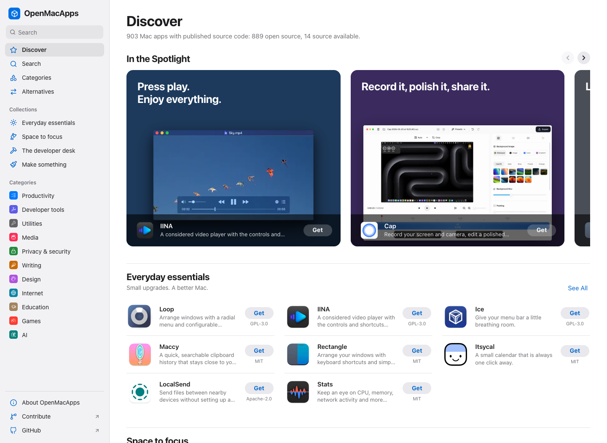

# Maco

**Good software. Open by nature.** A considered collection of open-source macOS apps and clearly labeled source-available alternatives, maintained by [Koative](https://github.com/koative).

[Explore the catalog](https://maco.koative.com/) · [Contribute an app](CONTRIBUTING.md) · [Research & inclusion policy](docs/RESEARCH.md)



Maco is an app-store-style catalog of open-source Mac software. Browse Discover shelves, collections, and categories, search the whole catalog, and open a product page that puts the source code, license, and official download side by side. Light and dark appearance follow your system. Every entry is a small, reviewable folder, and the website and the catalog below come from the same Markdown source.

## One app, one folder

```text
content/apps/
  rectangle/
    index.md              # Metadata + original Markdown description
    assets/
      icon.png            # Official image with recorded provenance
      screenshot.png
```

YAML frontmatter describes the app: name, summary, category, tags, the proprietary products it replaces, repository, official website, download page, optional Homebrew cask, source classification, reviewed license, license evidence, verification date, and asset attribution. The Markdown body explains what it does. Screenshots are optional; invented screenshots and unverified compatibility claims are not accepted. Alternatives pages (`content/alternatives/`) and topic pages (`content/topics/`) list apps by those fields and tags, so a new folder appears on them automatically.

This structure keeps assets beside the app, makes pull requests understandable, and avoids one giant JSON file becoming a merge-conflict bottleneck. Generated output is never the editing surface.

## Development

Requires Bun 1.4.3+. Bun installs dependencies, runs TypeScript, executes tests, and runs Astro in development and CI. The static site is served by GitHub Pages.

```sh
bun install --frozen-lockfile
bun run dev
bun run validate
bun run check
bun test
bun run build
bun run check:links
```

Open the address printed by the dev server (normally `http://localhost:4321/`). `bun run sync` copies catalog assets for the site and refreshes the generated catalog below. CI checks the data, TypeScript, tests, and production build. Changes pushed to `main` deploy to GitHub Pages.

The [discovery queue](research/README.md) tracks repository leads from ten directories. Refresh it with `bun run discover`; only independently reviewed app folders enter the store. `bun run homebrew` records Homebrew casks whose download or homepage is the app's own repository or website; see [CONTRIBUTING.md](CONTRIBUTING.md#local-workflow) for the matching rules.

See [publishing and SEO](docs/PUBLISHING.md) for the shared site configuration, social card, custom domain setup, and sitemap submission.

## Catalog principles

- **Licenses are explicit.** Paid open-source distributions can qualify. Apps with published source and additional restrictions are separately labeled **Source available**, explained on their detail pages, and filterable. Closed-source freeware is excluded.
- **Evidence travels with every entry.** Source repository, license file, official download, and a dated verification record are required.
- **Original projects get the credit.** Logos, screenshots, and trademarks belong to their respective owners; each included asset records its source and applicable rights.
- **A directory is a lead, not proof.** We research multiple lists and verify individual projects. See the [research notes](docs/RESEARCH.md).
- **No installer mirror.** Download links lead to official sources. Inclusion is not a security audit or an endorsement by Apple or the app authors.

## Browse the collection

<!-- catalog:start -->

878 macOS apps: **864 open source** and **14 source available**. Source-available apps have additional restrictions and are labeled separately. Generated from [content/apps](content/apps); edit the app folders to contribute.

### Productivity

| App | What it does | License |
| --- | --- | --- |
| [2FHey](https://maco.koative.com/apps/2fhey/) · [Source](https://github.com/SoFriendly/2fhey) | Detects verification codes arriving in Messages and copies them to the clipboard, with optional auto-paste. | [CC0-1.0](https://github.com/SoFriendly/2fhey/blob/main/LICENSE) |
| [ActivityWatch](https://maco.koative.com/apps/activitywatch/) · [Source](https://github.com/ActivityWatch/activitywatch) | Track which apps, windows and sites you use, with the activity data kept on your own computer. | [MPL-2.0](https://github.com/ActivityWatch/activitywatch/blob/master/LICENSE.txt) |
| [AeroSpace](https://maco.koative.com/apps/aerospace/) · [Source](https://github.com/nikitabobko/AeroSpace) | Arrange windows into keyboard-driven tiles and fast-switching workspaces. | [MIT](https://github.com/nikitabobko/AeroSpace/blob/main/LICENSE.txt) |
| [AltTab](https://maco.koative.com/apps/alttab/) · [Source](https://github.com/lwouis/alt-tab-macos) | Switch between individual windows with visual previews. | [GPL-3.0](https://github.com/lwouis/alt-tab-macos/blob/master/LICENCE.md) |
| [Amethyst](https://maco.koative.com/apps/amethyst/) · [Source](https://github.com/ianyh/Amethyst) | Automatically tile windows and move between layouts with keyboard shortcuts. | [MIT](https://github.com/ianyh/Amethyst/blob/development/LICENSE.md) |
| [AppFlowy](https://maco.koative.com/apps/appflowy/) · [Source](https://github.com/AppFlowy-IO/AppFlowy) | Arrange documents, tasks, and structured information in a customizable desktop workspace. | [AGPL-3.0](https://github.com/AppFlowy-IO/AppFlowy/blob/main/LICENSE) |
| [Apple Notes Exporter](https://maco.koative.com/apps/apple-notes-exporter/) · [Source](https://github.com/kzaremski/apple-notes-exporter) | Bulk-export Apple Notes, including iCloud notes, to Markdown, HTML, PDF and other formats with folders intact. | [GPL-3.0](https://github.com/kzaremski/apple-notes-exporter/blob/main/LICENSE) |
| [AutoDoc](https://maco.koative.com/apps/autodoc/) · [Source](https://github.com/DuetDisplay/AutoDoc) | Record meetings and get transcripts, editable notes and answers generated on your own computer, with timestamped replay. | [AGPL-3.0](https://github.com/DuetDisplay/AutoDoc/blob/main/LICENSE) |
| [AutoRaise](https://maco.koative.com/apps/autoraise/) · [Source](https://github.com/sbmpost/AutoRaise) | Focus and raise windows automatically when you hover over them. | [GPL-3.0](https://github.com/sbmpost/AutoRaise/blob/master/LICENSE.md) |
| [BarTranslate](https://maco.koative.com/apps/bartranslate/) · [Source](https://github.com/ThijmenDam/BarTranslate) | A menu bar panel that opens Google Translate behind a hotkey, with a shortcut for translating the clipboard. | [GPL-3.0](https://github.com/ThijmenDam/BarTranslate/blob/master/LICENSE) |
| [BetterCmdTab](https://maco.koative.com/apps/bettercmdtab/) · [Source](https://github.com/rokartur/BetterCmdTab) | Switch among windows using searchable lists, grids, and live previews. | [GPL-3.0](https://github.com/rokartur/BetterCmdTab/blob/main/LICENSE) |
| [BreakTimer](https://maco.koative.com/apps/breaktimer/) · [Source](https://github.com/tom-james-watson/breaktimer-app) | A break reminder that schedules regular pauses as notifications or fullscreen prompts, within your working hours. | [GPL-3.0](https://github.com/tom-james-watson/breaktimer-app/blob/master/LICENSE.md) |
| [Buffer](https://maco.koative.com/apps/buffer/) · [Source](https://github.com/samirpatil2000/Buffer) | A small menu bar clipboard manager with searchable history, pins, tags, multi-paste and on-device OCR for images. | [MIT](https://github.com/samirpatil2000/Buffer/blob/main/LICENSE) |
| [Calendr](https://maco.koative.com/apps/calendr/) · [Source](https://github.com/pakerwreah/Calendr) | A menu bar calendar with upcoming events, natural-language event entry and extra time zones in the menu bar. | [MIT](https://github.com/pakerwreah/Calendr/blob/master/LICENSE) |
| [Calibre](https://maco.koative.com/apps/calibre/) · [Source](https://github.com/kovidgoyal/calibre) | Organize ebooks, edit their metadata, convert formats, and transfer books to reading devices. | [GPL-3.0](https://github.com/kovidgoyal/calibre/blob/master/LICENSE) |
| [Capd](https://maco.koative.com/apps/capd/) · [Source](https://github.com/jamiedavenport/capd) | Capture web pages, text, links, notes and images into a local library and find them again with full-text search. | [MIT](https://github.com/jamiedavenport/capd/blob/main/LICENSE) |
| [Cerebro](https://maco.koative.com/apps/cerebro/) · [Source](https://github.com/cerebroapp/cerebro) | A keyboard launcher for apps, files, web searches and calculations, extended through community plugins. | [MIT](https://github.com/cerebroapp/cerebro/blob/master/LICENSE) |
| [Clipbara](https://maco.koative.com/apps/clipbara/) · [Source](https://github.com/mobrava/Clipbara) | A clipboard history that slides up as a row of cards, with pinboards, Quick Look, and an optional iPhone companion. | [GPL-3.0](https://github.com/mobrava/Clipbara/blob/main/LICENSE) |
| [Clipy](https://maco.koative.com/apps/clipy/) · [Source](https://github.com/Clipy/Clipy) | Recall clipboard history and reusable snippets through keyboard shortcuts. | [MIT](https://github.com/Clipy/Clipy/blob/develop/LICENSE) |
| [CopyQ](https://maco.koative.com/apps/copyq/) · [Source](https://github.com/hluk/CopyQ) | A scriptable clipboard manager that stores text, images and other formats in searchable, editable tabs. | [GPL-3.0](https://github.com/hluk/CopyQ/blob/master/LICENSE) |
| [CrossMacro](https://maco.koative.com/apps/crossmacro/) · [Source](https://github.com/alper-han/CrossMacro) | Record mouse and keyboard actions once, then replay them from hotkeys, schedules or window-based triggers. | [GPL-3.0-only](https://github.com/alper-han/CrossMacro/blob/dev/LICENSE) |
| [Dayflow](https://maco.koative.com/apps/dayflow/) · [Source](https://github.com/JerryZLiu/Dayflow) | An automatic work journal that turns periodic screen captures into a timeline, daily standup notes and weekly reviews. | [MIT](https://github.com/JerryZLiu/Dayflow/blob/main/LICENSE) |
| [DockDoor](https://maco.koative.com/apps/dockdoor/) · [Source](https://github.com/ejbills/DockDoor) | Preview application windows from the Dock and switch between them quickly. | [GPL-3.0-or-later](https://github.com/ejbills/DockDoor/blob/main/LICENSE) |
| [Dorso](https://maco.koative.com/apps/dorso/) · [Source](https://github.com/tldev/dorso) | Use a screen-blur reminder based on camera or AirPods posture tracking. | [MIT](https://github.com/tldev/dorso/blob/main/LICENSE) |
| [Easydict](https://maco.koative.com/apps/easydict/) · [Source](https://github.com/tisfeng/Easydict) | Look up words and translate selected text or screenshots with dictionaries, system translation and AI services. | [GPL-3.0](https://github.com/tisfeng/Easydict/blob/dev/LICENSE) |
| [EcoPaste](https://maco.koative.com/apps/ecopaste/) · [Source](https://github.com/EcoPasteHub/EcoPaste) | Store and search copied text, images, files, and folders locally. | [Apache-2.0](https://github.com/EcoPasteHub/EcoPaste/blob/master/LICENSE) |
| [EdgeMark](https://maco.koative.com/apps/edgemark/) · [Source](https://github.com/Ender-Wang/EdgeMark) | A Markdown notes panel that slides in from the edge of the screen and keeps every note as a plain file on disk. | [GPL-3.0](https://github.com/Ender-Wang/EdgeMark/blob/main/LICENSE) |
| [espanso](https://maco.koative.com/apps/espanso/) · [Source](https://github.com/espanso/espanso) | A cross-platform text expander that turns typed triggers into snippets, dates, forms or script output. | [GPL-3.0](https://github.com/espanso/espanso/blob/dev/LICENSE) |
| [File Architect](https://maco.koative.com/apps/file-architect/) · [Source](https://github.com/filearchitect/app) | Type an indented outline of files and folders and have the whole structure created on disk in one step. | [MIT](https://github.com/filearchitect/app/blob/main/LICENSE) |
| [Flycut](https://maco.koative.com/apps/flycut/) · [Source](https://github.com/TermiT/Flycut) | Keep a history of copied text and paste earlier items with a shortcut. | [MIT](https://github.com/TermiT/Flycut/blob/master/license.txt) |
| [Freeplane](https://maco.koative.com/apps/freeplane/) · [Source](https://github.com/freeplane/freeplane) | Map ideas into branching diagrams with notes, links, and structured project information. | [GPL-2.0](https://github.com/freeplane/freeplane/blob/1.13.x/license.txt) |
| [Freeter](https://maco.koative.com/apps/freeter/) · [Source](https://github.com/FreeterApp/Freeter) | Organize the links, notes, files and tools for each project into switchable workspaces. | [GPL-3.0](https://github.com/FreeterApp/Freeter/blob/master/COPYING) |
| [GnuCash](https://maco.koative.com/apps/gnucash/) · [Source](https://github.com/Gnucash/gnucash) | Track accounts, transactions, and reports with a desktop double-entry bookkeeping system. | [GPL-2.0-only OR GPL-3.0-only](https://github.com/Gnucash/gnucash/blob/stable/LICENSE) |
| [GoldenCheetah](https://maco.koative.com/apps/goldencheetah/) · [Source](https://github.com/GoldenCheetah/GoldenCheetah) | Analyze recorded endurance activities with charts, training histories, and performance metrics. | [GPL-2.0](https://github.com/GoldenCheetah/GoldenCheetah/blob/master/COPYING) |
| [Gramps](https://maco.koative.com/apps/gramps/) · [Source](https://github.com/gramps-project/gramps) | A long-running genealogy program for recording family trees, sources and events and producing charts and reports. | [GPL-2.0-or-later](https://github.com/gramps-project/gramps/blob/maintenance/gramps61/COPYING) |
| [Hammerspoon](https://maco.koative.com/apps/hammerspoon/) · [Source](https://github.com/Hammerspoon/hammerspoon) | Automate windows, shortcuts, and desktop behavior with Lua scripts. | [MIT](https://github.com/Hammerspoon/hammerspoon/blob/master/LICENSE) |
| [HealthTick](https://maco.koative.com/apps/healthtick/) · [Source](https://github.com/lifedever/health-tick-release) | A menu bar timer that reminds you to get up from your desk and can enforce a short break. | [GPL-3.0](https://github.com/lifedever/health-tick-release/blob/main/LICENSE) |
| [Itsycal](https://maco.koative.com/apps/itsycal/) · [Source](https://github.com/sfsam/Itsycal) | A small calendar that is always one click away. | [MIT](https://github.com/sfsam/Itsycal/blob/master/LICENSE.txt) |
| [Itsypad](https://maco.koative.com/apps/itsypad/) · [Source](https://github.com/nickustinov/itsypad-macos) | A small scratchpad and clipboard history in one window, summoned with a global hotkey. | [MIT](https://github.com/nickustinov/itsypad-macos/blob/main/LICENSE) |
| [Kando](https://maco.koative.com/apps/kando/) · [Source](https://github.com/kando-menu/kando) | A configurable pie menu that pops up under the pointer to launch apps, open files and send shortcuts. | [MIT](https://github.com/kando-menu/kando/blob/main/LICENSE.md) |
| [Keyboard Cowboy](https://maco.koative.com/apps/keyboard-cowboy/) · [Source](https://github.com/zenangst/KeyboardCowboy) | Create keyboard workflows and context-sensitive automation for your Mac. | [MIT](https://github.com/zenangst/KeyboardCowboy/blob/main/LICENSE.md) |
| [Knopo](https://maco.koative.com/apps/knopo/) · [Source](https://github.com/alkalim/Knopo) | A block-based outliner for linked notes and journals that stores everything as plain Markdown files. | [AGPL-3.0](https://github.com/alkalim/Knopo/blob/main/LICENSE) |
| [Koodo Reader](https://maco.koative.com/apps/koodo-reader/) · [Source](https://github.com/koodo-reader/koodo-reader) | A cross-platform ebook reader for EPUB, PDF, MOBI, comics and more, with optional cloud sync and backup. | [AGPL-3.0](https://github.com/koodo-reader/koodo-reader/blob/dev/LICENSE) |
| [Later](https://maco.koative.com/apps/later/) · [Source](https://github.com/alyssaxuu/later) | A menu bar app that hides or closes every open app in one click, then restores the session now or on a schedule. | [MIT](https://github.com/alyssaxuu/later/blob/master/LICENSE) |
| [Leader Key](https://maco.koative.com/apps/leader-key/) · [Source](https://github.com/mikker/LeaderKey) | Launch apps and actions through nested, memorable key sequences. | [MIT](https://github.com/mikker/LeaderKey/blob/main/LICENSE) |
| [LibreOffice](https://maco.koative.com/apps/libreoffice/) · [Source](https://github.com/LibreOffice/core) | Create documents, spreadsheets, presentations, and drawings in an open desktop office suite. | [MPL-2.0](https://github.com/LibreOffice/core/blob/master/COPYING.MPL) |
| [Logue](https://maco.koative.com/apps/logue/) · [Source](https://github.com/bitwize-ai/Logue) | A local-first workspace for documents, tasks and recorded meetings, with on-device transcription and an AI agent. | [MIT](https://github.com/bitwize-ai/Logue/blob/main/LICENSE) |
| [look](https://maco.koative.com/apps/look/) · [Source](https://github.com/kunkka19xx/look) | A keyboard-first launcher for apps, files, folders, clipboard history and quick commands, with a local index. | [GPL-3.0-or-later](https://github.com/kunkka19xx/look/blob/main/LICENSE) |
| [Loop](https://maco.koative.com/apps/loop/) · [Source](https://github.com/mrkai77/Loop) | Arrange windows with a radial menu and configurable keyboard shortcuts. | [GPL-3.0](https://github.com/mrkai77/Loop/blob/develop/LICENSE) |
| [Lotti](https://maco.koative.com/apps/lotti/) · [Source](https://github.com/matthiasn/lotti) | A private logbook for tasks, journal entries, voice notes and time, with encrypted sync and AI assistants you approve. | [GPL-3.0](https://github.com/matthiasn/lotti/blob/main/LICENSE) |
| [LunarBar](https://maco.koative.com/apps/lunarbar/) · [Source](https://github.com/LunarBar-app/LunarBar) | A compact menu bar calendar showing Chinese lunar dates, public holidays, and system calendar events. | [MIT](https://github.com/LunarBar-app/LunarBar/blob/main/LICENSE) |
| [Maccy](https://maco.koative.com/apps/maccy/) · [Source](https://github.com/p0deje/Maccy) | A quick, searchable clipboard history that stays close to your keyboard. | [MIT](https://github.com/p0deje/Maccy/blob/master/LICENSE) |
| [MakeItHome](https://maco.koative.com/apps/makeithome/) · [Source](https://github.com/Geckos-Ink/MakeItHome) | Push the cursor past a screen edge to switch apps with live previews and open a zone of widgets. | [MPL-2.0](https://github.com/Geckos-Ink/MakeItHome/blob/main/LICENSE) |
| [MeetingBar](https://maco.koative.com/apps/meetingbar/) · [Source](https://github.com/leits/MeetingBar) | Keep upcoming meetings in the menu bar and join from their calendar links. | [Apache-2.0](https://github.com/leits/MeetingBar/blob/master/LICENSE) |
| [Modal File Manager](https://maco.koative.com/apps/modal-file-manager/) · [Source](https://github.com/raguay/ModalFileManager) | A keyboard-driven file manager that uses Vim-style modal commands. | [MIT](https://github.com/raguay/ModalFileManager/blob/main/LICENSE) |
| [MoePeek](https://maco.koative.com/apps/moepeek/) · [Source](https://github.com/cosZone/MoePeek) | A menu bar translator that turns selected text, screenshots or the clipboard into a floating translation panel. | [AGPL-3.0](https://github.com/cosZone/MoePeek/blob/main/LICENSE) |
| [Money Manager Ex](https://maco.koative.com/apps/money-manager-ex/) · [Source](https://github.com/moneymanagerex/moneymanagerex) | Track everyday spending, accounts, and budgets in a personal finance desktop application. | [GPL-2.0](https://github.com/moneymanagerex/moneymanagerex/blob/master/LICENSE) |
| [Nimclip](https://maco.koative.com/apps/nimclip/) · [Source](https://github.com/hukdoesn/Nimclip) | A local-first clipboard history in the menu bar, with tags, favourites and OCR search for copied images. | [Apache-2.0](https://github.com/hukdoesn/Nimclip/blob/main/LICENSE) |
| [Notational Velocity](https://maco.koative.com/apps/notational-velocity/) · [Source](https://github.com/scrod/nv) | The classic keyboard-driven Mac notes app where one field both searches your notes and creates new ones. | [GPL-3.0](https://github.com/scrod/nv/blob/master/COPYING.txt) |
| [Notchprompt](https://maco.koative.com/apps/notchprompt/) · [Source](https://github.com/saif0200/notchprompt) | Scroll a script beside the notch while presenting or recording. | [MIT](https://github.com/saif0200/notchprompt/blob/main/LICENSE) |
| [NotchPrompter](https://maco.koative.com/apps/notch-prompter/) · [Source](https://github.com/jpomykala/NotchPrompter) | Keep a configurable floating script visible while presenting or recording. | [LicenseRef-NotchPrompter](https://github.com/jpomykala/NotchPrompter/blob/main/LICENSE) · **Source available** |
| [Noty](https://maco.koative.com/apps/noty/) · [Source](https://github.com/aimen08/noty) | Sticky notes that tuck into a slim tab on the screen edge and fan out as a deck when the pointer reaches it. | [MIT](https://github.com/aimen08/noty/blob/main/LICENSE) |
| [oats](https://maco.koative.com/apps/oats/) · [Source](https://github.com/ariso-ai/oats) | A menu bar meeting recorder that produces transcripts and notes in the cloud or fully on-device. | [MIT](https://github.com/ariso-ai/oats/blob/main/LICENSE) |
| [OffPDF](https://maco.koative.com/apps/offpdf/) · [Source](https://github.com/McanKul/offpdf) | An offline PDF toolbox for merging, splitting, converting, compressing, editing and OCR without uploading files. | [MIT](https://github.com/McanKul/offpdf/blob/main/LICENSE) |
| [OmniWM](https://maco.koative.com/apps/omniwm/) · [Source](https://github.com/OmniNull/OmniWM) | Organize windows with scrolling containers or binary-tree tiling layouts. | [GPL-2.0](https://github.com/OmniNull/OmniWM/blob/main/LICENSE) |
| [ONLYOFFICE Desktop Editors](https://maco.koative.com/apps/onlyoffice/) · [Source](https://github.com/ONLYOFFICE/DesktopEditors) | Edit documents, spreadsheets, and presentations in a desktop office suite. | [AGPL-3.0](https://github.com/ONLYOFFICE/DesktopEditors/blob/master/LICENSE) |
| [OpenClip](https://maco.koative.com/apps/openclip/) · [Source](https://github.com/ganeshmshetty/openclip) | Select text in any app to get a small action bar for transforms, searches, scripts, math, and optional AI. | [AGPL-3.0](https://github.com/ganeshmshetty/openclip/blob/main/LICENSE) |
| [OpenHabitTracker](https://maco.koative.com/apps/openhabittracker/) · [Source](https://github.com/Jinjinov/OpenHabitTracker) | A private notes, tasks and habit tracker that keeps data on the device and syncs only to a server you run. | [GPL-3.0](https://github.com/Jinjinov/OpenHabitTracker/blob/main/LICENSE) |
| [OpenQuack](https://maco.koative.com/apps/openquack/) · [Source](https://github.com/larryxiao/openquack) | Menu-bar voice dictation: press a hotkey, speak, and the transcript is typed at the cursor using on-device Whisper. | [MIT](https://github.com/larryxiao/openquack/blob/main/LICENSE) |
| [PasteBar](https://maco.koative.com/apps/pastebar/) · [Source](https://github.com/PasteBar/PasteBarApp) | Organize copied content into searchable history, boards, and reusable collections. | [LicenseRef-PasteBar](https://github.com/PasteBar/PasteBarApp/blob/main/CC-LICENSE) · **Source available** |
| [PasteMemo](https://maco.koative.com/apps/pastememo/) · [Source](https://github.com/lifedever/PasteMemo-app) | A clipboard manager that sorts copied items by type, previews them, and pastes clips as text, files or paths. | [GPL-3.0](https://github.com/lifedever/PasteMemo-app/blob/develop/LICENSE) |
| [Pasty](https://maco.koative.com/apps/pasty/) · [Source](https://github.com/IvyGain/Pasty) | Search clipboard history through a palette, a bottom strip, or a notch panel. | [MIT](https://github.com/IvyGain/Pasty/blob/main/LICENSE) |
| [PDFx](https://maco.koative.com/apps/pdfx/) · [Source](https://github.com/AlexandrosGounis/pdfx) | Lay out several PDFs on one canvas, reorder them, and save the set as one file that still opens as a normal PDF. | [MIT](https://github.com/AlexandrosGounis/pdfx/blob/main/LICENSE) |
| [Penc](https://maco.koative.com/apps/penc/) · [Source](https://github.com/dgurkaynak/Penc) | Move, resize, and snap windows with trackpad gestures. | [MIT](https://github.com/dgurkaynak/Penc/blob/master/LICENSE) |
| [Peninsula](https://maco.koative.com/apps/peninsula/) · [Source](https://github.com/celve/Peninsula) | A notch app that combines a window switcher, notification badges, a file tray and timers. | [GPL-3.0](https://github.com/celve/Peninsula/blob/main/LICENSE) |
| [Pesty](https://maco.koative.com/apps/pesty/) · [Source](https://github.com/momenbasel/pesty) | Browse clipboard history in a color-coded strip with reusable pinboards. | [MIT](https://github.com/momenbasel/pesty/blob/main/LICENSE) |
| [QDuo](https://maco.koative.com/apps/qduo/) · [Source](https://github.com/XueshiQiao/qduo) | Select text in any Mac app to get a popup of your own actions for translating, polishing, searching or speaking it. | [GPL-3.0](https://github.com/XueshiQiao/qduo/blob/main/LICENSE) |
| [Quicksilver](https://maco.koative.com/apps/quicksilver/) · [Source](https://github.com/quicksilver/Quicksilver) | Launch applications and perform actions through a keyboard-driven interface. | [Apache-2.0](https://github.com/quicksilver/Quicksilver/blob/main/LICENSE) |
| [ReadAny](https://maco.koative.com/apps/readany/) · [Source](https://github.com/codedogQBY/ReadAny) | An e-book reader with highlights, notes, text-to-speech and optional AI chat and semantic search over your library. | [GPL-3.0-or-later](https://github.com/codedogQBY/ReadAny/blob/main/LICENSE) |
| [Readest](https://maco.koative.com/apps/readest/) · [Source](https://github.com/readest/readest) | A cross-platform ebook reader with a clean library, highlights and notes, and optional sync between devices. | [AGPL-3.0](https://github.com/readest/readest/blob/main/LICENSE) |
| [Rectangle](https://maco.koative.com/apps/rectangle/) · [Source](https://github.com/rxhanson/Rectangle) | Arrange your windows with keyboard shortcuts and simple edge snapping. | [MIT](https://github.com/rxhanson/Rectangle/blob/main/LICENSE) |
| [rem](https://maco.koative.com/apps/rem/) · [Source](https://github.com/jasonjmcghee/rem) | Record what appears on your screen locally, then scrub back through it and search its recognised text. | [MIT](https://github.com/jasonjmcghee/rem/blob/main/LICENSE) |
| [Reminders MenuBar](https://maco.koative.com/apps/reminders-menubar/) · [Source](https://github.com/DamascenoRafael/reminders-menubar) | View, create, and complete Apple Reminders from the menu bar. | [GPL-3.0](https://github.com/DamascenoRafael/reminders-menubar/blob/master/LICENSE) |
| [Repose](https://maco.koative.com/apps/repose/) · [Source](https://github.com/fikrikarim/repose) | A break reminder that dims the screen on a timer and waits while your camera or microphone is in use. | [MIT](https://github.com/fikrikarim/repose/blob/main/LICENSE) |
| [SaneClick](https://maco.koative.com/apps/saneclick/) · [Source](https://github.com/sane-apps/SaneClick) | Add ready-made and custom script actions to the Finder right-click menu. | [PolyForm-Shield-1.0.0](https://github.com/sane-apps/SaneClick/blob/main/LICENSE) · **Source available** |
| [SaneClip](https://maco.koative.com/apps/saneclip/) · [Source](https://github.com/sane-apps/SaneClip) | Keep clipboard history with app exclusions and optional protection features. | [PolyForm-Shield-1.0.0](https://github.com/sane-apps/SaneClip/blob/main/LICENSE) · **Source available** |
| [SaneSales](https://maco.koative.com/apps/sanesales/) · [Source](https://github.com/sane-apps/SaneSales) | Track revenue and orders from Lemon Squeezy, Gumroad and Stripe in one private app with a menu bar total. | [MIT](https://github.com/sane-apps/SaneSales/blob/main/LICENSE) |
| [ScreenHint](https://maco.koative.com/apps/screenhint/) · [Source](https://github.com/salemhilal/ScreenHint) | Keep captured screen regions visible as floating reference hints. | [GPL-3.0](https://github.com/salemhilal/ScreenHint/blob/main/LICENSE) |
| [ScreenTranslate](https://maco.koative.com/apps/screentranslate/) · [Source](https://github.com/hcmhcs/screenTranslate) | Translate text from any area of the screen or a selection, with on-device OCR and translation by default. | [GPL-3.0](https://github.com/hcmhcs/screenTranslate/blob/main/LICENSE) |
| [SelfControl](https://maco.koative.com/apps/selfcontrol/) · [Source](https://github.com/SelfControlApp/selfcontrol) | Block distracting websites for a fixed period that cannot be canceled early. | [GPL-3.0](https://github.com/SelfControlApp/selfcontrol/blob/master/COPYING) |
| [Sol](https://maco.koative.com/apps/sol/) · [Source](https://github.com/ospfranco/sol) | A fast app launcher and command palette that bundles clipboard history, window management and quick tools. | [MIT](https://github.com/ospfranco/sol/blob/main/LICENSE) |
| [StandLock](https://maco.koative.com/apps/standlock/) · [Source](https://github.com/yagizdo/standlock) | A menu bar break timer that covers your screens until you stand up, with gentle, firm and strict schedules. | [MIT](https://github.com/yagizdo/standlock/blob/main/LICENSE) |
| [Stik](https://maco.koative.com/apps/stik/) · [Source](https://github.com/0xMassi/stik_app) | Summon a floating sticky note with a shortcut, type a thought and save it as a Markdown file. | [MIT](https://github.com/0xMassi/stik_app/blob/main/LICENSE) |
| [StockDock](https://maco.koative.com/apps/stockdock/) · [Source](https://github.com/simonsruggi/StockDock) | Track stocks, ETFs, indices, crypto and portfolio gains from the menu bar, with a full window for charts and news. | [MIT](https://github.com/simonsruggi/StockDock/blob/main/LICENSE) |
| [Stretchly](https://maco.koative.com/apps/stretchly/) · [Source](https://github.com/hovancik/stretchly) | A break reminder that schedules short micro breaks and longer pauses throughout the working day. | [BSD-2-Clause](https://github.com/hovancik/stretchly/blob/trunk/LICENSE) |
| [StrokeMouse](https://maco.koative.com/apps/strokemouse/) · [Source](https://github.com/Licoy/StrokeMouse) | Draw mouse or trackpad gestures to run shortcuts, open apps, control windows or start shell and AppleScript actions. | [AGPL-3.0](https://github.com/Licoy/StrokeMouse/blob/main/LICENSE) |
| [Super Productivity](https://maco.koative.com/apps/super-productivity/) · [Source](https://github.com/super-productivity/super-productivity) | A to-do list with timeboxing, time tracking, focus sessions and imports from Jira, GitHub, GitLab and other trackers. | [MIT](https://github.com/super-productivity/super-productivity/blob/master/LICENSE) |
| [SuperCmd](https://maco.koative.com/apps/supercmd/) · [Source](https://github.com/SuperCmdLabs/SuperCmd) | A keyboard launcher that runs Raycast extensions and adds clipboard history, snippets, dictation and AI actions. | [MIT](https://github.com/SuperCmdLabs/SuperCmd/blob/main/LICENSE) |
| [SwiftShift](https://maco.koative.com/apps/swiftshift/) · [Source](https://github.com/pablopunk/SwiftShift) | Move and resize windows using configurable mouse and keyboard gestures. | [MIT](https://github.com/pablopunk/SwiftShift/blob/main/LICENSE) |
| [Switch](https://maco.koative.com/apps/switch/) · [Source](https://github.com/Sanyam-G/switch) | Navigate and filter open windows through a keyboard-driven switcher. | [FSL-1.1-MIT](https://github.com/Sanyam-G/switch/blob/main/LICENSE.md) · **Source available** |
| [Table Habit](https://maco.koative.com/apps/table-habit/) · [Source](https://github.com/FriesI23/mhabit) | A habit tracker with a scoring system, progress charts and optional WebDAV sync, without accounts or ads. | [Apache-2.0](https://github.com/FriesI23/mhabit/blob/main/LICENSE) |
| [Telephone](https://maco.koative.com/apps/telephone/) · [Source](https://github.com/64characters/Telephone) | A SIP softphone for making and receiving internet calls through VoIP providers or a company phone system. | [GPL-3.0](https://github.com/64characters/Telephone/blob/master/LICENSE) |
| [Textream](https://maco.koative.com/apps/textream/) · [Source](https://github.com/f/textream) | A teleprompter that follows your script as you speak and shows it in a notch-style overlay, floating window or iPad. | [MIT](https://github.com/f/textream/blob/master/LICENSE) |
| [Thor](https://maco.koative.com/apps/thor/) · [Source](https://github.com/gbammc/Thor) | Assign a global keyboard shortcut to each app so you can open or switch to it instantly. | [MIT](https://github.com/gbammc/Thor/blob/master/LICENSE) |
| [Time to Leave](https://maco.koative.com/apps/time-to-leave/) · [Source](https://github.com/TTLApp/time-to-leave) | Log the hours you work each day and get a notification when you have put in enough time to head home. | [GPL-3.0](https://github.com/TTLApp/time-to-leave/blob/main/LICENSE) |
| [TimeMate](https://maco.koative.com/apps/timemate/) · [Source](https://github.com/homielab/timemate) | A menu bar Pomodoro timer that cycles through focus sessions and breaks, with an optional full-screen break overlay. | [MIT](https://github.com/homielab/timemate/blob/main/LICENSE) |
| [Timer](https://maco.koative.com/apps/timer/) · [Source](https://github.com/michaelvillar/timer-app) | Set simple visual timers by dragging an arrow or typing a duration. | [MIT](https://github.com/michaelvillar/timer-app/blob/master/LICENSE) |
| [TimeScribe](https://maco.koative.com/apps/timescribe/) · [Source](https://github.com/WINBIGFOX/TimeScribe) | An offline work-hours tracker with idle detection, projects, absences and PDF, Excel or CSV export. | [GPL-3.0](https://github.com/WINBIGFOX/TimeScribe/blob/main/LICENSE) |
| [Tinycast](https://maco.koative.com/apps/tinycast/) · [Source](https://github.com/abue-ammar/tinycast) | Launch apps, search files, recall clipboard items, and run shortcuts from one palette. | [AGPL-3.0-or-later](https://github.com/abue-ammar/tinycast/blob/main/LICENSE) |
| [Tolaria](https://maco.koative.com/apps/tolaria/) · [Source](https://github.com/refactoringhq/tolaria) | A keyboard-first desktop app for markdown knowledge bases, where every vault is a folder of plain files in Git. | [AGPL-3.0](https://github.com/refactoringhq/tolaria/blob/main/LICENSE) |
| [TomatoBar](https://maco.koative.com/apps/tomatobar/) · [Source](https://github.com/ivoronin/TomatoBar) | Run configurable work and break intervals from the menu bar. | [MIT](https://github.com/ivoronin/TomatoBar/blob/main/LICENSE) |
| [Trace](https://maco.koative.com/apps/trace/) · [Source](https://github.com/arjunkomath/trace) | A keyboard launcher for macOS that also snaps windows, opens quick links and offers push-to-talk dictation. | [MIT](https://github.com/arjunkomath/trace/blob/main/LICENSE) |
| [Tungsten Edge](https://maco.koative.com/apps/tungsten-edge/) · [Source](https://github.com/moonbai-studio/tungsten-edge) | A per-window taskbar for the bottom of the screen, with one clickable card per open window. | [GPL-3.0](https://github.com/moonbai-studio/tungsten-edge/blob/master/LICENSE) |
| [TypeCue](https://maco.koative.com/apps/typecue/) · [Source](https://github.com/alexpolonsky/TypeCue) | Type a prepared script into any app one block at a time, with real keystrokes, for demos, tutorials and screencasts. | [MIT](https://github.com/alexpolonsky/TypeCue/blob/main/LICENSE) |
| [Übersicht](https://maco.koative.com/apps/uebersicht/) · [Source](https://github.com/felixhageloh/uebersicht) | Display customizable widgets directly on your desktop. | [GPL-3.0-or-later](https://github.com/felixhageloh/uebersicht/blob/master/LICENSE) |
| [Ueli](https://maco.koative.com/apps/ueli/) · [Source](https://github.com/oliverschwendener/ueli) | A keystroke launcher for opening apps, files, bookmarks and quick conversions from a single search box. | [MIT](https://github.com/oliverschwendener/ueli/blob/main/LICENSE) |
| [Wox](https://maco.koative.com/apps/wox/) · [Source](https://github.com/Wox-launcher/Wox) | A keyboard launcher for apps, files and actions, extensible with Node.js, Python and script plugins. | [GPL-3.0](https://github.com/Wox-launcher/Wox/blob/master/LICENSE) |
| [yabai](https://maco.koative.com/apps/yabai/) · [Source](https://github.com/asmvik/yabai) | Tile windows automatically with binary space partitioning, controlled from the command line and your own shortcuts. | [MIT](https://github.com/asmvik/yabai/blob/master/LICENSE.txt) |
| [Yap](https://maco.koative.com/apps/yap/) · [Source](https://github.com/FrigadeHQ/yap) | Dictate into any text field with a shortcut, transcribed on device by Apple’s speech framework without accounts or API keys. | [MIT](https://github.com/FrigadeHQ/yap/blob/main/LICENSE) |
| [Yippy](https://maco.koative.com/apps/yippy/) · [Source](https://github.com/mattDavo/Yippy) | Keep copied items in an accessible clipboard-history panel. | [MIT](https://github.com/mattDavo/Yippy/blob/master/LICENSE) |
| [ZTools](https://maco.koative.com/apps/ztools/) · [Source](https://github.com/ZToolsCenter/ZTools) | An open-source launcher modelled on uTools, with app search, clipboard history and a plugin market. | [MIT](https://github.com/ZToolsCenter/ZTools/blob/main/LICENSE) |

### Developer tools

| App | What it does | License |
| --- | --- | --- |
| [Alacritty](https://maco.koative.com/apps/alacritty/) · [Source](https://github.com/alacritty/alacritty) | A GPU-accelerated terminal focused on a small, configurable core. | [Apache-2.0](https://github.com/alacritty/alacritty/blob/master/LICENSE-APACHE) |
| [Another Redis Desktop Manager](https://maco.koative.com/apps/another-redis-desktop-manager/) · [Source](https://github.com/qishibo/AnotherRedisDesktopManager) | A desktop client for browsing and editing Redis keys, with SSH tunnels, cluster support, and a command console. | [MIT](https://github.com/qishibo/AnotherRedisDesktopManager/blob/master/LICENSE) |
| [Apache NetBeans](https://maco.koative.com/apps/netbeans/) · [Source](https://github.com/apache/netbeans) | A long-running open-source IDE for Java and other languages, developed at the Apache Software Foundation. | [Apache-2.0](https://github.com/apache/netbeans/blob/master/LICENSE) |
| [Asset Catalog Tinkerer](https://maco.koative.com/apps/asset-catalog-tinkerer/) · [Source](https://github.com/insidegui/AssetCatalogTinkerer) | Open compiled asset catalog (.car) files to browse the images inside, then copy or export them. | [BSD-2-Clause](https://github.com/insidegui/AssetCatalogTinkerer/blob/main/LICENSE) |
| [Awal Terminal](https://maco.koative.com/apps/awal-terminal/) · [Source](https://github.com/AwalTerminal/Awal-terminal) | A Mac terminal emulator built around AI coding agents, with per-model profiles, cost tracking and foldable output. | [MIT](https://github.com/AwalTerminal/Awal-terminal/blob/main/LICENSE) |
| [Bdash](https://maco.koative.com/apps/bdash/) · [Source](https://github.com/bdash-app/bdash) | A lightweight SQL client for saving queries, charting results and sharing them as GitHub gists. | [MIT](https://github.com/bdash-app/bdash/blob/master/LICENSE) |
| [Beekeeper Studio Community](https://maco.koative.com/apps/beekeeper-studio/) · [Source](https://github.com/beekeeper-studio/beekeeper-studio) | A SQL editor and database browser in the open-source Community edition. | [GPL-3.0-or-later](https://github.com/beekeeper-studio/beekeeper-studio/blob/master/LICENSE.md) |
| [Berthly](https://maco.koative.com/apps/berthly/) · [Source](https://github.com/henrywang/Berthly) | A desktop front end for Apple's container tool to build images, run containers and VMs, and follow their logs. | [Apache-2.0](https://github.com/henrywang/Berthly/blob/main/LICENSE) |
| [Blink](https://maco.koative.com/apps/blink-dev-servers/) · [Source](https://github.com/megootronic/Blink) | A menu bar helper that lists running local dev servers and booted iOS simulators, with one-click restarts. | [MIT](https://github.com/megootronic/Blink/blob/main/LICENSE) |
| [Boop](https://maco.koative.com/apps/boop/) · [Source](https://github.com/IvanMathy/Boop) | A scratchpad for developers that transforms pasted text with built-in and custom JavaScript scripts. | [MIT](https://github.com/IvanMathy/Boop/blob/main/LICENSE) |
| [Brew Browser](https://maco.koative.com/apps/brew-browser/) · [Source](https://github.com/msitarzewski/brew-browser) | A desktop app for browsing, searching, installing and upgrading Homebrew formulae and casks. | [MIT](https://github.com/msitarzewski/brew-browser/blob/main/LICENSE) |
| [BrewMate](https://maco.koative.com/apps/brewmate/) · [Source](https://github.com/romankurnovskii/BrewMate) | A desktop interface for Homebrew that searches, installs, upgrades and removes formulae and casks. | [MIT](https://github.com/romankurnovskii/BrewMate/blob/main/LICENSE.md) |
| [BrewUI](https://maco.koative.com/apps/brewui/) · [Source](https://github.com/Homebrew/BrewUI) | Homebrew's official Mac app for finding, installing and updating formulae and casks without the Terminal. | [AGPL-3.0](https://github.com/Homebrew/BrewUI/blob/main/LICENSE) |
| [Bruno](https://maco.koative.com/apps/bruno/) · [Source](https://github.com/usebruno/bruno) | Keep API collections in your project, alongside your code. | [MIT](https://github.com/usebruno/bruno/blob/main/license.md) |
| [Cakebrew](https://maco.koative.com/apps/cakebrew/) · [Source](https://github.com/brunophilipe/Cakebrew) | A graphical front end for searching, installing and updating Homebrew formulae. | [GPL-3.0-or-later](https://github.com/brunophilipe/Cakebrew/blob/main/LICENSE) |
| [Calyx](https://maco.koative.com/apps/calyx/) · [Source](https://github.com/yuuichieguchi/Calyx) | A terminal built on Ghostty for supervising several coding agents at once, with one approval inbox and diff reviews. | [MIT](https://github.com/yuuichieguchi/Calyx/blob/main/LICENSE) |
| [Cate](https://maco.koative.com/apps/cate/) · [Source](https://github.com/0-AI-UG/cate) | An infinite canvas workspace that arranges editors, terminals, and browser panels for parallel coding agents. | [MIT](https://github.com/0-AI-UG/cate/blob/main/LICENSE) |
| [CCMenu](https://maco.koative.com/apps/ccmenu/) · [Source](https://github.com/ccmenu/ccmenu2) | A menu bar monitor that shows the status of GitHub Actions workflows and CCTray-compatible CI builds. | [Apache-2.0](https://github.com/ccmenu/ccmenu2/blob/main/LICENSE) |
| [Changes](https://maco.koative.com/apps/changes/) · [Source](https://github.com/maoyama/Changes) | A Git client for macOS with staging by hunk, branches, tags, stashes and commit search. | [MIT](https://github.com/maoyama/Changes/blob/main/LICENSE) |
| [Chipmunk](https://maco.koative.com/apps/chipmunk/) · [Source](https://github.com/esrlabs/chipmunk) | A desktop log viewer built for very large files, live streams, filtering and automotive DLT and SOME/IP traces. | [Apache-2.0](https://github.com/esrlabs/chipmunk/blob/master/LICENSE.txt) |
| [Chops](https://maco.koative.com/apps/chops/) · [Source](https://github.com/Shpigford/chops) | Browse, search and edit the skills and agent files used by Claude Code, Cursor, Codex and other coding agents. | [FSL-1.1-MIT](https://github.com/Shpigford/chops/blob/main/LICENSE) · **Source available** |
| [Claude Statistics](https://maco.koative.com/apps/claude-statistics/) · [Source](https://github.com/sj719045032/claude-statistics) | Track Claude Code, Codex and Gemini CLI sessions, quota use and costs from the menu bar and a notch overlay. | [MIT](https://github.com/sj719045032/claude-statistics/blob/main/LICENSE) |
| [Clave](https://maco.koative.com/apps/clave/) · [Source](https://github.com/antasphere/clave) | Run several coding-agent CLI sessions side by side in split or grid layouts, with a git panel and SSH remotes. | [MIT](https://github.com/antasphere/clave/blob/prod/LICENSE) |
| [ClearDisk](https://maco.koative.com/apps/cleardisk/) · [Source](https://github.com/bysiber/cleardisk) | A menu bar app that finds rebuildable developer caches and moves the ones you pick to the Trash. | [MIT](https://github.com/bysiber/cleardisk/blob/main/LICENSE) |
| [Cocoa-Way](https://maco.koative.com/apps/cocoa-way/) · [Source](https://github.com/J-x-Z/cocoa-way) | A Wayland compositor for macOS that shows Linux GUI apps from containers or remote machines in Mac windows. | [GPL-3.0](https://github.com/J-x-Z/cocoa-way/blob/main/LICENSE) |
| [CocoaRestClient](https://maco.koative.com/apps/cocoarestclient/) · [Source](https://github.com/mmattozzi/cocoa-rest-client) | A lightweight Mac app for sending HTTP requests and reading pretty-printed JSON and XML responses. | [BSD-3-Clause](https://github.com/mmattozzi/cocoa-rest-client/blob/master/LICENSE.txt) |
| [CodeEdit](https://maco.koative.com/apps/codeedit/) · [Source](https://github.com/CodeEditApp/CodeEdit) | A community-built native Mac code editor with projects, terminal tools, and Git integration. | [MIT](https://github.com/CodeEditApp/CodeEdit/blob/main/LICENSE.md) |
| [CodeIsland](https://maco.koative.com/apps/codeisland/) · [Source](https://github.com/wxtsky/codeisland) | Watch AI coding agents from the MacBook notch and approve their tool calls or answer questions without switching windows. | [MIT](https://github.com/wxtsky/codeisland/blob/main/LICENSE) |
| [CodeSucker](https://maco.koative.com/apps/codesucker/) · [Source](https://github.com/fanbuz/codesucker) | Turns a local code project into the source-code document required for Chinese software copyright registration. | [Apache-2.0](https://github.com/fanbuz/codesucker/blob/main/LICENSE) |
| [CodexIsland](https://maco.koative.com/apps/codex-island/) · [Source](https://github.com/ericjypark/codex-island) | Show remaining usage for AI coding subscriptions in a live overlay around the MacBook notch. | [MIT](https://github.com/ericjypark/codex-island/blob/main/LICENSE) |
| [Configs](https://maco.koative.com/apps/configs/) · [Source](https://github.com/iHongRen/configEditor) | Find, edit and track the dotfiles on your Mac, such as .zshrc and .gitconfig, in one window. | [Apache-2.0](https://github.com/iHongRen/configEditor/blob/main/LICENSE) |
| [Davit](https://maco.koative.com/apps/davit/) · [Source](https://github.com/wouterdebie/davit) | A desktop app for Apple's container platform: run, inspect and build Linux containers, images, volumes and networks. | [MIT](https://github.com/wouterdebie/davit/blob/main/LICENSE) |
| [DB Browser for SQLite](https://maco.koative.com/apps/db-browser-for-sqlite/) · [Source](https://github.com/sqlitebrowser/sqlitebrowser) | Browse SQLite files, edit tables, and run SQL through a desktop interface. | [MPL-2.0 OR GPL-3.0-or-later](https://github.com/sqlitebrowser/sqlitebrowser/blob/master/LICENSE) |
| [DBeaver Community](https://maco.koative.com/apps/dbeaver/) · [Source](https://github.com/dbeaver/dbeaver) | A database workbench for browsing tables, writing SQL, and managing many database engines. | [Apache-2.0](https://github.com/dbeaver/dbeaver/blob/devel/LICENSE.md) |
| [DbGate](https://maco.koative.com/apps/dbgate/) · [Source](https://github.com/dbgate/dbgate) | A database manager for querying SQL systems and exploring supported NoSQL stores. | [GPL-3.0](https://github.com/dbgate/dbgate/blob/master/LICENSE) |
| [DevCleaner](https://maco.koative.com/apps/devcleaner/) · [Source](https://github.com/vashpan/xcode-dev-cleaner) | Reclaim disk space taken up by Xcode device support files, archives, derived data and simulator caches. | [GPL-3.0](https://github.com/vashpan/xcode-dev-cleaner/blob/master/LICENSE) |
| [DevDocs for macOS](https://maco.koative.com/apps/devdocs-for-macos/) · [Source](https://github.com/dteoh/devdocs-macos) | An unofficial Mac viewer for DevDocs that puts searchable API documentation in its own app window. | [GPL-3.0](https://github.com/dteoh/devdocs-macos/blob/master/LICENSE.txt) |
| [Device Hub Pro](https://maco.koative.com/apps/device-hub-pro/) · [Source](https://github.com/gitemre/device-hub-pro) | Mirror, control and configure Android devices and iOS simulators side by side for app testing. | [MIT](https://github.com/gitemre/device-hub-pro/blob/main/LICENSE) |
| [DevProjex](https://maco.koative.com/apps/devprojex/) · [Source](https://github.com/Avazbek22/DevProjex) | Select files from a project tree and export clean, redacted context for AI chats and coding agents. | [Apache-2.0](https://github.com/Avazbek22/DevProjex/blob/master/LICENSE) |
| [DevToys](https://maco.koative.com/apps/devtoys/) · [Source](https://github.com/DevToys-app/DevToys) | A desktop collection of formatters, converters, encoders, and text utilities. | [MIT](https://github.com/DevToys-app/DevToys/blob/main/LICENSE.md) |
| [electerm](https://maco.koative.com/apps/electerm/) · [Source](https://github.com/electerm/electerm) | A terminal and remote access client covering SSH, SFTP, FTP, Telnet, serial ports, RDP, and VNC. | [MIT](https://github.com/electerm/electerm/blob/master/LICENSE) |
| [ElectroCRUD](https://maco.koative.com/apps/electrocrud/) · [Source](https://github.com/garrylachman/ElectroCRUD) | Build browsable admin views over MySQL, PostgreSQL, SQLite or SQL Server tables without writing code. | [MIT](https://github.com/garrylachman/ElectroCRUD/blob/master/LICENSE) |
| [Farol](https://maco.koative.com/apps/farol/) · [Source](https://github.com/snowztech/farol) | A terminal built on libghostty for running several coding agents side by side and seeing which needs attention. | [MIT](https://github.com/snowztech/farol/blob/main/LICENSE) |
| [flock](https://maco.koative.com/apps/flock/) · [Source](https://github.com/baahaus/flock) | A tiling workspace that runs several Claude Code sessions side by side with shell and Markdown panes. | [MIT](https://github.com/baahaus/flock/blob/main/LICENSE) |
| [FlyEnv](https://maco.koative.com/apps/flyenv/) · [Source](https://github.com/xpf0000/FlyEnv) | A desktop manager for local development stacks: language runtimes, databases, web servers, local domains and HTTPS. | [BSD-3-Clause](https://github.com/xpf0000/FlyEnv/blob/master/LICENSE) |
| [Gantry](https://maco.koative.com/apps/gantry/) · [Source](https://github.com/getgantry/gantry) | A Mac app for managing Docker containers, images and Compose stacks locally and on remote hosts over SSH. | [MIT](https://github.com/getgantry/gantry/blob/main/LICENSE) |
| [Gaphor](https://maco.koative.com/apps/gaphor/) · [Source](https://github.com/gaphor/gaphor) | A UML and SysML modeling application that keeps a real model behind its diagrams, not just drawings. | [Apache-2.0](https://github.com/gaphor/gaphor/blob/main/LICENSES/Apache-2.0.txt) |
| [Geany](https://maco.koative.com/apps/geany/) · [Source](https://github.com/geany/geany) | A compact editor and IDE with syntax highlighting, project tools, and build commands. | [GPL-2.0](https://github.com/geany/geany/blob/master/COPYING) |
| [Ghostty](https://maco.koative.com/apps/ghostty/) · [Source](https://github.com/ghostty-org/ghostty) | A fast terminal with native Mac windows, tabs, split panes, and extensive keyboard controls. | [MIT](https://github.com/ghostty-org/ghostty/blob/main/LICENSE) |
| [GitButler](https://maco.koative.com/apps/gitbutler/) · [Source](https://github.com/gitbutlerapp/gitbutler) | A graphical Git workspace for organizing parallel changes and preparing commits. | [FSL-1.1-MIT](https://github.com/gitbutlerapp/gitbutler/blob/master/LICENSE.md) · **Source available** |
| [GitHub Desktop](https://maco.koative.com/apps/github-desktop/) · [Source](https://github.com/desktop/desktop) | A desktop Git workflow for reviewing diffs, committing changes, and working with branches. | [MIT](https://github.com/desktop/desktop/blob/development/LICENSE) |
| [GitHub Stars Manager](https://maco.koative.com/apps/github-stars-manager/) · [Source](https://github.com/AmintaCCCP/GithubStarsManager) | Syncs your GitHub stars, has an AI model summarise and categorise them, and tracks their releases in one timeline. | [MIT](https://github.com/AmintaCCCP/GithubStarsManager/blob/main/LICENSE) |
| [Gitify](https://maco.koative.com/apps/gitify/) · [Source](https://github.com/gitify-app/gitify) | A menu bar app that collects notifications from GitHub, GitLab, Gitea, Forgejo and other Git forges in one list. | [MIT](https://github.com/gitify-app/gitify/blob/main/LICENSE) |
| [Gittyup](https://maco.koative.com/apps/gittyup/) · [Source](https://github.com/Murmele/Gittyup) | A graphical Git client for reading history, inspecting changes, and preparing commits. | [MIT](https://github.com/Murmele/Gittyup/blob/master/LICENSE.md) |
| [GitUp](https://maco.koative.com/apps/gitup/) · [Source](https://github.com/git-up/GitUp) | A Mac Git client built around an interactive history graph and reversible operations. | [GPL-3.0](https://github.com/git-up/GitUp/blob/master/LICENSE) |
| [GitX](https://maco.koative.com/apps/gitx/) · [Source](https://github.com/gitx/gitx) | A community-maintained Mac Git client for browsing history, staging changes and committing, continuing the GitX lineage. | [GPL-2.0-only](https://github.com/gitx/gitx/blob/master/COPYING) |
| [Hex Fiend](https://maco.koative.com/apps/hex-fiend/) · [Source](https://github.com/HexFiend/HexFiend) | A fast hex editor that handles very large files, compares binaries and decodes structures with templates. | [BSD-2-Clause](https://github.com/HexFiend/HexFiend/blob/master/License.txt) |
| [Hoppscotch Desktop](https://maco.koative.com/apps/hoppscotch/) · [Source](https://github.com/hoppscotch/hoppscotch) | The Hoppscotch API development workspace packaged as a desktop app. | [MIT](https://github.com/hoppscotch/hoppscotch/blob/main/LICENSE) |
| [HTTP Toolkit](https://maco.koative.com/apps/http-toolkit/) · [Source](https://github.com/httptoolkit/httptoolkit-desktop) | A debugging proxy and HTTP client for intercepting, inspecting and rewriting traffic from browsers, apps and devices. | [AGPL-3.0](https://github.com/httptoolkit/httptoolkit-desktop/blob/main/LICENSE) |
| [Hyper](https://maco.koative.com/apps/hyper/) · [Source](https://github.com/vercel/hyper) | A terminal built with web technologies and customized through themes and extensions. | [MIT](https://github.com/vercel/hyper/blob/canary/LICENSE) |
| [ImHex](https://maco.koative.com/apps/imhex/) · [Source](https://github.com/WerWolv/ImHex) | A hex editor for reverse engineering, with a C++-like pattern language for decoding and highlighting binary formats. | [GPL-2.0-only AND LGPL-2.1](https://github.com/WerWolv/ImHex/blob/master/LICENSE) |
| [InjectionIII](https://maco.koative.com/apps/injectioniii/) · [Source](https://github.com/johnno1962/InjectionIII) | Hot-reload edited source files into an app running in the simulator without a full rebuild and relaunch. | [MIT](https://github.com/johnno1962/InjectionIII/blob/main/LICENSE) |
| [Insomnia](https://maco.koative.com/apps/insomnia/) · [Source](https://github.com/Kong/insomnia) | Design and send API requests, inspect responses, and organize collections of endpoints. | [Apache-2.0](https://github.com/Kong/insomnia/blob/develop/LICENSE) |
| [ipaverse](https://maco.koative.com/apps/ipaverse/) · [Source](https://github.com/bahattinkoc/ipaverse) | Search, download, inspect and re-sign App Store packages, then install compatible IPAs on an iPhone or iPad. | [MIT AND GPL-2.0 AND LGPL-2.1-or-later](https://github.com/bahattinkoc/ipaverse/blob/main/LICENSE) |
| [iTerm2](https://maco.koative.com/apps/iterm2/) · [Source](https://github.com/gnachman/iTerm2) | A Mac terminal with split panes, search, profiles, and deep shell integration. | [GPL-2.0](https://github.com/gnachman/iTerm2/blob/master/LICENSE) |
| [Itsyconnect](https://maco.koative.com/apps/itsyconnect/) · [Source](https://github.com/nickustinov/itsyconnect-macos) | A local desktop client for App Store Connect listings, TestFlight builds, customer reviews and analytics. | [MIT](https://github.com/nickustinov/itsyconnect-macos/blob/main/LICENSE) |
| [JET Pilot](https://maco.koative.com/apps/jet-pilot/) · [Source](https://github.com/unxsist/jet-pilot) | A desktop Kubernetes client for browsing clusters, inspecting workloads, reading logs and managing Helm charts. | [MIT](https://github.com/unxsist/jet-pilot/blob/main/LICENSE) |
| [JSON Model Generator](https://maco.koative.com/apps/json-model-generator/) · [Source](https://github.com/chanonly123/Json-Model-Generator) | Generate model classes from a sample JSON payload using editable templates for Swift, Kotlin, Dart, C# and Python. | [MIT](https://github.com/chanonly123/Json-Model-Generator/blob/master/LICENSE) |
| [Jupyter Notebook Viewer](https://maco.koative.com/apps/jupyter-notebook-viewer/) · [Source](https://github.com/tuxu/nbviewer-app) | A small Mac app for reading Jupyter notebooks without running Jupyter, with a Quick Look preview plug-in. | [MIT](https://github.com/tuxu/nbviewer-app/blob/master/LICENSE.md) |
| [JustTags](https://maco.koative.com/apps/just-tags/) · [Source](https://github.com/kaphacius/just-tags) | Decode, filter and compare BER-TLV EMV tags from hex or base64 strings in a dedicated Mac app. | [GPL-3.0](https://github.com/kaphacius/just-tags/blob/main/LICENSE) |
| [Kaku](https://maco.koative.com/apps/kaku/) · [Source](https://github.com/tw93/Kaku) | A WezTerm-based terminal preconfigured with fonts, themes, Mac shortcuts and optional AI help. | [MIT](https://github.com/tw93/Kaku/blob/main/LICENSE.md) |
| [kitty](https://maco.koative.com/apps/kitty/) · [Source](https://github.com/kovidgoyal/kitty) | A keyboard-driven terminal with GPU rendering, layouts, and extensible helper tools. | [GPL-3.0](https://github.com/kovidgoyal/kitty/blob/master/LICENSE) |
| [Knuff](https://maco.koative.com/apps/knuff/) · [Source](https://github.com/KnuffApp/Knuff) | Send test push notifications to Apple devices through APNs using certificates from your keychain. | [MIT](https://github.com/KnuffApp/Knuff/blob/master/LICENSE) |
| [KubeContext](https://maco.koative.com/apps/kubecontext/) · [Source](https://github.com/turkenh/KubeContext) | Switch Kubernetes contexts from the menu bar and manage kubeconfig entries, namespaces and colours in a small window. | [Apache-2.0](https://github.com/turkenh/KubeContext/blob/master/LICENSE) |
| [Lapce](https://maco.koative.com/apps/lapce/) · [Source](https://github.com/lapce/lapce) | A code editor built around responsive editing, language tools, and a modern interface. | [Apache-2.0](https://github.com/lapce/lapce/blob/master/LICENSE) |
| [Lepton](https://maco.koative.com/apps/lepton/) · [Source](https://github.com/hackjutsu/Lepton) | A snippet manager that stores and organizes your code snippets as GitHub Gists. | [MIT](https://github.com/hackjutsu/Lepton/blob/master/LICENSE) |
| [lich](https://maco.koative.com/apps/lich/) · [Source](https://github.com/omartelo/lich) | A desktop workspace for terminal coding agents, with real terminals, git worktrees, diffs and pull requests side by side. | [AGPL-3.0-only](https://github.com/omartelo/lich/blob/main/LICENSE) |
| [Lite XL](https://maco.koative.com/apps/lite-xl/) · [Source](https://github.com/lite-xl/lite-xl) | A lightweight text editor extended with Lua plugins and a deliberately compact interface. | [MIT](https://github.com/lite-xl/lite-xl/blob/master/LICENSE) |
| [LiteEdit](https://maco.koative.com/apps/lite-edit/) · [Source](https://github.com/arietan/lite-edit) | A small code editor for opening a project folder, reading files and making quick edits. | [MIT](https://github.com/arietan/lite-edit/blob/main/LICENSE) |
| [Loadout](https://maco.koative.com/apps/loadout/) · [Source](https://github.com/migsilva89/loadout) | See and manage the skills, slash commands, subagents, plugins and MCP servers your coding assistants load. | [MIT](https://github.com/migsilva89/loadout/blob/main/LICENSE) |
| [Localization Editor](https://maco.koative.com/apps/localization-editor/) · [Source](https://github.com/igorkulman/iOSLocalizationEditor) | Edit every language of an iOS or macOS project's Localizable.strings side by side and spot missing translations. | [MIT](https://github.com/igorkulman/iOSLocalizationEditor/blob/master/LICENSE) |
| [Loupe](https://maco.koative.com/apps/loupe/) · [Source](https://github.com/britchie4/Loupe) | An accessibility inspector that turns any on-screen Mac UI element into structured notes for AI coding agents. | [MIT](https://github.com/britchie4/Loupe/blob/main/LICENSE) |
| [MacVim](https://maco.koative.com/apps/macvim/) · [Source](https://github.com/macvim-dev/macvim) | Vim editing in a Mac desktop app with platform integration and graphical windows. | [Vim](https://github.com/macvim-dev/macvim/blob/master/LICENSE) |
| [Maestro](https://maco.koative.com/apps/maestro/) · [Source](https://github.com/RunMaestro/Maestro) | A keyboard-driven desktop app for running and supervising several AI coding agents across projects at once. | [AGPL-3.0](https://github.com/RunMaestro/Maestro/blob/main/LICENSE) |
| [massCode](https://maco.koative.com/apps/masscode/) · [Source](https://github.com/massCodeIO/massCode) | A local-first developer workspace for code snippets, notes, HTTP requests, and small developer utilities. | [AGPL-3.0](https://github.com/massCodeIO/massCode/blob/main/LICENSE) |
| [Medio](https://maco.koative.com/apps/medio/) · [Source](https://github.com/nuance-dev/medio) | A small text diff checker that highlights word-level differences between two passages as you type. | [MIT](https://github.com/nuance-dev/medio/blob/main/LICENSE) |
| [Medis](https://maco.koative.com/apps/medis/) · [Source](https://github.com/luin/medis) | A graphical Redis client for browsing keys and inspecting stored values. | [MIT](https://github.com/luin/medis/blob/master/LICENSE) |
| [MiniSim](https://maco.koative.com/apps/minisim/) · [Source](https://github.com/okwasniewski/MiniSim) | Launch iOS simulators and Android emulators from a menu-bar list or a global shortcut. | [MIT](https://github.com/okwasniewski/MiniSim/blob/main/LICENSE) |
| [Mockoon](https://maco.koative.com/apps/mockoon/) · [Source](https://github.com/mockoon/mockoon) | Design and run mock REST APIs locally, with templating, proxying and request logs, without an account. | [MIT](https://github.com/mockoon/mockoon/blob/main/LICENSE.md) |
| [MongoDB.app](https://maco.koative.com/apps/mongodb-app/) · [Source](https://github.com/gcollazo/mongodbapp) | Run a local MongoDB server by opening a Mac app instead of installing it through a package manager. | [MIT](https://github.com/gcollazo/mongodbapp/blob/master/LICENSE) |
| [MQTTX](https://maco.koative.com/apps/mqttx/) · [Source](https://github.com/emqx/MQTTX) | A desktop MQTT 5.0 client for opening several broker connections and testing publish and subscribe flows. | [Apache-2.0](https://github.com/emqx/MQTTX/blob/main/LICENSE) |
| [MrEditor](https://maco.koative.com/apps/mreditor/) · [Source](https://github.com/MR-TABATA/MrEditor) | A Mac editor for huge logs and CSV files that opens multi-gigabyte text instantly and can follow, filter and diff it. | [MIT](https://github.com/MR-TABATA/MrEditor/blob/main/LICENSE) |
| [Multipass](https://maco.koative.com/apps/multipass/) · [Source](https://github.com/canonical/multipass) | Launch and manage lightweight Ubuntu virtual machines from a desktop app or the command line. | [GPL-3.0](https://github.com/canonical/multipass/blob/main/LICENSE) |
| [Muxy](https://maco.koative.com/apps/muxy/) · [Source](https://github.com/muxy-app/muxy) | A terminal multiplexer app with split panes, background and remote sessions, git worktrees and coding-agent integrations. | [MIT](https://github.com/muxy-app/muxy/blob/main/LICENSE) |
| [Neon Vision Editor](https://maco.koative.com/apps/neon-vision-editor/) · [Source](https://github.com/h3pdesign/Neon-Vision-Editor) | A lightweight Swift editor for code and Markdown, built for quick edits rather than full IDE workflows. | [Apache-2.0](https://github.com/h3pdesign/Neon-Vision-Editor/blob/main/LICENSE) |
| [Nextpad++](https://maco.koative.com/apps/nextpad-plus-plus/) · [Source](https://github.com/nextpad-plus-plus/nextpad-plus-plus-macos) | A macOS port of the Notepad++ code editor, with syntax highlighting, macros, plugins and find in files. | [GPL-3.0](https://github.com/nextpad-plus-plus/nextpad-plus-plus-macos/blob/main/LICENSE) |
| [Open in Code](https://maco.koative.com/apps/open-in-code/) · [Source](https://github.com/sozercan/OpenInCode) | A Finder toolbar button that opens the current folder, or the selected item, in Visual Studio Code. | [MIT](https://github.com/sozercan/OpenInCode/blob/master/LICENSE) |
| [OpenInTerminal](https://maco.koative.com/apps/openinterminal/) · [Source](https://github.com/Ji4n1ng/OpenInTerminal) | Open the current Finder folder or file in your terminal or editor from the toolbar, menu bar or a shortcut. | [MIT](https://github.com/Ji4n1ng/OpenInTerminal/blob/master/LICENSE) |
| [Pasteboard Viewer](https://maco.koative.com/apps/pasteboard-viewer/) · [Source](https://github.com/sindresorhus/Pasteboard-Viewer) | Inspect every type and value that apps place on the macOS pasteboards. | [MIT](https://github.com/sindresorhus/Pasteboard-Viewer/blob/main/license) |
| [pgAdmin 4](https://maco.koative.com/apps/pgadmin/) · [Source](https://github.com/pgadmin-org/pgadmin4) | A PostgreSQL administration app with database navigation, query tools, and server management. | [PostgreSQL](https://github.com/pgadmin-org/pgadmin4/blob/master/LICENSE) |
| [PHP Monitor](https://maco.koative.com/apps/php-monitor/) · [Source](https://github.com/nicoverbruggen/phpmon) | A menu bar app for switching PHP versions and managing a Homebrew and Laravel Valet development setup. | [MIT](https://github.com/nicoverbruggen/phpmon/blob/main/LICENSE) |
| [Platypus](https://maco.koative.com/apps/platypus/) · [Source](https://github.com/sveinbjornt/Platypus) | Wrap shell, Python, Ruby and other scripts in Mac app bundles with droplets, menus or progress windows. | [BSD-3-Clause](https://github.com/sveinbjornt/Platypus/blob/master/LICENSE.txt) |
| [Podman Desktop](https://maco.koative.com/apps/podman-desktop/) · [Source](https://github.com/podman-desktop/podman-desktop) | Manage containers, images, and local development environments from a desktop app. | [Apache-2.0](https://github.com/podman-desktop/podman-desktop/blob/main/LICENSE) |
| [PortKiller](https://maco.koative.com/apps/portkiller/) · [Source](https://github.com/productdevbook/port-killer) | Lists listening ports with their processes so you can stop them, and manages Kubernetes port forwards from the menu bar. | [MIT](https://github.com/productdevbook/port-killer/blob/main/LICENSE) |
| [Postgres.app](https://maco.koative.com/apps/postgres-app/) · [Source](https://github.com/PostgresApp/PostgresApp) | Run one or more PostgreSQL servers on your Mac from a self-contained app with a simple start and stop interface. | [PostgreSQL](https://github.com/PostgresApp/PostgresApp/blob/master/LICENSE) |
| [ProfilesManager](https://maco.koative.com/apps/profilesmanager/) · [Source](https://github.com/shaojiankui/ProfilesManager) | Browse, inspect, install and export iOS and macOS provisioning profiles, with Quick Look previews for app bundles. | [MIT](https://github.com/shaojiankui/ProfilesManager/blob/master/LICENSE) |
| [Pulsar](https://maco.koative.com/apps/pulsar/) · [Source](https://github.com/pulsar-edit/pulsar) | A community-led text and code editor continuing the extensible Atom experience. | [MIT](https://github.com/pulsar-edit/pulsar/blob/master/LICENSE.md) |
| [Rancher Desktop](https://maco.koative.com/apps/rancher-desktop/) · [Source](https://github.com/rancher-sandbox/rancher-desktop) | A local container and Kubernetes environment with desktop settings and management tools. | [Apache-2.0](https://github.com/rancher-sandbox/rancher-desktop/blob/main/LICENSE) |
| [Reactotron](https://maco.koative.com/apps/reactotron/) · [Source](https://github.com/infinitered/reactotron) | A desktop debugger for React and React Native apps that shows state, network requests, logs and performance. | [MIT](https://github.com/infinitered/reactotron/blob/master/LICENSE) |
| [Redis Pro](https://maco.koative.com/apps/redis-pro/) · [Source](https://github.com/cmushroom/redis-pro) | A SwiftUI desktop client for browsing keys, editing values and inspecting Redis servers. | [GPL-3.0](https://github.com/cmushroom/redis-pro/blob/main/LICENSE) |
| [RelaGit](https://maco.koative.com/apps/relagit/) · [Source](https://github.com/relagit/relagit) | A cross-platform graphical Git client with a commit graph and submodule support, still in early beta. | [LGPL-3.0](https://github.com/relagit/relagit/blob/main/LICENSE) |
| [RelayBar](https://maco.koative.com/apps/relaybar/) · [Source](https://github.com/lx2026/RelayBar) | A menu bar manager for saved SSH port forwards, with a remote file browser built on the system ssh and sftp. | [MIT](https://github.com/lx2026/RelayBar/blob/main/LICENSE) |
| [RepoBar](https://maco.koative.com/apps/repobar/) · [Source](https://github.com/steipete/RepoBar) | Keep GitHub issues, pull requests, CI status and releases for many repositories in a single menu bar menu. | [MIT](https://github.com/steipete/RepoBar/blob/main/LICENSE) |
| [Responsively App](https://maco.koative.com/apps/responsively/) · [Source](https://github.com/responsively-org/responsively-app) | A development browser that shows a page on many device sizes at once, with synced scrolling and clicks. | [AGPL-3.0](https://github.com/responsively-org/responsively-app/blob/main/LICENSE) |
| [Rilmazafone](https://maco.koative.com/apps/rilmazafone/) · [Source](https://github.com/kageroumado/rilmazafone) | Design a Mac app installer disk image visually and run the signing and release steps from one plan. | [MIT](https://github.com/kageroumado/rilmazafone/blob/main/LICENSE) |
| [Rio](https://maco.koative.com/apps/rio/) · [Source](https://github.com/raphamorim/rio) | A hardware-accelerated terminal with configurable rendering and window layouts. | [MIT](https://github.com/raphamorim/rio/blob/main/LICENSE) |
| [Runner](https://maco.koative.com/apps/runner/) · [Source](https://github.com/yicheng47/runner) | Run Claude Code, Codex and other coding-agent CLIs together on shared missions, each in its own real terminal. | [MIT](https://github.com/yicheng47/runner/blob/main/LICENSE) |
| [Sequel Ace](https://maco.koative.com/apps/sequel-ace/) · [Source](https://github.com/Sequel-Ace/Sequel-Ace) | Explore MySQL and MariaDB databases in a native Mac interface. | [MIT](https://github.com/Sequel-Ace/Sequel-Ace/blob/main/LICENSE) |
| [Sloth](https://maco.koative.com/apps/sloth/) · [Source](https://github.com/sveinbjornt/Sloth) | Browse every file, socket, pipe and device that running processes have open, in a searchable window. | [BSD-3-Clause](https://github.com/sveinbjornt/Sloth/blob/master/LICENSE.txt) |
| [SmartPush](https://maco.koative.com/apps/smartpush/) · [Source](https://github.com/shaojiankui/SmartPush) | Send test push notifications to iOS devices through Apple Push Notification service. | [MIT](https://github.com/shaojiankui/SmartPush/blob/master/LICENSE) |
| [Sqlectron](https://maco.koative.com/apps/sqlectron/) · [Source](https://github.com/sqlectron/sqlectron) | A lightweight cross-platform SQL client for PostgreSQL, MySQL, SQLite, SQL Server, Cassandra and more. | [MIT](https://github.com/sqlectron/sqlectron/blob/main/LICENSE) |
| [SSH Keys Manager](https://maco.koative.com/apps/ssh-keys-manager/) · [Source](https://github.com/Stmol/ssh-keys-manager-macos-app) | Browse, generate and organise SSH keys and edit SSH config entries in a native window instead of the terminal. | [MIT](https://github.com/Stmol/ssh-keys-manager-macos-app/blob/master/LICENSE) |
| [SSH Tunnel Manager](https://maco.koative.com/apps/ssh-tunnel-manager/) · [Source](https://github.com/0fuz/ssh-tunnel-manager) | A menu bar app for saving SSH port forwards and switching them on and off with a click. | [MIT](https://github.com/0fuz/ssh-tunnel-manager/blob/main/LICENSE) |
| [Starcat](https://maco.koative.com/apps/starcat/) · [Source](https://github.com/starcat-app/Starcat) | Sync your GitHub stars into a searchable local library with tags, notes, rendered READMEs and optional AI summaries. | [MIT](https://github.com/starcat-app/Starcat/blob/main/LICENSE) |
| [Streaker](https://maco.koative.com/apps/streaker/) · [Source](https://github.com/jamieweavis/streaker) | A menu bar tracker for your GitHub contribution streak, with a reminder before the day ends. | [MIT](https://github.com/jamieweavis/streaker/blob/main/LICENSE) |
| [Stringz](https://maco.koative.com/apps/stringz/) · [Source](https://github.com/heysem-useinsider/Stringz) | An editor for the localization files in Xcode projects, showing every language side by side. | [GPL-3.0](https://github.com/heysem-useinsider/Stringz/blob/main/LICENSE) |
| [stts](https://maco.koative.com/apps/stts/) · [Source](https://github.com/inket/stts) | A menu bar app that watches the status pages of cloud services and notifies you when one goes down or recovers. | [MIT](https://github.com/inket/stts/blob/master/LICENSE) |
| [Swifka](https://maco.koative.com/apps/swifka/) · [Source](https://github.com/Ender-Wang/Swifka) | A read-only Kafka monitor that browses topics, decodes messages and charts consumer lag without any write access. | [GPL-3.0](https://github.com/Ender-Wang/Swifka/blob/main/LICENSE) |
| [SwitchHosts](https://maco.koative.com/apps/switchhosts/) · [Source](https://github.com/oldj/SwitchHosts) | Manage, combine and switch between sets of hosts-file entries from a window or the tray. | [Apache-2.0](https://github.com/oldj/SwitchHosts/blob/master/LICENSE) |
| [SwitchShuttle](https://maco.koative.com/apps/switchshuttle/) · [Source](https://github.com/s00d/switchshuttle) | A tray app that keeps terminal commands in nested menus and runs them by hotkey in the terminal of your choice. | [MIT](https://github.com/s00d/switchshuttle/blob/main/LICENSE) |
| [Switzy](https://maco.koative.com/apps/switzy/) · [Source](https://github.com/yefga/Switzy) | Switch between Git identities and their SSH keys from the menu bar, for example between work and personal accounts. | [MIT](https://github.com/yefga/Switzy/blob/main/LICENSE) |
| [SYM](https://maco.koative.com/apps/sym/) · [Source](https://github.com/zqqf16/SYM) | Symbolicate Apple crash reports by matching them with dSYM files found on your Mac, in Xcode archives or on a server. | [MIT](https://github.com/zqqf16/SYM/blob/master/LICENSE) |
| [Tabby](https://maco.koative.com/apps/tabby/) · [Source](https://github.com/Eugeny/tabby) | A terminal workspace for local shells, SSH connections, and serial devices. | [MIT](https://github.com/Eugeny/tabby/blob/master/LICENSE) |
| [TablePro](https://maco.koative.com/apps/tablepro/) · [Source](https://github.com/TableProApp/TablePro) | A database client for SQL and NoSQL engines with a query editor, editable data grid and SSH tunnels. | [AGPL-3.0](https://github.com/TableProApp/TablePro/blob/main/LICENSE) |
| [Tad](https://maco.koative.com/apps/tad/) · [Source](https://github.com/antonycourtney/tad) | A desktop viewer for CSV, Parquet, SQLite and DuckDB files with pivoting, filtering and aggregation. | [MIT](https://github.com/antonycourtney/tad/blob/master/LICENSE) |
| [teebe](https://maco.koative.com/apps/teebe/) · [Source](https://github.com/klein-t/teebe) | A native window listing every git worktree across your repositories, with live views of the coding agents working in each. | [GPL-3.0-or-later](https://github.com/klein-t/teebe/blob/dev/LICENSE) |
| [TextMate](https://maco.koative.com/apps/textmate/) · [Source](https://github.com/textmate/textmate) | A Mac text editor with language bundles, snippets, commands, and project navigation. | [GPL-3.0-or-later](https://github.com/textmate/textmate/blob/master/LICENSE) |
| [TopOff](https://maco.koative.com/apps/topoff/) · [Source](https://github.com/ihazgithub/TopOff) | A menu bar app that checks for outdated Homebrew packages and updates them with one click. | [MIT](https://github.com/ihazgithub/TopOff/blob/main/LICENSE) |
| [Trailer](https://maco.koative.com/apps/trailer/) · [Source](https://github.com/ptsochantaris/trailer) | Track pull requests and issues across GitHub and GitHub Enterprise from the menu bar. | [MIT](https://github.com/ptsochantaris/trailer/blob/main/LICENSE.txt) |
| [TrayceGUI](https://maco.koative.com/apps/trayce/) · [Source](https://github.com/evanrolfe/trayce_gui) | Watch HTTP, gRPC, MySQL and Postgres traffic inside Docker containers, with a built-in API client. | [GPL-3.0](https://github.com/evanrolfe/trayce_gui/blob/main/LICENSE.txt) |
| [tty7](https://maco.koative.com/apps/tty7/) · [Source](https://github.com/l0ng-ai/tty7) | A GPU-rendered terminal whose shells keep running after the window quits, with agent and SSH tools. | [Apache-2.0](https://github.com/l0ng-ai/tty7/blob/main/LICENSE) |
| [usage](https://maco.koative.com/apps/usage/) · [Source](https://github.com/aqua5230/usage) | Keep Claude Code, Codex, Antigravity and Grok CLI quota limits and reset times visible in the menu bar. | [AGPL-3.0](https://github.com/aqua5230/usage/blob/main/LICENSE) |
| [UTM](https://maco.koative.com/apps/utm/) · [Source](https://github.com/utmapp/UTM) | Run virtual machines and emulate other systems through a Mac desktop interface. | [Apache-2.0](https://github.com/utmapp/UTM/blob/main/LICENSE) |
| [Vesta](https://maco.koative.com/apps/vesta/) · [Source](https://github.com/vestaterm/Vesta) | A terminal built on libghostty for running coding agents in parallel, with a workspace sidebar, splits and persistent sessions. | [MIT](https://github.com/vestaterm/Vesta/blob/main/LICENSE) |
| [Vibe Notch](https://maco.koative.com/apps/vibe-notch/) · [Source](https://github.com/farouqaldori/vibe-notch) | Shows Claude Code sessions in a notch overlay, with live status, chat history and approve-or-deny permission prompts. | [Apache-2.0](https://github.com/farouqaldori/vibe-notch/blob/main/LICENSE.md) |
| [VimR](https://maco.koative.com/apps/vimr/) · [Source](https://github.com/qvacua/vimr) | A Neovim-based editor for macOS with a file browser, fuzzy file finder and Markdown preview. | [MIT](https://github.com/qvacua/vimr/blob/master/LICENSE) |
| [VirtualBox](https://maco.koative.com/apps/virtualbox/) · [Source](https://github.com/VirtualBox/virtualbox) | Oracle's general-purpose virtualizer for running other operating systems in windows on your Mac. | [GPL-3.0-only](https://github.com/VirtualBox/virtualbox/blob/main/COPYING) |
| [VirtualBuddy](https://maco.koative.com/apps/virtualbuddy/) · [Source](https://github.com/insidegui/VirtualBuddy) | Create and run macOS virtual machines on Apple silicon Macs, with guided installs of current and beta releases. | [BSD-2-Clause](https://github.com/insidegui/VirtualBuddy/blob/main/LICENSE) |
| [VSCodium](https://maco.koative.com/apps/vscodium/) · [Source](https://github.com/VSCodium/vscodium) | Community builds of the VS Code source with a different default distribution setup. | [MIT](https://github.com/VSCodium/vscodium/blob/master/LICENSE) |
| [WailBrew](https://maco.koative.com/apps/wailbrew/) · [Source](https://github.com/wickenico/WailBrew) | A graphical front end for Homebrew to browse, install, update and remove formulae, casks, taps and services. | [MIT](https://github.com/wickenico/WailBrew/blob/main/LICENSE) |
| [Warp](https://maco.koative.com/apps/warp/) · [Source](https://github.com/warpdotdev/warp) | A modern terminal that doubles as a workspace for running and reviewing AI coding agents. | [AGPL-3.0-only AND MIT](https://github.com/warpdotdev/warp/blob/master/LICENSE-AGPL) |
| [Wave Terminal](https://maco.koative.com/apps/wave-terminal/) · [Source](https://github.com/wavetermdev/waveterm) | A terminal with tiled blocks for shells, remote file editing, previews, a browser and AI chat. | [Apache-2.0](https://github.com/wavetermdev/waveterm/blob/main/LICENSE) |
| [WezTerm](https://maco.koative.com/apps/wezterm/) · [Source](https://github.com/wezterm/wezterm) | A configurable terminal and multiplexer with tabs, panes, and Lua-based settings. | [MIT](https://github.com/wezterm/wezterm/blob/main/LICENSE.md) |
| [Wireshark](https://maco.koative.com/apps/wireshark/) · [Source](https://github.com/wireshark/wireshark) | Capture and inspect network traffic with protocol-aware views and powerful display filters. | [GPL-2.0](https://github.com/wireshark/wireshark/blob/master/COPYING) |
| [WWDC](https://maco.koative.com/apps/wwdc/) · [Source](https://github.com/insidegui/WWDC) | An unofficial Mac app for browsing, watching and bookmarking Apple developer conference sessions. | [BSD-2-Clause](https://github.com/insidegui/WWDC/blob/master/LICENSE) |
| [Xcodes](https://maco.koative.com/apps/xcodes/) · [Source](https://github.com/XcodesOrg/XcodesApp) | Download, install and switch between multiple Xcode versions from a single window. | [MIT](https://github.com/XcodesOrg/XcodesApp/blob/main/LICENSE) |
| [xHistory](https://maco.koative.com/apps/xhistory/) · [Source](https://github.com/lihaoyun6/xHistory) | A menu bar shell history manager with search, syntax highlighting and quick pasting of past commands. | [AGPL-3.0](https://github.com/lihaoyun6/xHistory/blob/main/LICENSE) |
| [Xit](https://maco.koative.com/apps/xit/) · [Source](https://github.com/Uncommon/Xit) | A Git client for browsing history, staging changes and managing branches, stashes and submodules. | [Apache-2.0](https://github.com/Uncommon/Xit/blob/main/COPYING) |
| [Yaak](https://maco.koative.com/apps/yaak/) · [Source](https://github.com/mountain-loop/yaak) | A desktop API client for organizing requests and examining responses. | [MIT](https://github.com/mountain-loop/yaak/blob/main/LICENSE) |
| [Zed](https://maco.koative.com/apps/zed/) · [Source](https://github.com/zed-industries/zed) | A fast code editor with project navigation, collaboration, and integrated development tools. | [GPL-3.0-or-later AND Apache-2.0](https://github.com/zed-industries/zed/blob/main/LICENSE-GPL) |
| [ZeroBrane Studio](https://maco.koative.com/apps/zerobrane-studio/) · [Source](https://github.com/pkulchenko/ZeroBraneStudio) | A lightweight Lua IDE with code completion, a remote debugger, live coding and support for many Lua engines. | [MIT](https://github.com/pkulchenko/ZeroBraneStudio/blob/master/LICENSE) |

### Utilities

| App | What it does | License |
| --- | --- | --- |
| [Abendrot](https://maco.koative.com/apps/abendrot/) · [Source](https://github.com/matthewrball/abendrot) | Warm each display around local sunset, with a hotkey to briefly reveal true colour and a scripting CLI. | [MIT](https://github.com/matthewrball/abendrot/blob/main/LICENSE) |
| [AirBattery](https://maco.koative.com/apps/airbattery/) · [Source](https://github.com/lihaoyun6/AirBattery) | See battery levels for your iPhone, iPad, Apple Watch, and Bluetooth accessories in the Dock, menu bar, or widgets. | [AGPL-3.0](https://github.com/lihaoyun6/AirBattery/blob/main/LICENSE) |
| [AirStats](https://maco.koative.com/apps/airstats/) · [Source](https://github.com/byrencheema/airstats) | A low-overhead menu bar monitor for CPU, memory, GPU, network, disk, battery and temperatures. | [MIT](https://github.com/byrencheema/airstats/blob/main/LICENSE) |
| [Americano](https://maco.koative.com/apps/americano/) · [Source](https://github.com/LZhenHong/Americano) | A menu bar switch that keeps your Mac awake for a chosen time, with battery and power-source safeguards. | [MIT](https://github.com/LZhenHong/Americano/blob/main/LICENSE) |
| [ApolloShell](https://maco.koative.com/apps/apolloshell/) · [Source](https://github.com/Silvertree2010/ApolloShell) | A Caelestia-inspired desktop shell adding a sidebar dock, launcher, dashboard and control centre. | [MIT](https://github.com/Silvertree2010/ApolloShell/blob/main/LICENSE) |
| [App Downloader](https://maco.koative.com/apps/app-downloader/) · [Source](https://github.com/yep/app-downloader) | Search the Homebrew Cask catalogue and open each Mac app's original download link in your browser. | [GPL-3.0-or-later](https://github.com/yep/app-downloader/blob/master/LICENSE) |
| [AppDuo](https://maco.koative.com/apps/appduo/) · [Source](https://github.com/tamia6/AppDuo) | Clone a Mac app into separate copies, each with its own name, icon and data, to run two accounts side by side. | [GPL-3.0](https://github.com/tamia6/AppDuo/blob/main/LICENSE) |
| [Application Menu](https://maco.koative.com/apps/application-menu/) · [Source](https://github.com/barseghyanartur/app-menu) | Open installed apps from a menu bar list, a small take on the classic Applications menu. | [MIT](https://github.com/barseghyanartur/app-menu/blob/main/LICENSE) |
| [Applite](https://maco.koative.com/apps/applite/) · [Source](https://github.com/milanvarady/Applite) | Browse, install, update and remove Homebrew Cask apps through a store-like Mac interface. | [MIT](https://github.com/milanvarady/Applite/blob/main/LICENSE.txt) |
| [AppPolice](https://maco.koative.com/apps/apppolice/) · [Source](https://github.com/AppPolice/AppPolice) | Limit the CPU usage of a selected running process. | [GPL-2.0](https://github.com/AppPolice/AppPolice/blob/master/LICENSE) |
| [AppPorts](https://maco.koative.com/apps/appports/) · [Source](https://github.com/wzh4869/AppPorts) | Move suitable applications and their data to external storage. | [Apache-2.0](https://github.com/wzh4869/AppPorts/blob/main/LICENSE) |
| [Atoll](https://maco.koative.com/apps/atoll/) · [Source](https://github.com/Ebullioscopic/Atoll) | Bring media controls, timers, and system information to the MacBook notch. | [GPL-3.0](https://github.com/Ebullioscopic/Atoll/blob/dev/LICENSE) |
| [AutoMute](https://maco.koative.com/apps/automute/) · [Source](https://github.com/yonilevy/automute) | A menu bar app that mutes your Mac when headphones disconnect, the Mac sleeps, or the screen locks. | [MIT](https://github.com/yonilevy/automute/blob/master/LICENSE) |
| [Background Music](https://maco.koative.com/apps/background-music/) · [Source](https://github.com/kyleneideck/BackgroundMusic) | Control application volumes and pause music when another app plays audio. | [GPL-2.0](https://github.com/kyleneideck/BackgroundMusic/blob/master/LICENSE) |
| [balenaEtcher](https://maco.koative.com/apps/balena-etcher/) · [Source](https://github.com/balena-io/etcher) | Write operating system images to SD cards and USB drives, with drive selection safeguards and post-write checks. | [Apache-2.0](https://github.com/balena-io/etcher/blob/master/LICENSE) |
| [Betaflight App](https://maco.koative.com/apps/betaflight-app/) · [Source](https://github.com/betaflight/betaflight-configurator) | Configuration and management app for flight controllers running Betaflight, for multirotor and fixed-wing aircraft. | [GPL-3.0](https://github.com/betaflight/betaflight-configurator/blob/master/LICENSE) |
| [Better Resource Monitor](https://maco.koative.com/apps/better-resource-monitor/) · [Source](https://github.com/alexx855/better-resource-monitor) | A small menu bar monitor for CPU, memory, storage, GPU and network use, with optional warning colours. | [MIT](https://github.com/alexx855/better-resource-monitor/blob/main/LICENSE) |
| [betterglobekey](https://maco.koative.com/apps/betterglobekey/) · [Source](https://github.com/Serpentiel/betterglobekey) | Rework the Globe key to cycle through groups of input sources, with an optional settings app. | [MIT](https://github.com/Serpentiel/betterglobekey/blob/main/LICENSE.md) |
| [Bitcoin Core](https://maco.koative.com/apps/bitcoin-core/) · [Source](https://github.com/bitcoin/bitcoin) | A Bitcoin node and wallet application with a graphical desktop interface. | [MIT](https://github.com/bitcoin/bitcoin/blob/master/COPYING) |
| [BongoCat](https://maco.koative.com/apps/bongocat/) · [Source](https://github.com/ayangweb/BongoCat) | A Live2D desktop cat that taps along as you type, click and press gamepad buttons. | [Apache-2.0](https://github.com/ayangweb/BongoCat/blob/master/LICENSE) |
| [Boring Notch](https://maco.koative.com/apps/boring-notch/) · [Source](https://github.com/TheBoredTeam/boring.notch) | Expand the notch into media controls, calendar information, and a file shelf. | [GPL-3.0](https://github.com/TheBoredTeam/boring.notch/blob/main/LICENSE) |
| [Bye](https://maco.koative.com/apps/bye/) · [Source](https://github.com/designsbymuzeer/Bye-Mac-App) | Quit all of your running apps at once from the menu bar, with the option to keep selected apps open. | [GPL-3.0](https://github.com/designsbymuzeer/Bye-Mac-App/blob/main/LICENSE) |
| [Candela](https://maco.koative.com/apps/candela/) · [Source](https://github.com/Rydersel/Candela) | Tracks display wear and protects OLED panels from burn-in, with monitor checkups and external display controls. | [MIT](https://github.com/Rydersel/Candela/blob/main/LICENSE) |
| [capcap](https://maco.koative.com/apps/capcap/) · [Source](https://github.com/realskyrin/capcap) | A menu bar screenshot tool triggered by double-tapping Command, with annotation, scrolling capture and OCR. | [MIT](https://github.com/realskyrin/capcap/blob/main/LICENSE) |
| [CapsLockNoDelay](https://maco.koative.com/apps/capslocknodelay/) · [Source](https://github.com/gkpln3/CapsLockNoDelay) | Removes the short delay macOS adds before Caps Lock turns on, so a quick tap toggles it. | [MIT](https://github.com/gkpln3/CapsLockNoDelay/blob/main/LICENSE) |
| [Cardinal](https://maco.koative.com/apps/cardinal/) · [Source](https://github.com/cardisoft/cardinal) | A fast file-name search window for macOS with Everything-style query syntax, filters and Quick Look previews. | [MIT](https://github.com/cardisoft/cardinal/blob/master/LICENSE) |
| [CaskHub](https://maco.koative.com/apps/caskhub/) · [Source](https://github.com/alielsokary/CaskHub) | Browse, install, update and remove Homebrew casks from an App Store-style window. | [MIT](https://github.com/alielsokary/CaskHub/blob/master/LICENSE) |
| [cd to…](https://maco.koative.com/apps/cdto/) · [Source](https://github.com/jbtule/cdto) | A Finder toolbar button that opens a Terminal window at the folder you are currently viewing. | [MIT](https://github.com/jbtule/cdto/blob/master/LICENSE) |
| [Clock.saver](https://maco.koative.com/apps/clock-saver/) · [Source](https://github.com/soffes/Clock.saver) | A minimal analogue clock screen saver inspired by Braun watch faces, with several models and colours. | [MIT](https://github.com/soffes/Clock.saver/blob/main/LICENSE) |
| [Core-Monitor](https://maco.koative.com/apps/core-monitor/) · [Source](https://github.com/offyotto/Core-Monitor) | Monitor CPU, GPU, memory, temperatures and power, and set custom fan curves on Apple silicon Macs. | [GPL-3.0](https://github.com/offyotto/Core-Monitor/blob/main/LICENSE) |
| [Crisp](https://maco.koative.com/apps/crisp/) · [Source](https://github.com/didriksg/Crisp) | Control external monitors from the menu bar: HiDPI scaling, DDC brightness and volume, presets and input switching. | [MIT](https://github.com/didriksg/Crisp/blob/main/LICENSE) |
| [Dantrolene](https://maco.koative.com/apps/dantrolene/) · [Source](https://github.com/kageroumado/dantrolene) | Keeps a Mac from locking while it is on a chosen home Wi-Fi network, while still dimming the display when idle. | [MIT](https://github.com/kageroumado/dantrolene/blob/main/LICENSE) |
| [DatWeatherDoe](https://maco.koative.com/apps/datweatherdoe/) · [Source](https://github.com/inderdhir/DatWeatherDoe) | Current weather for your location or chosen coordinates, shown in the menu bar. | [Apache-2.0](https://github.com/inderdhir/DatWeatherDoe/blob/main/LICENSE) |
| [Deckle](https://maco.koative.com/apps/deckle/) · [Source](https://github.com/Kelvanic/deckle) | A menu bar app that lays a subtle, click-through paper-grain texture over the whole screen. | [MIT](https://github.com/Kelvanic/deckle/blob/dev/LICENSE) |
| [Dimble](https://maco.koative.com/apps/dimble/) · [Source](https://github.com/fif7y/dimble) | Tidies the macOS 27 menu bar by tucking rarely used icons behind a chevron until you hover or click. | [GPL-3.0](https://github.com/fif7y/dimble/blob/main/LICENSE) |
| [Dimly](https://maco.koative.com/apps/dimly/) · [Source](https://github.com/Punshnut/macos-dimly) | A menu bar app for per-display brightness, contrast, color profiles and input switching on external monitors. | [AGPL-3.0](https://github.com/Punshnut/macos-dimly/blob/dev/LICENSE) |
| [DNS Easy Switcher](https://maco.koative.com/apps/dns-easy-switcher/) · [Source](https://github.com/glinford/dns-easy-switcher) | Switch between DNS providers or your own servers from the menu bar, and test which one responds fastest. | [MIT](https://github.com/glinford/dns-easy-switcher/blob/main/LICENSE) |
| [DockAnchor](https://maco.koative.com/apps/dockanchor/) · [Source](https://github.com/bwya77/DockAnchor) | Keep the Dock pinned to one display instead of letting it jump between monitors. | [MIT](https://github.com/bwya77/DockAnchor/blob/main/LICENSE) |
| [Docky](https://maco.koative.com/apps/docky/) · [Source](https://github.com/josejuanqm/docky) | A configurable Dock replacement with widgets, folders, a window switcher with live previews and a built-in launcher. | [GPL-3.0](https://github.com/josejuanqm/docky/blob/main/LICENSE) |
| [Double Commander](https://maco.koative.com/apps/double-commander/) · [Source](https://github.com/doublecmd/doublecmd) | A two-panel file manager in the style of Total Commander, with tabs, archive browsing and a multi-rename tool. | [GPL-2.0](https://github.com/doublecmd/doublecmd/blob/master/LICENSE.md) |
| [Dozer](https://maco.koative.com/apps/dozer/) · [Source](https://github.com/Mortennn/Dozer) | Hide groups of menu bar icons until you need them. | [MPL-2.0](https://github.com/Mortennn/Dozer/blob/master/LICENSE) |
| [DropPoint](https://maco.koative.com/apps/droppoint/) · [Source](https://github.com/GameGodS3/DropPoint) | Use a temporary shelf to move files between windows and desktops. | [GPL-3.0](https://github.com/GameGodS3/DropPoint/blob/main/LICENSE) |
| [dupeGuru](https://maco.koative.com/apps/dupeguru/) · [Source](https://github.com/arsenetar/dupeguru) | Finds duplicate files across chosen folders by name or content, with special modes for music and pictures. | [GPL-3.0](https://github.com/arsenetar/dupeguru/blob/master/LICENSE) |
| [Dusty](https://maco.koative.com/apps/dusty/) · [Source](https://github.com/yagcioglutoprak/dusty) | A menu bar cleaner that lists cache and leftover files by path and size before anything is moved to the Trash. | [MIT](https://github.com/yagcioglutoprak/dusty/blob/main/LICENSE) |
| [DynamicNotch](https://maco.koative.com/apps/dynamicnotch/) · [Source](https://github.com/jackson-storm/DynamicNotch) | Turns the MacBook notch into an animated live area for music, timers, downloads, AirDrop and system status alerts. | [GPL-3.0](https://github.com/jackson-storm/DynamicNotch/blob/main/LICENSE) |
| [Electrum](https://maco.koative.com/apps/electrum/) · [Source](https://github.com/spesmilo/electrum) | A Bitcoin wallet with a desktop interface and support for advanced wallet workflows. | [MIT](https://github.com/spesmilo/electrum/blob/master/LICENCE) |
| [Escrcpy](https://maco.koative.com/apps/escrcpy/) · [Source](https://github.com/viarotel-org/escrcpy) | Mirror and control Android devices from the Mac with a graphical front end for scrcpy. | [Apache-2.0](https://github.com/viarotel-org/escrcpy/blob/main/LICENSE) |
| [eul](https://maco.koative.com/apps/eul/) · [Source](https://github.com/gao-sun/eul) | Monitor Mac resource usage and device information from the menu bar. | [MIT](https://github.com/gao-sun/eul/blob/master/LICENSE) |
| [Everything by mdfind](https://maco.koative.com/apps/everything-by-mdfind/) · [Source](https://github.com/appledragon/everythingByMdfind) | A desktop file search window built on the Spotlight index, with filters, bookmarks, and built-in previews. | [Apache-2.0](https://github.com/appledragon/everythingByMdfind/blob/master/LICENSE.md) |
| [ExtendFS](https://maco.koative.com/apps/extendfs/) · [Source](https://github.com/kthchew/ExtendFS) | Mount Linux ext2, ext3 and ext4 drives read-only on a Mac through an FSKit extension. | [GPL-3.0-or-later](https://github.com/kthchew/ExtendFS/blob/main/LICENSE.md) |
| [Fader](https://maco.koative.com/apps/fader/) · [Source](https://github.com/pantafive/fader) | A menu bar volume mixer with per-app volume, one-click output switching and Bluetooth headphone control. | [MIT](https://github.com/pantafive/fader/blob/main/LICENSE) |
| [FanBar](https://maco.koative.com/apps/fanbar/) · [Source](https://github.com/helson-lin/FanBar) | A menu bar fan controller that shows Mac temperatures and fan speeds and applies fixed or curve-based fan presets. | [GPL-3.0](https://github.com/helson-lin/FanBar/blob/main/LICENSE) |
| [far2l](https://maco.koative.com/apps/far2l/) · [Source](https://github.com/elfmz/far2l) | A Linux and macOS port of the FAR Manager v2 two-panel file manager, with editor, viewer and plugins. | [GPL-2.0](https://github.com/elfmz/far2l/blob/master/LICENSE.txt) |
| [FineTune](https://maco.koative.com/apps/finetune/) · [Source](https://github.com/ronitsingh10/FineTune) | Set per-app volume, boost quiet apps, route audio to different devices and apply EQ from the menu bar. | [GPL-3.0](https://github.com/ronitsingh10/FineTune/blob/main/LICENSE) |
| [Finicky](https://maco.koative.com/apps/finicky/) · [Source](https://github.com/johnste/finicky) | Route links to different browsers with configurable rules. | [MIT](https://github.com/johnste/finicky/blob/main/LICENSE) |
| [Flameshot](https://maco.koative.com/apps/flameshot/) · [Source](https://github.com/flameshot-org/flameshot) | A cross-platform screenshot tool with an in-place editor for arrows, text, blur and quick sharing. | [GPL-3.0-or-later](https://github.com/flameshot-org/flameshot/blob/master/LICENSE) |
| [Fluor](https://maco.koative.com/apps/fluor/) · [Source](https://github.com/Pyroh/Fluor) | A menu bar utility that switches the function keys between media controls and F1–F12 depending on the active app. | [MIT](https://github.com/Pyroh/Fluor/blob/main/LICENSE) |
| [FluxMarkdown](https://maco.koative.com/apps/fluxmarkdown/) · [Source](https://github.com/xykong/flux-markdown) | Preview Markdown in Quick Look with GitHub-style rendering, diagrams, math and a table of contents. | [GPL-3.0](https://github.com/xykong/flux-markdown/blob/master/LICENSE) |
| [Flying Carpet](https://maco.koative.com/apps/flying-carpet/) · [Source](https://github.com/spieglt/FlyingCarpet) | Send files between Mac, Windows, Linux, Android and iOS over an ad hoc Wi-Fi hotspot or a shared network. | [GPL-3.0](https://github.com/spieglt/FlyingCarpet/blob/main/LICENSE.txt) |
| [ftop](https://maco.koative.com/apps/ftop/) · [Source](https://github.com/Nongfsq/ftop) | A compact floating system monitor for Apple silicon Macs showing cores, memory, GPU, power and the busiest apps. | [MIT](https://github.com/Nongfsq/ftop/blob/main/LICENSE) |
| [gfxCardStatus](https://maco.koative.com/apps/gfxcardstatus/) · [Source](https://github.com/codykrieger/gfxCardStatus) | A menu bar utility that shows which GPU a dual-GPU MacBook Pro is using and lets you switch between them. | [BSD-3-Clause](https://github.com/codykrieger/gfxCardStatus/blob/master/LICENSE) |
| [GoogleDriveSync](https://maco.koative.com/apps/googledrivesync/) · [Source](https://github.com/saihgupr/GoogleDriveSync) | A menu bar app that syncs chosen local folders to one or more Google Drive accounts using rclone. | [MIT](https://github.com/saihgupr/GoogleDriveSync/blob/main/LICENSE) |
| [Gray](https://maco.koative.com/apps/gray/) · [Source](https://github.com/zenangst/Gray) | Choose light or dark appearance for individual apps instead of using one system-wide setting. | [MIT](https://github.com/zenangst/Gray/blob/master/LICENSE.md) |
| [Grayscale Mode](https://maco.koative.com/apps/grayscale-mode/) · [Source](https://github.com/rkbhochalya/grayscale-mode) | Toggle macOS grayscale from the menu bar or a shortcut, with exceptions for chosen apps. | [MIT](https://github.com/rkbhochalya/grayscale-mode/blob/master/LICENSE) |
| [HapticKey](https://maco.koative.com/apps/haptickey/) · [Source](https://github.com/niw/HapticKey) | Make the Touch Bar answer key taps with trackpad haptic feedback, a sound or a screen flash. | [MIT](https://github.com/niw/HapticKey/blob/master/LICENSE) |
| [HardwareVisualizer](https://maco.koative.com/apps/hardwarevisualizer/) · [Source](https://github.com/shm11C3/HardwareVisualizer) | A hardware monitor with live CPU, GPU and memory graphs, a specs sheet, and locally stored usage history. | [GPL-3.0-or-later](https://github.com/shm11C3/HardwareVisualizer/blob/develop/LICENSE) |
| [Hidden Bar](https://maco.koative.com/apps/hidden-bar/) · [Source](https://github.com/dwarvesf/hidden) | Hide the menu bar items you rarely need, with a single divider. | [MIT](https://github.com/dwarvesf/hidden/blob/develop/LICENSE) |
| [Holeberry](https://maco.koative.com/apps/holeberry/) · [Source](https://github.com/pedrovieira/Holeberry) | Monitor Pi-hole from the menu bar, pause blocking on a timer, or unblock the site in your current browser tab. | [MIT](https://github.com/pedrovieira/Holeberry/blob/main/LICENSE) |
| [Hop](https://maco.koative.com/apps/hop/) · [Source](https://github.com/antonyshakirov/hop) | A menu bar toolkit that bundles timers, to-dos, clipboard history, keep-awake and other small tools you switch on as needed. | [MIT](https://github.com/antonyshakirov/hop/blob/main/LICENSE) |
| [Hot](https://maco.koative.com/apps/hot/) · [Source](https://github.com/macmade/Hot) | See CPU temperature and thermal pressure from the menu bar. | [MIT](https://github.com/macmade/Hot/blob/main/LICENSE) |
| [HotkeyClash](https://maco.koative.com/apps/hotkeyclash/) · [Source](https://github.com/Wunderlandmedia/HotkeyClash) | Find conflicting shortcuts across running apps and common automation tools. | [GPL-2.0](https://github.com/Wunderlandmedia/HotkeyClash/blob/main/LICENSE) |
| [Ice](https://maco.koative.com/apps/ice/) · [Source](https://github.com/jordanbaird/Ice) | Give your menu bar a little breathing room. | [GPL-3.0](https://github.com/jordanbaird/Ice/blob/main/LICENSE) |
| [Input Source Pro](https://maco.koative.com/apps/input-source-pro/) · [Source](https://github.com/runjuu/InputSourcePro) | Switch keyboard input sources automatically for different apps and websites. | [GPL-3.0](https://github.com/runjuu/InputSourcePro/blob/main/LICENSE) |
| [Itsyhome](https://maco.koative.com/apps/itsyhome/) · [Source](https://github.com/nickustinov/itsyhome-macos) | Control HomeKit and Home Assistant devices, scenes and groups from the Mac menu bar. | [MIT](https://github.com/nickustinov/itsyhome-macos/blob/main/LICENSE) |
| [Itsytv](https://maco.koative.com/apps/itsytv/) · [Source](https://github.com/nickustinov/itsytv-macos) | An Apple TV remote for the Mac menu bar with a d-pad, keyboard control, text input and now-playing details. | [MIT](https://github.com/nickustinov/itsytv-macos/blob/main/LICENSE) |
| [Karabiner-Elements](https://maco.koative.com/apps/karabiner-elements/) · [Source](https://github.com/pqrs-org/Karabiner-Elements) | Remap keys and build complex keyboard rules for macOS. | [Unlicense](https://github.com/pqrs-org/Karabiner-Elements/blob/main/LICENSE.md) |
| [KeepingYouAwake](https://maco.koative.com/apps/keepingyouawake/) · [Source](https://github.com/newmarcel/KeepingYouAwake) | Keep your Mac awake for a chosen interval from the menu bar. | [MIT](https://github.com/newmarcel/KeepingYouAwake/blob/main/LICENSE) |
| [KeyCastr](https://maco.koative.com/apps/keycastr/) · [Source](https://github.com/keycastr/keycastr) | Display keystrokes and mouse clicks during demos and recordings. | [BSD-3-Clause](https://github.com/keycastr/keycastr/blob/main/LICENSE.md) |
| [KeyStats](https://maco.koative.com/apps/keystats/) · [Source](https://github.com/debugtheworldbot/keyStats) | A menu bar app that counts daily keystrokes, mouse clicks, pointer travel and scrolling on your Mac. | [MIT](https://github.com/debugtheworldbot/keyStats/blob/main/LICENSE) |
| [Keyty](https://maco.koative.com/apps/keyty/) · [Source](https://github.com/keytyapp/Keyty) | Show keystrokes, shortcuts and mouse clicks on screen for demos, tutorials and streams. | [BSD-3-Clause](https://github.com/keytyapp/Keyty/blob/main/LICENSE) |
| [ksnip](https://maco.koative.com/apps/ksnip/) · [Source](https://github.com/ksnip/ksnip) | A cross-platform screenshot tool that captures an area or a whole screen and opens it in a full annotation editor. | [GPL-3.0](https://github.com/ksnip/ksnip/blob/master/LICENSE.txt) |
| [Lan Mouse](https://maco.koative.com/apps/lan-mouse/) · [Source](https://github.com/feschber/lan-mouse) | Share one mouse and keyboard across Macs, Linux and Windows computers on the same local network. | [GPL-3.0-or-later](https://github.com/feschber/lan-mouse/blob/main/LICENSE) |
| [LangSwitcher](https://maco.koative.com/apps/langswitcher/) · [Source](https://github.com/reg2005/langSwitcher) | Converts text typed in the wrong keyboard layout with a hotkey, such as Latin keystrokes meant as Cyrillic. | [MIT](https://github.com/reg2005/langSwitcher/blob/main/LICENSE) |
| [Latest](https://maco.koative.com/apps/latest/) · [Source](https://github.com/mangerlahn/Latest) | See available updates for supported Mac apps in one place. | [GPL-3.0](https://github.com/mangerlahn/Latest/blob/main/LICENSE.md) |
| [LaunchNext](https://maco.koative.com/apps/launchnext/) · [Source](https://github.com/RoversX/LaunchNext) | A customizable Launchpad-style grid of apps with folders and search, built for Macs without Launchpad. | [GPL-3.0](https://github.com/RoversX/LaunchNext/blob/main/LICENSE) |
| [LaunchNow](https://maco.koative.com/apps/launchnow/) · [Source](https://github.com/ggkevinnnn/LaunchNow) | A customisable Launchpad replacement for recent macOS versions, with folders, search and keyboard navigation. | [GPL-3.0](https://github.com/ggkevinnnn/LaunchNow/blob/main/LICENSE) |
| [Launchy Launchpad](https://maco.koative.com/apps/launchy/) · [Source](https://github.com/Punshnut/macos-launchy) | A Launchpad-style app grid with a fullscreen view, a compact floating palette, folders and instant search. | [AGPL-3.0](https://github.com/Punshnut/macos-launchy/blob/dev/LICENSE) |
| [LinearMouse](https://maco.koative.com/apps/linearmouse/) · [Source](https://github.com/linearmouse/linearmouse) | Tune mouse and trackpad behavior with controls for scrolling and pointer movement. | [MIT](https://github.com/linearmouse/linearmouse/blob/main/LICENSE) |
| [LiveWallpaper](https://maco.koative.com/apps/livewallpaper/) · [Source](https://github.com/thusvill/LiveWallpaperMacOS) | Play your own MP4 or MOV videos as animated desktop wallpaper. | [GPL-3.0-or-later](https://github.com/thusvill/LiveWallpaperMacOS/blob/SwiftUI/LICENSE) |
| [LocalSend](https://maco.koative.com/apps/localsend/) · [Source](https://github.com/localsend/localsend) | Send files between nearby devices without setting up a cloud account. | [Apache-2.0](https://github.com/localsend/localsend/blob/main/LICENSE) |
| [LockIME](https://maco.koative.com/apps/lockime/) · [Source](https://github.com/oomol-lab/LockIME) | Lock or switch your input source globally, by application, or by website. | [GPL-3.0](https://github.com/oomol-lab/LockIME/blob/main/LICENSE) |
| [Lockpaw](https://maco.koative.com/apps/lockpaw/) · [Source](https://github.com/sorkila/lockpaw) | Cover every screen with a hotkey while builds and AI coding agents keep running underneath. | [MIT](https://github.com/sorkila/lockpaw/blob/main/LICENSE) |
| [Lunar](https://maco.koative.com/apps/lunar/) · [Source](https://github.com/alin23/Lunar) | Control external monitor brightness, volume, and input settings. | [MIT](https://github.com/alin23/Lunar/blob/master/LICENSE) |
| [LuxShot](https://maco.koative.com/apps/luxshot/) · [Source](https://github.com/lukebuild/LuxShot) | A menu bar tool that reads text, QR codes and barcodes from any area of the screen you select. | [GPL-3.0](https://github.com/lukebuild/LuxShot/blob/main/LICENSE) |
| [Mac Duo](https://maco.koative.com/apps/mac-duo/) · [Source](https://github.com/DhananjayBhosale/MacDuo) | Animates the desktop as the MacBook lid closes and opens, with six effects driven by the lid-angle sensor. | [MIT](https://github.com/DhananjayBhosale/MacDuo/blob/main/LICENSE) |
| [Mac Mouse Fix](https://maco.koative.com/apps/mac-mouse-fix/) · [Source](https://github.com/noah-nuebling/mac-mouse-fix) | Customize mouse buttons, scrolling, and gestures for everyday navigation on macOS. | [LicenseRef-Mac-Mouse-Fix](https://github.com/noah-nuebling/mac-mouse-fix/blob/master/License) · **Source available** |
| [Mac Sai](https://maco.koative.com/apps/macsai/) · [Source](https://github.com/iliyami/MacSai) | An all-in-one cleanup and maintenance app covering junk files, large files, app removal and startup items. | [BSD-3-Clause](https://github.com/iliyami/MacSai/blob/main/LICENSE) |
| [MacDirStat](https://maco.koative.com/apps/macdirstat/) · [Source](https://github.com/phalladar/MacDirStat) | A WinDirStat-inspired disk space analyzer that draws every file on a drive as a color-coded treemap. | [MIT](https://github.com/phalladar/MacDirStat/blob/main/LICENSE) |
| [MacGesture](https://maco.koative.com/apps/macgesture/) · [Source](https://github.com/MacGesture/MacGesture) | Draw mouse gestures anywhere on your Mac to trigger keyboard shortcuts, with rules filtered per app. | [GPL-3.0](https://github.com/MacGesture/MacGesture/blob/develop/LICENSE) |
| [MacPacker](https://maco.koative.com/apps/macpacker/) · [Source](https://github.com/sarensw/MacPacker) | Browse archives and extract selected files without unpacking everything. | [GPL-3.0](https://github.com/sarensw/MacPacker/blob/main/LICENSE) |
| [MacSift](https://maco.koative.com/apps/macsift/) · [Source](https://github.com/Lcharvol/MacSift) | A disk cleaner that groups removable files by app and sends selections to the Trash, never deleting outright. | [MIT](https://github.com/Lcharvol/MacSift/blob/main/LICENSE) |
| [MacsyZones](https://maco.koative.com/apps/macsyzones/) · [Source](https://github.com/rohanrhu/MacsyZones) | Design custom zone layouts and snap windows into them by dragging, modelled on PowerToys FancyZones. | [GPL-3.0](https://github.com/rohanrhu/MacsyZones/blob/main/LICENSE) |
| [MacTools](https://maco.koative.com/apps/mactools/) · [Source](https://github.com/mactools-app/MacTools) | A plugin-based menu bar toolkit with custom panels for system status, quick controls and small everyday utilities. | [GPL-3.0-only](https://github.com/mactools-app/MacTools/blob/main/LICENSE) |
| [MaCursor](https://maco.koative.com/apps/macursor/) · [Source](https://github.com/writronic/MaCursor) | Replace and edit macOS system cursors with themes, per-app cursors, cursor trails and gesture actions. | [GPL-3.0](https://github.com/writronic/MaCursor/blob/main/LICENSE) |
| [macUSB](https://maco.koative.com/apps/macusb/) · [Source](https://github.com/Kruszoneq/macUSB) | A guided app for creating bootable USB drives for macOS, Windows and Linux, with a built-in macOS installer downloader. | [MIT](https://github.com/Kruszoneq/macUSB/blob/main/LICENSE.txt) |
| [MagicQuit](https://maco.koative.com/apps/magicquit/) · [Source](https://github.com/BigBerny/magicquit) | Quit apps you have not used for hours, or when their last window closes, from a small menu bar utility. | [GPL-3.0](https://github.com/BigBerny/magicquit/blob/main/LICENSE) |
| [MangoDisk](https://maco.koative.com/apps/mangodisk/) · [Source](https://github.com/harry0703/MangoDisk) | A disk cleaner and space analyzer that also finds duplicates, uninstalls apps and manages startup items. | [GPL-3.0](https://github.com/harry0703/MangoDisk/blob/main/LICENSE) |
| [MechvibesDX](https://maco.koative.com/apps/mechvibes-dx/) · [Source](https://github.com/hainguyents13/mechvibes-dx) | Plays mechanical keyboard and mouse click sounds as you type, using swappable sound packs. | [MIT](https://github.com/hainguyents13/mechvibes-dx/blob/main/LICENSE) |
| [MenubarHide](https://maco.koative.com/apps/menubar-hide/) · [Source](https://github.com/junior-rj/menubar-hide) | Hides chosen menu bar icons behind a separator and can show them in a panel below the bar, clear of the notch. | [MIT](https://github.com/junior-rj/menubar-hide/blob/main/LICENSE) |
| [MenuMeters](https://maco.koative.com/apps/menumeters/) · [Source](https://github.com/yujitach/MenuMeters) | Show CPU, memory, disk, and network activity in the menu bar. | [GPL-2.0](https://github.com/yujitach/MenuMeters/blob/main/LICENSE) |
| [MenuScores](https://maco.koative.com/apps/menuscores/) · [Source](https://github.com/daniyalmaster693/MenuScores) | Live sports scores pinned to the menu bar or notch, with alerts when followed games start and end. | [GPL-3.0](https://github.com/daniyalmaster693/MenuScores/blob/main/LICENSE) |
| [MewNotch](https://maco.koative.com/apps/mewnotch/) · [Source](https://github.com/monuk7735/mew-notch) | Turns the MacBook notch into a heads-up display for volume, brightness, power and now playing media. | [GPL-3.0](https://github.com/monuk7735/mew-notch/blob/main/LICENSE) |
| [MiddleClick](https://maco.koative.com/apps/middleclick/) · [Source](https://github.com/artginzburg/MiddleClick) | Add a middle-click gesture to a Mac trackpad or Magic Mouse. | [GPL-3.0](https://github.com/artginzburg/MiddleClick/blob/main/LICENSE) |
| [MiddleDrag](https://maco.koative.com/apps/middledrag/) · [Source](https://github.com/NullPointerDepressiveDisorder/MiddleDrag) | Add middle-click and middle-drag gestures to the Mac trackpad. | [MIT](https://github.com/NullPointerDepressiveDisorder/MiddleDrag/blob/main/LICENSE) |
| [Mole Widget](https://maco.koative.com/apps/mole-widget/) · [Source](https://github.com/TadelUnso/mole-widget) | A desktop-level system monitor showing CPU, memory, disk, network, battery and top processes in a terminal style. | [MIT](https://github.com/TadelUnso/mole-widget/blob/main/LICENSE) |
| [Monitor Bar](https://maco.koative.com/apps/monitor-bar/) · [Source](https://github.com/tidiemme/monitorbar) | A menu bar system monitor styled after vim-airline, showing CPU, memory, disk, network, battery and Wi-Fi. | [MIT](https://github.com/tidiemme/monitorbar/blob/main/LICENSE) |
| [MonitorControl](https://maco.koative.com/apps/monitorcontrol/) · [Source](https://github.com/MonitorControl/MonitorControl) | Adjust supported external displays using familiar Mac controls. | [MIT](https://github.com/MonitorControl/MonitorControl/blob/main/License.txt) |
| [Monolingual](https://maco.koative.com/apps/monolingual/) · [Source](https://github.com/IngmarStein/Monolingual) | Remove language resources you do not need from installed software. | [GPL-3.0](https://github.com/IngmarStein/Monolingual/blob/main/LICENSE.txt) |
| [Mos](https://maco.koative.com/apps/mos/) · [Source](https://github.com/Caldis/Mos) | Smooth out mouse-wheel scrolling and set its direction independently of the trackpad. | [CC-BY-NC-4.0](https://github.com/Caldis/Mos/blob/master/LICENSE) · **Source available** |
| [MountMate](https://maco.koative.com/apps/mountmate/) · [Source](https://github.com/homielab/mountmate) | Mount and unmount external drives and reconnect network shares from the menu bar. | [MIT](https://github.com/homielab/mountmate/blob/main/LICENSE) |
| [MTMR](https://maco.koative.com/apps/mtmr/) · [Source](https://github.com/Toxblh/MTMR) | Replace the MacBook Pro Touch Bar with your own layout of buttons, widgets and scripts defined in a JSON file. | [MIT](https://github.com/Toxblh/MTMR/blob/master/LICENSE) |
| [muCommander](https://maco.koative.com/apps/mucommander/) · [Source](https://github.com/mucommander/mucommander) | A dual-pane file manager with keyboard-driven copying, archive browsing and remote file systems. | [GPL-3.0](https://github.com/mucommander/mucommander/blob/master/LICENSE) |
| [mysa](https://maco.koative.com/apps/mysa/) · [Source](https://github.com/alishansnsn/mysa) | A tiny menu-bar break app that dims the screen for a guided breathing pause. | [MIT](https://github.com/alishansnsn/mysa/blob/main/LICENSE) |
| [NAPS2](https://maco.koative.com/apps/naps2/) · [Source](https://github.com/cyanfish/naps2) | Scan documents, arrange pages, and create searchable PDFs with a focused desktop scanning app. | [GPL-2.0-or-later](https://github.com/cyanfish/naps2/blob/master/LICENSE) |
| [NearDrop](https://maco.koative.com/apps/neardrop/) · [Source](https://github.com/grishka/NearDrop) | Exchange files with Android Quick Share devices on the same network. | [Unlicense](https://github.com/grishka/NearDrop/blob/master/UNLICENSE) |
| [Neodisk](https://maco.koative.com/apps/neodisk/) · [Source](https://github.com/tkslucas/Neodisk) | Explore disk usage through interactive treemap and sunburst views. | [GPL-3.0](https://github.com/tkslucas/Neodisk/blob/main/LICENSE) |
| [NeoHtop](https://maco.koative.com/apps/neohtop/) · [Source](https://github.com/Abdenasser/neohtop) | Inspect process activity with searchable CPU and memory views. | [MIT](https://github.com/Abdenasser/neohtop/blob/main/LICENSE) |
| [NetFluss](https://maco.koative.com/apps/netfluss/) · [Source](https://github.com/rana-gmbh/NetFluss) | A menu bar network monitor for live upload and download rates, traffic history, router bandwidth and speed tests. | [GPL-3.0](https://github.com/rana-gmbh/NetFluss/blob/main/LICENSE) |
| [Nimble Commander](https://maco.koative.com/apps/nimble-commander/) · [Source](https://github.com/mikekazakov/nimble-commander) | A keyboard-driven dual-pane file manager that brings classic orthodox file manager workflows to the Mac. | [GPL-3.0](https://github.com/mikekazakov/nimble-commander/blob/main/LICENSE.md) |
| [Nocturne](https://maco.koative.com/apps/nocturne/) · [Source](https://github.com/dotcomjack/nocturne) | Make the menu bar clock unreadable on demand or whenever a Focus mode is on. | [MIT](https://github.com/dotcomjack/nocturne/blob/main/LICENSE) |
| [NotchDrop](https://maco.koative.com/apps/notchdrop/) · [Source](https://github.com/Lakr233/NotchDrop) | Use the MacBook notch as a temporary file shelf and AirDrop shortcut. | [MIT](https://github.com/Lakr233/NotchDrop/blob/main/LICENSE) |
| [Notchly](https://maco.koative.com/apps/notchly/) · [Source](https://github.com/Notchly/Notchly) | Turn the MacBook notch into a small panel for media controls, battery status and coding-agent alerts. | [MIT](https://github.com/Notchly/Notchly/blob/main/LICENSE) |
| [noTunes](https://maco.koative.com/apps/notunes/) · [Source](https://github.com/tombonez/noTunes) | Prevent unwanted Apple Music launches and optionally open another app instead. | [MIT](https://github.com/tombonez/noTunes/blob/master/LICENSE) |
| [Nudge](https://maco.koative.com/apps/nudge-window-manager/) · [Source](https://github.com/mikusnuz/nudge) | A menu bar window manager with remappable shortcuts for halves, thirds and quarters plus drag-to-edge snapping. | [MIT](https://github.com/mikusnuz/nudge/blob/master/LICENSE) |
| [OnlySwitch](https://maco.koative.com/apps/onlyswitch/) · [Source](https://github.com/jacklandrin/OnlySwitch) | Collect everyday macOS toggles and shortcuts into a configurable menu. | [MIT](https://github.com/jacklandrin/OnlySwitch/blob/main/LICENSE) |
| [OpenDisk](https://maco.koative.com/apps/opendisk/) · [Source](https://github.com/137137137/OpenDisk) | A disk-usage analyzer that maps your drive as an interactive sunburst chart and lets you clear out large files. | [MIT](https://github.com/137137137/OpenDisk/blob/main/LICENSE) |
| [OpenDisplay](https://maco.koative.com/apps/opendisplay/) · [Source](https://github.com/peetzweg/opendisplay) | Use an iPhone, iPad or spare Mac as an extended second display over USB or Wi-Fi. | [GPL-3.0](https://github.com/peetzweg/opendisplay/blob/main/LICENSE) |
| [OpenMTP](https://maco.koative.com/apps/openmtp/) · [Source](https://github.com/ganeshrvel/openmtp) | A two-pane file manager for moving files between a Mac and Android phones or cameras over MTP. | [MIT](https://github.com/ganeshrvel/openmtp/blob/master/LICENSE) |
| [Pastel](https://maco.koative.com/apps/pastel/) · [Source](https://github.com/EEliberto/Pastel-macOS) | Find and download earlier versions of iPhone, iPad and Vision Pro apps from Apple using your own account. | [Apache-2.0](https://github.com/EEliberto/Pastel-macOS/blob/main/LICENSE) |
| [PDFsam Basic](https://maco.koative.com/apps/pdfsam/) · [Source](https://github.com/torakiki/pdfsam) | Split, merge, rotate, and reorganize PDF documents with a desktop toolkit. | [AGPL-3.0](https://github.com/torakiki/pdfsam/blob/master/LICENSE) |
| [Pearcleaner](https://maco.koative.com/apps/pearcleaner/) · [Source](https://github.com/alienator88/Pearcleaner) | Inspect installed apps and their leftover files before removing them from your Mac. | [Apache-2.0 WITH Commons-Clause](https://github.com/alienator88/Pearcleaner/blob/main/LICENSE.md) · **Source available** |
| [PeaZip](https://maco.koative.com/apps/peazip/) · [Source](https://github.com/peazip/PeaZip) | A cross-platform archive manager that creates, extracts, and encrypts 7Z, ZIP, TAR, and many other formats. | [LGPL-3.0](https://github.com/peazip/PeaZip/blob/sources/LICENSE) |
| [PeekX](https://maco.koative.com/apps/peekx/) · [Source](https://github.com/altic-dev/PeekX) | A Quick Look extension that previews what is inside a folder, with file counts, sizes and type breakdowns. | [MIT](https://github.com/altic-dev/PeekX/blob/main/LICENSE) |
| [Phoenix](https://maco.koative.com/apps/phoenix/) · [Source](https://github.com/kasper/phoenix) | A lightweight window and app manager you script in JavaScript to bind keys and react to events. | [MIT](https://github.com/kasper/phoenix/blob/master/LICENSE.md) |
| [Phosphene](https://maco.koative.com/apps/phosphene/) · [Source](https://github.com/kageroumado/phosphene) | Use your own videos as animated desktop and lock screen wallpapers, chosen in System Settings. | [MIT](https://github.com/kageroumado/phosphene/blob/main/LICENSE) |
| [Pi Stats](https://maco.koative.com/apps/pi-stats/) · [Source](https://github.com/Bunn/PiStats) | A menu bar monitor for Pi-hole that shows blocking statistics and can pause filtering on one or more servers. | [BSD-2-Clause](https://github.com/Bunn/PiStats/blob/master/LICENSE) |
| [PicGo](https://maco.koative.com/apps/picgo/) · [Source](https://github.com/Molunerfinn/PicGo) | Upload images to an image host by paste, drag or shortcut and copy a ready-made link for Markdown. | [MIT](https://github.com/Molunerfinn/PicGo/blob/dev/LICENSE) |
| [PicList](https://maco.koative.com/apps/piclist/) · [Source](https://github.com/Kuingsmile/PicList) | Upload images to cloud storage or image hosts and manage the files already stored there. | [MIT](https://github.com/Kuingsmile/PicList/blob/dev/LICENSE) |
| [Plonk](https://maco.koative.com/apps/plonk/) · [Source](https://github.com/ostapondo/Plonk) | A modular menu bar toolbox for screenshots, OCR, measuring, keep-awake, window zones and workspaces. | [MIT](https://github.com/ostapondo/Plonk/blob/main/LICENSE) |
| [Pock](https://maco.koative.com/apps/pock/) · [Source](https://github.com/pock/pock) | Put a Dock, media controls, system status and other widgets on the Touch Bar of older MacBook Pro models. | [MIT](https://github.com/pock/pock/blob/main/LICENSE.md) |
| [Preview3MF](https://maco.koative.com/apps/preview3mf/) · [Source](https://github.com/cavoco/Preview3MF) | Quick Look previews and Finder thumbnails for 3MF print files, rendered in 3D without opening a slicer. | [MIT](https://github.com/cavoco/Preview3MF/blob/main/LICENSE) |
| [ProfileCreator](https://maco.koative.com/apps/profilecreator/) · [Source](https://github.com/ProfileCreator/ProfileCreator) | A graphical editor for building standard or customized macOS configuration profiles. | [MIT](https://github.com/ProfileCreator/ProfileCreator/blob/master/LICENSE) |
| [Pulse](https://maco.koative.com/apps/pulse/) · [Source](https://github.com/emgeorrk/pulse) | A menu-bar system monitor for CPU, memory, temperatures, fans, network, disk and power. | [MIT](https://github.com/emgeorrk/pulse/blob/main/LICENSE) |
| [PureMac](https://maco.koative.com/apps/puremac/) · [Source](https://github.com/momenbasel/PureMac) | Review cache cleanup, installed apps, and storage usage in a native Mac interface. | [MIT](https://github.com/momenbasel/PureMac/blob/main/LICENSE) |
| [Purge](https://maco.koative.com/apps/purge/) · [Source](https://github.com/jithin-sabu/purge-app) | Find and clear caches and junk files on your Mac, with safety labels and Trash-first removal. | [MIT](https://github.com/jithin-sabu/purge-app/blob/main/LICENSE) |
| [QLMarkdown](https://maco.koative.com/apps/qlmarkdown/) · [Source](https://github.com/sbarex/QLMarkdown) | Preview formatted Markdown through Finder's Quick Look. | [GPL-3.0](https://github.com/sbarex/QLMarkdown/blob/main/LICENSE.txt) |
| [QtScrcpy](https://maco.koative.com/apps/qtscrcpy/) · [Source](https://github.com/barry-ran/QtScrcpy) | Mirror and control Android phones from your Mac over USB or Wi-Fi, with keyboard mapping and group control. | [Apache-2.0](https://github.com/barry-ran/QtScrcpy/blob/dev/LICENSE) |
| [QuickNetStats](https://maco.koative.com/apps/quicknetstats/) · [Source](https://github.com/FI-153/QuickNetStats) | A menu bar indicator that reacts instantly to connection changes and shows link quality and your IP addresses. | [MIT](https://github.com/FI-153/QuickNetStats/blob/main/LICENSE) |
| [Raspberry](https://maco.koative.com/apps/raspberry/) · [Source](https://github.com/Ryan-the-hito/Raspberry) | A Launchpad-style app grid with custom groups, search and keyboard navigation, aimed at macOS 26 where Launchpad is gone. | [GPL-3.0](https://github.com/Ryan-the-hito/Raspberry/blob/main/LICENSE) |
| [RClick](https://maco.koative.com/apps/rclick/) · [Source](https://github.com/wflixu/RClick) | Add custom Finder right-click actions for new files, copying paths and opening items in other apps. | [GPL-3.0](https://github.com/wflixu/RClick/blob/main/LICENSE) |
| [Rclone UI](https://maco.koative.com/apps/rclone-ui/) · [Source](https://github.com/rclone/rclone-ui) | A desktop interface for rclone that mounts remotes and runs, schedules and monitors transfers to S3 and other storage. | [Apache-2.0](https://github.com/rclone/rclone-ui/blob/main/LICENSE) |
| [RsyncUI](https://maco.koative.com/apps/rsyncui/) · [Source](https://github.com/rsyncOSX/RsyncUI) | Configure and organize rsync transfers through a macOS interface. | [MIT](https://github.com/rsyncOSX/RsyncUI/blob/main/Licence.MD) |
| [RunCat Neo](https://maco.koative.com/apps/runcat-neo/) · [Source](https://github.com/runcat-dev/RunCatNeo) | An animated runner in the menu bar, with a dashboard that can show custom metrics read from local JSON files. | [Apache-2.0](https://github.com/runcat-dev/RunCatNeo/blob/main/LICENSE) |
| [RustDesk](https://maco.koative.com/apps/rustdesk/) · [Source](https://github.com/rustdesk/rustdesk) | A remote desktop application with an option to use your own connection infrastructure. | [AGPL-3.0](https://github.com/rustdesk/rustdesk/blob/master/LICENCE) |
| [SaneBar](https://maco.koative.com/apps/sanebar/) · [Source](https://github.com/sane-apps/SaneBar) | Hide menu bar icons you rarely need and reveal them from a searchable panel or second bar. | [MIT](https://github.com/sane-apps/SaneBar/blob/main/LICENSE) |
| [Sapphire](https://maco.koative.com/apps/sapphire/) · [Source](https://github.com/cshariq/Sapphire) | A notch app that shows media, weather and reminders around the MacBook notch, with Android file sharing and window snapping. | [AGPL-3.0](https://github.com/cshariq/Sapphire/blob/main/LICENSE) |
| [Satellite Eyes](https://maco.koative.com/apps/satellite-eyes/) · [Source](https://github.com/tomtaylor/satellite-eyes) | A menu bar app that sets your desktop wallpaper to the satellite or map view of your current location. | [Apache-2.0](https://github.com/tomtaylor/satellite-eyes/blob/main/LICENSE) |
| [Scrcpy GUI](https://maco.koative.com/apps/scrcpy-gui/) · [Source](https://github.com/GeorgeEnglezos/Scrcpy-GUI) | A graphical front end for scrcpy that builds mirroring commands and manages connected Android devices. | [AGPL-3.0](https://github.com/GeorgeEnglezos/Scrcpy-GUI/blob/main/LICENSE) |
| [Scroll Reverser](https://maco.koative.com/apps/scroll-reverser/) · [Source](https://github.com/pilotmoon/Scroll-Reverser) | Choose scrolling direction separately for different input devices. | [Apache-2.0](https://github.com/pilotmoon/Scroll-Reverser/blob/master/LICENSE) |
| [ScrollSnap](https://maco.koative.com/apps/scrollsnap/) · [Source](https://github.com/Brkgng/ScrollSnap) | Capture a scrolling region of the screen and stitch it into one tall screenshot. | [MIT](https://github.com/Brkgng/ScrollSnap/blob/main/LICENSE) |
| [SensibleSideButtons](https://maco.koative.com/apps/sensible-side-buttons/) · [Source](https://github.com/archagon/sensible-side-buttons) | Use extra mouse buttons for back and forward navigation across macOS. | [GPL-2.0](https://github.com/archagon/sensible-side-buttons/blob/master/LICENSE) |
| [Sentinel](https://maco.koative.com/apps/sentinel/) · [Source](https://github.com/alienator88/Sentinel) | A small app for Gatekeeper chores: toggle it, clear the quarantine flag from apps, or re-sign them ad hoc. | [Apache-2.0 WITH Commons-Clause](https://github.com/alienator88/Sentinel/blob/main/LICENSE.md) · **Source available** |
| [Shifty](https://maco.koative.com/apps/shifty/) · [Source](https://github.com/thompsonate/Shifty) | Adjust Night Shift quickly and create app-specific exceptions. | [GPL-3.0](https://github.com/thompsonate/Shifty/blob/master/LICENSE) |
| [Shotnix](https://maco.koative.com/apps/shotnix/) · [Source](https://github.com/OMARVII/Shotnix) | Screenshots, OCR, annotations and screen recordings, plus a video editor with auto-zoom and captions. | [MIT](https://github.com/OMARVII/Shotnix/blob/main/LICENSE) |
| [Shuffle](https://maco.koative.com/apps/shuffle/) · [Source](https://github.com/WizenPainter/shuffle) | A GPU-rendered file manager with tabs, dual panes, and a fuzzy command palette as a Finder alternative. | [MIT](https://github.com/WizenPainter/shuffle/blob/master/LICENSE) |
| [SiliconScope](https://maco.koative.com/apps/siliconscope/) · [Source](https://github.com/kennss/SiliconScope) | A system monitor for Apple silicon Macs that charts CPU, GPU, Neural Engine, media engine and memory bandwidth. | [MIT](https://github.com/kennss/SiliconScope/blob/main/LICENSE) |
| [SketchyBar](https://maco.koative.com/apps/sketchybar/) · [Source](https://github.com/FelixKratz/SketchyBar) | A scriptable status bar replacement whose items, graphs and popups are defined by shell configuration. | [GPL-3.0](https://github.com/FelixKratz/SketchyBar/blob/master/LICENSE.md) |
| [Sleepless](https://maco.koative.com/apps/sleepless/) · [Source](https://github.com/Aboudjem/Sleepless) | A menu-bar switch that keeps a closed-lid MacBook awake, with a timer and battery cutoff. | [MIT](https://github.com/Aboudjem/Sleepless/blob/main/LICENSE) |
| [SlimHUD](https://maco.koative.com/apps/slimhud/) · [Source](https://github.com/AlexPerathoner/SlimHUD) | Replace volume and brightness overlays with configurable slim indicators. | [GPL-3.0](https://github.com/AlexPerathoner/SlimHUD/blob/develop/LICENSE.md) |
| [SlowQuitApps](https://maco.koative.com/apps/slowquitapps/) · [Source](https://github.com/dteoh/SlowQuitApps) | Require holding Command-Q for a moment before an app quits, preventing accidental exits. | [GPL-2.0-or-later](https://github.com/dteoh/SlowQuitApps/blob/master/LICENSE) |
| [Sniffnet](https://maco.koative.com/apps/sniffnet/) · [Source](https://github.com/GyulyVGC/sniffnet) | Watch your network traffic by adapter, with filters, live charts, per-host details and PCAP import and export. | [MIT OR Apache-2.0](https://github.com/GyulyVGC/sniffnet/blob/main/LICENSE-MIT) |
| [Sparrow Wallet](https://maco.koative.com/apps/sparrow/) · [Source](https://github.com/sparrowwallet/sparrow) | A desktop Bitcoin wallet with detailed transaction views and hardware wallet support. | [Apache-2.0](https://github.com/sparrowwallet/sparrow/blob/master/LICENSE) |
| [SquirrelDisk](https://maco.koative.com/apps/squirreldisk/) · [Source](https://github.com/adileo/squirreldisk) | Visualise disk usage as a sunburst or treemap and clean up large folders on local, SSH or cloud storage. | [AGPL-3.0](https://github.com/adileo/squirreldisk/blob/main/LICENSE) |
| [Stats](https://maco.koative.com/apps/stats/) · [Source](https://github.com/exelban/stats) | Keep an eye on CPU, memory, network activity and more from your menu bar. | [MIT](https://github.com/exelban/stats/blob/master/LICENSE) |
| [SuperCorners](https://maco.koative.com/apps/supercorners/) · [Source](https://github.com/daniyalmaster693/SuperCorners) | Turn screen corners and edge zones into triggers for apps, shortcuts, scripts, hotkeys and system commands. | [GPL-3.0](https://github.com/daniyalmaster693/SuperCorners/blob/main/License) |
| [Swift Quit](https://maco.koative.com/apps/swift-quit/) · [Source](https://github.com/onebadidea/swiftquit) | Quits Mac apps automatically when you close their last window, with per-app include and exclude lists. | [GPL-3.0](https://github.com/onebadidea/swiftquit/blob/main/LICENSE) |
| [SwiftBar](https://maco.koative.com/apps/swiftbar/) · [Source](https://github.com/swiftbar/SwiftBar) | Build menu bar tools from scripts and a library of community plugins. | [MIT](https://github.com/swiftbar/SwiftBar/blob/main/LICENSE) |
| [Syncthing for macOS](https://maco.koative.com/apps/syncthing-macos/) · [Source](https://github.com/syncthing/syncthing-macos) | A Mac app wrapper that starts and manages the Syncthing file synchronization service. | [MIT](https://github.com/syncthing/syncthing-macos/blob/v2/LICENSE) |
| [Syntax Highlight](https://maco.koative.com/apps/syntax-highlight/) · [Source](https://github.com/sbarex/SourceCodeSyntaxHighlight) | Read source files with syntax highlighting in Finder Quick Look. | [GPL-3.0](https://github.com/sbarex/SourceCodeSyntaxHighlight/blob/master/LICENSE.txt) |
| [Tactile](https://maco.koative.com/apps/tactile/) · [Source](https://github.com/Mason363/Tactile) | Feel a Force Touch trackpad tick whenever the pointer moves over a button, link or other clickable element. | [MIT](https://github.com/Mason363/Tactile/blob/main/LICENSE) |
| [TaskTick](https://maco.koative.com/apps/tasktick/) · [Source](https://github.com/lifedever/TaskTick) | Schedule shell, Python and other scripts from a menu bar app, with logs and notifications instead of crontab. | [GPL-3.0](https://github.com/lifedever/TaskTick/blob/main/LICENSE) |
| [Teleport](https://maco.koative.com/apps/teleport/) · [Source](https://github.com/johndbritton/teleport) | Share one keyboard and pointing device between several Macs, with clipboard sync, as a lightweight virtual KVM. | [GPL-2.0](https://github.com/johndbritton/teleport/blob/main/LICENSE) |
| [TetherShot](https://maco.koative.com/apps/tethershot/) · [Source](https://github.com/apoorvdarshan/TetherShot) | Capture your iPhone or Android screen from the Mac menu bar, over USB or Wi-Fi, straight to a folder and the clipboard. | [MIT](https://github.com/apoorvdarshan/TetherShot/blob/main/LICENSE) |
| [Thaw](https://maco.koative.com/apps/thaw/) · [Source](https://github.com/thaw-app/Thaw) | Organize, search, and reveal menu bar items with contextual layouts. | [GPL-3.0](https://github.com/thaw-app/Thaw/blob/development/LICENSE) |
| [Thock](https://maco.koative.com/apps/thock/) · [Source](https://github.com/kamillobinski/thock) | Add mechanical keyboard sounds to typing on a Mac, from a lightweight menu-bar app. | [MIT](https://github.com/kamillobinski/thock/blob/main/LICENSE) |
| [Topit](https://maco.koative.com/apps/topit/) · [Source](https://github.com/lihaoyun6/Topit) | Keep any window floating above the others so you can watch or reference it while you work. | [AGPL-3.0](https://github.com/lihaoyun6/Topit/blob/main/LICENSE) |
| [TRex](https://maco.koative.com/apps/trex/) · [Source](https://github.com/amebalabs/TRex) | Capture text from the screen with local optical character recognition. | [MIT](https://github.com/amebalabs/TRex/blob/main/LICENSE) |
| [Turbo Boost Switcher](https://maco.koative.com/apps/turbo-boost-switcher/) · [Source](https://github.com/rugarciap/Turbo-Boost-Switcher) | A menu bar app that turns Turbo Boost on or off on Intel Macs to lower heat, fan noise and power use. | [GPL-2.0-or-later](https://github.com/rugarciap/Turbo-Boost-Switcher/blob/master/LICENSE) |
| [UnnaturalScrollWheels](https://maco.koative.com/apps/unnatural-scroll-wheels/) · [Source](https://github.com/ther0n/UnnaturalScrollWheels) | Reverse a physical mouse wheel without changing natural trackpad scrolling. | [GPL-3.0](https://github.com/ther0n/UnnaturalScrollWheels/blob/main/LICENSE) |
| [Vorssaint](https://maco.koative.com/apps/vorssaint/) · [Source](https://github.com/vorssaint/vorssaint-utils) | A modular menu bar toolkit with audio mixing, system stats, window tools, clipboard history and more. | [GPL-3.0](https://github.com/vorssaint/vorssaint-utils/blob/main/LICENSE) |
| [Wallnetic](https://maco.koative.com/apps/wallnetic/) · [Source](https://github.com/fatihkan/wallnetic) | Play your own video files as a live desktop wallpaper, per display, with in-app browsing of wallpaper sites. | [MIT](https://github.com/fatihkan/wallnetic/blob/main/LICENSE) |
| [wechsel](https://maco.koative.com/apps/wechsel/) · [Source](https://github.com/friedrichweise/wechsel) | Switch Bluetooth audio devices from a keyboard-driven, Spotlight-style window instead of the menu bar. | [GPL-3.0](https://github.com/friedrichweise/wechsel/blob/master/LICENSE.md) |
| [WiFi Lens](https://maco.koative.com/apps/wifi-lens/) · [Source](https://github.com/ShiinaLabs/wifi-lens) | A Wi-Fi analyzer that scans nearby networks, rates channel congestion and runs local network diagnostics. | [Apache-2.0](https://github.com/ShiinaLabs/wifi-lens/blob/master/LICENSE) |
| [Window Glue](https://maco.koative.com/apps/window-glue/) · [Source](https://github.com/Conxt/WindowGlue) | A menu bar utility that glues two windows together so they move and resize as a pair. | [MIT](https://github.com/Conxt/WindowGlue/blob/main/LICENSE) |
| [WinMux](https://maco.koative.com/apps/winmux/) · [Source](https://github.com/ZimengXiong/WinMux) | A tiling window manager organized around projects and workspaces, with a sidebar for moving windows between them. | [MIT](https://github.com/ZimengXiong/WinMux/blob/main/LICENSE.txt) |
| [xbar](https://maco.koative.com/apps/xbar/) · [Source](https://github.com/matryer/xbar) | Put script output and custom controls in your macOS menu bar. | [MIT](https://github.com/matryer/xbar/blob/main/LICENSE.txt) |
| [Yojam](https://maco.koative.com/apps/yojam/) · [Source](https://github.com/fluffypony/yojam) | A browser picker that routes each clicked link to the right browser, profile or app using your own rules. | [BSD-3-Clause](https://github.com/fluffypony/yojam/blob/main/LICENSE) |

### Media

| App | What it does | License |
| --- | --- | --- |
| [Acid Cam](https://maco.koative.com/apps/acid-cam/) · [Source](https://github.com/lostjared/Acid.Cam.v2.OSX) | Turn webcam input or video files into glitch art by layering from a library of more than two thousand distortion filters. | [BSD-2-Clause](https://github.com/lostjared/Acid.Cam.v2.OSX/blob/master/LICENSE) |
| [Aerial](https://maco.koative.com/apps/aerial/) · [Source](https://github.com/AerialScreensaver/Aerial) | A screen saver and companion app that plays Apple TV-style aerial videos on your Mac. | [MIT](https://github.com/AerialScreensaver/Aerial/blob/main/LICENSE) |
| [Ardour](https://maco.koative.com/apps/ardour/) · [Source](https://github.com/Ardour/ardour) | A professional digital audio workstation for recording, editing and mixing audio and MIDI. | [GPL-2.0-or-later](https://github.com/Ardour/ardour/blob/master/COPYING) |
| [Audacity](https://maco.koative.com/apps/audacity/) · [Source](https://github.com/audacity/audacity) | Record, trim, mix, and process audio in a multitrack desktop editor. | [GPL-3.0-only](https://github.com/audacity/audacity/blob/master/LICENSE.txt) |
| [BetterCapture](https://maco.koative.com/apps/bettercapture/) · [Source](https://github.com/jsattler/BetterCapture) | A menu bar screen recorder with ProRes, HEVC and H.264 output, system audio plus microphone, and content filters. | [MIT](https://github.com/jsattler/BetterCapture/blob/main/LICENSE) |
| [BetterShot](https://maco.koative.com/apps/better-shot/) · [Source](https://github.com/KartikLabhshetwar/better-shot) | Screenshots, screen recording and image and video editing in one app, with OCR, a color picker and a media gallery. | [BSD-3-Clause](https://github.com/KartikLabhshetwar/better-shot/blob/main/LICENSE) |
| [BlackHole](https://maco.koative.com/apps/blackhole/) · [Source](https://github.com/ExistentialAudio/BlackHole) | A virtual audio loopback driver for routing sound from one Mac application into another. | [GPL-3.0](https://github.com/ExistentialAudio/BlackHole/blob/master/LICENSE) |
| [Cap](https://maco.koative.com/apps/cap/) · [Source](https://github.com/CapSoftware/Cap) | Record your screen and camera, edit a polished video, and share it from your own workflow. | [AGPL-3.0](https://github.com/CapSoftware/Cap/blob/main/LICENSE) |
| [CartCut](https://maco.koative.com/apps/cartcut/) · [Source](https://github.com/cartesiancs/cartcut) | A layer-based video editor with keyframe animation, audio mixing, captions and an MCP interface for AI agents. | [MIT](https://github.com/cartesiancs/cartcut/blob/main/LICENSE) |
| [Clementine](https://maco.koative.com/apps/clementine/) · [Source](https://github.com/clementine-player/Clementine) | Browse a music library, manage playlists, and listen to local tracks or internet radio. | [GPL-3.0](https://github.com/clementine-player/Clementine/blob/master/COPYING) |
| [Cog](https://maco.koative.com/apps/cog/) · [Source](https://github.com/losnoco/Cog) | An audio player for lossless, lossy, tracker, MIDI and video game music formats, with ReplayGain and EQ. | [GPL-2.0](https://github.com/losnoco/Cog/blob/main/COPYING) |
| [CompressO](https://maco.koative.com/apps/compresso/) · [Source](https://github.com/codeforreal1/compressO) | An offline desktop app that shrinks video and image files with FFmpeg-based compression presets. | [AGPL-3.0](https://github.com/codeforreal1/compressO/blob/main/LICENSE) |
| [Doughnut](https://maco.koative.com/apps/doughnut/) · [Source](https://github.com/dyerc/Doughnut) | A three-column podcast app for the Mac with a library that can live on a local or network drive. | [GPL-3.0](https://github.com/dyerc/Doughnut/blob/master/LICENSE) |
| [FlowVision](https://maco.koative.com/apps/flowvision/) · [Source](https://github.com/netdcy/FlowVision) | Browse folders of images and videos in a waterfall-style grid, with mouse gestures for moving between folders. | [GPL-3.0](https://github.com/netdcy/FlowVision/blob/main/LICENSE) |
| [fmusic](https://maco.koative.com/apps/fmusic/) · [Source](https://github.com/wandercn/fmusic) | A SwiftUI player for a local music library, with album art, tag editing and synced lyrics. | [GPL-3.0](https://github.com/wandercn/fmusic/blob/master/LICENSE) |
| [fre:ac](https://maco.koative.com/apps/freac/) · [Source](https://github.com/enzo1982/freac) | A free audio converter and CD ripper with tag editing, batch conversion and support for MP3, AAC, Opus and FLAC. | [GPL-2.0-or-later](https://github.com/enzo1982/freac/blob/master/COPYING) |
| [FreeTube](https://maco.koative.com/apps/freetube/) · [Source](https://github.com/FreeTubeApp/FreeTube) | Watch YouTube through a desktop client with local subscriptions and viewing preferences. | [AGPL-3.0](https://github.com/FreeTubeApp/FreeTube/blob/development/LICENSE) |
| [Gifski](https://maco.koative.com/apps/gifski/) · [Source](https://github.com/sindresorhus/Gifski) | Turn video clips into animated GIFs with controls for size, quality, and playback. | [MIT](https://github.com/sindresorhus/Gifski/blob/main/license) |
| [gPodder](https://maco.koative.com/apps/gpodder/) · [Source](https://github.com/gpodder/gpodder) | A long-running podcast client that subscribes to feeds, downloads episodes and keeps them organised offline. | [GPL-3.0-or-later](https://github.com/gpodder/gpodder/blob/master/COPYING) |
| [HandBrake](https://maco.koative.com/apps/handbrake/) · [Source](https://github.com/HandBrake/HandBrake) | Convert video files with useful presets and detailed encoding controls. | [GPL-2.0-only](https://github.com/HandBrake/HandBrake/blob/master/LICENSE) |
| [Hydrogen](https://maco.koative.com/apps/hydrogen/) · [Source](https://github.com/hydrogen-music/hydrogen) | Program drum patterns and arrange them into songs with a dedicated drum machine. | [GPL-2.0](https://github.com/hydrogen-music/hydrogen/blob/main/COPYING) |
| [IINA](https://maco.koative.com/apps/iina/) · [Source](https://github.com/iina/iina) | A considered video player with the controls and shortcuts Mac users expect. | [GPL-3.0](https://github.com/iina/iina/blob/develop/LICENSE) |
| [IINA+](https://maco.koative.com/apps/iina-plus/) · [Source](https://github.com/xjbeta/iina-plus) | A companion to the IINA player for watching Chinese video and live-stream sites, with danmaku comment overlays. | [GPL-3.0](https://github.com/xjbeta/iina-plus/blob/master/LICENSE) |
| [ImageOptim](https://maco.koative.com/apps/imageoptim/) · [Source](https://github.com/ImageOptim/ImageOptim) | Reduce image file sizes through a desktop interface for established optimizers. | [GPL-2.0-or-later](https://github.com/ImageOptim/ImageOptim/blob/main/LICENSE) |
| [IPTVnator](https://maco.koative.com/apps/iptvnator/) · [Source](https://github.com/4gray/iptvnator) | An IPTV player for M3U playlists and Xtream Codes or Stalker portals, with a programme guide and favourites. | [MIT](https://github.com/4gray/iptvnator/blob/master/LICENSE.md) |
| [Jellyfin Desktop](https://maco.koative.com/apps/jellyfin-desktop/) · [Source](https://github.com/jellyfin/jellyfin-desktop) | A desktop client for browsing and playing media from a Jellyfin server. | [GPL-2.0](https://github.com/jellyfin/jellyfin-desktop/blob/master/LICENSE) |
| [Kap](https://maco.koative.com/apps/kap/) · [Source](https://github.com/wulkano/Kap) | Capture a small moment on your screen and share it as a clip. | [MIT](https://github.com/wulkano/Kap/blob/main/LICENSE.md) |
| [Kaset](https://maco.koative.com/apps/kaset/) · [Source](https://github.com/sozercan/kaset) | An unofficial Mac player for YouTube Music and YouTube with media keys, lyrics and a play queue. | [MIT](https://github.com/sozercan/kaset/blob/main/LICENSE) |
| [Kdenlive](https://maco.koative.com/apps/kdenlive/) · [Source](https://github.com/KDE/kdenlive) | Edit multitrack video with effects, transitions, proxy workflows, and flexible export options. | [GPL-3.0](https://github.com/KDE/kdenlive/blob/master/COPYING) |
| [Kodi](https://maco.koative.com/apps/kodi/) · [Source](https://github.com/xbmc/xbmc) | A media center for playing and organising local and network video, music and photos. | [GPL-2.0-or-later](https://github.com/xbmc/xbmc/blob/master/LICENSE.md) |
| [Kompakt](https://maco.koative.com/apps/kompakt/) · [Source](https://github.com/edinabazi/Kompakt) | A menu bar drop zone that shrinks or converts images and videos as soon as you drag a file onto it. | [MIT](https://github.com/edinabazi/Kompakt/blob/main/LICENSE) |
| [Lap](https://maco.koative.com/apps/lap/) · [Source](https://github.com/julyx10/lap) | An offline-first photo manager that works on your existing folders, with local AI search and no cloud account. | [GPL-3.0-or-later](https://github.com/julyx10/lap/blob/main/LICENSE) |
| [LICEcap](https://maco.koative.com/apps/licecap/) · [Source](https://github.com/justinfrankel/licecap) | A tiny screen recorder from Cockos that captures part of the screen straight to an animated GIF. | [GPL-2.0-or-later](https://github.com/justinfrankel/licecap/blob/main/licecap/license.txt) |
| [Life Saver](https://maco.koative.com/apps/life-saver/) · [Source](https://github.com/amiantos/lifesaver) | An abstract, colourful screensaver based on Conway's Game of Life, with presets and adjustable settings. | [MPL-2.0](https://github.com/amiantos/lifesaver/blob/master/LICENSE) |
| [LMMS](https://maco.koative.com/apps/lmms/) · [Source](https://github.com/LMMS/lmms) | Compose electronic music with a piano roll, instruments, patterns, and an effects mixer. | [GPL-2.0](https://github.com/LMMS/lmms/blob/master/LICENSE.txt) |
| [LosslessCut](https://maco.koative.com/apps/losslesscut/) · [Source](https://github.com/mifi/lossless-cut) | Trim and rearrange video or audio segments without re-encoding supported media. | [GPL-2.0](https://github.com/mifi/lossless-cut/blob/master/LICENSE) |
| [Lurar](https://maco.koative.com/apps/lurar/) · [Source](https://github.com/lsjoberg/lurar) | A menu bar parametric equalizer that applies headphone EQ presets to all Mac audio without installing an audio driver. | [MIT](https://github.com/lsjoberg/lurar/blob/main/LICENSE) |
| [LyricGlow](https://maco.koative.com/apps/lyricglow/) · [Source](https://github.com/ateymoori/lyricglow) | Synced, word-by-word lyrics for Spotify and Apple Music in the menu bar or a floating window, with translation. | [MIT](https://github.com/ateymoori/lyricglow/blob/main/LICENSE) |
| [LyricsX](https://maco.koative.com/apps/lyricsx/) · [Source](https://github.com/ddddxxx/LyricsX) | Shows synchronized lyrics for the current song on the desktop or in the menu bar, fetched from several sources. | [MPL-2.0](https://github.com/ddddxxx/LyricsX/blob/master/LICENSE) |
| [Lyrimuse](https://maco.koative.com/apps/lyrimuse/) · [Source](https://github.com/Yudaotor/lyrimuse) | Word-by-word synced lyrics for Apple Music, Spotify and other players, shown on the desktop, menu bar or notch. | [GPL-3.0](https://github.com/Yudaotor/lyrimuse/blob/main/LICENSE) |
| [Mac Classic Player](https://maco.koative.com/apps/mac-classic-player/) · [Source](https://github.com/piro0919/mac-classic-player) | A lightweight video and audio player modelled on Media Player Classic, with a playlist and thorough keyboard control. | [MIT](https://github.com/piro0919/mac-classic-player/blob/main/LICENSE) |
| [Mac Media Key Forwarder](https://maco.koative.com/apps/mac-media-key-forwarder/) · [Source](https://github.com/quentinlesceller/macmediakeyforwarder) | Sends the keyboard play, pause and skip keys straight to Apple Music, Spotify, Cider or other chosen players. | [Unlicense](https://github.com/quentinlesceller/macmediakeyforwarder/blob/master/LICENSE) |
| [MacMusicPlayer](https://maco.koative.com/apps/macmusicplayer/) · [Source](https://github.com/samzong/MacMusicPlayer) | A menu bar music player for local folders, with quick song search and multiple libraries. | [MIT](https://github.com/samzong/MacMusicPlayer/blob/main/LICENSE) |
| [macshot](https://maco.koative.com/apps/macshot/) · [Source](https://github.com/sw33tLie/macshot) | A screenshot and screen recording tool with annotation, redaction, OCR, translation and scrolling capture. | [GPL-3.0](https://github.com/sw33tLie/macshot/blob/main/LICENSE) |
| [Marker Data](https://maco.koative.com/apps/marker-data/) · [Source](https://github.com/TheAcharya/MarkerData) | Export Final Cut Pro markers with stills, GIFs and metadata to CSV, spreadsheets, Notion or Airtable. | [MIT](https://github.com/TheAcharya/MarkerData/blob/main/LICENSE) |
| [Mixio](https://maco.koative.com/apps/mixio/) · [Source](https://github.com/RadixIV/Mixio) | Set separate volumes for each app and browser tab, with a 10-band equalizer in the menu bar. | [GPL-3.0](https://github.com/RadixIV/Mixio/blob/main/LICENSE) |
| [Mixxx](https://maco.koative.com/apps/mixxx/) · [Source](https://github.com/mixxxdj/mixxx) | Mix music with virtual decks, beat analysis, effects, and support for DJ controllers. | [GPL-2.0-or-later](https://github.com/mixxxdj/mixxx/blob/main/LICENSE) |
| [mpv](https://maco.koative.com/apps/mpv/) · [Source](https://github.com/mpv-player/mpv) | A minimal, keyboard-driven media player that handles a very wide range of video, audio and subtitle formats. | [GPL-2.0-or-later](https://github.com/mpv-player/mpv/blob/master/Copyright) |
| [Museeks](https://maco.koative.com/apps/museeks/) · [Source](https://github.com/martpie/museeks) | A simple, clean music player for local libraries, with playlists, a queue and cover art. | [MIT](https://github.com/martpie/museeks/blob/master/LICENSE) |
| [MuseScore Studio](https://maco.koative.com/apps/musescore/) · [Source](https://github.com/musescore/MuseScore) | Compose, arrange, and print sheet music with a dedicated notation editor. | [GPL-3.0-only](https://github.com/musescore/MuseScore/blob/main/LICENSE.txt) |
| [MusicBrainz Picard](https://maco.koative.com/apps/musicbrainz-picard/) · [Source](https://github.com/metabrainz/picard) | Match albums to MusicBrainz and clean up the tags in a local music collection. | [GPL-2.0](https://github.com/metabrainz/picard/blob/master/COPYING.txt) |
| [MyMedia](https://maco.koative.com/apps/mymedia/) · [Source](https://github.com/photangralenphie/MyMedia) | Browse and play a local library of movies and TV shows, organized from the metadata already embedded in your files. | [MIT](https://github.com/photangralenphie/MyMedia/blob/main/LICENSE) |
| [Natron](https://maco.koative.com/apps/natron/) · [Source](https://github.com/NatronGitHub/Natron) | Build visual effects and image composites by connecting processing nodes. | [GPL-2.0](https://github.com/NatronGitHub/Natron/blob/RB-2.6/LICENSE.txt) |
| [Nuclear](https://maco.koative.com/apps/nuclear/) · [Source](https://github.com/nukeop/nuclear) | Discover and play music through a desktop player that brings multiple online sources together. | [AGPL-3.0](https://github.com/nukeop/nuclear/blob/master/LICENSE) |
| [OBS Studio](https://maco.koative.com/apps/obs-studio/) · [Source](https://github.com/obsproject/obs-studio) | Build scenes, record your screen and broadcast live. | [GPL-2.0](https://github.com/obsproject/obs-studio/blob/master/COPYING) |
| [Open Video Downloader](https://maco.koative.com/apps/open-video-downloader/) · [Source](https://github.com/jely2002/youtube-dl-gui) | A desktop front end for yt-dlp that downloads video, audio, subtitles and playlists from many sites. | [AGPL-3.0](https://github.com/jely2002/youtube-dl-gui/blob/main/LICENSE) |
| [OpenScreen](https://maco.koative.com/apps/openscreen/) · [Source](https://github.com/getopenscreen/openscreen) | Records your screen and turns the capture into a polished demo video with zooms, backgrounds, captions and cursor effects. | [MIT](https://github.com/getopenscreen/openscreen/blob/main/LICENSE) |
| [OpenShot](https://maco.koative.com/apps/openshot/) · [Source](https://github.com/OpenShot/openshot-qt) | Assemble clips, titles, transitions, and audio in an approachable timeline video editor. | [GPL-3.0](https://github.com/OpenShot/openshot-qt/blob/develop/COPYING) |
| [Parabolic](https://maco.koative.com/apps/parabolic/) · [Source](https://github.com/NickvisionApps/Parabolic) | A yt-dlp front end for downloading video and audio from hundreds of sites in common formats. | [MIT](https://github.com/NickvisionApps/Parabolic/blob/main/LICENSE) |
| [Pear Desktop](https://maco.koative.com/apps/pear-desktop/) · [Source](https://github.com/pear-devs/pear-desktop) | An unofficial YouTube Music desktop app with a large set of built-in plugins, formerly known as th-ch/youtube-music. | [MIT](https://github.com/pear-devs/pear-desktop/blob/master/license) |
| [Petrichor](https://maco.koative.com/apps/petrichor/) · [Source](https://github.com/kushalpandya/Petrichor) | An offline music player for local libraries, with smart playlists, synced lyrics and internet radio. | [MIT](https://github.com/kushalpandya/Petrichor/blob/main/LICENSE) |
| [PlayStatus](https://maco.koative.com/apps/playstatus/) · [Source](https://github.com/nbolar/PlayStatus) | Control Apple Music and Spotify from the menu bar, with lyrics, play history, Last.fm scrobbling and a floating player. | [MIT](https://github.com/nbolar/PlayStatus/blob/master/LICENSE) |
| [Plug](https://maco.koative.com/apps/plug/) · [Source](https://github.com/wulkano/Plug) | A Mac client for discovering and listening to music blogs through Hype Machine. | [MIT](https://github.com/wulkano/Plug/blob/main/license) |
| [Predator](https://maco.koative.com/apps/predator/) · [Source](https://github.com/vpeschenkov/Predator) | A clock screensaver styled after the alien countdown display from the Predator films, with custom colours. | [Apache-2.0](https://github.com/vpeschenkov/Predator/blob/main/LICENSE) |
| [QuickLook Video](https://maco.koative.com/apps/quicklook-video/) · [Source](https://github.com/Marginal/QuickLookVideo) | Adds Finder thumbnails, Quick Look previews and Get Info metadata for video and audio formats macOS does not read. | [GPL-2.0-or-later](https://github.com/Marginal/QuickLookVideo/blob/master/LICENSE.txt) |
| [QuickRecorder](https://maco.koative.com/apps/quickrecorder/) · [Source](https://github.com/lihaoyun6/QuickRecorder) | Record screens, windows, and apps with audio and presenter controls. | [AGPL-3.0](https://github.com/lihaoyun6/QuickRecorder/blob/main/LICENSE) |
| [qView](https://maco.koative.com/apps/qview/) · [Source](https://github.com/jurplel/qView) | A minimal image viewer that keeps the window free of toolbars and opens pictures quickly. | [GPL-3.0](https://github.com/jurplel/qView/blob/main/LICENSE) |
| [Radiola](https://maco.koative.com/apps/radiola/) · [Source](https://github.com/SokoloffA/radiola) | A lightweight internet radio player that lives in the menu bar, with a station manager and song history. | [MIT](https://github.com/SokoloffA/radiola/blob/main/LICENSE) |
| [Recordly](https://maco.koative.com/apps/recordly/) · [Source](https://github.com/webadderallorg/Recordly) | Record your screen and edit it into polished demos with automatic zooms, cursor smoothing and styled frames. | [AGPL-3.0](https://github.com/webadderallorg/Recordly/blob/main/LICENSE.md) |
| [Reframed](https://maco.koative.com/apps/reframed/) · [Source](https://github.com/jkuri/Reframed) | Record your screen, a window or an iOS device, then add cursor zooms, captions and a webcam overlay before exporting. | [MIT](https://github.com/jkuri/Reframed/blob/main/LICENSE) |
| [Screendrop](https://maco.koative.com/apps/screendrop/) · [Source](https://github.com/fayazara/Screendrop) | Screenshots, screen recordings and quick video messages with annotation, on-device OCR and optional self-hosted sharing. | [CC0-1.0](https://github.com/fayazara/Screendrop/blob/main/LICENSE) |
| [Screenize](https://maco.koative.com/apps/screenize/) · [Source](https://github.com/syi0808/screenize) | Record your screen and get automatic zooms that follow your cursor, then fine-tune them on a timeline. | [Apache-2.0](https://github.com/syi0808/screenize/blob/main/LICENSE) |
| [Shotcut](https://maco.koative.com/apps/shotcut/) · [Source](https://github.com/mltframework/shotcut) | Edit videos with a multitrack timeline, filters, transitions, and flexible export settings. | [GPL-3.0](https://github.com/mltframework/shotcut/blob/master/COPYING) |
| [Simple Comic](https://maco.koative.com/apps/simple-comic/) · [Source](https://github.com/MaddTheSane/Simple-Comic) | A streamlined comic book reader for CBZ, CBR and image folders with minimal clicks. | [MIT](https://github.com/MaddTheSane/Simple-Comic/blob/arc/license.txt) |
| [Snapzy](https://maco.koative.com/apps/snapzy/) · [Source](https://github.com/duongductrong/Snapzy) | Capture screenshots and screen recordings from the menu bar, then annotate and edit them. | [BSD-3-Clause](https://github.com/duongductrong/Snapzy/blob/master/LICENSE) |
| [SomaFM miniplayer](https://maco.koative.com/apps/somafm-miniplayer/) · [Source](https://github.com/ealeksandrov/SomaFM-miniplayer) | An unofficial menu-bar player for the listener-supported SomaFM internet radio stations. | [MIT](https://github.com/ealeksandrov/SomaFM-miniplayer/blob/master/LICENSE.md) |
| [Sonic Visualiser](https://maco.koative.com/apps/sonic-visualiser/) · [Source](https://github.com/sonic-visualiser/sonic-visualiser) | Inspect recordings with waveforms, spectrograms, annotations, and audio analysis layers. | [GPL-2.0](https://github.com/sonic-visualiser/sonic-visualiser/blob/default/COPYING) |
| [Spotifly](https://maco.koative.com/apps/spotifly/) · [Source](https://github.com/ralph/Spotifly) | A lightweight native Spotify player that also acts as a Spotify Connect device; needs a Premium account. | [MIT](https://github.com/ralph/Spotifly/blob/main/LICENSE) |
| [SpotMenu](https://maco.koative.com/apps/spotmenu/) · [Source](https://github.com/kmikiy/SpotMenu) | Show the current Spotify or Apple Music track in the menu bar, with playback controls and hotkeys. | [MIT](https://github.com/kmikiy/SpotMenu/blob/master/LICENSE) |
| [Stargate](https://maco.koative.com/apps/stargate/) · [Source](https://github.com/stargatedaw/stargate) | An all-in-one digital audio workstation with built-in instruments, effects, a wave editor and flexible routing. | [GPL-3.0](https://github.com/stargatedaw/stargate/blob/main/LICENSE) |
| [Subler](https://maco.koative.com/apps/subler/) · [Source](https://github.com/SublerApp/Subler) | Mux video, audio, chapter and subtitle tracks into MP4 files and tag them with movie and TV metadata. | [GPL-2.0](https://github.com/SublerApp/Subler/blob/main/LICENSE) |
| [Subtitle Edit](https://maco.koative.com/apps/subtitle-edit/) · [Source](https://github.com/SubtitleEdit/subtitleedit) | Create, synchronize, and revise subtitle files with video and waveform guidance. | [MIT](https://github.com/SubtitleEdit/subtitleedit/blob/main/LICENSE) |
| [SuperCollider](https://maco.koative.com/apps/supercollider/) · [Source](https://github.com/supercollider/supercollider) | Create sounds and performances with an audio programming language, synthesis server, and IDE. | [GPL-3.0](https://github.com/supercollider/supercollider/blob/develop/COPYING) |
| [SystemEQ](https://maco.koative.com/apps/systemeq/) · [Source](https://github.com/denzam/SystemEQ-for-Mac) | A system-wide parametric equaliser with AutoEQ headphone presets, calibration tools and a visualiser. | [GPL-3.0](https://github.com/denzam/SystemEQ-for-Mac/blob/main/LICENSE) |
| [TBD (To Be Downloaded)](https://maco.koative.com/apps/to-be-downloaded/) · [Source](https://github.com/eliorpom-cmd/to-be-downloaded) | A minimal front end for yt-dlp: paste a link, get the file, or send links from your phone over local Wi-Fi. | [AGPL-3.0](https://github.com/eliorpom-cmd/to-be-downloaded/blob/main/LICENSE) |
| [VLC](https://maco.koative.com/apps/vlc/) · [Source](https://github.com/videolan/vlc) | A familiar media player for a wide range of files and streams. | [GPL-2.0](https://github.com/videolan/vlc/blob/master/COPYING) |
| [YesPlayMusic](https://maco.koative.com/apps/yesplaymusic/) · [Source](https://github.com/qier222/YesPlayMusic) | A polished third-party desktop player for NetEase Cloud Music with lyrics, MVs and Last.fm scrobbling. | [MIT](https://github.com/qier222/YesPlayMusic/blob/master/LICENSE) |
| [YouTube Music Desktop App](https://maco.koative.com/apps/youtube-music-desktop-app/) · [Source](https://github.com/ytmdesktop/ytmdesktop) | An unofficial YouTube Music desktop client with custom shortcuts, Discord presence, Last.fm scrobbling and a remote-control API. | [GPL-3.0](https://github.com/ytmdesktop/ytmdesktop/blob/development/LICENSE) |
| [YT Music](https://maco.koative.com/apps/yt-music/) · [Source](https://github.com/steve228uk/YouTube-Music) | An unofficial standalone wrapper for YouTube Music with media keys, track notifications and Touch Bar controls. | [MIT](https://github.com/steve228uk/YouTube-Music/blob/master/LICENSE) |

### Privacy & security

| App | What it does | License |
| --- | --- | --- |
| [AdGuard Mini](https://maco.koative.com/apps/adguard-mini/) · [Source](https://github.com/AdguardTeam/AdGuardMiniForMac) | AdGuard's Safari ad blocker for Mac, with tracker and annoyance filters, custom rules and an element picker. | [GPL-3.0-or-later](https://github.com/AdguardTeam/AdGuardMiniForMac/blob/master/LICENSE.txt) |
| [Bitwarden](https://maco.koative.com/apps/bitwarden/) · [Source](https://github.com/bitwarden/clients) | A desktop password vault with open-source builds and account synchronization. | [GPL-3.0](https://github.com/bitwarden/clients/blob/main/LICENSE.txt) |
| [BlockBlock](https://maco.koative.com/apps/blockblock/) · [Source](https://github.com/objective-see/BlockBlock) | Receive alerts when software attempts to establish persistence. | [GPL-3.0](https://github.com/objective-see/BlockBlock/blob/master/LICENSE.md) |
| [ClearanceKit](https://maco.koative.com/apps/clearancekit/) · [Source](https://github.com/craigjbass/clearancekit) | Block processes from protected files unless a rule tied to their code-signing identity allows it. | [MIT](https://github.com/craigjbass/clearancekit/blob/main/LICENSE.md) |
| [Cloaker](https://maco.koative.com/apps/cloaker/) · [Source](https://github.com/spieglt/Cloaker) | Password-based file encryption: drop a file on the window, choose a password and save the encrypted copy. | [GPL-3.0](https://github.com/spieglt/Cloaker/blob/master/LICENSE) |
| [Cryptomator](https://maco.koative.com/apps/cryptomator/) · [Source](https://github.com/cryptomator/cryptomator) | Create encrypted file vaults that can live in local folders or cloud-synced storage. | [GPL-3.0](https://github.com/cryptomator/cryptomator/blob/develop/LICENSE.txt) |
| [Deadbolt](https://maco.koative.com/apps/deadbolt/) · [Source](https://github.com/alichtman/deadbolt) | Encrypt and decrypt files or folders with a password through a minimal drag-and-drop window. | [MIT](https://github.com/alichtman/deadbolt/blob/main/LICENSE) |
| [Dylib Hijack Scanner](https://maco.koative.com/apps/dylib-hijack-scanner/) · [Source](https://github.com/objective-see/DylibHijackScanner) | Scan for applications susceptible to dynamic-library hijacking. | [GPL-3.0](https://github.com/objective-see/DylibHijackScanner/blob/main/LICENSE) |
| [ExifCleaner](https://maco.koative.com/apps/exifcleaner/) · [Source](https://github.com/szTheory/exifcleaner) | Drag in images, videos and PDFs to strip their metadata in batches. | [MIT](https://github.com/szTheory/exifcleaner/blob/master/LICENSE) |
| [fob](https://maco.koative.com/apps/fob/) · [Source](https://github.com/olivierzol/fob) | Keeps SSH and Git signing keys in the Secure Enclave and asks for Touch ID, naming the destination, before each use. | [AGPL-3.0](https://github.com/olivierzol/fob/blob/main/LICENSE) |
| [IVPN](https://maco.koative.com/apps/ivpn/) · [Source](https://github.com/ivpn/desktop-app) | The open-source desktop client for connecting to the IVPN service. | [GPL-3.0](https://github.com/ivpn/desktop-app/blob/development/LICENSE.md) |
| [KeePassXC](https://maco.koative.com/apps/keepassxc/) · [Source](https://github.com/keepassxreboot/keepassxc) | Manage passwords in an encrypted database you control. | [GPL-2.0-only OR GPL-3.0-only](https://github.com/keepassxreboot/keepassxc/blob/develop/COPYING) |
| [KeeWeb](https://maco.koative.com/apps/keeweb/) · [Source](https://github.com/keeweb/keeweb) | A cross-platform password manager that opens and edits KeePass databases in a desktop app or browser. | [MIT](https://github.com/keeweb/keeweb/blob/master/LICENSE) |
| [KnockKnock](https://maco.koative.com/apps/knockknock/) · [Source](https://github.com/objective-see/KnockKnock) | Inspect software configured to persist on your Mac. | [GPL-3.0](https://github.com/objective-see/KnockKnock/blob/main/LICENSE) |
| [Lantern](https://maco.koative.com/apps/lantern/) · [Source](https://github.com/getlantern/lantern) | A censorship-circumvention VPN and proxy for reaching blocked sites and services. | [GPL-3.0](https://github.com/getlantern/lantern/blob/main/LICENSE) |
| [LuLu](https://maco.koative.com/apps/lulu/) · [Source](https://github.com/objective-see/LuLu) | See and control which apps make outgoing network connections. | [GPL-3.0](https://github.com/objective-see/LuLu/blob/master/LICENSE.md) |
| [MacPass](https://maco.koative.com/apps/macpass/) · [Source](https://github.com/MacPass/MacPass) | Manage KeePass-compatible password databases in a native Mac interface. | [GPL-3.0-or-later](https://github.com/MacPass/MacPass/blob/master/LICENSE.txt) |
| [MakLock](https://maco.koative.com/apps/maklock/) · [Source](https://github.com/dutkiewiczmaciej/MakLock) | Lock chosen apps behind Touch ID, Apple Watch or a password, with auto-lock on idle or sleep. | [MIT](https://github.com/dutkiewiczmaciej/MakLock/blob/main/LICENSE) |
| [Mullvad VPN](https://maco.koative.com/apps/mullvad-vpn/) · [Source](https://github.com/mullvad/mullvadvpn-app) | The open-source Mac client for managing a Mullvad VPN connection. | [GPL-3.0](https://github.com/mullvad/mullvadvpn-app/blob/main/LICENSE.md) |
| [Netiquette](https://maco.koative.com/apps/netiquette/) · [Source](https://github.com/objective-see/Netiquette) | Inspect network connections and the processes behind them. | [GPL-3.0](https://github.com/objective-see/Netiquette/blob/master/LICENSE.md) |
| [OnionShare](https://maco.koative.com/apps/onionshare/) · [Source](https://github.com/onionshare/onionshare) | Share and receive files, host a static site or run a chat room over Tor onion services, with no server or account. | [GPL-3.0](https://github.com/onionshare/onionshare/blob/main/LICENSE.txt) |
| [OverSight](https://maco.koative.com/apps/oversight/) · [Source](https://github.com/objective-see/OverSight) | See alerts when processes use your Mac's microphone or camera. | [GPL-3.0](https://github.com/objective-see/OverSight/blob/main/LICENSE.md) |
| [Padloc](https://maco.koative.com/apps/padloc/) · [Source](https://github.com/padloc/padloc) | An end-to-end encrypted password manager for individuals and teams, usable with the hosted service or your own server. | [AGPL-3.0](https://github.com/padloc/padloc/blob/main/LICENSE) |
| [Pareto Security](https://maco.koative.com/apps/pareto-security/) · [Source](https://github.com/ParetoSecurity/pareto-mac) | Check your Mac for common security misconfigurations such as disabled FileVault, firewall or automatic updates. | [GPL-3.0](https://github.com/ParetoSecurity/pareto-mac/blob/main/LICENSE) |
| [Proton VPN](https://maco.koative.com/apps/proton-vpn/) · [Source](https://github.com/ProtonVPN/ios-mac-app) | The open-source macOS client for connecting to Proton VPN. | [GPL-3.0](https://github.com/ProtonVPN/ios-mac-app/blob/develop/LICENSE) |
| [PureSnitch](https://maco.koative.com/apps/puresnitch/) · [Source](https://github.com/momenbasel/puresnitch) | Watch which hosts your Mac connects to and block untrusted ones with rules enforced by the packet filter. | [MIT](https://github.com/momenbasel/puresnitch/blob/main/LICENSE) |
| [RansomWhere?](https://maco.koative.com/apps/ransomwhere/) · [Source](https://github.com/objective-see/RansomWhere) | Watch for suspicious file encryption activity on your Mac. | [GPL-3.0](https://github.com/objective-see/RansomWhere/blob/main/LICENSE.md) |
| [ReiKey](https://maco.koative.com/apps/reikey/) · [Source](https://github.com/objective-see/ReiKey) | Inspect keyboard event taps that can observe keystrokes. | [GPL-3.0](https://github.com/objective-see/ReiKey/blob/master/LICENSE.md) |
| [Rowel](https://maco.koative.com/apps/rowel/) · [Source](https://github.com/fwdai/rowel) | A local-first vault for passwords, passkeys, cards, SSH keys and .env files, with optional sync through your own cloud. | [GPL-3.0](https://github.com/fwdai/rowel/blob/main/LICENSE) |
| [SaneHosts](https://maco.koative.com/apps/sanehosts/) · [Source](https://github.com/sane-apps/SaneHosts) | Manage the hosts file through profiles and curated blocklists for ads, trackers and distractions. | [PolyForm-Shield-1.0.0](https://github.com/sane-apps/SaneHosts/blob/main/LICENSE) · **Source available** |
| [Santa](https://maco.koative.com/apps/santa/) · [Source](https://github.com/northpolesec/santa) | A binary and file access authorization system for macOS that can monitor or block executables by signature or path. | [Apache-2.0](https://github.com/northpolesec/santa/blob/main/LICENSE) |
| [ShadowsocksX-NG](https://maco.koative.com/apps/shadowsocksx-ng/) · [Source](https://github.com/shadowsocks/ShadowsocksX-NG) | A menu bar client for Shadowsocks proxy servers, with server profiles and PAC-based routing. | [GPL-3.0](https://github.com/shadowsocks/ShadowsocksX-NG/blob/develop/LICENSE) |
| [Strongbox](https://maco.koative.com/apps/strongbox/) · [Source](https://github.com/strongbox-password-safe/Strongbox) | A password manager for KeePass and Password Safe databases, with YubiKey support and sync through cloud storage. | [AGPL-3.0](https://github.com/strongbox-password-safe/Strongbox/blob/master/LICENSE.md) |
| [TaskExplorer](https://maco.koative.com/apps/taskexplorer/) · [Source](https://github.com/objective-see/TaskExplorer) | Explore running processes, signatures, loaded libraries, and network connections. | [GPL-3.0](https://github.com/objective-see/TaskExplorer/blob/main/LICENSE) |
| [Tunnelblick](https://maco.koative.com/apps/tunnelblick/) · [Source](https://github.com/Tunnelblick/Tunnelblick) | A Mac interface for importing OpenVPN profiles and controlling VPN connections. | [GPL-2.0](https://github.com/Tunnelblick/Tunnelblick/blob/main/COPYING) |
| [WhatsYourSign](https://maco.koative.com/apps/whatsyoursign/) · [Source](https://github.com/objective-see/WhatsYourSign) | Inspect a file's code-signing information from Finder. | [GPL-3.0](https://github.com/objective-see/WhatsYourSign/blob/master/License.md) |
| [WireGuard](https://maco.koative.com/apps/wireguard/) · [Source](https://git.zx2c4.com/wireguard-apple) | The official WireGuard VPN client for macOS, managing tunnels from the menu bar with on-demand activation rules. | [MIT](https://git.zx2c4.com/wireguard-apple/tree/COPYING) |

### Writing

| App | What it does | License |
| --- | --- | --- |
| [AI Novel Writer](https://maco.koative.com/apps/ai-novel-writer/) · [Source](https://github.com/EthanYoQ/AI-Novel-Writer) | A desktop workspace for planning, drafting and revising long-form fiction with AI models you configure yourself. | [GPL-3.0](https://github.com/EthanYoQ/AI-Novel-Writer/blob/master/LICENSE) |
| [Coluracetam](https://maco.koative.com/apps/coluracetam/) · [Source](https://github.com/kageroumado/coluracetam) | Read Markdown files with a rendered preview in Finder Quick Look and a live split editor, then export to PDF or HTML. | [MIT](https://github.com/kageroumado/coluracetam/blob/main/LICENSE) |
| [CotEditor](https://maco.koative.com/apps/coteditor/) · [Source](https://github.com/coteditor/CotEditor) | A focused native editor for plain text, scripts and everyday notes. | [Apache-2.0](https://github.com/coteditor/CotEditor/blob/main/LICENSE) |
| [Downright](https://maco.koative.com/apps/downright/) · [Source](https://github.com/ezzy1630/Downright) | A Markdown editor and reader that opens ordinary .md files in place and keeps their source exactly as written. | [MIT](https://github.com/ezzy1630/Downright/blob/main/LICENSE) |
| [Edmund](https://maco.koative.com/apps/edmund/) · [Source](https://github.com/I7T5/Edmund) | A lightweight Markdown editor with inline live preview that opens plain .md files from anywhere. | [Apache-2.0](https://github.com/I7T5/Edmund/blob/main/LICENSE) |
| [FSNotes](https://maco.koative.com/apps/fsnotes/) · [Source](https://github.com/glushchenko/fsnotes) | Keep searchable notes in plain-text files. | [MIT](https://github.com/glushchenko/fsnotes/blob/master/LICENSE) |
| [Imark](https://maco.koative.com/apps/imark/) · [Source](https://github.com/migsilva89/imark) | A Markdown reader that live-reloads on save, previews in Quick Look, and stores your comments inside the file. | [MIT](https://github.com/migsilva89/imark/blob/main/LICENSE) |
| [Joplin](https://maco.koative.com/apps/joplin/) · [Source](https://github.com/laurent22/joplin) | Organize notes, to-do lists, and attachments in notebooks with optional synchronization. | [AGPL-3.0-or-later](https://github.com/laurent22/joplin/blob/dev/LICENSE) |
| [Linked](https://maco.koative.com/apps/linked/) · [Source](https://github.com/lostdesign/linked) | A distraction-free daily journal that stores one entry per day as local files and searches across them. | [GPL-3.0](https://github.com/lostdesign/linked/blob/master/LICENSE) |
| [Logseq](https://maco.koative.com/apps/logseq/) · [Source](https://github.com/logseq/logseq) | Connect daily notes and ideas through an outliner with backlinks and linked references. | [AGPL-3.0](https://github.com/logseq/logseq/blob/master/LICENSE.md) |
| [MacDown](https://maco.koative.com/apps/macdown/) · [Source](https://github.com/MacDownApp/macdown) | A Markdown editor with a live side-by-side preview, syntax highlighting and configurable rendering options. | [MIT](https://github.com/MacDownApp/macdown/blob/master/LICENSE/macdown.txt) |
| [Markdown Preview](https://maco.koative.com/apps/markdown-preview/) · [Source](https://github.com/pluk-inc/markdown-preview) | A lightweight Mac viewer for Markdown files, with a document outline, themes and a Quick Look extension. | [MIT](https://github.com/pluk-inc/markdown-preview/blob/main/LICENSE) |
| [MarkEdit](https://maco.koative.com/apps/markedit/) · [Source](https://github.com/MarkEdit-app/MarkEdit) | A clean Mac workspace for writing Markdown. | [MIT](https://github.com/MarkEdit-app/MarkEdit/blob/main/LICENSE) |
| [MarkText](https://maco.koative.com/apps/marktext/) · [Source](https://github.com/marktext/marktext) | Edit Markdown with a live rendered view, tables, code blocks, and a focused writing workspace. | [MIT](https://github.com/marktext/marktext/blob/develop/LICENSE) |
| [MiaoYan](https://maco.koative.com/apps/miaoyan/) · [Source](https://github.com/tw93/MiaoYan) | A quiet Markdown note app that keeps notes as files in a folder you choose. | [MIT](https://github.com/tw93/MiaoYan/blob/main/LICENSE) |
| [mxMarkEdit](https://maco.koative.com/apps/mxmarkedit/) · [Source](https://github.com/maxnd/mxMarkEdit) | An outline-oriented Markdown editor inspired by Org-mode, with todo tracking, tables, presentations and Pandoc export. | [GPL-3.0-or-later](https://github.com/maxnd/mxMarkEdit/blob/main/LICENSE) |
| [NoteGen](https://maco.koative.com/apps/notegen/) · [Source](https://github.com/codexu/note-gen) | A local-first Markdown notes app that collects quick captures and uses your chosen AI models to organise them. | [GPL-3.0](https://github.com/codexu/note-gen/blob/dev/LICENSE) |
| [Notenik](https://maco.koative.com/apps/notenik/) · [Source](https://github.com/hbowie/Notenik-25) | A note-taking app that stores each note as a plain-text file with custom fields, Markdown bodies and tags. | [MIT](https://github.com/hbowie/Notenik-25/blob/main/LICENSE.md) |
| [Notepad Next](https://maco.koative.com/apps/notepadnext/) · [Source](https://github.com/dail8859/NotepadNext) | A cross-platform reimplementation of the Notepad++ text editor, with macOS disk images. | [GPL-3.0](https://github.com/dail8859/NotepadNext/blob/master/LICENSE) |
| [Notes](https://maco.koative.com/apps/notes/) · [Source](https://github.com/nuttyartist/notes) | A fast Qt note-taking app with Markdown, nested folders, tags and a Kanban view for task lists. | [MPL-2.0](https://github.com/nuttyartist/notes/blob/master/LICENSE) |
| [Notesnook](https://maco.koative.com/apps/notesnook/) · [Source](https://github.com/streetwriters/notesnook) | Keep notes and notebooks in a writing app built around encrypted synchronization. | [GPL-3.0](https://github.com/streetwriters/notesnook/blob/master/LICENSE) |
| [QOwnNotes](https://maco.koative.com/apps/qownnotes/) · [Source](https://github.com/pbek/QOwnNotes) | Manage plain-text Markdown notes with search, scripting, and optional Nextcloud integration. | [GPL-2.0](https://github.com/pbek/QOwnNotes/blob/main/LICENSE) |
| [Sigil](https://maco.koative.com/apps/sigil/) · [Source](https://github.com/Sigil-Ebook/Sigil) | A multi-platform EPUB editor for creating and fixing ebooks, with code and preview views and plugin support. | [GPL-3.0](https://github.com/Sigil-Ebook/Sigil/blob/master/COPYING.txt) |
| [Simplenote](https://maco.koative.com/apps/simplenote/) · [Source](https://github.com/Automattic/simplenote-macos) | Automattic's native Mac client for Simplenote, a plain-text notes service with tags, Markdown and sync across devices. | [GPL-2.0](https://github.com/Automattic/simplenote-macos/blob/trunk/LICENSE.md) |
| [SiYuan](https://maco.koative.com/apps/siyuan/) · [Source](https://github.com/siyuan-note/siyuan) | Organize notes with block references, document trees, and a locally stored workspace. | [AGPL-3.0](https://github.com/siyuan-note/siyuan/blob/master/LICENSE) |
| [Standard Notes](https://maco.koative.com/apps/standard-notes/) · [Source](https://github.com/standardnotes/app) | Write and organize notes with encrypted synchronization across desktop and mobile clients. | [AGPL-3.0](https://github.com/standardnotes/app/blob/main/LICENSE) |
| [SubEthaEdit](https://maco.koative.com/apps/subethaedit/) · [Source](https://github.com/subethaedit/SubEthaEdit) | A plain-text and code editor known for real-time collaborative editing over the network. | [MIT](https://github.com/subethaedit/SubEthaEdit/blob/develop/LICENSE.txt) |
| [TeXstudio](https://maco.koative.com/apps/texstudio/) · [Source](https://github.com/texstudio-org/texstudio) | Write LaTeX documents with completion, reference navigation, and an integrated PDF preview. | [GPL-3.0](https://github.com/texstudio-org/texstudio/blob/master/COPYING) |
| [Trilium Notes](https://maco.koative.com/apps/trilium-notes/) · [Source](https://github.com/TriliumNext/Trilium) | Build a hierarchical personal knowledge base with rich notes, links, and attachments. | [AGPL-3.0](https://github.com/TriliumNext/Trilium/blob/main/LICENSE) |
| [VNote](https://maco.koative.com/apps/vnote/) · [Source](https://github.com/vnotex/vnote) | Organize Markdown notebooks in a keyboard-friendly editor with navigation and preview tools. | [LGPL-3.0](https://github.com/vnotex/vnote/blob/master/COPYING.LESSER) |
| [Xournal++](https://maco.koative.com/apps/xournalpp/) · [Source](https://github.com/xournalpp/xournalpp) | Take handwritten notes, sketch diagrams, and annotate PDF documents with pen-based tools. | [GPL-2.0](https://github.com/xournalpp/xournalpp/blob/master/LICENSE) |
| [Zettel](https://maco.koative.com/apps/zettel/) · [Source](https://github.com/AlexW00/Zettel) | A minimal notes app that edits one note at a time and stores every note as a local Markdown file. | [GPL-3.0](https://github.com/AlexW00/Zettel/blob/main/LICENSE) |
| [Zettlr](https://maco.koative.com/apps/zettlr/) · [Source](https://github.com/Zettlr/Zettlr) | Write Markdown documents with project organization, references, and research-oriented tools. | [GPL-3.0](https://github.com/Zettlr/Zettlr/blob/develop/LICENSE) |

### Design

| App | What it does | License |
| --- | --- | --- |
| [Bambu Studio](https://maco.koative.com/apps/bambu-studio/) · [Source](https://github.com/bambulab/BambuStudio) | Slice 3D models and manage print projects with multi-plate and material-aware workflows. | [AGPL-3.0](https://github.com/bambulab/BambuStudio/blob/master/LICENSE) |
| [Blender](https://maco.koative.com/apps/blender/) · [Source](https://github.com/blender/blender) | Model, animate, render, and composite 3D scenes in a complete creation suite. | [GPL-3.0](https://github.com/blender/blender/blob/main/doc/license/GPL3-license.txt) |
| [Blockbench](https://maco.koative.com/apps/blockbench/) · [Source](https://github.com/JannisX11/blockbench) | Model, texture, and animate low-poly assets with a desktop editor built for block-based workflows. | [GPL-3.0](https://github.com/JannisX11/blockbench/blob/master/LICENSE.MD) |
| [Colorpicker](https://maco.koative.com/apps/colorpicker/) · [Source](https://github.com/Toinane/colorpicker) | A small always-on-top window for picking, adjusting, and saving colours, with a screen eyedropper. | [GPL-3.0](https://github.com/Toinane/colorpicker/blob/master/LICENSE) |
| [Crunch](https://maco.koative.com/apps/crunch/) · [Source](https://github.com/chrissimpkins/Crunch) | A drag-and-drop PNG optimizer that combines pngquant and zopflipng to shrink image files. | [MIT AND GPL-3.0 AND Apache-2.0](https://github.com/chrissimpkins/Crunch/blob/master/LICENSE.md) |
| [darktable](https://maco.koative.com/apps/darktable/) · [Source](https://github.com/darktable-org/darktable) | Develop RAW photographs with a nondestructive editing pipeline and a searchable photo library. | [GPL-3.0](https://github.com/darktable-org/darktable/blob/master/LICENSE) |
| [digiKam](https://maco.koative.com/apps/digikam/) · [Source](https://invent.kde.org/graphics/digikam) | Organize large photo collections with albums, tags, metadata editing, and image search. | [GPL-2.0-or-later](https://invent.kde.org/graphics/digikam/-/blob/master/LICENSES/GPL-2.0-or-later.txt) |
| [draw.io Desktop](https://maco.koative.com/apps/drawio/) · [Source](https://github.com/jgraph/drawio-desktop) | Create flowcharts, architecture diagrams, and other visual documents in an offline desktop editor. | [GPL-3.0](https://github.com/jgraph/drawio-desktop/blob/dev/LICENSE) |
| [Equinox](https://maco.koative.com/apps/equinox/) · [Source](https://github.com/rlxone/Equinox) | Build dynamic macOS wallpapers that change with the sun, the time of day, or light and dark appearance. | [MIT](https://github.com/rlxone/Equinox/blob/main/LICENSE) |
| [ExcalidrawZ](https://maco.koative.com/apps/excalidrawz/) · [Source](https://github.com/chocoford/ExcalidrawZ) | A Mac app for Excalidraw sketches with local file management, version history, iCloud sync and export. | [MIT](https://github.com/chocoford/ExcalidrawZ/blob/main/LICENSE) |
| [FreeCAD](https://maco.koative.com/apps/freecad/) · [Source](https://github.com/FreeCAD/FreeCAD) | Build parametric 3D models with sketches, constraints, and specialized design workbenches. | [LGPL-2.1](https://github.com/FreeCAD/FreeCAD/blob/main/LICENSE) |
| [Fritzing](https://maco.koative.com/apps/fritzing/) · [Source](https://github.com/fritzing/fritzing-app) | Document circuits with breadboard views, schematics, and printed circuit board layouts. | [GPL-3.0](https://github.com/fritzing/fritzing-app/blob/develop/LICENSE.GPL3) |
| [GIMP](https://maco.koative.com/apps/gimp/) · [Source](https://github.com/GNOME/gimp) | Retouch photographs and build layered images with selection, painting, and editing tools. | [GPL-3.0](https://github.com/GNOME/gimp/blob/master/COPYING) |
| [Icons](https://maco.koative.com/apps/sap-icons/) · [Source](https://github.com/SAP/macOS-icon-generator) | Make consistent app, installer and uninstaller icons for an internal Mac app catalog by dropping in an image. | [Apache-2.0](https://github.com/SAP/macOS-icon-generator/blob/main/LICENSE) |
| [Inkscape](https://maco.koative.com/apps/inkscape/) · [Source](https://gitlab.com/inkscape/inkscape) | Draw scalable illustrations, diagrams, and graphics with a full-featured vector editor. | [GPL-2.0-or-later](https://gitlab.com/inkscape/inkscape/-/blob/master/COPYING) |
| [ItsPaint](https://maco.koative.com/apps/itspaint/) · [Source](https://github.com/joshlin2201/itspaint) | A small paint and markup app for numbering steps, pixelating details and drawing on screenshots. | [MIT](https://github.com/joshlin2201/itspaint/blob/main/LICENSE) |
| [KiCad](https://maco.koative.com/apps/kicad/) · [Source](https://github.com/KiCad/kicad-source-mirror) | Design electronic schematics and circuit boards with integrated layout and inspection tools. | [GPL-3.0](https://github.com/KiCad/kicad-source-mirror/blob/master/LICENSE) |
| [KLayout](https://maco.koative.com/apps/klayout/) · [Source](https://github.com/KLayout/klayout) | View and edit integrated-circuit layouts with layer controls, geometry tools, and scripting. | [GPL-3.0](https://github.com/KLayout/klayout/blob/master/LICENSE) |
| [Krita](https://maco.koative.com/apps/krita/) · [Source](https://github.com/KDE/krita) | Paint illustrations, comics, and frame-by-frame animation with a flexible digital art workspace. | [GPL-3.0](https://github.com/KDE/krita/blob/master/COPYING) |
| [LibreCAD](https://maco.koative.com/apps/librecad/) · [Source](https://github.com/LibreCAD/LibreCAD) | Draft technical 2D drawings with layers, dimensions, and precision geometry tools. | [GPL-2.0-only](https://github.com/LibreCAD/LibreCAD/blob/master/LICENSE) |
| [LibreSprite](https://maco.koative.com/apps/libresprite/) · [Source](https://github.com/LibreSprite/LibreSprite) | Create pixel art, sprite sheets, and frame-by-frame animations in a focused editor. | [GPL-2.0](https://github.com/LibreSprite/LibreSprite/blob/master/LICENSE.txt) |
| [macSVG](https://maco.koative.com/apps/macsvg/) · [Source](https://github.com/dsward2/macSVG) | Design and animate SVG graphics with an editable element tree, attribute inspector, and live WebKit preview. | [MIT](https://github.com/dsward2/macSVG/blob/master/LICENSE) |
| [MeshLab](https://maco.koative.com/apps/meshlab/) · [Source](https://github.com/cnr-isti-vclab/meshlab) | Inspect, clean, simplify, and convert polygon meshes from scans and other 3D sources. | [GPL-3.0](https://github.com/cnr-isti-vclab/meshlab/blob/main/LICENSE.txt) |
| [OpenSCAD](https://maco.koative.com/apps/openscad/) · [Source](https://github.com/openscad/openscad) | Design precise 3D objects by writing code that describes their geometry. | [GPL-2.0](https://github.com/openscad/openscad/blob/master/COPYING) |
| [OpenToonz](https://maco.koative.com/apps/opentoonz/) · [Source](https://github.com/opentoonz/opentoonz) | Produce 2D animation with drawing tools, an exposure sheet, and compositing controls. | [BSD-3-Clause](https://github.com/opentoonz/opentoonz/blob/master/LICENSE.txt) |
| [OrcaSlicer](https://maco.koative.com/apps/orcaslicer/) · [Source](https://github.com/OrcaSlicer/OrcaSlicer) | Prepare 3D prints with printer profiles, calibration tools, and detailed slicing controls. | [AGPL-3.0](https://github.com/OrcaSlicer/OrcaSlicer/blob/main/LICENSE.txt) |
| [Pencil](https://maco.koative.com/apps/pencil/) · [Source](https://github.com/evolus/pencil) | A desktop tool for GUI mockups and diagrams, with built-in shape collections and export to PNG, PDF and HTML. | [GPL-2.0](https://github.com/evolus/pencil/blob/master/LICENSE.md) |
| [Pencil2D](https://maco.koative.com/apps/pencil2d/) · [Source](https://github.com/pencil2d/pencil) | Make hand-drawn animation with bitmap and vector layers on a straightforward timeline. | [GPL-2.0](https://github.com/pencil2d/pencil/blob/master/LICENSE.TXT) |
| [Pika](https://maco.koative.com/apps/pika/) · [Source](https://github.com/superhighfives/pika) | Pick colours from anywhere on screen, copy them in common formats, and check foreground and background contrast. | [MIT](https://github.com/superhighfives/pika/blob/main/LICENSE.md) |
| [Pixelorama](https://maco.koative.com/apps/pixelorama/) · [Source](https://github.com/Orama-Interactive/Pixelorama) | Draw pixel art and animated sprites with layers, frames, palettes, and tile-focused tools. | [MIT](https://github.com/Orama-Interactive/Pixelorama/blob/master/LICENSE) |
| [PrusaSlicer](https://maco.koative.com/apps/prusaslicer/) · [Source](https://github.com/prusa3d/PrusaSlicer) | Prepare 3D models for printing with supports, printer profiles, and detailed toolpath previews. | [AGPL-3.0](https://github.com/prusa3d/PrusaSlicer/blob/master/LICENSE) |
| [QCAD Community Edition](https://maco.koative.com/apps/qcad/) · [Source](https://github.com/qcad/qcad) | Create technical 2D drawings with geometric tools, layers, dimensions, and snapping. | [GPL-3.0](https://github.com/qcad/qcad/blob/master/LICENSE.txt) |
| [RawTherapee](https://maco.koative.com/apps/rawtherapee/) · [Source](https://github.com/RawTherapee/RawTherapee) | Develop RAW files with detailed exposure, color, sharpening, and batch export controls. | [GPL-3.0](https://github.com/RawTherapee/RawTherapee/blob/dev/LICENSE) |
| [Redlamp](https://maco.koative.com/apps/redlamp/) · [Source](https://github.com/pdcgomes/redlamp) | An alpha-stage RAW photo developer modelled on Lightroom’s Develop workspace, with masking and film looks. | [MPL-2.0](https://github.com/pdcgomes/redlamp/blob/main/LICENSE) |
| [Scribus](https://maco.koative.com/apps/scribus/) · [Source](https://github.com/scribusproject/scribus) | Lay out brochures, magazines, and other print documents with precise page controls. | [GPL-2.0-or-later](https://github.com/scribusproject/scribus/blob/master/COPYING) |
| [Seashore](https://maco.koative.com/apps/seashore/) · [Source](https://github.com/robaho/seashore) | A free, straightforward layer-based image editor, kept available on the Mac App Store by its maintainer. | [GPL-2.0](https://github.com/robaho/seashore/blob/master/LICENSE) |
| [SolveSpace](https://maco.koative.com/apps/solvespace/) · [Source](https://github.com/solvespace/solvespace) | Create constrained sketches and parametric 3D parts in a compact CAD application. | [GPL-3.0](https://github.com/solvespace/solvespace/blob/master/COPYING.txt) |
| [Synfig Studio](https://maco.koative.com/apps/synfig/) · [Source](https://github.com/synfig/synfig) | Animate vector artwork with keyframes, interpolation, layers, and a timeline. | [GPL-3.0](https://github.com/synfig/synfig/blob/master/LICENSE) |
| [Tiny Image](https://maco.koative.com/apps/tiny-image/) · [Source](https://github.com/kyleduo/TinyPNG4Mac) | Compress and convert images through the TinyPNG API by dropping them onto a Mac window. | [MIT](https://github.com/kyleduo/TinyPNG4Mac/blob/master/LICENSE) |
| [UltiMaker Cura](https://maco.koative.com/apps/ultimaker-cura/) · [Source](https://github.com/Ultimaker/Cura) | Convert 3D models into printer-ready toolpaths with profiles and adjustable slicing settings. | [LGPL-3.0](https://github.com/Ultimaker/Cura/blob/main/LICENSE) |

### Internet

| App | What it does | License |
| --- | --- | --- |
| [AB Download Manager](https://maco.koative.com/apps/ab-download-manager/) · [Source](https://github.com/amir1376/ab-download-manager) | A download manager with queues, scheduling, browser integration and themes, for desktop and Android. | [Apache-2.0](https://github.com/amir1376/ab-download-manager/blob/master/LICENSE) |
| [Adium](https://maco.koative.com/apps/adium/) · [Source](https://github.com/adium/adium) | A classic instant messaging client for macOS built on libpurple, with tabbed chats, themes and OTR encryption. | [GPL-2.0](https://github.com/adium/adium/blob/master/License.txt) |
| [baRSS](https://maco.koative.com/apps/barss/) · [Source](https://github.com/relikd/baRSS) | A menu bar RSS and Atom reader that checks feeds in the background and opens new articles in your browser. | [MIT](https://github.com/relikd/baRSS/blob/main/LICENSE) |
| [Beagle IM](https://maco.koative.com/apps/beagle-im/) · [Source](https://github.com/tigase/beagle-im) | An XMPP chat client for the Mac with group chats, file transfer, calls and OMEMO end-to-end encryption. | [GPL-3.0-or-later](https://github.com/tigase/beagle-im/blob/master/LICENSE) |
| [Betterbird](https://maco.koative.com/apps/betterbird/) · [Source](https://github.com/Betterbird/thunderbird-patches) | A Thunderbird-based email client with an additional set of fixes and usability changes. | [MPL-2.0](https://github.com/Betterbird/thunderbird-patches/blob/main/LICENSE) |
| [Brave](https://maco.koative.com/apps/brave/) · [Source](https://github.com/brave/brave-browser) | A Chromium-based browser with built-in controls for advertisements and trackers. | [MPL-2.0](https://github.com/brave/brave-browser/blob/master/LICENSE) |
| [Catch](https://maco.koative.com/apps/catch/) · [Source](https://github.com/mipstian/catch) | A menu-bar broadcatcher that watches RSS feeds and downloads new episodes automatically. | [MIT](https://github.com/mipstian/catch/blob/main/LICENSE.txt) |
| [Clash Party](https://maco.koative.com/apps/clash-party/) · [Source](https://github.com/mihomo-party-org/clash-party) | A desktop GUI for the Mihomo (Clash Meta) proxy core, with subscription management, TUN mode and config overrides. | [GPL-3.0](https://github.com/mihomo-party-org/clash-party/blob/smart_core/LICENSE) |
| [Clash Verge Rev](https://maco.koative.com/apps/clash-verge-rev/) · [Source](https://github.com/clash-verge-rev/clash-verge-rev) | A desktop client for the Mihomo (Clash Meta) proxy core with profile, rule and TUN mode management. | [GPL-3.0](https://github.com/clash-verge-rev/clash-verge-rev/blob/dev/LICENSE) |
| [ClashBar](https://maco.koative.com/apps/clashbar/) · [Source](https://github.com/Sitoi/ClashBar) | A lightweight menu bar proxy client powered by the mihomo core, for configs, nodes, rules and system proxy settings. | [GPL-3.0](https://github.com/Sitoi/ClashBar/blob/main/LICENSE) |
| [ClashX.Meta](https://maco.koative.com/apps/clashx-meta/) · [Source](https://github.com/MetaCubeX/ClashX.Meta) | A rule-based proxy client for the menu bar, maintained by MetaCubeX as a fork of ClashX. | [AGPL-3.0](https://github.com/MetaCubeX/ClashX.Meta/blob/master/LICENSE) |
| [Cyberduck](https://maco.koative.com/apps/cyberduck/) · [Source](https://github.com/iterate-ch/cyberduck) | Browse remote servers and cloud storage from your desktop. | [GPL-3.0](https://github.com/iterate-ch/cyberduck/blob/master/LICENSE.txt) |
| [ElectronMail](https://maco.koative.com/apps/electronmail/) · [Source](https://github.com/vladimiry/ElectronMail) | An unofficial Proton Mail desktop client with multiple accounts, offline storage and full-text search. | [GPL-3.0](https://github.com/vladimiry/ElectronMail/blob/master/LICENSE) |
| [Element](https://maco.koative.com/apps/element/) · [Source](https://github.com/element-hq/element-web) | A Matrix chat client for rooms, direct conversations, and community collaboration. | [AGPL-3.0-or-later OR GPL-3.0-or-later](https://github.com/element-hq/element-web/blob/develop/LICENSE-AGPL-3.0) |
| [Ferdium](https://maco.koative.com/apps/ferdium/) · [Source](https://github.com/ferdium/ferdium-app) | Combine messaging and web services such as Slack, WhatsApp and email in one app, with workspaces. | [Apache-2.0](https://github.com/ferdium/ferdium-app/blob/develop/LICENSE.md) |
| [Firefox](https://maco.koative.com/apps/firefox/) · [Source](https://github.com/mozilla-firefox/firefox) | Mozilla's web browser with extensions, tab tools, and privacy controls. | [MPL-2.0](https://github.com/mozilla-firefox/firefox/blob/main/toolkit/content/licenses/mpl.html) |
| [Floorp](https://maco.koative.com/apps/floorp/) · [Source](https://github.com/Floorp-Projects/Floorp) | A Firefox-based browser with additional workspace and interface customization tools. | [MPL-2.0](https://github.com/Floorp-Projects/Floorp/blob/main/LICENSE) |
| [Fluent Reader](https://maco.koative.com/apps/fluent-reader/) · [Source](https://github.com/yang991178/fluent-reader) | Follow RSS subscriptions in a desktop reader with several article layouts and reading controls. | [BSD-3-Clause](https://github.com/yang991178/fluent-reader/blob/master/LICENSE) |
| [Folo](https://maco.koative.com/apps/folo/) · [Source](https://github.com/RSSNext/Folo) | A cross-platform feed reader for blogs, newsletters, podcasts and social feeds, with AI summaries. | [AGPL-3.0](https://github.com/RSSNext/Folo/blob/dev/LICENSE) |
| [Frpc-Desktop](https://maco.koative.com/apps/frpc-desktop/) · [Source](https://github.com/luckjiawei/frpc-desktop) | A desktop client for the frp reverse proxy that sets up tunnels and proxies through forms instead of config files. | [MIT](https://github.com/luckjiawei/frpc-desktop/blob/main/LICENSE) |
| [Ghost Downloader](https://maco.koative.com/apps/ghost-downloader/) · [Source](https://github.com/XiaoYouChR/Ghost-Downloader-3) | A cross-platform download manager for HTTP, BitTorrent, FTP and streaming video, with a browser extension for grabbing media. | [GPL-3.0](https://github.com/XiaoYouChR/Ghost-Downloader-3/blob/main/LICENSE) |
| [Harbor](https://maco.koative.com/apps/harbor/) · [Source](https://github.com/thsnkhn/harbor) | A macOS download manager for direct links, media URLs, magnet links and torrent files, with queues and speed limits. | [GPL-3.0](https://github.com/thsnkhn/harbor/blob/main/LICENSE) |
| [Helium](https://maco.koative.com/apps/helium/) · [Source](https://github.com/imputnet/helium) | A Chromium-based browser with a bundled ad blocker and self-hostable supporting services, currently in beta. | [GPL-3.0 AND BSD-3-Clause](https://github.com/imputnet/helium/blob/main/LICENSE) |
| [Jami](https://maco.koative.com/apps/jami/) · [Source](https://github.com/savoirfairelinux/jami-client-qt) | A communication app for messages and calls using a distributed network. | [GPL-3.0](https://github.com/savoirfairelinux/jami-client-qt/blob/master/COPYING) |
| [LimeChat](https://maco.koative.com/apps/limechat/) · [Source](https://github.com/psychs/limechat) | A lightweight IRC client for Mac that keeps multiple servers in one window with extensive keyboard shortcuts. | [GPL-2.0](https://github.com/psychs/limechat/blob/master/GPL.txt) |
| [Mailspring](https://maco.koative.com/apps/mailspring/) · [Source](https://github.com/Foundry376/Mailspring) | A cross-platform desktop mail client with a unified inbox, snoozing, send later, mail rules and templates. | [GPL-3.0](https://github.com/Foundry376/Mailspring/blob/master/LICENSE.md) |
| [Min](https://maco.koative.com/apps/min/) · [Source](https://github.com/minbrowser/min) | A compact browser that organizes tabs into tasks and keeps navigation simple. | [Apache-2.0](https://github.com/minbrowser/min/blob/master/LICENSE.txt) |
| [MoonProxy](https://maco.koative.com/apps/moonproxy/) · [Source](https://github.com/MoonProxyHQ/moonproxy-desktop) | A desktop client for frp tunnels that manages frpc, proxy rules, health checks and traffic stats. | [MIT](https://github.com/MoonProxyHQ/moonproxy-desktop/blob/main/LICENSE) |
| [Motrix](https://maco.koative.com/apps/motrix/) · [Source](https://github.com/agalwood/Motrix) | A graphical download manager for HTTP, FTP, BitTorrent, and magnet links. | [MIT](https://github.com/agalwood/Motrix/blob/main/LICENSE) |
| [NetNewsWire](https://maco.koative.com/apps/netnewswire/) · [Source](https://github.com/Ranchero-Software/NetNewsWire) | Follow the websites you care about in a calm RSS reader. | [MIT](https://github.com/Ranchero-Software/NetNewsWire/blob/main/LICENSE) |
| [OpenBucket](https://maco.koative.com/apps/openbucket/) · [Source](https://github.com/koative/openbucket) | Browse, preview, share and manage files in Amazon S3 and S3-compatible storage from a native Mac app. | [MIT](https://github.com/koative/openbucket/blob/main/LICENSE) |
| [OpenSurge for Mac](https://maco.koative.com/apps/opensurge-for-mac/) · [Source](https://github.com/YTwsy/OpenSurge-for-Mac) | Turns a Mac into a rule-based proxy gateway for other devices on the network, with per-device routing policies. | [GPL-3.0-only](https://github.com/YTwsy/OpenSurge-for-Mac/blob/master/LICENSE) |
| [Ora Browser](https://maco.koative.com/apps/ora-browser/) · [Source](https://github.com/the-ora/browser) | A WebKit web browser for macOS built with SwiftUI and AppKit, with built-in content blocking. | [GPL-3.0](https://github.com/the-ora/browser/blob/main/LICENSE) |
| [Papr](https://maco.koative.com/apps/papr/) · [Source](https://github.com/l0ng-ai/papr) | A local-first RSS reader with tags and rules, full-text fetching and FreshRSS sync, plus a CLI that AI agents can use. | [MIT](https://github.com/l0ng-ai/papr/blob/main/LICENSE) |
| [qBittorrent](https://maco.koative.com/apps/qbittorrent/) · [Source](https://github.com/qbittorrent/qBittorrent) | A BitTorrent client with download queues, bandwidth controls, and torrent management. | [GPL-2.0-or-later](https://github.com/qbittorrent/qBittorrent/blob/master/COPYING) |
| [qutebrowser](https://maco.koative.com/apps/qutebrowser/) · [Source](https://github.com/qutebrowser/qutebrowser) | A keyboard-driven web browser with Vim-style commands and a minimal interface, built on Qt WebEngine. | [GPL-3.0-or-later](https://github.com/qutebrowser/qutebrowser/blob/main/LICENSE) |
| [Rayburst](https://maco.koative.com/apps/rayburst/) · [Source](https://github.com/AnInsomniacy/rayburst) | A download manager for HTTP, BitTorrent, magnet, ED2K and streaming-media tasks, built on a maintained aria2 fork. | [MIT](https://github.com/AnInsomniacy/rayburst/blob/main/LICENSE) |
| [Rocket.Chat Desktop](https://maco.koative.com/apps/rocket-chat/) · [Source](https://github.com/RocketChat/Rocket.Chat.Electron) | The official desktop client for Rocket.Chat team chat servers, with several workspaces in one window. | [MIT](https://github.com/RocketChat/Rocket.Chat.Electron/blob/dev/LICENSE) |
| [RSS Guard](https://maco.koative.com/apps/rssguard/) · [Source](https://github.com/martinrotter/rssguard) | Read and organize feeds in a desktop client with folders, filters, and service integrations. | [GPL-3.0](https://github.com/martinrotter/rssguard/blob/master/LICENSE.md) |
| [Session](https://maco.koative.com/apps/session/) · [Source](https://github.com/session-foundation/session-desktop) | A messaging app that uses account identifiers instead of requiring a phone number. | [GPL-3.0](https://github.com/session-foundation/session-desktop/blob/dev/LICENSE) |
| [Signal Desktop](https://maco.koative.com/apps/signal/) · [Source](https://github.com/signalapp/Signal-Desktop) | An encrypted messaging desktop app linked to your Signal account. | [AGPL-3.0](https://github.com/signalapp/Signal-Desktop/blob/main/LICENSE) |
| [SimpleX Chat](https://maco.koative.com/apps/simplex-chat/) · [Source](https://github.com/simplex-chat/simplex-chat) | A messaging app that connects contacts without requiring a public user identifier. | [AGPL-3.0](https://github.com/simplex-chat/simplex-chat/blob/stable/LICENSE) |
| [Surge Relay](https://maco.koative.com/apps/surge-relay/) · [Source](https://github.com/EEliberto/SurgeRelay-macOS) | Manage, convert and republish Surge modules from a Mac so every device subscribes to one stable URL. | [Apache-2.0](https://github.com/EEliberto/SurgeRelay-macOS/blob/main/LICENSE) |
| [Telegram Desktop](https://maco.koative.com/apps/telegram-desktop/) · [Source](https://github.com/telegramdesktop/tdesktop) | A desktop Telegram client for conversations, groups, channels, and file sharing. | [GPL-3.0](https://github.com/telegramdesktop/tdesktop/blob/dev/LICENSE) |
| [Telegram for macOS](https://maco.koative.com/apps/telegram-macos/) · [Source](https://github.com/overtake/TelegramSwift) | Telegram's Swift-based Mac client for chats, channels, calls and file sharing. | [GPL-2.0](https://github.com/overtake/TelegramSwift/blob/master/LICENSE) |
| [Textual](https://maco.koative.com/apps/textual/) · [Source](https://github.com/blendbyte/Textual) | A customizable IRC client for macOS with CSS-based chat styles, scripting support and modern IRCv3 features. | [BSD-3-Clause AND BSD-2-Clause](https://github.com/blendbyte/Textual/blob/main/LICENSE) |
| [Thunderbird](https://maco.koative.com/apps/thunderbird/) · [Source](https://github.com/thunderbird/thunderbird-desktop) | Manage email accounts, calendars, and contacts in Mozilla's desktop mail application. | [MPL-2.0](https://github.com/thunderbird/thunderbird-desktop/blob/main/mail/app/nsMailApp.cpp) |
| [Transmission](https://maco.koative.com/apps/transmission/) · [Source](https://github.com/transmission/transmission) | A focused BitTorrent client with a native Mac interface. | [GPL-2.0-only OR GPL-3.0-only](https://github.com/transmission/transmission/blob/main/COPYING) |
| [Transmission Remote GUI](https://maco.koative.com/apps/transmission-remote-gui/) · [Source](https://github.com/epaxpax/transmission-remote-gui) | A SwiftUI client that manages a local or remote Transmission BitTorrent daemon over its RPC interface. | [MIT](https://github.com/epaxpax/transmission-remote-gui/blob/main/LICENSE) |
| [Tribler](https://maco.koative.com/apps/tribler/) · [Source](https://github.com/Tribler/tribler) | A BitTorrent client that routes downloads through its own onion-style relay network to keep peers anonymous. | [GPL-3.0](https://github.com/Tribler/tribler/blob/main/LICENSE.txt) |
| [Tuta Mail](https://maco.koative.com/apps/tuta/) · [Source](https://github.com/tutao/tutanota) | Desktop client for Tuta, the end-to-end encrypted email and calendar service. | [GPL-3.0](https://github.com/tutao/tutanota/blob/master/LICENSE.txt) |
| [ungoogled-chromium](https://maco.koative.com/apps/ungoogled-chromium/) · [Source](https://github.com/ungoogled-software/ungoogled-chromium) | Chromium without its dependencies on Google web services, plus optional privacy and control tweaks. | [BSD-3-Clause](https://github.com/ungoogled-software/ungoogled-chromium/blob/master/LICENSE) |
| [v2rayN](https://maco.koative.com/apps/v2rayn/) · [Source](https://github.com/2dust/v2rayN) | A desktop proxy client that manages Xray, sing-box and other cores, with subscriptions and routing rules. | [GPL-3.0](https://github.com/2dust/v2rayN/blob/master/LICENSE) |
| [Vienna](https://maco.koative.com/apps/vienna/) · [Source](https://github.com/ViennaRSS/vienna-rss) | A long-running feed reader for RSS, Atom and JSON Feed with a mail-style layout and optional sync. | [Apache-2.0](https://github.com/ViennaRSS/vienna-rss/blob/master/LICENCE.md) |
| [VPN Bypass](https://maco.koative.com/apps/vpn-bypass/) · [Source](https://github.com/GeiserX/VPN-Bypass) | A menu bar app that routes chosen domains and services around a VPN, or forces only selected traffic through it. | [GPL-3.0](https://github.com/GeiserX/VPN-Bypass/blob/main/LICENSE) |
| [Waterfox](https://maco.koative.com/apps/waterfox/) · [Source](https://github.com/BrowserWorks/waterfox) | An independent Firefox-based browser with its own defaults and release choices. | [MPL-2.0](https://github.com/BrowserWorks/waterfox/blob/current/toolkit/content/license.html) |
| [Web](https://maco.koative.com/apps/nuance-web/) · [Source](https://github.com/nuance-dev/Web) | An experimental WebKit browser with a quick-lookup Glance panel and an optional local AI assistant. | [MIT](https://github.com/nuance-dev/Web/blob/main/LICENSE) |
| [WebTorrent Desktop](https://maco.koative.com/apps/webtorrent-desktop/) · [Source](https://github.com/webtorrent/webtorrent-desktop) | A torrent client that streams video and audio while it downloads, and shares with both BitTorrent and WebTorrent peers. | [MIT](https://github.com/webtorrent/webtorrent-desktop/blob/master/LICENSE) |
| [Wire](https://maco.koative.com/apps/wire/) · [Source](https://github.com/wireapp/wire-desktop) | The desktop client for Wire, an end-to-end encrypted messenger for chats, calls, video and file sharing. | [GPL-3.0](https://github.com/wireapp/wire-desktop/blob/dev/LICENSE) |
| [Zen Browser](https://maco.koative.com/apps/zen-browser/) · [Source](https://github.com/zen-browser/desktop) | A Firefox-based browser organized around vertical tabs and workspaces. | [MPL-2.0](https://github.com/zen-browser/desktop/blob/dev/LICENSE) |
| [Zephyr](https://maco.koative.com/apps/zephyr/) · [Source](https://github.com/Juwan-Hwang/Zephyr) | A Mihomo (Clash Meta) proxy client with subscriptions, rule modes, TUN mode and a rule-patching engine. | [MIT](https://github.com/Juwan-Hwang/Zephyr/blob/main/LICENSE) |
| [Zulip Desktop](https://maco.koative.com/apps/zulip-desktop/) · [Source](https://github.com/zulip/zulip-desktop) | The official desktop client for Zulip team chat, with multiple organizations, notifications and inline replies. | [Apache-2.0](https://github.com/zulip/zulip-desktop/blob/main/LICENSE) |

### Education

| App | What it does | License |
| --- | --- | --- |
| [Anki](https://maco.koative.com/apps/anki/) · [Source](https://github.com/ankitects/anki) | Study with customizable flashcards and review schedules based on spaced repetition. | [AGPL-3.0-or-later](https://github.com/ankitects/anki/blob/main/LICENSE) |
| [Burette](https://maco.koative.com/apps/burette/) · [Source](https://github.com/SergeiNikolenko/Burette) | Quick Look previews and a desktop workspace for molecular structure files, built around the Mol* 3D viewer. | [MIT](https://github.com/SergeiNikolenko/Burette/blob/main/LICENSE) |
| [Celestia](https://maco.koative.com/apps/celestia/) · [Source](https://github.com/CelestiaProject/Celestia) | Travel through a three-dimensional view of the Solar System and beyond. | [GPL-2.0](https://github.com/CelestiaProject/Celestia/blob/master/COPYING) |
| [Gephi](https://maco.koative.com/apps/gephi/) · [Source](https://github.com/gephi/gephi) | Explore and visualize networks with interactive layouts, statistics, and graph styling. | [GPL-3.0](https://github.com/gephi/gephi/blob/master/LICENSE.md) |
| [GoldenDict-ng](https://maco.koative.com/apps/goldendict-ng/) · [Source](https://github.com/xiaoyifang/goldendict-ng) | Search local dictionaries and reference sources from a single desktop lookup interface. | [GPL-3.0-or-later](https://github.com/xiaoyifang/goldendict-ng/blob/staged/LICENSE.txt) |
| [InVesalius](https://maco.koative.com/apps/invesalius/) · [Source](https://github.com/invesalius/invesalius3) | Medical imaging software that builds 3D reconstructions from CT and MRI DICOM image series. | [GPL-2.0](https://github.com/invesalius/invesalius3/blob/master/LICENSE.txt) |
| [JabRef](https://maco.koative.com/apps/jabref/) · [Source](https://github.com/JabRef/jabref) | Manage bibliography files, collect publication metadata, and organize research references. | [MIT](https://github.com/JabRef/jabref/blob/main/LICENSE) |
| [jamovi](https://maco.koative.com/apps/jamovi/) · [Source](https://github.com/jamovi/jamovi) | Analyze data in a statistical spreadsheet with an approachable graphical interface. | [AGPL-3.0](https://github.com/jamovi/jamovi/blob/main/LICENSE.md) |
| [JASP](https://maco.koative.com/apps/jasp/) · [Source](https://github.com/jasp-stats/jasp-desktop) | Run statistical analyses through a graphical interface with tables and plots that update as you work. | [AGPL-3.0](https://github.com/jasp-stats/jasp-desktop/blob/development/COPYING.txt) |
| [Kiwix](https://maco.koative.com/apps/kiwix/) · [Source](https://github.com/kiwix/kiwix-apple) | Read Wikipedia and other websites offline from compressed ZIM archives downloaded to your Mac. | [GPL-3.0-or-later](https://github.com/kiwix/kiwix-apple/blob/main/LICENSE) |
| [KStars](https://maco.koative.com/apps/kstars/) · [Source](https://github.com/KDE/kstars) | Explore the night sky and prepare observing sessions with a desktop astronomy application. | [GPL-2.0-or-later](https://github.com/KDE/kstars/blob/master/LICENSES/GPL-2.0-or-later.txt) |
| [OpenBoard](https://maco.koative.com/apps/openboard/) · [Source](https://github.com/OpenBoard-org/OpenBoard) | Teach and present on a digital whiteboard with drawing tools, documents, and multimedia. | [GPL-3.0](https://github.com/OpenBoard-org/OpenBoard/blob/master/LICENSE) |
| [OpenRocket](https://maco.koative.com/apps/openrocket/) · [Source](https://github.com/openrocket/openrocket) | Design model rockets and simulate their flight characteristics before a launch. | [GPL-3.0-or-later](https://github.com/openrocket/openrocket/blob/unstable/LICENSE.TXT) |
| [Orange Data Mining](https://maco.koative.com/apps/orange/) · [Source](https://github.com/biolab/orange3) | Explore datasets by connecting visual widgets for data preparation, analysis, and visualization. | [GPL-3.0-or-later](https://github.com/biolab/orange3/blob/master/LICENSE) |
| [ParaView](https://maco.koative.com/apps/paraview/) · [Source](https://github.com/Kitware/ParaView) | Explore scientific datasets with interactive 3D views, filters, and visualization pipelines. | [BSD-3-Clause](https://github.com/Kitware/ParaView/blob/master/Copyright.txt) |
| [QGIS](https://maco.koative.com/apps/qgis/) · [Source](https://github.com/qgis/QGIS) | Explore geographic data, analyze spatial relationships, and create publication-ready maps. | [GPL-2.0](https://github.com/qgis/QGIS/blob/master/COPYING) |
| [Qingjian](https://maco.koative.com/apps/qingjian/) · [Source](https://github.com/qingjian-team/qingjian) | A Chinese pinyin input method that shows a translation in the language you are learning beside each candidate. | [GPL-3.0-or-later](https://github.com/qingjian-team/qingjian/blob/main/LICENSE) |
| [Rapid Reader](https://maco.koative.com/apps/rapid-reader/) · [Source](https://github.com/Zer0codestuff/Rapid-Reader) | A speed reader that shows EPUB, PDF, DOCX and web articles one word at a time, with a full-text view to resume anywhere. | [MIT](https://github.com/Zer0codestuff/Rapid-Reader/blob/main/LICENSE) |
| [Stellarium](https://maco.koative.com/apps/stellarium/) · [Source](https://github.com/Stellarium/stellarium) | Explore the night sky through a planetarium that shows stars, planets, and constellations. | [GPL-2.0](https://github.com/Stellarium/stellarium/blob/master/COPYING) |
| [Tropy](https://maco.koative.com/apps/tropy/) · [Source](https://github.com/tropy/tropy) | Organize research photographs with metadata, notes, tags, and document groupings. | [AGPL-3.0-only](https://github.com/tropy/tropy/blob/main/LICENSE) |
| [Zotero](https://maco.koative.com/apps/zotero/) · [Source](https://github.com/zotero/zotero) | Collect research sources, annotate documents, and generate citations and bibliographies. | [AGPL-3.0-only](https://github.com/zotero/zotero/blob/main/COPYING) |

### Games

| App | What it does | License |
| --- | --- | --- |
| [Cemu](https://maco.koative.com/apps/cemu/) · [Source](https://github.com/cemu-project/Cemu) | A Wii U emulator with experimental macOS builds. | [MPL-2.0](https://github.com/cemu-project/Cemu/blob/main/LICENSE.txt) |
| [ConsoleMini](https://maco.koative.com/apps/consolemini/) · [Source](https://github.com/momenbasel/ConsoleMini) | A controller-friendly, full-screen launcher that turns a Mac into a living-room console front end for emulators. | [MIT](https://github.com/momenbasel/ConsoleMini/blob/main/LICENSE) |
| [Dolphin](https://maco.koative.com/apps/dolphin/) · [Source](https://github.com/dolphin-emu/dolphin) | A GameCube and Wii emulator with a graphical game library and controller settings. | [GPL-3.0](https://github.com/dolphin-emu/dolphin/blob/master/COPYING) |
| [DOSBox Staging](https://maco.koative.com/apps/dosbox-staging/) · [Source](https://github.com/dosbox-staging/dosbox-staging) | A modern DOS environment for running classic DOS games on a Mac. | [GPL-2.0-or-later](https://github.com/dosbox-staging/dosbox-staging/blob/main/LICENSE) |
| [DuckStation](https://maco.koative.com/apps/duckstation/) · [Source](https://github.com/stenzek/duckstation) | A PlayStation emulator whose current source has noncommercial, no-derivatives restrictions. | [CC-BY-NC-ND-4.0](https://github.com/stenzek/duckstation/blob/master/LICENSE) · **Source available** |
| [Flycast](https://maco.koative.com/apps/flycast/) · [Source](https://github.com/flyinghead/flycast) | A Dreamcast and related arcade-system emulator with desktop builds. | [GPL-2.0](https://github.com/flyinghead/flycast/blob/master/LICENSE) |
| [Heroic Games Launcher](https://maco.koative.com/apps/heroic/) · [Source](https://github.com/Heroic-Games-Launcher/HeroicGamesLauncher) | A launcher for managing supported game-store libraries and installed games. | [GPL-3.0](https://github.com/Heroic-Games-Launcher/HeroicGamesLauncher/blob/main/COPYING) |
| [Highball](https://maco.koative.com/apps/highball/) · [Source](https://github.com/gauthierpiarrette/highball) | Sets up Wine-based environments for running Windows games, guided by an open per-game compatibility database. | [GPL-3.0](https://github.com/gauthierpiarrette/highball/blob/main/LICENSE) |
| [melonDS](https://maco.koative.com/apps/melonds/) · [Source](https://github.com/melonDS-emu/melonDS) | A Nintendo DS and DSi emulator with a desktop interface and configurable controls. | [GPL-3.0](https://github.com/melonDS-emu/melonDS/blob/master/LICENSE) |
| [mGBA](https://maco.koative.com/apps/mgba/) · [Source](https://github.com/mgba-emu/mgba) | An emulator for Game Boy Advance and related handheld systems. | [MPL-2.0](https://github.com/mgba-emu/mgba/blob/master/LICENSE) |
| [Moonlight](https://maco.koative.com/apps/moonlight/) · [Source](https://github.com/moonlight-stream/moonlight-qt) | Stream games and full desktops from a Sunshine or GameStream host with low-latency hardware decoding. | [GPL-3.0](https://github.com/moonlight-stream/moonlight-qt/blob/master/LICENSE) |
| [OpenEmu](https://maco.koative.com/apps/openemu/) · [Source](https://github.com/OpenEmu/OpenEmu) | A native Mac game library that connects multiple emulator cores behind one interface. | [BSD-3-Clause](https://github.com/OpenEmu/OpenEmu/blob/master/OpenEmu/OpenEmuApplication.swift) |
| [OpenRCT2](https://maco.koative.com/apps/openrct2/) · [Source](https://github.com/OpenRCT2/OpenRCT2) | An open-source recreation of RollerCoaster Tycoon 2 with modern features. | [GPL-3.0-or-later](https://github.com/OpenRCT2/OpenRCT2/blob/develop/licence.txt) |
| [OpenTTD](https://maco.koative.com/apps/openttd/) · [Source](https://github.com/OpenTTD/OpenTTD) | Build and operate transport networks in an open-source business simulation game. | [GPL-2.0](https://github.com/OpenTTD/OpenTTD/blob/master/COPYING.md) |
| [PCSX2](https://maco.koative.com/apps/pcsx2/) · [Source](https://github.com/PCSX2/pcsx2) | A PlayStation 2 emulator with a desktop library, graphics options, and controller tools. | [GPL-3.0](https://github.com/PCSX2/pcsx2/blob/master/COPYING.GPLv3) |
| [PlayCover](https://maco.koative.com/apps/playcover/) · [Source](https://github.com/PlayCover/PlayCover) | Run iOS and iPadOS apps on Apple silicon Macs with custom keyboard, mouse and controller mapping. | [GPL-3.0](https://github.com/PlayCover/PlayCover/blob/develop/LICENSE) |
| [PPSSPP](https://maco.koative.com/apps/ppsspp/) · [Source](https://github.com/hrydgard/ppsspp) | A PSP emulator with desktop controls and adjustable rendering settings. | [GPL-2.0-or-later](https://github.com/hrydgard/ppsspp/blob/master/LICENSE.TXT) |
| [Prism Launcher](https://maco.koative.com/apps/prism-launcher/) · [Source](https://github.com/PrismLauncher/PrismLauncher) | Manage separate Minecraft instances, mod packs, and launch settings. | [GPL-3.0-only](https://github.com/PrismLauncher/PrismLauncher/blob/develop/LICENSE) |
| [RetroArch](https://maco.koative.com/apps/retroarch/) · [Source](https://github.com/libretro/RetroArch) | A frontend that runs compatible emulator cores and other libretro applications. | [GPL-3.0](https://github.com/libretro/RetroArch/blob/master/COPYING) |
| [RPCS3](https://maco.koative.com/apps/rpcs3/) · [Source](https://github.com/RPCS3/rpcs3) | A PlayStation 3 emulator and debugger with macOS desktop builds. | [GPL-2.0](https://github.com/RPCS3/rpcs3/blob/master/LICENSE) |
| [Sabaki](https://maco.koative.com/apps/sabaki/) · [Source](https://github.com/SabakiHQ/Sabaki) | A Go board and SGF editor for reviewing games, annotating variations and playing against GTP engines. | [MIT](https://github.com/SabakiHQ/Sabaki/blob/master/LICENSE.md) |
| [ScummVM](https://maco.koative.com/apps/scummvm/) · [Source](https://github.com/scummvm/scummvm) | Run supported classic adventure games through a collection of replacement game engines. | [GPL-3.0](https://github.com/scummvm/scummvm/blob/master/COPYING) |
| [Snk](https://maco.koative.com/apps/snk/) · [Source](https://github.com/sfsam/snk) | A small game of classic Snake for the Mac, with three levels and keyboard controls. | [MIT](https://github.com/sfsam/snk/blob/master/LICENSE.md) |
| [Stockfish for Mac](https://maco.koative.com/apps/stockfish-for-mac/) · [Source](https://github.com/daylen/stockfish-mac) | Analyze chess games and positions on a Mac board powered by the open-source Stockfish engine. | [GPL-3.0](https://github.com/daylen/stockfish-mac/blob/master/license.txt) |
| [Sunshine](https://maco.koative.com/apps/sunshine/) · [Source](https://github.com/LizardByte/Sunshine) | A self-hosted game streaming host that sends your desktop and games to Moonlight clients. | [GPL-3.0](https://github.com/LizardByte/Sunshine/blob/master/LICENSE) |
| [The Battle for Wesnoth](https://maco.koative.com/apps/wesnoth/) · [Source](https://github.com/wesnoth/wesnoth) | A turn-based fantasy strategy game on a hex grid, with story campaigns, skirmishes and online multiplayer. | [GPL-2.0-or-later](https://github.com/wesnoth/wesnoth/blob/master/COPYING) |
| [Whisky](https://maco.koative.com/apps/whisky/) · [Source](https://github.com/frankea/Whisky) | A SwiftUI front end for Wine that creates bottles and runs Windows apps and games on Apple silicon Macs. | [GPL-3.0](https://github.com/frankea/Whisky/blob/main/LICENSE) |
| [Widelands](https://maco.koative.com/apps/widelands/) · [Source](https://github.com/widelands/widelands) | A slow-paced real-time strategy game about building economies and settlements, with campaigns and online multiplayer. | [GPL-2.0-or-later](https://github.com/widelands/widelands/blob/master/COPYING) |

### AI

| App | What it does | License |
| --- | --- | --- |
| [Adrafinil](https://maco.koative.com/apps/adrafinil/) · [Source](https://github.com/kageroumado/adrafinil) | Keep a Mac awake with the lid closed only while AI coding agents are working. | [MIT](https://github.com/kageroumado/adrafinil/blob/main/LICENSE) |
| [Agent Teams AI](https://maco.koative.com/apps/agent-teams-ai/) · [Source](https://github.com/777genius/agent-teams-ai) | Run teams of AI coding agents on a kanban board, with agents messaging and reviewing each other. | [AGPL-3.0](https://github.com/777genius/agent-teams-ai/blob/main/LICENSE) |
| [AI Dictation](https://maco.koative.com/apps/ai-dictation/) · [Source](https://github.com/writingmate/aidictation) | Dictate into any text field with a shortcut, using offline recognition or optional cloud transcription. | [MIT](https://github.com/writingmate/aidictation/blob/main/LICENSE) |
| [AnythingLLM](https://maco.koative.com/apps/anythingllm/) · [Source](https://github.com/Mintplex-Labs/anything-llm) | A desktop AI workspace for chatting with models and organizing document collections. | [MIT](https://github.com/Mintplex-Labs/anything-llm/blob/master/LICENSE) |
| [AQBot](https://maco.koative.com/apps/aqbot/) · [Source](https://github.com/AQBot-Desktop/AQBot) | A desktop AI workspace combining multi-provider chat, coding agents, knowledge bases, MCP tools and a local API gateway. | [AGPL-3.0](https://github.com/AQBot-Desktop/AQBot/blob/main/LICENSE) |
| [Atomic Chat](https://maco.koative.com/apps/atomic-chat/) · [Source](https://github.com/AtomicBot-ai/Atomic-Chat) | Download open-weight language models and chat with them locally, with an OpenAI-compatible server for other tools. | [Apache-2.0](https://github.com/AtomicBot-ai/Atomic-Chat/blob/main/LICENSE) |
| [Blurt](https://maco.koative.com/apps/blurt/) · [Source](https://github.com/AssemblyAI/blurt) | Push-to-talk dictation from AssemblyAI that pastes cleaned-up text into whichever Mac app has focus. | [MIT](https://github.com/AssemblyAI/blurt/blob/main/LICENSE) |
| [Buzz](https://maco.koative.com/apps/buzz/) · [Source](https://github.com/chidiwilliams/buzz) | Transcribe and translate recordings or live microphone audio on your own computer with Whisper models. | [MIT](https://github.com/chidiwilliams/buzz/blob/main/LICENSE) |
| [CC Switch](https://maco.koative.com/apps/cc-switch/) · [Source](https://github.com/farion1231/cc-switch) | Switch API providers and manage MCP servers, skills, and prompts for Claude Code, Codex, Gemini CLI, and more. | [MIT](https://github.com/farion1231/cc-switch/blob/main/LICENSE) |
| [cctop](https://maco.koative.com/apps/cctop/) · [Source](https://github.com/st0012/cctop) | A keyboard-first menu bar view of AI coding sessions that shows which need you and jumps straight back to them. | [MIT](https://github.com/st0012/cctop/blob/master/LICENSE) |
| [Chatbox](https://maco.koative.com/apps/chatbox/) · [Source](https://github.com/chatboxai/chatbox) | A desktop chat interface for supported AI models and providers. | [GPL-3.0](https://github.com/chatboxai/chatbox/blob/main/LICENSE) |
| [Cherry Studio](https://maco.koative.com/apps/cherry-studio/) · [Source](https://github.com/CherryHQ/cherry-studio) | A desktop AI client for organizing conversations across multiple model providers. | [AGPL-3.0](https://github.com/CherryHQ/cherry-studio/blob/main/LICENSE) |
| [Claude God](https://maco.koative.com/apps/claude-god/) · [Source](https://github.com/Lcharvol/Claude-God) | A menu bar monitor for Claude plan quotas, Claude Code costs, burn rate and per-project usage. | [MIT](https://github.com/Lcharvol/Claude-God/blob/main/LICENSE) |
| [Claude Usage](https://maco.koative.com/apps/claude-usage/) · [Source](https://github.com/Bread-bang/claude-usage) | Shows Claude Code session, weekly, and credit usage in the menu bar, plus context use in the status line. | [MIT](https://github.com/Bread-bang/claude-usage/blob/main/LICENSE) |
| [Claude Usage Monitor](https://maco.koative.com/apps/claude-usage-monitor/) · [Source](https://github.com/theDanButuc/Claude-Usage-Monitor) | Track Claude.ai plan usage limits and reset times from a colour-coded menu bar icon. | [MIT](https://github.com/theDanButuc/Claude-Usage-Monitor/blob/v2.2.1/LICENSE) |
| [Claude Usage Tracker](https://maco.koative.com/apps/claude-usage-tracker/) · [Source](https://github.com/hamed-elfayome/Claude-Usage-Tracker) | A menu bar monitor for Claude session and weekly limits, with multiple profiles, history charts and a terminal status line. | [MIT](https://github.com/hamed-elfayome/Claude-Usage-Tracker/blob/main/LICENSE) |
| [ClaudeBar](https://maco.koative.com/apps/claudebar/) · [Source](https://github.com/tddworks/ClaudeBar) | A menu bar monitor for the remaining quota of AI coding services, with reset countdowns and low-quota alerts. | [Apache-2.0](https://github.com/tddworks/ClaudeBar/blob/main/LICENSE) |
| [Claudexor](https://maco.koative.com/apps/claudexor/) · [Source](https://github.com/razzant/claudexor) | A local control plane that runs Claude Code, Codex, Cursor and OpenCode behind one interface with quota and cost tracking. | [MIT](https://github.com/razzant/claudexor/blob/main/LICENSE) |
| [Claudoscope](https://maco.koative.com/apps/claudoscope/) · [Source](https://github.com/cordwainersmith/Claudoscope) | Browse, replay, and analyse local Claude Code sessions, with cost alerts and secret scanning from the menu bar. | [MIT](https://github.com/cordwainersmith/Claudoscope/blob/master/LICENSE) |
| [ClawdHome](https://maco.koative.com/apps/clawdhome/) · [Source](https://github.com/ThinkInAIXYZ/clawdhome) | A console for running several OpenClaw or Hermes AI agents on one Mac, each isolated in its own macOS user account. | [Apache-2.0](https://github.com/ThinkInAIXYZ/clawdhome/blob/main/LICENSE) |
| [CodeBurn](https://maco.koative.com/apps/codeburn/) · [Source](https://github.com/getagentseal/codeburn) | See what AI coding tools cost you, broken down by project, model, branch and task, from a menu bar app or dashboard. | [MIT](https://github.com/getagentseal/codeburn/blob/main/LICENSE) |
| [CodexBar](https://maco.koative.com/apps/codexbar/) · [Source](https://github.com/steipete/CodexBar) | A menu bar app that shows usage limits, credits and reset times for AI coding services such as Codex and Claude Code. | [MIT](https://github.com/steipete/CodexBar/blob/main/LICENSE) |
| [Comfy Desktop](https://maco.koative.com/apps/comfyui-desktop/) · [Source](https://github.com/Comfy-Org/Comfy-Desktop) | A desktop package for building and running node-based ComfyUI workflows. | [AGPL-3.0-or-later](https://github.com/Comfy-Org/Comfy-Desktop/blob/main/LICENSE) |
| [Dictly](https://maco.koative.com/apps/dictly/) · [Source](https://github.com/vlr-code/dictly) | Hold a hotkey, speak, and get the text pasted or copied, transcribed on your Mac by Whisper. | [MIT](https://github.com/vlr-code/dictly/blob/main/LICENSE) |
| [DiffusionBee](https://maco.koative.com/apps/diffusionbee/) · [Source](https://github.com/divamgupta/diffusionbee-stable-diffusion-ui) | A Mac desktop interface for generating images with supported local diffusion models. | [AGPL-3.0](https://github.com/divamgupta/diffusionbee-stable-diffusion-ui/blob/master/LICENSE) |
| [Dorothy](https://maco.koative.com/apps/dorothy/) · [Source](https://github.com/Charlie85270/Dorothy) | A desktop control room for running, scheduling and supervising several AI coding agents at once. | [MIT](https://github.com/Charlie85270/Dorothy/blob/main/LICENSE) |
| [EnviousWispr](https://maco.koative.com/apps/enviouswispr/) · [Source](https://github.com/saurabhav88/EnviousWispr) | On-device dictation that transcribes speech with Parakeet or Whisper, optionally polishes it, and pastes the text. | [GPL-3.0](https://github.com/saurabhav88/EnviousWispr/blob/main/LICENSE) |
| [Fletch](https://maco.koative.com/apps/fletch/) · [Source](https://github.com/fwdai/fletch) | Runs coding agents in sandboxed clones of your repository and chains them into reviewable plan, build and test workflows. | [AGPL-3.0](https://github.com/fwdai/fletch/blob/main/LICENSE) |
| [FlowDown](https://maco.koative.com/apps/flowdown/) · [Source](https://github.com/Lakr233/FlowDown) | A native AI chat client for Mac, iPhone and iPad that works with local MLX models or OpenAI-compatible providers. | [AGPL-3.0](https://github.com/Lakr233/FlowDown/blob/main/LICENSE) |
| [FnKey](https://maco.koative.com/apps/fnkey/) · [Source](https://github.com/evoleinik/fnkey) | Hold the Fn key, speak, and release to paste a cloud transcription of what you said. | [GPL-3.0](https://github.com/evoleinik/fnkey/blob/main/LICENSE) |
| [FreeFlow](https://maco.koative.com/apps/freeflow/) · [Source](https://github.com/zachlatta/freeflow) | Hold a key to dictate into any text field, with AI transcription and cleanup through Groq or another provider. | [MIT](https://github.com/zachlatta/freeflow/blob/main/LICENSE) |
| [Gemini Collector](https://maco.koative.com/apps/gemini-collector/) · [Source](https://github.com/FirenzeLor/gemini-collector) | Back up Google Gemini conversations, attachments and generated media locally, then browse and export them. | [AGPL-3.0-only](https://github.com/FirenzeLor/gemini-collector/blob/main/LICENSE) |
| [GPT4All](https://maco.koative.com/apps/gpt4all/) · [Source](https://github.com/nomic-ai/gpt4all) | Run supported language models locally and work with documents through a desktop interface. | [MIT](https://github.com/nomic-ai/gpt4all/blob/main/LICENSE.txt) |
| [Handy](https://maco.koative.com/apps/handy/) · [Source](https://github.com/cjpais/Handy) | Hold a shortcut, speak, and have offline speech recognition type the words into whatever app you are using. | [MIT](https://github.com/cjpais/Handy/blob/main/LICENSE) |
| [HiPixel](https://maco.koative.com/apps/hipixel/) · [Source](https://github.com/okooo5km/HiPixel) | Upscale images on your Mac with Upscayl AI models, using drag and drop, batches, watched folders or Shortcuts. | [AGPL-3.0](https://github.com/okooo5km/HiPixel/blob/main/LICENSE) |
| [iMCP](https://maco.koative.com/apps/imcp/) · [Source](https://github.com/mattt/iMCP) | Expose your Messages, Contacts, Calendar, Reminders and more to AI assistants through the Model Context Protocol. | [MIT](https://github.com/mattt/iMCP/blob/main/LICENSE.md) |
| [Jan](https://maco.koative.com/apps/jan/) · [Source](https://github.com/janhq/jan) | A desktop workspace for chatting with local models and supported remote AI services. | [Apache-2.0](https://github.com/janhq/jan/blob/main/LICENSE) |
| [JoeBro](https://maco.koative.com/apps/joebro/) · [Source](https://github.com/joexk1/JoeBro) | A local-first AI workspace for the Mac that combines chat, agents, documents, email, calendar and long-term memory. | [GPL-3.0](https://github.com/joexk1/JoeBro/blob/main/LICENSE) |
| [KeyType](https://maco.koative.com/apps/keytype/) · [Source](https://github.com/johnbean393/KeyType) | System-wide tab autocomplete for macOS that suggests the next few words with a local language model. | [MIT](https://github.com/johnbean393/KeyType/blob/main/LICENSE) |
| [LokalBot](https://maco.koative.com/apps/lokalbot/) · [Source](https://github.com/stevyhacker/LokalBot) | On-device meeting notes, dictation, autocomplete and searchable workday recall powered by local AI models. | [GPL-3.0](https://github.com/stevyhacker/LokalBot/blob/master/LICENSE) |
| [LTX Video Generator](https://maco.koative.com/apps/ltx-video-generator/) · [Source](https://github.com/james-see/ltx-video-mac) | Generate video clips from text or images on your own Mac with LTX and MiniMax H3 models, plus a queue and history. | [MIT](https://github.com/james-see/ltx-video-mac/blob/main/LICENSE) |
| [MacParakeet](https://maco.koative.com/apps/macparakeet/) · [Source](https://github.com/moona3k/macparakeet) | A local voice app for dictation into any app, transcription of audio and video files, and meeting recording. | [GPL-3.0](https://github.com/moona3k/macparakeet/blob/main/LICENSE) |
| [MioIsland](https://maco.koative.com/apps/mioisland/) · [Source](https://github.com/MioMioOS/MioIsland) | Monitors Claude Code sessions from the Mac notch, with a session list, permission approvals and a pixel-art companion. | [CC-BY-NC-4.0](https://github.com/MioMioOS/MioIsland/blob/main/LICENSE.md) · **Source available** |
| [Mochi Diffusion](https://maco.koative.com/apps/mochi-diffusion/) · [Source](https://github.com/MochiDiffusion/MochiDiffusion) | Generate images on your Mac, offline, with Core ML Stable Diffusion and FLUX.2 Klein models. | [GPL-3.0](https://github.com/MochiDiffusion/MochiDiffusion/blob/main/LICENSE) |
| [Nativ](https://maco.koative.com/apps/nativ/) · [Source](https://github.com/Blaizzy/nativ) | A Mac workspace for chatting with, serving and monitoring local MLX models on Apple silicon. | [MIT](https://github.com/Blaizzy/nativ/blob/main/LICENSE) |
| [NextAI Translator](https://maco.koative.com/apps/nextai-translator/) · [Source](https://github.com/nextai-translator/nextai-translator) | Translate, polish or summarize selected text with a language model, from a desktop window or a global shortcut. | [AGPL-3.0](https://github.com/nextai-translator/nextai-translator/blob/main/LICENSE) |
| [Notchi](https://maco.koative.com/apps/notchi/) · [Source](https://github.com/cyrus-cai/notchi) | Type into the MacBook notch to save notes, set reminders, ask AI or hand tasks to coding agents. | [MIT](https://github.com/cyrus-cai/notchi/blob/master/LICENSE) |
| [Ollama](https://maco.koative.com/apps/ollama/) · [Source](https://github.com/ollama/ollama) | Run supported language models on your Mac with a desktop app and local API. | [MIT](https://github.com/ollama/ollama/blob/main/LICENSE) |
| [Open Dictation](https://maco.koative.com/apps/open-dictation/) · [Source](https://github.com/kdcokenny/OpenDictation) | Press a shortcut, speak, and have your words transcribed locally and pasted at the cursor. | [MIT](https://github.com/kdcokenny/OpenDictation/blob/main/LICENSE) |
| [Open Island](https://maco.koative.com/apps/open-island/) · [Source](https://github.com/Octane0411/open-vibe-island) | Shows your AI coding agents' status in the Mac notch, with permission approvals and a jump back to the right terminal. | [GPL-3.0](https://github.com/Octane0411/open-vibe-island/blob/main/LICENSE) |
| [OpenBitFun](https://maco.koative.com/apps/openbitfun/) · [Source](https://github.com/GCWing/OpenBitFun) | A desktop workspace for AI agents with several working modes, remote control from other devices and Mini Apps. | [MIT](https://github.com/GCWing/OpenBitFun/blob/main/LICENSE) |
| [OpenCode](https://maco.koative.com/apps/opencode/) · [Source](https://github.com/anomalyco/opencode) | An open-source AI coding agent with a terminal interface and a beta desktop app for macOS. | [MIT](https://github.com/anomalyco/opencode/blob/dev/LICENSE) |
| [OpenLess](https://maco.koative.com/apps/openless/) · [Source](https://github.com/Open-Less/openless) | Hold a hotkey and speak: OpenLess transcribes your voice, polishes it with an AI model and inserts the text at the cursor. | [AGPL-3.0-only](https://github.com/Open-Less/openless/blob/beta/LICENSE) |
| [OpenOats](https://maco.koative.com/apps/openoats/) · [Source](https://github.com/yazinsai/OpenOats) | A meeting companion that transcribes both sides of a call on the Mac and surfaces talking points from your notes. | [MIT](https://github.com/yazinsai/OpenOats/blob/main/LICENSE) |
| [OpenTypeless](https://maco.koative.com/apps/opentypeless/) · [Source](https://github.com/tover0314-w/opentypeless) | Voice typing that turns speech into cleaned-up text in any app, with your own AI keys or an optional paid cloud. | [MIT](https://github.com/tover0314-w/opentypeless/blob/main/LICENSE) |
| [OpenVoiceFlow](https://maco.koative.com/apps/openvoiceflow/) · [Source](https://github.com/shimoverse/openvoiceflow) | Push-to-talk dictation that transcribes on device with Whisper and pastes the text into whichever app you are using. | [AGPL-3.0-or-later](https://github.com/shimoverse/openvoiceflow/blob/main/LICENSE) |
| [Orca](https://maco.koative.com/apps/orca/) · [Source](https://github.com/stablyai/orca) | Run several AI coding agents side by side, each in its own git worktree, with terminals and review tools. | [MIT](https://github.com/stablyai/orca/blob/main/LICENSE) |
| [Orkas](https://maco.koative.com/apps/orkas/) · [Source](https://github.com/Orkas-AI/Orkas) | A local-first desktop chat where a coordinating model delegates tasks to specialist AI agents. | [MIT](https://github.com/Orkas-AI/Orkas/blob/main/LICENSE) |
| [Osaurus](https://maco.koative.com/apps/osaurus/) · [Source](https://github.com/osaurus-ai/osaurus) | A Mac AI harness that runs local MLX models or cloud providers with agents, memory, tools and an MCP server. | [MIT](https://github.com/osaurus-ai/osaurus/blob/main/LICENSE) |
| [Poirot](https://maco.koative.com/apps/poirot/) · [Source](https://github.com/a7t-ai/poirot) | Browse Claude Code sessions, diffs, costs and configuration in a Mac app instead of digging through transcript files. | [MIT](https://github.com/a7t-ai/poirot/blob/main/LICENSE) |
| [Pulse](https://maco.koative.com/apps/pulse-coding-limits/) · [Source](https://github.com/qunqin24/Pulse) | A screen-edge rail of rings showing how much of each AI coding service's usage limit you have left. | [Apache-2.0](https://github.com/qunqin24/Pulse/blob/main/LICENSE) |
| [Quotio](https://maco.koative.com/apps/quotio/) · [Source](https://github.com/nguyenphutrong/quotio) | Track quota across AI coding subscriptions, manage provider accounts and run a local CLIProxyAPI proxy from the menu bar. | [MIT](https://github.com/nguyenphutrong/quotio/blob/master/LICENSE) |
| [Qwen Audio Agent](https://maco.koative.com/apps/qwen-audio-agent/) · [Source](https://github.com/QwenAudio/qwen-audio-agent) | A realtime voice assistant that keeps talking with you while delegating tasks to coding agents in the background. | [Apache-2.0](https://github.com/QwenAudio/qwen-audio-agent/blob/main/LICENSE) |
| [Saga Reader](https://maco.koative.com/apps/saga-reader/) · [Source](https://github.com/sopaco/saga-reader) | Collect articles on topics you choose and have a cloud or local language model summarise and discuss them with you. | [MIT](https://github.com/sopaco/saga-reader/blob/main/LICENSE) |
| [ThinkWatch Lite](https://maco.koative.com/apps/thinkwatch-lite/) · [Source](https://github.com/ThinkWatchProject/ThinkWatch-Lite) | A local gateway for Claude Code, Codex and other AI clients that routes upstreams, logs costs and filters risky replies. | [MIT](https://github.com/ThinkWatchProject/ThinkWatch-Lite/blob/main/LICENSE) |
| [Tintpad](https://maco.koative.com/apps/tintpad/) · [Source](https://github.com/sorkila/tintpad) | Pick a repository from the notch and open your terminal with a coding agent already running. | [MIT](https://github.com/sorkila/tintpad/blob/main/LICENSE) |
| [TokenTracker](https://maco.koative.com/apps/tokentracker/) · [Source](https://github.com/xiufengsun/TokenTracker) | Tracks token use and estimated cost across AI coding tools on your Mac, with a menu bar app and desktop widgets. | [MIT](https://github.com/xiufengsun/TokenTracker/blob/main/LICENSE) |
| [Translate Like Me](https://maco.koative.com/apps/translate-like-me/) · [Source](https://github.com/wiltodelta/translate-like-me) | Translate or rewrite selected text in place with a hotkey, in your own writing style, through the AI CLI you already use. | [Apache-2.0](https://github.com/wiltodelta/translate-like-me/blob/main/LICENSE) |
| [Typeflux](https://maco.koative.com/apps/typeflux/) · [Source](https://github.com/mylxsw/typeflux) | Hold Fn to dictate into any app, or double-press it to ask an AI assistant, with on-device speech models supported. | [AGPL-3.0](https://github.com/mylxsw/typeflux/blob/main/LICENSE) |
| [TypeWhisper](https://maco.koative.com/apps/typewhisper/) · [Source](https://github.com/TypeWhisper/typewhisper-mac) | Dictate into any app with on-device speech recognition or cloud APIs, then reshape text with workflows. | [GPL-3.0-or-later](https://github.com/TypeWhisper/typewhisper-mac/blob/main/LICENSE) |
| [Upscayl](https://maco.koative.com/apps/upscayl/) · [Source](https://github.com/upscayl/upscayl) | Enlarge images using supported AI upscaling models in a desktop interface. | [AGPL-3.0](https://github.com/upscayl/upscayl/blob/main/LICENSE) |
| [Usage4Claude](https://maco.koative.com/apps/usage4claude/) · [Source](https://github.com/f-is-h/Usage4Claude) | Watch your Claude and Codex subscription limits and reset times from the menu bar. | [MIT](https://github.com/f-is-h/Usage4Claude/blob/main/LICENSE) |
| [VibeProxy](https://maco.koative.com/apps/vibeproxy/) · [Source](https://github.com/automazeio/vibeproxy) | A menu bar proxy that lets AI coding tools use the Claude, ChatGPT, Gemini and other subscriptions you already pay for. | [MIT](https://github.com/automazeio/vibeproxy/blob/main/LICENSE) |
| [VoiceInk](https://maco.koative.com/apps/voiceink/) · [Source](https://github.com/Beingpax/VoiceInk) | Dictate into any app with on-device speech models, push-to-talk shortcuts and per-app modes. | [GPL-3.0](https://github.com/Beingpax/VoiceInk/blob/main/LICENSE) |
| [VoxFlow](https://maco.koative.com/apps/voxflow/) · [Source](https://github.com/xingbofeng/VoxFlow) | System-wide dictation plus a local workbench for screenshots, recordings, clipboard items and notes, with OCR and AI tools. | [GPL-3.0-or-later](https://github.com/xingbofeng/VoxFlow/blob/main/LICENSE) |
| [Voxt](https://maco.koative.com/apps/voxt/) · [Source](https://github.com/sgl-project/sglang-omni/tree/main/Voxt) | Voice input and translation in any app, with AI rewriting of what you say plus note and meeting modes for longer audio. | [Apache-2.0](https://github.com/sgl-project/sglang-omni/blob/main/Voxt/LICENSE) |
| [Warden](https://maco.koative.com/apps/warden/) · [Source](https://github.com/SidhuK/WardenApp) | A chat client for cloud and local AI models with projects, custom assistants, file chat and MCP tools. | [Apache-2.0](https://github.com/SidhuK/WardenApp/blob/main/LICENSE) |
| [Whispering](https://maco.koative.com/apps/whispering/) · [Source](https://github.com/EpicenterHQ/epicenter) | Dictate with a shortcut, transcribe through local or cloud speech models, and paste the polished text at the cursor. | [AGPL-3.0-or-later](https://github.com/EpicenterHQ/epicenter/blob/main/apps/whispering/LICENSE) |
| [yovoice](https://maco.koative.com/apps/yovoice/) · [Source](https://github.com/leemysw/yovoice) | A local audio studio for speech synthesis, voice cloning, AI-generated songs and multi-track MIDI scores. | [Apache-2.0](https://github.com/leemysw/yovoice/blob/main/LICENSE) |

<!-- catalog:end -->

## Contributing

See [CONTRIBUTING.md](CONTRIBUTING.md) for the complete entry format, image policy, and checks. Small improvements to descriptions, broken links, screenshots, and license evidence are welcome.

## Credits and licensing

Built with [Astro](https://astro.build/) and [Lucide](https://lucide.dev/). Text uses each visitor's system fonts; the bundled icon license is preserved in [third-party notices](public/third-party-notices.txt). Discovery sources include [mac-apps](https://github.com/jeffreyjackson/mac-apps), [open-source-mac-os-apps](https://github.com/serhii-londar/open-source-mac-os-apps), and [awesome-mac](https://github.com/jaywcjlove/awesome-mac); the full comparison is in [our research](docs/RESEARCH.md).

Maco's original code and text are MIT licensed. Third-party application code, logos, screenshots, fonts, and other assets retain their own licenses and trademark rights. App code licenses are listed for discovery and do not automatically license every visual asset.
