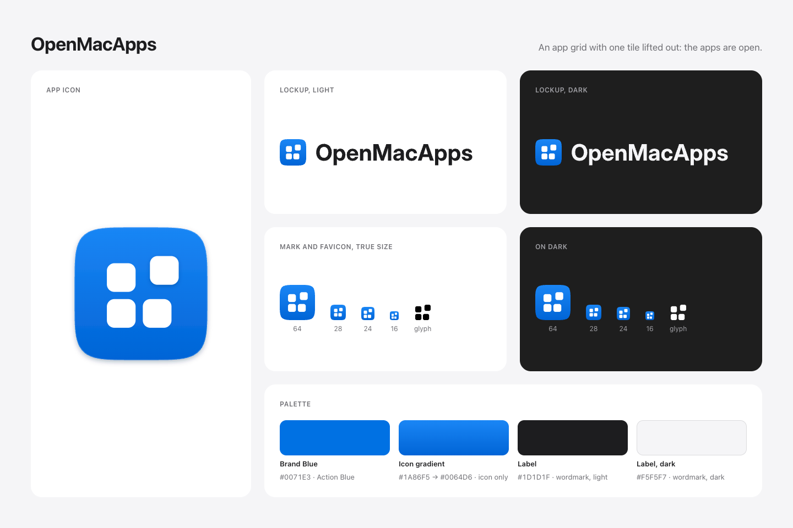

# OpenMacApps brand

## The mark

A blue squircle holding a white 2×2 grid of app tiles. The top-right tile is lifted up and out of the grid: the apps are open. It was chosen on 2026-11-06 and replaces the earlier blue square with a cube.

The geometry is fixed. Use the files below; never redraw, rebalance or re-space the tiles.

## Files

Everything lives in `public/brand/` and is served at `https://openmacapps.com/brand/`.

| File | Use |
| --- | --- |
| `mark.svg` | Full-bleed squircle and glyph. Interface use above 24 px: the site's sidebar and top bar, lockups, documents. |
| `mark-512.png` | `mark.svg` as a transparent PNG. |
| `app-icon.svg` | 1024 px macOS-style icon: 824 px body at a 100 px inset, drop shadow, shadow under the lifted tile. Use where an app icon is expected (stores, listings, slides). |
| `app-icon-1024.png`, `-512`, `-256`, `-128` | `app-icon.svg` rendered with a transparent background. |
| `favicon.svg` | 16 px pixel-grid version. Use it for anything rendered at 24 px or smaller. |
| `glyph.svg` | The 2×2 lifted-tile glyph alone, in `currentColor`. |
| `glyph-white.svg`, `glyph-black.svg` | The glyph in white or black, for one-colour contexts (embossing, single-colour print, monochrome UI). |
| `lockup-light.svg`, `lockup-dark.svg` | Mark plus wordmark, for light and dark backgrounds. |

Site icons in `public/` (`favicon.svg`, `apple-touch-icon.png`, `icon-192.png`, `icon-512.png`, `icon-maskable-512.png`), the README badge (`public/badge.svg`) and the social card (`public/social-card.png`) are derived from these files; `docs/PUBLISHING.md` explains how to re-render them. In the site, `src/components/BrandMark.astro` inlines `mark.svg`.

## Palette

- **Brand Blue `#0071E3`**: the site's Action Blue (`--accent-fill`). Use it wherever the brand needs a flat blue: buttons, links in brand material, a coloured background behind the white glyph.
- **Icon gradient `#1A86F5` → `#0064D6`**, top to bottom: only inside the mark and the app icon. Never use it for buttons, text, backgrounds or charts.
- **White `#FFFFFF`**: the glyph, always.
- **Wordmark ink**: Label `#1D1D1F` on light backgrounds, `#F5F5F7` on dark ones.

## Type

The wordmark is the product name, "OpenMacApps", set in bold with tight tracking. On the site it is live text in the system font (SF Pro on Apple platforms) at 700, -0.02em, from `site.name`. In the exported lockups it is outlined from Inter Display Bold (Inter 4.1, SIL Open Font License 1.1), so the files render the same everywhere.

## Lockups

- Mark to the left of the wordmark, never above or below it.
- The mark's height is 1.6 × the wordmark's cap height, and the mark is centred on the cap height.
- The gap between mark and wordmark is 0.35 × the mark's height.
- Use `lockup-light.svg` on white or light grey, `lockup-dark.svg` on near-black. On a photo or a busy background, use the mark alone.
- Do not rebuild the lockup in another font or retype the wordmark next to the mark at other proportions.

## Clear space and size

- Keep clear space of at least 25% of the mark's width on every side, for the mark alone and for lockups (measured from the mark).
- At 24 px or smaller, use `favicon.svg`: its tiles sit on the pixel grid and stay crisp.
- Never render the mark below 16 px.

## Don'ts

- Don't recolour the glyph, the squircle or the gradient. The glyph is white on blue, or one-colour white or black on its own.
- Never make it orange: on OpenMacApps, orange means source-available.
- Don't rotate, skew, stretch or mirror the mark, and don't move the lifted tile.
- Don't add effects: no extra shadows, glows, outlines, bevels or textures. The app icon's own shadows are part of `app-icon.svg` only.
- Don't place the mark in a container shape (circle, rounded square) of another colour.
- No Apple marks, Apple logos or "App Store" wording next to the mark or anywhere in brand material. OpenMacApps is independent and not affiliated with Apple.
